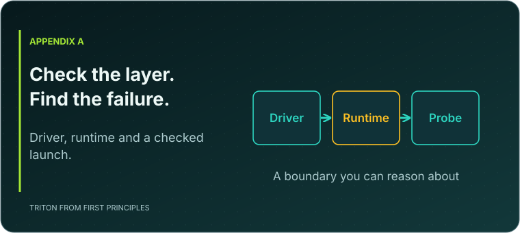
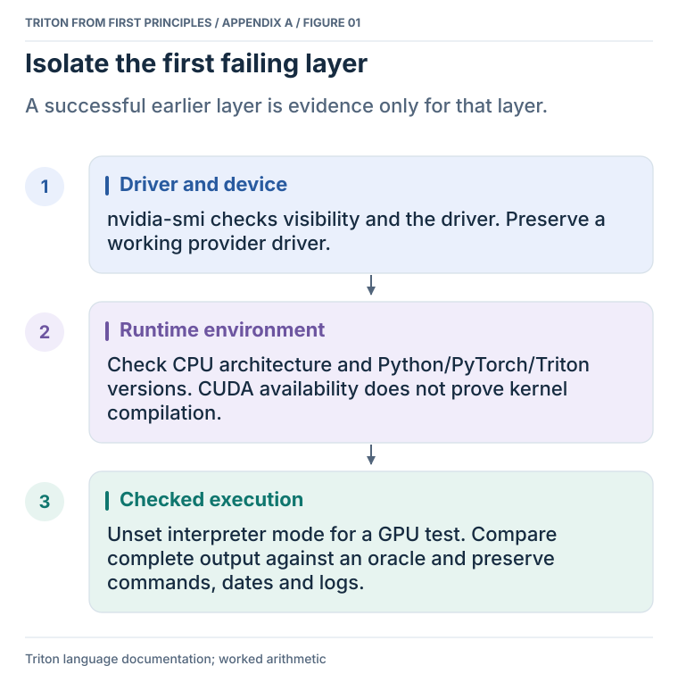

# Appendix A: Installation and Troubleshooting

The complete, architecture-aware installation recipe is in [Getting Started](../getting-started.md). Use one recipe and record its versions rather than mixing CUDA 12.1 commands from an older draft with a newer standalone Triton package.

| First failure | Check and next step |
| --- | --- |
| `nvidia-smi` fails | Resolve GPU visibility, driver/module or provider-image setup first. Installing a Python wheel does not install a kernel driver. |
| `torch.cuda.is_available()` is false | Check that the active interpreter has a CUDA wheel, the driver is usable, and CUDA_VISIBLE_DEVICES exposes the intended GPU. |
| No matching wheel | Check Python version, Linux/glibc version and CPU architecture. GH200 needs ARM64 wheels; macOS ARM wheels for PyTorch are not CUDA wheels. |
| Triton is absent after installing PyTorch | Inspect package dependencies on this architecture. Install the matching selected Triton version, not an arbitrary latest version. |
| Pointer cannot be accessed by Triton | CPU tensors were passed to a compiled GPU kernel, or devices were mixed. Place inputs and outputs on the same selected CUDA device. |
| Dot input shape is rejected | A logical example tile can be smaller than the compiled backend permits. Pad the physical tile, preserve logical dimensions and masks, and check the chosen backend's contract. |
| FP32 dot differs from the oracle | Inspect input_precision, reference precision and tolerances. An FP32 accumulator does not imply full-mantissa FP32 multiplication. |
| Invalid device ordinal | Inspect CUDA_VISIBLE_DEVICES and use the ordinal visible inside this process. A single-visible-GPU process normally selects device 0. |
| `nvcc` is absent | Normal wheel-based Triton use need not install the complete CUDA C++ toolkit. Check the actual failing compiler/runtime component. |
| GPU JIT/assembler/driver incompatibility | Record the full error and package versions; select a supported runtime/compiler/driver pairing. Do not disguise the failure with interpreter mode. |
| Interpreter prints a correct result | This establishes only that interpreter execution; rerun the compiled path for GPU numerical, memory and performance checks. |

For GPU memory debugging, run the intended workload with NVIDIA Compute Sanitizer where supported. A clean memory check does not by itself establish the mathematical formula or a performance claim. For benchmarks, compile and warm up first, reset mutated inputs, measure device completion, and report the workload and statistical scope (Chapter 19).

The examples target NVIDIA Linux workflows. AMD uses ROCm and a different backend/toolchain; an NVIDIA test is not an AMD compatibility result. Experimental Gluon and newer descriptor APIs are separate from the classic triton.language scope used by these chapters.
