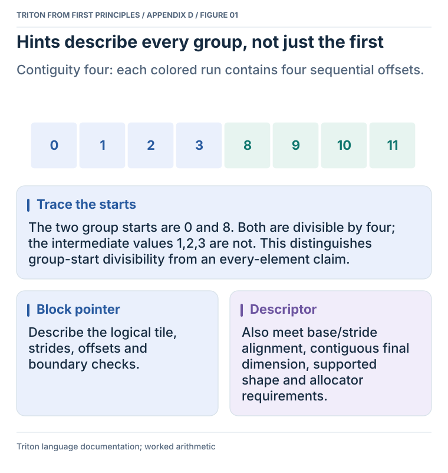

# Appendix D: The Memory Model, Continued — Block Pointers, Alignment Hints, and Tensor Descriptors

[](../images/chapter-openers/appendix-d.svg)

[](../images/appendix-d/01-concept.svg)

Chapters 6 through 11 built this book's whole account of Triton's memory model: pointers plus `tl.arange`-generated offsets plus a boolean mask (Chapters 6–7), the block-shaped values that make a "kernel" a program over tiles rather than scalars (Chapter 8 onward), and the register-pressure story in Chapter 11 explaining why Triton exposes no `__shared__` keyword at all. That account is complete for everything the rest of the book builds on. It leaves out four things, all added to Triton after — or used only at the very edge of — the material those chapters draw from: alignment hints, block pointers, autotuning's actual failure mode under this book's no-GPU methodology, and tensor descriptors, the newest of the four and the closest thing Triton has to this appendix's CUDA-book sibling's WMMA section.

The following outputs were author-reported in the original authoring environment (PyTorch 2.13.0, Triton 3.7.1, `TRITON_INTERPRET=1`, no CUDA device present), exactly as every kernel in Chapters 1–22 was. Those original outputs have no raw capture bundle in this repository and were not among the 84 complete files rerun on November 21. API contracts below are checked against the cited primary documentation.

!!! info "Historical appendix captures"
    These version strings and interpreter results describe the original authoring session. They were not among the 84 complete chapter references in the [November 21 rerun](../execution-2026-11-21.md). The appendix snippets have not been revalidated on that H100 stack.

!!! warning "Block-pointer API is version-specific"
    The block-pointer listings here target Triton 3.5.1 (also present in the captured 3.3.0 stack). They do not run unchanged on Triton 3.9: make_block_ptr and advance were removed there. The quoted deprecation warning belongs to the author-reported 3.7/3.8 era, not every version. Use the pinned environment for these historical listings or the [descriptor migration example](../version-and-migration.md).

## D.1 Why None of This Needed a `__shared__` Keyword

Classic `triton.language` generally leaves physical register and shared-memory placement to compiler lowering. A `tl.dot` does not universally imply one particular shared-memory staging sequence: the target, dtype, shape and selected instructions matter. Register pressure is the live-value demand on registers; spilling is one possible consequence when that demand cannot be allocated. Interpreter array execution measures neither. Experimental APIs such as Gluon have a different explicit-layout scope.

Every construct in this appendix — block pointers, tensor descriptors, alignment hints — is additional vocabulary for describing tiles and memory layout to the compiler more precisely. These classic-language examples describe data access rather than an explicit CUDA-style allocation of shared memory or registers. That absence is not a gap this appendix fills; Triton's whole design keeps it absent on purpose, and the four sections below are still, categorically, about pointers and tiles.

## D.2 Alignment and Contiguity Hints: `tl.multiple_of` and `tl.max_contiguous`

Alignment hints describe groups along each dimension. [`tl.multiple_of`](https://triton-lang.org/main/python-api/generated/triton.language.multiple_of.html) communicates divisibility at group starts; it does not generally say that every offset is divisible. [`tl.max_contiguous`](https://triton-lang.org/main/python-api/generated/triton.language.max_contiguous.html) describes successive contiguous runs, not only the first run. For `[0,1,2,3,8,9,10,11]`, contiguity four means runs `[0,1,2,3]` and `[8,9,10,11]`; their starts are divisible by four. A false hint can invalidate generated accesses. The interpreter does not validate the resulting GPU vectorization.

```python
import triton
import triton.language as tl

@triton.jit
def hinted_copy_kernel(in_ptr, out_ptr, N, BLOCK: tl.constexpr):
    pid = tl.program_id(0)
    block_start = tl.multiple_of(pid * BLOCK, BLOCK)   # pid*BLOCK is genuinely a multiple of BLOCK
    offs = block_start + tl.arange(0, BLOCK)
    offs = tl.max_contiguous(offs, BLOCK)               # these BLOCK offsets are genuinely contiguous
    mask = offs < N
    vals = tl.load(in_ptr + offs, mask=mask)
    tl.store(out_ptr + offs, vals * 3.0, mask=mask)
```

Genuinely captured, `N=20` deliberately not a multiple of `BLOCK=8` so the final tile's mask is doing real correctness work:

```
input:  tensor([ 0.,  1.,  2.,  3.,  4.,  5.,  6.,  7.,  8.,  9., 10., 11., 12., 13.,
        14., 15., 16., 17., 18., 19.])
output: tensor([ 0.,  3.,  6.,  9., 12., 15., 18., 21., 24., 27., 30., 33., 36., 39.,
        42., 45., 48., 51., 54., 57.])
expected (x * 3): tensor([ 0.,  3.,  6.,  9., 12., 15., 18., 21., 24., 27., 30., 33., 36., 39.,
        42., 45., 48., 51., 54., 57.])
match: True
```

**[COMMON TRAP]** Neither function checks its own claim. `tl.multiple_of(x, k)` on a tensor that is *not* actually a multiple of `k` will not raise an error here or on real hardware — it will simply give the compiler a false premise to optimize against, which on a real GPU can produce a kernel that reads or writes the wrong addresses while compiling and running without complaint. Exactly like the stride arguments in Chapter 6, this is a promise Triton trusts, not one it verifies.

## D.3 Block Pointers: `tl.make_block_ptr` and `tl.advance`

Most introductory `tl.load`/`tl.store` examples address memory through a pointer plus a `tl.arange`-built offset tensor plus a mask — one flat range of addresses per call. A block pointer instead packages an entire *tile* description — base pointer, full tensor `shape`, `strides`, an `offsets` tuple, and a `block_shape` — into one object, and `tl.advance` moves that whole tile description forward by a given step without the kernel recomputing raw addresses by hand.

```python
import triton
import triton.language as tl

@triton.jit
def copy_block_ptr_kernel(in_ptr, out_ptr, M, N, stride_m, stride_n,
                           BLOCK_M: tl.constexpr, BLOCK_N: tl.constexpr):
    pid_m = tl.program_id(0)
    pid_n = tl.program_id(1)
    in_block_ptr = tl.make_block_ptr(
        base=in_ptr, shape=(M, N), strides=(stride_m, stride_n),
        offsets=(pid_m * BLOCK_M, pid_n * BLOCK_N),
        block_shape=(BLOCK_M, BLOCK_N), order=(1, 0),
    )
    out_block_ptr = tl.make_block_ptr(
        base=out_ptr, shape=(M, N), strides=(stride_m, stride_n),
        offsets=(pid_m * BLOCK_M, pid_n * BLOCK_N),
        block_shape=(BLOCK_M, BLOCK_N), order=(1, 0),
    )
    block = tl.load(in_block_ptr, boundary_check=(0, 1))
    tl.store(out_block_ptr, block, boundary_check=(0, 1))
```

Genuinely captured, copying an 8×8 tensor one 4×4 block-pointer tile at a time:

```
input:
tensor([[ 0.,  1.,  2.,  3.,  4.,  5.,  6.,  7.],
        [ 8.,  9., 10., 11., 12., 13., 14., 15.],
        [16., 17., 18., 19., 20., 21., 22., 23.],
        [24., 25., 26., 27., 28., 29., 30., 31.],
        [32., 33., 34., 35., 36., 37., 38., 39.],
        [40., 41., 42., 43., 44., 45., 46., 47.],
        [48., 49., 50., 51., 52., 53., 54., 55.],
        [56., 57., 58., 59., 60., 61., 62., 63.]])
output (copied via block pointers):
tensor([[ 0.,  1.,  2.,  3.,  4.,  5.,  6.,  7.],
        [ 8.,  9., 10., 11., 12., 13., 14., 15.],
        [16., 17., 18., 19., 20., 21., 22., 23.],
        [24., 25., 26., 27., 28., 29., 30., 31.],
        [32., 33., 34., 35., 36., 37., 38., 39.],
        [40., 41., 42., 43., 44., 45., 46., 47.],
        [48., 49., 50., 51., 52., 53., 54., 55.],
        [56., 57., 58., 59., 60., 61., 62., 63.]])
match: True
```

`tl.advance` earns its keep once a kernel needs to walk several tiles in sequence inside one launch, instead of relying on the grid to place one tile per program — the pattern a real tiled-matmul K-loop uses to sweep across the reduction dimension. A smaller, exactly checkable version of the same thing, one 1D block pointer advanced through four consecutive tiles in a single kernel invocation:

```python
@triton.jit
def advance_kernel(in_ptr, out_ptr, N, BLOCK: tl.constexpr):
    block_ptr = tl.make_block_ptr(base=in_ptr, shape=(N,), strides=(1,),
                                   offsets=(0,), block_shape=(BLOCK,), order=(0,))
    out_block_ptr = tl.make_block_ptr(base=out_ptr, shape=(N,), strides=(1,),
                                       offsets=(0,), block_shape=(BLOCK,), order=(0,))
    for _ in range(4):
        vals = tl.load(block_ptr, boundary_check=(0,))
        tl.store(out_block_ptr, vals * 2.0, boundary_check=(0,))
        block_ptr = tl.advance(block_ptr, (BLOCK,))
        out_block_ptr = tl.advance(out_block_ptr, (BLOCK,))
```

Genuinely captured, `N=16`, `BLOCK=4`, one launch (`grid=(1,)`) advancing across all four tiles:

```
input: tensor([ 0.,  1.,  2.,  3.,  4.,  5.,  6.,  7.,  8.,  9., 10., 11., 12., 13.,
        14., 15.])
output (via 4 chained tl.advance() calls, one kernel launch): tensor([ 0.,  2.,  4.,  6.,  8., 10., 12., 14., 16., 18., 20., 22., 24., 26.,
        28., 30.])
match: True
```

**[COMMON TRAP]** Running the exact code above genuinely prints a `UserWarning` on this Triton version, in this environment, before either result:

```
UserWarning: tl.make_block_ptr is deprecated. Use TensorDescriptor or tl.make_tensor_descriptor instead.
```

The warning above belongs to the author-reported historical version; it is not a universal policy for every installed release. Chapter 7 already introduces block pointers. Choose raw pointers, block pointers or descriptors using the supported API, target and layout requirements of the actual stack. These historical interpreter copies do not prove compiled compatibility.

## D.4 `num_warps`/`num_stages`, and Autotuning's Genuine Failure

Chapter 18 already established the general pattern this section extends: `num_warps` and `num_stages` are accepted as ordinary launch kwargs on any kernel and never acted on by `TRITON_INTERPRET=1` — there is no real warp scheduler or software pipeliner inside the interpreter to configure, so these numbers pass through as inert metadata. That pattern held again in this appendix's own testing: a tensor-descriptor kernel (Section D.5) launched with `num_warps=8, num_stages=4` runs and produces byte-identical output to the same kernel launched with neither kwarg set. "Accepted but inert" is the right description for both kwargs, on every kernel in this book, without exception found so far.

`@triton.autotune` is a different case, and Chapter 18 is precise about why: autotuning's entire job is to launch every candidate `Config`, time each one, and keep the fastest — and timing requires a real device to run candidates on. This is not "accepted but inert," it is a hard dependency on hardware the interpreter cannot fake. Re-verified here with a fresh kernel this appendix wrote (Chapter 18's own finding used a different one, so this appendix's account rests on its own evidence rather than repeating a claim unchecked):

```python
@triton.autotune(
    configs=[
        triton.Config({"BLOCK": 4}, num_warps=1),
        triton.Config({"BLOCK": 8}, num_warps=2),
    ],
    key=["N"],
)
@triton.jit
def autotuned_copy_kernel(in_ptr, out_ptr, N, BLOCK: tl.constexpr):
    pid = tl.program_id(0)
    offs = pid * BLOCK + tl.arange(0, BLOCK)
    mask = offs < N
    vals = tl.load(in_ptr + offs, mask=mask)
    tl.store(out_ptr + offs, vals, mask=mask)
```

Genuinely captured:

```
genuinely raised: RuntimeError: 0 active drivers ([]). There should only be one.
```

Identical to Chapter 18's own documented failure, on different source. Autotuning's *concept* — searching a small config space for the fastest launch parameters on the actual target device — needs nothing more from this book than that one sentence; genuinely demonstrating it needs a GPU this environment does not have, exactly as this book's CUDA-book sibling can honestly report `cudaErrorNoDevice` from a real API call but cannot measure an occupancy number that call would have returned.

## D.5 Tensor Descriptors and the Road to TMA

A tensor descriptor is what block pointers are being deprecated in favor of (Section D.3's warning, verbatim), and it is Triton's Python-level surface over TMA — the Tensor Memory Accelerator hardware on Hopper- and Blackwell-generation GPUs that moves whole tiles between global and shared memory as a single asynchronous hardware operation, off the critical path of the compute cores entirely. It is also the closest thing this appendix has to this book's CUDA sibling's WMMA/tensor-core section: the newest hardware-adjacent feature covered, and — unlike WMMA, which that appendix could only verify by disassembling compiled SASS since no GPU was present to run it — genuinely executable and numerically checkable right here, under `TRITON_INTERPRET=1`, with no GPU needed at all.

A tensor descriptor describes an entire tensor's `shape`, `strides`, and `block_shape` once; loading or storing a tile at a given offset is then one call, `tl.load_tensor_descriptor(desc, offsets)` / `tl.store_tensor_descriptor(desc, offsets, value)` (equivalently, `desc.load(offsets)` / `desc.store(offsets, value)` as methods) — with no `boundary_check` argument anywhere, unlike block pointers in Section D.3.

```python
@triton.jit
def copy_tensor_desc_kernel(in_ptr, out_ptr, M, N, BLOCK_M: tl.constexpr, BLOCK_N: tl.constexpr):
    pid_m = tl.program_id(0)
    pid_n = tl.program_id(1)
    in_desc = tl.make_tensor_descriptor(in_ptr, shape=[M, N], strides=[N, 1], block_shape=[BLOCK_M, BLOCK_N])
    out_desc = tl.make_tensor_descriptor(out_ptr, shape=[M, N], strides=[N, 1], block_shape=[BLOCK_M, BLOCK_N])
    block = tl.load_tensor_descriptor(in_desc, [pid_m * BLOCK_M, pid_n * BLOCK_N])
    tl.store_tensor_descriptor(out_desc, [pid_m * BLOCK_M, pid_n * BLOCK_N], block)
```

Genuinely captured, an exact 8×8 tile copy first, then a deliberately uneven 6×12 tensor where `M=6` is not a multiple of `BLOCK_M=4` — checking that boundary handling really is automatic, with no `boundary_check` tuple written anywhere in the kernel:

```
match: True

6x12, M=6 not a multiple of BLOCK_M=4:
tensor([[ 0.,  1.,  2.,  3.,  4.,  5.,  6.,  7.,  8.,  9., 10., 11.],
        [12., 13., 14., 15., 16., 17., 18., 19., 20., 21., 22., 23.],
        [24., 25., 26., 27., 28., 29., 30., 31., 32., 33., 34., 35.],
        [36., 37., 38., 39., 40., 41., 42., 43., 44., 45., 46., 47.],
        [48., 49., 50., 51., 52., 53., 54., 55., 56., 57., 58., 59.],
        [60., 61., 62., 63., 64., 65., 66., 67., 68., 69., 70., 71.]])
match: True
```

Testing this uneven case is what surfaced something genuinely new: the exact same kernel, called on a tensor shaped `(12, 6)` instead of `(6, 12)`, fails.

```
row stride N=12 elements x 4 bytes = 48 bytes (a multiple of 16): should succeed
48-byte row stride: succeeded, match: True

row stride N=6 elements x 4 bytes = 24 bytes (NOT a multiple of 16): should fail
24-byte row stride: genuinely raised InterpreterError: AssertionError('stride must be 16-byte aligned')
```

The observed rejection checks one descriptor stride constraint; the successful interpreter copy does not prove a GPU TMA transfer occurred. Descriptor use also requires a 16-byte-aligned base, leading strides in multiples of 16 bytes, a contiguous final dimension, and supported rank/block shape. Device-side descriptor creation additionally needs the documented descriptor allocator setup via `triton.set_allocator`. Check these conditions together against the [descriptor API and allocator example](https://triton-lang.org/main/python-api/generated/triton.language.make_tensor_descriptor.html), rather than treating row stride as the only condition.

**[COMMON TRAP]** Strides are supplied in elements but alignment is checked in bytes. A logical `(12,6)` FP32 view may use a backing row stride of 8 elements (32 bytes), keeping six logical columns and two padding elements. Passing that stride test alone does not establish the base alignment, block shape or other GPU descriptor requirements.

## D.6 Where This Leaves the Book

Chapter 7 already introduces alignment hints and block pointers. This appendix extends that vocabulary with descriptor constraints and historical observations about API versions. Use the reference for the installed release: a warning captured on one author-reported version is not a universal deprecation guarantee across the tested 3.3.0 stack and newer releases.

The main chapters' pointer-and-mask model remains useful, but hints must be true, block pointers still need valid shapes/strides/bounds, and descriptors have additional hardware contracts. The interpreter cannot validate physical placement or resource limits. Autotuning needs actual device timing for its intended purpose; the November 21 smoke run did not retest these appendix snippets or benchmark their configurations.
