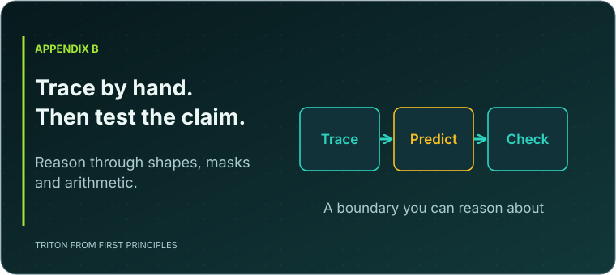
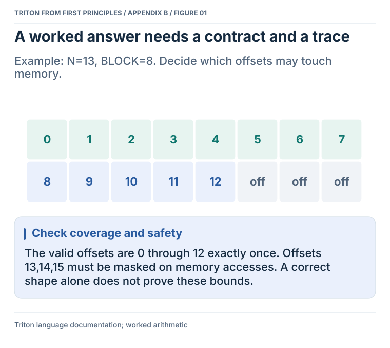

# Appendix B: Practice Quiz

Work through the question before opening its answer. These are reasoning exercises, not GPU execution records. Chapter numbers follow the book's main sequence.

## Foundations and tensor contracts

**1 — JIT boundary.** Two CPU interpreter launches print `COMPILING`. Have you observed two compiled GPU binaries?

??? success "Worked answer"
    No. The message is literal text printed during interpreted execution. The interpreter bypasses compilation. Different constexpr values select distinct keys on the compiled path, but inspecting the actual cache/artifacts is a separate experiment.

**2 — Configuration.** N=513 and BLOCK=256: how many programs do you launch, and how many lanes in the last program are valid?

??? success "Worked answer"
    ceil(513/256)=3 programs. The last starts at 512, so only its first lane is valid. Changing BLOCK changes the tiling; it does not change the required 513 outputs.

**3 — Strides.** A `(2,3)` FP32 tensor has element strides `(5,1)`. Where is `(1,2)` relative to its data pointer?

??? success "Worked answer"
    Element offset 1*5+2=7; byte displacement 7*4=28. A view's data pointer already includes its storage offset. Do not add that offset a second time.

**4 — Program grid.** A `(17,23)` output uses `(16,16)` tiles. How many programs and which coordinates does program `(1,1)` own?

??? success "Worked answer"
    The grid is `(2,2)`, four programs. Program `(1,1)` covers logical rows 16–31 and columns 16–31. Only row 16 and columns 16–22 are valid: seven output elements.

**5 — Tail mask.** N=13, BLOCK=8: which offsets must the second program avoid loading or storing?

??? success "Worked answer"
    Its offsets are 8–15, so mask 13,14,15. Forming their pointer expressions is not the same as performing an unmasked access. Use the mask on the actual memory operation.

**6 — Pointer contract.** Does passing `a.stride(0)` make a kernel stride-aware automatically?

??? success "Worked answer"
    No. The address formula must use that argument. For a matrix it also needs the other dimension's stride unless the wrapper checks a contiguous-layout requirement.

**7 — Broadcast aliases.** Can a stride-zero input view be read safely? Can every logical lane independently store to that same stride-zero address?

??? success "Worked answer"
    Repeated reads can intentionally select one value. Repeated non-atomic writes have overlapping ownership and can race. A valid read broadcast is not a proof of a valid writable layout.

**8 — Allocation.** Who allocates the output tensor for an ordinary Triton launch?

??? success "Worked answer"
    The host wrapper, usually through PyTorch. The kernel receives a pointer and populates its assigned elements. Use the intended CUDA device and preserve storage until stream dependencies permit reuse.

**9 — Causality.** Should a top-left causal mask use `j < i` or `j <= i`?

??? success "Worked answer"
    `j <= i` includes the query's own position. `j < i` excludes it and leaves query zero with no key unless another policy is explicitly defined. Rectangular end-aligned causality is a different contract.

**10 — Hardware mapping.** Does BLOCK=1024 imply 1024 CUDA threads?

??? success "Worked answer"
    No. BLOCK is a logical extent. On NVIDIA, num_warps=4 requests 128 cooperating threads; the compiler maps logical values to them. One thread can own several logical elements.

**11 — Resources.** Does an interpreter accepting BLOCK=65536 prove that the kernel fits the GPU's register file?

??? success "Worked answer"
    No. The interpreter models neither the physical layout nor live register/shared-memory allocation. Inspect compiled metadata and measure; do not equate logical array size with registers in one thread.

## Kernels, gradients and measurement

**12 — Elementwise fusion.** What is `max(2*x+1,0)` at x=-2,0,3, and what does fusion save?

??? success "Worked answer"
    The outputs are 0,1,7. A fused implementation can avoid storing and rereading an intermediate between the multiply/add and clamp. This is a traffic argument, not a measured speedup.

**13 — GEMM.** A row `[3,4]` multiplies B's column `[5,7]`. What output and which reduction terms are needed?

??? success "Worked answer"
    3*5+4*7=43. Both K terms are required exactly once. Output bounds masks do not replace a mask on a partial K input tile. Physical dot tile extents must also satisfy the compiled backend.

**14 — Reduction.** `[3,-1,2,4]` is padded to eight lanes. Which sum and mean are correct?

??? success "Worked answer"
    Pad sum with zeros: the sum remains 8. Divide by four valid samples for mean 2; dividing by eight gives 1 and changes the operation. Maximum reduction needs negative infinity, not zero, as its padding identity.

**15 — Autograd.** What does `grad_output` represent in a pointwise backward?

??? success "Worked answer"
    The derivative of the downstream loss with respect to this operation's output. Multiply it by the local derivative. It is not generally one; `.sum().backward()` is only a special upstream computation.

**16 — GELU.** For exact y=x*Phi(x), what is dy/dx, and does a raw Triton backward automatically support second derivatives?

??? success "Worked answer"
    dy/dx=Phi(x)+x*phi(x). The chain-rule result is grad_output times that expression. A raw launch is not itself a recorded PyTorch graph for the backward, so higher-order support needs additional implementation or an explicit rejection.

**17 — Fan-in.** At x=2, y=x*x+x. What gradient reaches x?

??? success "Worked answer"
    The product path contributes x+x=4 and the direct path contributes 1, totaling 5. Within the traversal, contributions add; overwriting one loses a path.

**18 — Autotuning.** Can the fastest configuration on one GPU be assumed fastest on another?

??? success "Worked answer"
    No. Device resources, compiler lowering and workload shape affect the result. Check each candidate's correctness, reset mutated outputs between trials, and benchmark for the selected device and key.

**19 — Timing.** Why is the duration of a host launch call not the duration of the GPU workload?

??? success "Worked answer"
    Launches enqueue asynchronous work. Use device completion events or a GPU-aware benchmark. Compile and warm up outside the measured interval unless cold-start behavior is the question; include dependencies from all relevant streams.

## Applications

**20 — LayerNorm.** What are the mean and population variance of `[1,2,3,4]`?

??? success "Worked answer"
    Mean 2.5. Squared deviations sum to 5, giving population variance 5/4=1.25. Add epsilon inside the square root before dividing, then apply affine parameters. The sample-variance denominator 3 defines a different operation.

**21 — Attention.** Scores `[ln(2),0,ln(2)]` attend to V=`[1,3,5]`. What is the output, and which running quantities need rescaling?

??? success "Worked answer"
    Relative weights are `[2,1,2]`, so output `(2*1+1*3+2*5)/5=3`. When a new maximum increases, rescale both the old denominator and the old weighted-value numerator; rescaling only the denominator is wrong.

**22 — Finance.** Terminal prices `[80,100,120]`, strike 100: what is the illustrative call-price estimate, and does it prove convergence?

??? success "Worked answer"
    Payoffs are `[0,0,20]`, with mean 20/3. Discount by exp(-r*T). Three hand-selected prices establish that arithmetic only, not a random sample, convergence, or a confidence interval. State the model and statistical assumptions for an actual Monte Carlo run.
