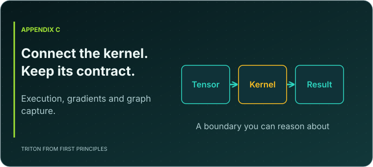
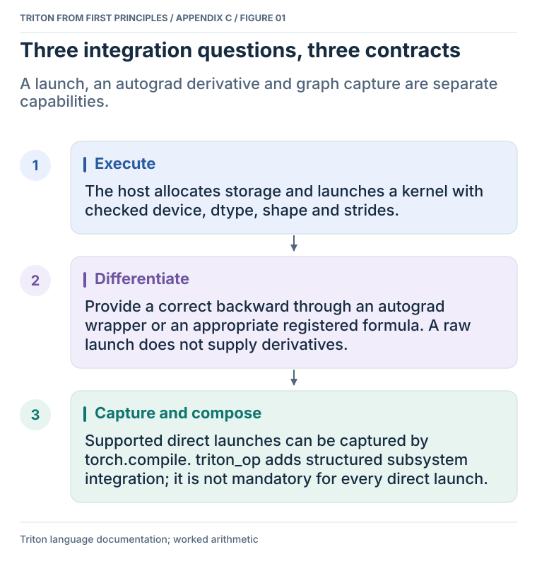

# Appendix C: PyTorch and Triton Integration — A Deep Dive

[](../images/chapter-openers/appendix-c.svg)

[](../images/appendix-c/01-concept.svg)

This appendix steps back from individual kernels and looks at the machinery on the other side of the boundary: what PyTorch actually is underneath `torch.Tensor`, and exactly how a `@triton.jit` kernel becomes something PyTorch's own subsystems — eager execution, autograd, and `torch.compile` — can see, call, and (in the right circumstances) optimize.

The following outputs were author-reported in the original authoring environment (PyTorch 2.13.0, Triton 3.7.1, `TRITON_INTERPRET=1`, no CUDA device present — `torch.cuda.is_available()` returns `False` throughout). Where a real GPU would produce a different or additional result, that is called out explicitly rather than guessed at.

!!! info "Historical appendix captures"
    These version strings and interpreter results describe the original authoring session. They were not among the 84 complete chapter references in the [November 21 rerun](../execution-2026-11-21.md). The appendix snippets have not been revalidated on that H100 stack.

## C.1 What PyTorch Actually Is

"PyTorch" names three layers that are easy to blur together:

| Layer | What it is | What you touch directly |
|---|---|---|
| `torch.Tensor` + ATen | A C++ tensor library (storage, striding, dtype, device) with a huge library of operators (`add`, `matmul`, `relu`, ...), each with CPU/CUDA/other backend implementations | Every time you write `x + y` or `x.relu()` |
| Autograd | A reverse-mode automatic differentiation engine built on top of ATen, recording a graph of `Function` nodes as tensors with `requires_grad=True` flow through operators | `.backward()`, `.grad`, `.grad_fn` — covered in depth in Chapters 16–17 |
| `torch.compile` (Dynamo + Inductor) | A just-in-time graph capture and compilation layer sitting *above* eager execution, which can trace a Python function into an FX graph and generate fused, specialized code for it | The `@torch.compile` decorator |

A raw Triton launch does not automatically supply an autograd derivative. Graph capture is a different issue: supported direct `kernel[grid]` launches can be used inside `torch.compile`; registration is not universally required. `torch.library.triton_op` is a structured integration route for additional PyTorch subsystems. See the [official direct-launch and composability tutorial](https://docs.pytorch.org/tutorials/recipes/torch_compile_user_defined_triton_kernel_tutorial.html).

### `torch.Tensor` internals, genuinely inspected

```python
import torch

x = torch.arange(12, dtype=torch.float32).reshape(2, 6)
print("shape:", x.shape)
print("dtype:", x.dtype)
print("device:", x.device)
print("stride:", x.stride())
print("is_contiguous:", x.is_contiguous())

xt = x.t()
print("transposed shape:", xt.shape)
print("transposed stride:", xt.stride())
print("transposed is_contiguous:", xt.is_contiguous())
```

Genuinely captured:

```
shape: torch.Size([2, 6])
dtype: torch.float32
device: cpu
stride: (6, 1)
is_contiguous: True
transposed shape: torch.Size([6, 2])
transposed stride: (1, 6)
transposed is_contiguous: False
```

Nothing here should be surprising after Chapter 6: `.stride()` is exactly the row/column stride pair that chapter's worked examples typed into kernel launches by hand. Transposing a tensor doesn't move any data — `x.t()` returns a view over the same storage with the stride tuple reversed, which is precisely why `xt.is_contiguous()` is `False`: element `(i, j)` of `xt` lives at the same address as element `(j, i)` of `x`, and walking `xt` row-by-row no longer walks memory linearly. This is the exact situation Chapter 6 warns about: if you launch a kernel against `xt` using the stride arguments computed for `x`, the kernel will read the wrong elements without any error, because strides are an unverified promise, not something Triton can check against the tensor's real memory layout.

### The ATen dispatcher

Every PyTorch operator — `+`, `.relu()`, `torch.matmul`, all of it — is a thin Python-level entry point onto a *dispatcher*. The dispatcher looks at an operator's name, its overload (which concrete argument-type signature matched), and the input tensors' device, and routes the call to one specific backend implementation, all before any actual math runs. You can call into this dispatcher directly, bypassing the usual Python operator syntax entirely:

```python
a = torch.tensor([1.0, 2.0])
b = torch.tensor([3.0, 4.0])
print("aten add:", torch.ops.aten.add.Tensor(a, b))
print("aten relu:", torch.ops.aten.relu.default(torch.tensor([-1.0, 2.0])))
print("overload packet:", torch.ops.aten.add)
print("resolved schema:", torch.ops.aten.add.Tensor._schema)
```

Genuinely captured:

```
aten add: tensor([4., 6.])
aten relu: tensor([0., 2.])
overload packet: aten.add
resolved schema: aten::add.Tensor(Tensor self, Tensor other, *, Scalar alpha=1) -> Tensor
```

`torch.ops.aten.add` is an *overload packet* — a namespace of every schema-distinct variant of `add` (`Tensor`, `Scalar`, in-place `_`, and so on). `torch.ops.aten.add.Tensor` is one concrete, fully resolved *overload*, with a real schema string. This distinction matters directly for what follows: when you register a custom operator, you are asking PyTorch to add a new overload packet — `torch.ops.<your_namespace>.<your_op>` — to exactly this same dispatcher, sitting right alongside `aten.add` and `aten.relu`. `torch.compile`'s graph capture (Section C.3) works by tracing a sequence of these dispatcher calls into an FX graph; a direct Triton launch is not itself a dispatcher registration, but Dynamo has dedicated support for supported user-defined Triton launches. Absence of registration does not imply that graph capture is impossible.

## C.2 Making a Triton Kernel a First-Class PyTorch Operator

Chapters 1–22 launch kernels the direct way: `kernel[grid](x, out, n, BLOCK=...)`, wrapped in an ordinary Python function (and, from Chapter 16 onward, an `autograd.Function`). That is sufficient for eager use and for hand-built autograd, but it is invisible to `torch.compile`: Dynamo traces Python bytecode and dispatcher calls, and a bare Triton kernel launch is neither.

`torch.library` provides two decorators for closing this gap, and the choice between them matters:

| API | What `torch.compile`/`torch.export` see | When to use it |
|---|---|---|
| `torch.library.custom_op` | Nothing — the operator is opaque; tracing treats it as a black box | Wrapping a third-party library, or deliberately hiding an implementation from tracing |
| `torch.library.triton_op` | The Triton kernel launch(es) inside it, wrapped via `wrap_triton` — visible and optimizable | Wrapping your own `@triton.jit` kernel(s) so `torch.compile` can trace into and around them |

`custom_op` provides an opaque operator boundary, while `triton_op` permits deeper Triton-aware integration. This appendix demonstrates the latter route; it is an API choice rather than a prerequisite for every direct launch. Follow the official tutorial for the installed PyTorch version.

### Registering and calling a Triton kernel as a real op

```python
import torch
import triton
import triton.language as tl
from torch.library import triton_op, wrap_triton

@triton.jit
def gelu_exact_kernel(x_ptr, out_ptr, n, BLOCK: tl.constexpr):
    pid = tl.program_id(0)
    offsets = pid * BLOCK + tl.arange(0, BLOCK)
    mask = offsets < n
    x = tl.load(x_ptr + offsets, mask=mask, other=0.0)
    SQRT_2_INV: tl.constexpr = 0.7071067811865476
    cdf = 0.5 * (1.0 + tl.math.erf(x * SQRT_2_INV))
    out = x * cdf
    tl.store(out_ptr + offsets, out, mask=mask)

@triton_op("appendixdemo::gelu", mutates_args={})
def triton_gelu_op(x: torch.Tensor) -> torch.Tensor:
    out = torch.empty_like(x)
    n = out.numel()
    BLOCK = triton.next_power_of_2(n)
    wrap_triton(gelu_exact_kernel)[(triton.cdiv(n, BLOCK),)](x, out, n, BLOCK=BLOCK)
    return out

x = torch.tensor([-1.0, 0.5, 2.0])
y = triton_gelu_op(x)
oracle = torch.nn.functional.gelu(x, approximate="none")
print("y:", y)
print("op accessible as torch.ops.appendixdemo.gelu?", hasattr(torch.ops.appendixdemo, "gelu"))
print("calling via torch.ops namespace directly:", torch.ops.appendixdemo.gelu(x))
print("allclose to oracle?", torch.allclose(y, oracle, atol=1e-5))
```

Genuinely captured (interpreter mode):

```
y: tensor([-0.1587,  0.3457,  1.9545])
op accessible as torch.ops.appendixdemo.gelu? True
calling via torch.ops namespace directly: tensor([-0.1587,  0.3457,  1.9545])
allclose to oracle? True
```

Three things are worth naming explicitly here, since none of them are visible from the code alone:

- `"appendixdemo::gelu"` is a `"{namespace}::{name}"` string, not a Python identifier — the namespace exists specifically to avoid collisions the way `aten::`, `fbgemm::`, and every other real-world extension's ops avoid colliding with each other.
- `mutates_args={}` is a hard requirement of the API, not a convenience default. `triton_gelu_op` writes into a *freshly allocated* `out`, not into any of its input tensors, so the correct answer is "mutates nothing." Getting this wrong — claiming an op doesn't mutate an argument it actually writes into in place — is explicitly documented as producing undefined behavior, because downstream systems (autograd, `torch.compile`) make correctness-affecting assumptions based on this flag without re-checking it.
- The raw `@triton.jit` kernel is *not* called directly inside `triton_gelu_op` — it's wrapped in `wrap_triton(gelu_exact_kernel)` first. This is the `wrap_triton` pattern used by this `triton_op` recipe. It is not evidence that supported direct user-defined Triton launches outside this recipe are invisible to Dynamo.

Once registered, `torch.ops.appendixdemo.gelu` is a genuine dispatcher entry, indistinguishable in kind from `torch.ops.aten.relu.default` from Section C.1 — calling it through the plain Python function (`triton_gelu_op(x)`) and through the dispatcher path (`torch.ops.appendixdemo.gelu(x)`) produce the identical result, because the plain function *is* the dispatcher registration's default-backend implementation.

## C.3 `torch.compile`: Three Genuinely Different Outcomes

This is the part of the integration surface that is easiest to get a false sense of security about, because "it worked eagerly" and "`torch.compile` will handle it" are not the same claim. Wrapping a kernel in `triton_op` makes it *traceable* — it does not, by itself, make every `torch.compile` backend able to actually compile it. Three distinct, genuinely tested outcomes below make the boundary concrete.

!!! info "Version-specific interpreter observations"
    The following FakeTensor errors and added fake implementation are historical observations from the author-reported interpreter setup. They are not a universal recipe requiring a separate register_fake for every triton_op, nor proof of a CUDA graph-capture failure. Use the current API's documented fake/tracing contract and test the supported GPU path independently.

### Outcome 1 — no `register_fake`: Dynamo's tracer fails immediately

```python
@triton_op("appendixdemo2::gelu", mutates_args={})
def triton_gelu_op(x: torch.Tensor) -> torch.Tensor:
    out = torch.empty_like(x)
    n = out.numel()
    BLOCK = triton.next_power_of_2(n)
    wrap_triton(gelu_exact_kernel)[(triton.cdiv(n, BLOCK),)](x, out, n, BLOCK=BLOCK)
    return out

@torch.compile
def f(x):
    return triton_gelu_op(x) * 2.0

x = torch.tensor([-1.0, 0.5, 2.0])
y = f(x)
```

Genuinely captured:

```
TorchRuntimeError: RuntimeError when making fake tensor call
  Explanation: Dynamo failed to run FX node with fake tensors: call_function
  appendixdemo2.gelu.default(*(FakeTensor(..., size=(3,)),), **{}): got
  RuntimeError("Cannot access data pointer of Tensor (e.g. FakeTensor,
  FunctionalTensor). If you're using torch.compile/export/fx, it is likely
  that we are erroneously tracing into a custom kernel. To fix this,
  please wrap the custom kernel into an opaque custom op...")
```

`torch.compile` traces a function once, symbolically, using **`FakeTensor`**s — tensor stand-ins that carry real shape/dtype/device/stride metadata but own no actual storage, precisely so tracing doesn't have to run real (possibly expensive, possibly side-effecting) computation just to build a graph. `triton_gelu_op`'s body calls `out.numel()` (fine — `FakeTensor` knows its own shape) but then launches a real Triton kernel against `out`, which needs `out.data_ptr()` — and a `FakeTensor` has no storage to take a pointer from. Note precisely what failed: not the *kernel*, but the attempt to trace through the *wrapper function's Python body* using fake inputs, before any kernel would even run.

### Outcome 2 — `register_fake` added, default Inductor backend: a different, later failure

```python
@triton_gelu_op.register_fake
def _(x: torch.Tensor) -> torch.Tensor:
    return torch.empty_like(x)

@torch.compile
def f(x):
    return triton_gelu_op(x) * 2.0
```

Genuinely captured:

```
BackendCompilerFailed: backend='inductor' raised:
RuntimeError: Attempted to access the data pointer on an invalid python storage.

While executing %gelu_default : [num_users=1] = call_function[target=torch.ops.appendixdemo3.gelu.default](args = (%l_x_,), kwargs = {})
```

`register_fake` gives the operator a **fake (meta) implementation**: a function with the same signature, run only against storage-less tensors, whose entire job is to describe the *shape and dtype* of the output without touching any real data — `torch.empty_like(x)` on a `FakeTensor` input is legal because `empty_like` only needs the metadata, never the storage. With this in place, Dynamo's graph capture stage succeeds; the error above happens *later*, when Inductor (the default compile backend) actually tries to compile and run the captured graph on CPU, and hits the same "no real storage yet" problem one layer down, at backend-compilation/execution time rather than at tracing time. This is a strictly later, more specific failure than Outcome 1 — Dynamo now understands the *shape* of what `torch.ops.appendixdemo3.gelu` produces; Inductor's CPU backend still doesn't have a way to actually run the Triton kernel underneath it in this no-GPU environment.

### Outcome 3 — `register_fake` + `backend="eager"`: genuine success

```python
@torch.compile(backend="eager")
def f(x):
    return triton_gelu_op(x) * 2.0

x = torch.tensor([-1.0, 0.5, 2.0])
y = f(x)
```

Genuinely captured:

```
succeeded: tensor([-0.3173,  0.6915,  3.9090])
allclose to oracle? True
```

`backend="eager"` tells `torch.compile` to do Dynamo's graph capture and guard installation — the same tracing machinery Outcomes 1–2 exercised — but then simply hand the captured graph to ordinary eager PyTorch execution instead of compiling it with Inductor. That is enough to succeed here: once `register_fake` lets tracing complete, the real op just runs the real Triton kernel on real data, identically to calling `triton_gelu_op(x)` directly. This isolates the two stages cleanly: `register_fake` is what Dynamo's *tracing* needs; Inductor's *backend compilation* is a separate, later concern that this environment's lack of a CUDA device happens to block outright (Section C.4 explains why with genuine evidence, rather than a guess).

### Summary of the three outcomes

| Setup | Stage reached | Result |
|---|---|---|
| `triton_op`, no `register_fake`, default (`inductor`) backend | Dynamo tracing (FakeTensor propagation) | Fails — `data_ptr()` on a storage-less `FakeTensor` |
| `triton_op` + `register_fake`, default (`inductor`) backend | Inductor backend compilation | Fails — different, later error; tracing itself succeeded |
| `triton_op` + `register_fake`, `backend="eager"` | Full pipeline | Succeeds — matches the oracle |

## C.4 What Inductor Actually Generates (and Why Triton Specifically Needs a GPU Here)

It's worth being precise about what "Inductor" means, since Section C.3 blamed it for a failure without yet showing what it does when it *doesn't* fail. Inductor is `torch.compile`'s default backend: given a captured FX graph, it generates and compiles specialized code for it. Crucially, *which language* it generates depends on the target device — and that fact is directly demonstrable here, on CPU, without needing to guess about the CUDA path at all.

```python
import torch

@torch.compile
def f(x, y):
    return torch.relu(x + y) * 2.0

x = torch.randn(1000)
y = torch.randn(1000)
out = f(x, y)
```

Run with `TORCH_LOGS=output_code`, Inductor genuinely emits this (trimmed to the generated kernel body):

```cpp
cpp_fused_add_mul_relu_0 = async_compile.cpp_pybinding(['const float*', 'const float*', 'float*'], r'''
#include <torch/csrc/inductor/cpp_prefix.h>
extern "C"  void  kernel(const float* in_ptr0,
                       const float* in_ptr1,
                       float* out_ptr0)
{
    ...
    for(int64_t x0=static_cast<int64_t>(0L); x0<static_cast<int64_t>(1000L); x0+=static_cast<int64_t>(16L))
    {
        if(C10_LIKELY(x0 >= static_cast<int64_t>(0) && x0 < static_cast<int64_t>(992L)))
        {
            auto tmp0 = at::vec::Vectorized<float>::loadu(in_ptr0 + static_cast<int64_t>(x0), static_cast<int64_t>(16));
            auto tmp1 = at::vec::Vectorized<float>::loadu(in_ptr1 + static_cast<int64_t>(x0), static_cast<int64_t>(16));
            auto tmp2 = tmp0 + tmp1;
            auto tmp3 = at::vec::clamp_min(tmp2, decltype(tmp2)(0));
            auto tmp4 = static_cast<float>(2.0);
            auto tmp5 = at::vec::Vectorized<float>(tmp4);
            auto tmp6 = tmp3 * tmp5;
            tmp6.store(out_ptr0 + static_cast<int64_t>(x0));
        }
        ...
    }
}
''')
```

This is genuinely captured, unedited Inductor output for a plain, non-custom-op PyTorch expression — no Triton anywhere. It's hand-vectorized **C++**, using `at::vec::Vectorized<float>` (a wrapper over CPU SIMD registers) and compiled through `async_compile.cpp_pybinding`, with the add/relu/multiply fused into a single loop exactly the way Chapter 20's hand-written fused kernels fuse a Linear+bias+GELU epilogue — Inductor is doing, automatically, the same category of fusion this book has been teaching by hand since Part 6.

Inductor may generate Triton kernels for CUDA tensor expressions, while CPU compilation commonly generates C++. It may also retain external library calls or other operations; a CUDA graph is not guaranteed to become only Triton. This historical CPU capture demonstrates one backend choice, not the generated code of a GPU execution.

## C.5 Where This Leaves the Rest of the Book

The chapter examples use direct launches, with custom autograd wrappers where taught. Supported direct launches can be captured by `torch.compile`; the historical interpreter/FakeTensor failures above do not establish a general limitation of compiled CUDA execution.

For stronger operator integration, use `torch.library.triton_op` with an accurate mutation contract and the documented `wrap_triton` launch pattern. Shape/dtype behavior must remain valid under tracing. A separate `custom_op` generally needs a fake implementation; do not assume every integration API has the identical registration recipe. Register an autograd formula where differentiation is required, and test the complete compiled wrapper on the intended GPU/software versions. The official tutorial linked above explains the API choices. These appendix examples have not been rerun on the November 21 host.
