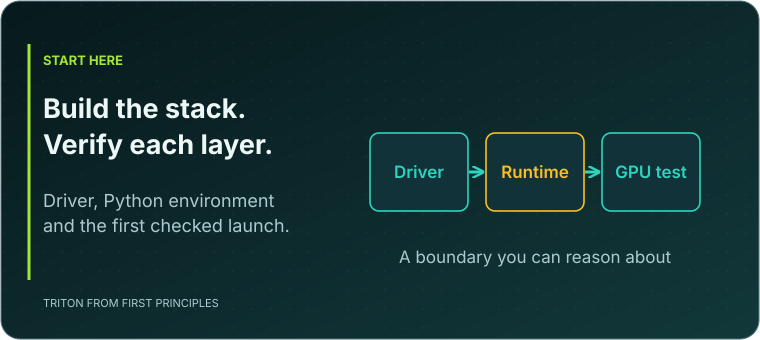

# Getting Started

[](images/chapter-openers/getting-started.svg)

Start by choosing an execution mode. Reading, building the website and checking Python syntax need no GPU. Interpreter references need a supported Linux Python/Triton installation but do not compile GPU code. Real kernel correctness and performance need a compatible NVIDIA GPU and working driver.

The book contains 22 chapters. Its older printed results are author-reported **interpreter** outputs, not dated GPU captures. This review has not converted them into GPU results. See the [review and testing record](review-and-testing.md) for what was checked and what remains pending.

See [the version matrix and descriptor migration](version-and-migration.md) and the [independent-review response](opus-review-response-2026-11-21.md). The selected recipe is not a claim that old printed transcripts reproduce byte-for-byte.

## 1 — Inspect a managed GPU host before installing anything

```bash
uname -m
cat /etc/os-release
nvidia-smi
python3 --version
```

Use an NVIDIA GPU with compute capability at least 8.0 for the supported current classic-language path. An H100 or GH200 is suitable for the planned single-GPU tests. GH200 uses an ARM64 CPU (`aarch64`); ordinary H100 hosts commonly use `x86_64`. Select wheels and system packages for the actual CPU architecture. Apple Silicon's ARM CPU does not make macOS a CUDA/Triton GPU platform. The supported Triton platform for this recipe is Linux; Windows/WSL use is not validated by this book.

Keep a working provider driver. `nvidia-smi` checks the driver/device path; it does not prove that PyTorch is CUDA-enabled, that Triton can compile, or that a kernel is correct. A missing `nvcc` is not by itself a failure: normal wheel-based PyTorch/Triton use does not require installing the complete CUDA C++ toolkit. CUDA extensions and profiling tools have separate requirements.

## 2 — Fresh Ubuntu 24.04: host prerequisites

On a new host, install the Python environment and host compiler tools:

```bash
sudo apt-get update
sudo apt-get install -y python3-venv python3-dev build-essential git ca-certificates wget
```

If a physical **x86-64 Ubuntu 24.04** machine has no working NVIDIA driver, NVIDIA's network repository path is:

```bash
sudo apt-get install -y linux-headers-$(uname -r)
wget https://developer.download.nvidia.com/compute/cuda/repos/ubuntu2404/x86_64/cuda-keyring_1.1-1_all.deb
sudo dpkg -i cuda-keyring_1.1-1_all.deb
sudo apt-get update
sudo apt-get install -y nvidia-open
sudo reboot
```

Reconnect after reboot and repeat `nvidia-smi`. Follow any required Secure Boot module-enrollment instructions. These commands are for the stated OS/architecture, not a prescription to replace a working cloud stack. For GH200/ARM64, use the provider's supported image and the matching NVIDIA SBSA/ARM installation procedure; do not install x86-64 driver repositories. See [NVIDIA's driver installation guide](https://docs.nvidia.com/datacenter/tesla/driver-installation-guide/latest/ubuntu.html) for platform-specific prerequisites and packages. This offline review did not perform a fresh bare-metal driver installation.

## 3 — Create an isolated runtime environment

The selected reproducibility target is **PyTorch 2.9.1 with CUDA 12.8 wheels and Triton 3.5.1**, not a claim that every chapter has already been GPU-tested with it. Official indexes provide Linux x86-64 and ARM64 wheels. Python 3.12 on Ubuntu 24.04 is a straightforward choice.

```bash
python3 -m venv .venv-runtime
source .venv-runtime/bin/activate
python -m pip install --upgrade pip
python -m pip install 'torch==2.9.1' --index-url https://download.pytorch.org/whl/cu128
python -m pip install 'triton==3.5.1' numpy scipy pandas
python -m pip check
```

The explicit Triton version matches this PyTorch release's x86-64 dependency; it also avoids assuming the same dependency marker installs Triton on ARM64. Do not upgrade Triton independently and assume compatibility remains established. Preserve an existing supported provider environment if appropriate, recording its exact versions instead.

Sources: [official PyTorch CUDA wheel index](https://download.pytorch.org/whl/cu128/torch/), [PyTorch 2.9.1 metadata](https://pypi.org/pypi/torch/2.9.1/json), [Triton 3.5.1 wheels](https://pypi.org/project/triton/3.5.1/#files). The wheel's CUDA runtime and the installed driver are separate components; for this recipe use an R570-or-newer supported driver for CUDA 12.8 JIT/PTX support; the generic CUDA 12.x minor-compatibility floor is a different, restricted contract. See [CUDA release notes](https://docs.nvidia.com/cuda/archive/12.8.0/cuda-toolkit-release-notes/index.html).

## 4 — Run a real GPU smoke test

Clone the book, then use its complete [GPU smoke test source](examples/gpu_smoke.py):

```bash
git clone https://github.com/MaximumBeings/triton-from-first-principles.git
cd triton-from-first-principles
unset TRITON_INTERPRET
python docs/examples/gpu_smoke.py
```

The script refuses interpreter mode and a missing CUDA device. It checks a masked strided vector operation, ragged GEMM and causal/non-causal attention against independent CPU references. It uses supported physical dot tile extents and explicit FP32 precision. **All twelve GPU smoke cases passed on H100 on November 21, 2026**, using the provider’s PyTorch 2.7.0/Triton 3.3.0 stack. See the [captured output, exact dates and source hash](execution-2026-11-21.md). This does not validate the separate installation target or every chapter on the compiled backend.

The hand-sized `BLOCK=4` dot examples elsewhere deliberately trace interpreter arithmetic. They cannot simply be launched on the NVIDIA compiled backend unchanged. CUDA allocation, valid physical tile shapes and the specified dtype/precision contract all matter.

## 5 — Reproduce an interpreter reference separately

Download a chapter's complete file and use its printed interpreter command:

```bash
TRITON_INTERPRET=1 python chapter_reference.py
```

Set the variable before importing Triton. The interpreter bypasses compilation and simulates program instances sequentially; it is not GPU emulation. CPU results do not prove supported dot tile shapes, races, alignment assumptions, resource use, or performance. [Triton's debugging guide](https://triton-lang.org/main/programming-guide/chapter-3/debugging.html) explains the limits.

## 6 — Build the website without GPU dependencies

Use Python 3.12 for the documentation build (the pinned dependencies need Python >=3.11.5; Ubuntu 22.04 default Python 3.10 is insufficient). Use a separate environment so documentation work does not replace runtime packages:

```bash
python3 -m venv .venv-docs
source .venv-docs/bin/activate
python -m pip install -r requirements.txt
python tools/verify_book.py
python tools/verify_execution.py
python tools/verify_svg_readability.py
mkdocs build --strict
python tools/verify_site_links.py
mkdocs serve
```

Open <http://127.0.0.1:8000>. Clicking diagrams opens an accessible overlay on the chapter; Escape, Close and Back dismiss it. Fit width preserves readable type with vertical scrolling; Fit whole shows the entire figure.

## 7 — Save evidence before releasing a rented host

Record the real device/driver, CPU architecture, Python/PyTorch/Triton versions, source hashes, exact commands, UTC start/finish times, exit codes and raw output. Save `python -m pip freeze` and `nvidia-smi -q`. Separate interpreter checks, actual GPU kernels and benchmarks. A process that merely exits zero after reporting an unavailable driver is not a passing GPU test.

See [Appendix A](appendix/installation-setup.md) for troubleshooting.
