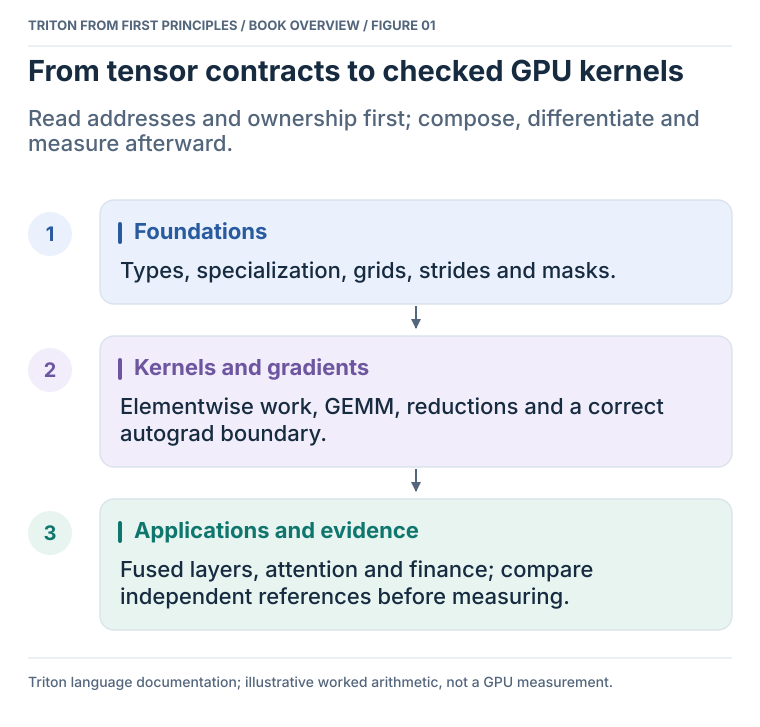

# Triton From First Principles

**Building Production GPU Kernels in OpenAI Triton, One Layer at a Time**

!!! info "Scope and testing status"
    All 22 chapters are present. Existing example outputs are interpreter references, not GPU benchmark records. This edition adds original SVGs and an offline technical review; 12 compiled H100 smoke cases have now passed, and all 84 complete references exited zero in interpreter mode. Full compiled chapter coverage remains pending. See the [dated execution record](execution-2026-11-21.md) and [review record](review-and-testing.md).

> "A kernel is not finished when it computes the right answer once. It is finished when you can tell the compiler exactly which memory it may touch, which values it may assume never change, and how many threads get to look at each byte at the same time — and PyTorch's own autograd engine can still find its way through it."

This is a practitioner's guide to [OpenAI Triton](https://triton-lang.org) — the Python-embedded language for writing GPU kernels that compile down to machine code competitive with hand-tuned CUDA, without leaving Python. Unlike a systems language building its own tensor library from scratch, Triton is deliberately narrow: it owns the *kernel*, not the tensor, the device, or the autograd graph. Those belong to PyTorch. The running project in this book is a set of fused, production-style Triton kernels — element-wise ops, a blocked matmul, reductions, fused layer-norm and softmax, attention and top-2 MoE gating — with dedicated chapters wiring custom operations into PyTorch's `torch.autograd.Function` machinery rather than a hand-rolled graph, and each one pointed, in the closing part, at the same quantitative-finance problems the Mojo book ends on.

The design principles carried through the whole book:

- **Kernel-first, not framework-first.** Triton doesn't give you a tensor class or a computational graph — it gives you a compiler for the innermost loop. This book treats that boundary honestly instead of papering over it.
- **PyTorch does the bookkeeping.** The autograd chapters wrap custom kernels in `torch.autograd.Function`, so the chain rule, the graph traversal, and gradient accumulation are the real engine's job, not a toy reimplementation of it.
- **Numbers you can check by hand.** Every worked example traces the arithmetic — block indices, strides, masked lanes — before showing the code that produces it.
- **Financial computing examples.** The closing chapter compares teaching implementations of Black–Scholes pricing, rolling return statistics, and Monte Carlo option pricing; production use requires additional numerical, domain and GPU validation.

- :material-book-open-page-variant:{ .lg .middle } **22 chapters**

    Part 0 through Part 7, from `@triton.jit` to Monte Carlo pricing.

- :material-code-tags:{ .lg .middle } **Real, runnable kernels**

    84 complete downloadable reference listings accompany the explanations. Historical interpreter outputs and pending GPU tests are distinguished.

- :material-file-document-multiple:{ .lg .middle } **4 appendices**

    Setup, a self-check quiz, PyTorch integration and memory-model notes.

- :material-finance:{ .lg .middle } **Real financial models**

    Black–Scholes, rolling volatility and Monte Carlo teaching kernels.

## How the book is organized

| Part | Focus |
|---|---|
| **Part 0 — Triton Foundations** | Triton's type system and the JIT boundary, kernel parameterization (`constexpr`, configs), strides and pointers, the grid/program/block model, block-level SPMD vectorization |
| **Part 1 — Kernel–Tensor Interface** | The pointer+stride contract with `torch.Tensor`, broadcasting and block pointers, GPU-side construction, mask/structure kernels (causal, diagonal, block-sparse), targeting hardware, shared memory and the kernel cache |
| **Part 2 — Core Kernels** | Element-wise kernels, the blocked matmul kernel, reduction kernels |
| **Part 3 — Wiring Into PyTorch's Autograd** | `torch.autograd.Function` as the real graph node a Triton kernel plugs into |
| **Part 4 — The Backward Kernel** | Writing the backward kernel and `ctx.save_for_backward`, how PyTorch's autograd engine chains custom ops |
| **Part 5 — GPU Acceleration and Performance** | Autotuning (`num_warps`, `num_stages`, `BLOCK_SIZE`), benchmarking correctly with `triton.testing.do_bench` |
| **Part 6 — Neural Network Building Blocks** | Fused LayerNorm/softmax/dropout/matmul+bias+activation, Flash Attention, top-2 MoE gating and the boundary to a full expert-dispatch system |
| **Part 7 — Financial Computing Applications** | Black–Scholes calls, rolling standard deviation and Monte Carlo call pricing |

Start with [Getting Started](getting-started.md) to stand up a Triton + PyTorch + CUDA environment, or jump straight into [Part 0: Triton Foundations](part0/01-types-and-the-jit-boundary.md) if your toolchain is already installed.

!!! note "How this book differs from its Mojo sibling"
    Triton has no user-defined structs, no hand-built tensor class, and no computational graph of its own — a kernel receives raw pointers and strides, and the tensor, the device, and the autograd graph all belong to PyTorch. Rather than mechanically porting chapters that assume a from-scratch systems language, several parts of this book are deliberately redesigned around what Triton actually is: a compiler for the innermost loop that plugs into a real, existing autograd engine. Parts 3 and 4 in particular trade "build your own AD framework" for "build production-grade fused kernels that plug into PyTorch's real one" — which is what Triton is used for in practice.
