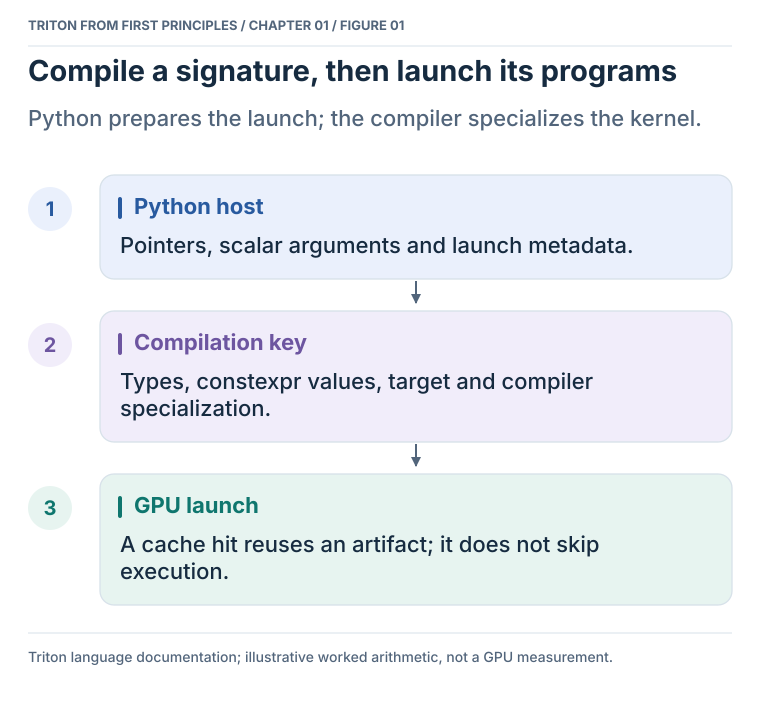

# Chapter 1: Types and the JIT Boundary

[](../images/ch01/01-concept.svg)

> "A `@triton.jit` function is not a function you call. It is a function you compile — and the exact moment that compilation happens, and exactly which of its arguments the compiler is allowed to treat as fixed forever, is the single fact everything else in this book rests on."

**What you will understand by the end of this chapter:**

- Why calling a `@triton.jit`-decorated function directly, the way you'd call any Python function, does not run your kernel — and what `kernel[grid](...)` actually triggers the first time you write it
- The difference between a `tl.constexpr` argument and an ordinary runtime argument, and why that distinction — not a type annotation like `Int` or `Float32` — is Triton's real analogue to a statically-typed language's compile-time/run-time split
- Why mixing `tl.float32` and `tl.float16` in one expression *silently succeeds* in Triton, in direct contrast to a language that rejects it outright, and what that implicit promotion costs you if you're not deliberate about it
- Why every value inside a Triton kernel body — even one that looks like a single number — is actually block-shaped, and why branching in Python's `if` on the wrong kind of value is either illegal or, worse, silently wrong
- How this book's code is actually executed without a CUDA GPU in front of it, and what that setup can and cannot honestly tell you

**What you need to know first:**

- Basic familiarity with PyTorch tensors (`torch.tensor`, `.dtype`, `device=`) — this book does not assume prior GPU programming experience
- No prior Triton exposure is assumed — this is the first technical chapter of the book
- If your toolchain isn't installed yet, see [Getting Started](../getting-started.md) before continuing

!!! warning "A note on how the code in this book is actually run"
    The small reference listings in this edition target interpreter-based instruction and are not all directly GPU-launchable: some use CPU tensors or dot tiles below compiled-backend limits. A compiled GPU version needs valid tiles, CUDA allocations and a compatible toolchain. But this book itself was authored and its output captured on a machine with **no CUDA GPU attached** — not the author's cloud workspace, and not the Mac the book is written on. Rather than fabricate plausible-looking numbers, every "Reference Implementations" section in this book that needed to run code ran it with `TRITON_INTERPRET=1` set — Triton's built-in interpreter, which executes a kernel's logic in Python on the CPU instead of compiling it to PTX and launching it on a GPU. This gives genuinely computed, reproducible output for anything that depends only on a kernel's *logic* being correct. It does **not** exercise the real GPU compiler or its error messages, and it cannot produce a meaningful timing number — Chapters 18 and 19, where wall-clock performance is the entire point, disclose this limitation again and handle it differently. Anywhere this chapter's behavior might differ between the interpreter and a real compiled GPU build, it says so explicitly rather than presenting interpreter-only behavior as universal.

## 1.1 The Two-Phase Model: Python Function, Compiled Kernel `[FOUNDATIONAL]`

### Intuition

A restaurant menu is not the meal. Printing "Grilled Salmon — pan-seared, lemon butter" on a menu describes a dish precisely enough that any competent kitchen could produce it, but nothing gets cooked, no pan gets hot, until a customer actually orders it — and a kitchen that gets the same order twice in a row doesn't re-read the recipe from scratch the second time, it just repeats the now-familiar preparation.

A `@triton.jit` function is the menu entry, not the meal. Writing

```python
@triton.jit
def add_kernel(x_ptr, y_ptr, out_ptr, n, BLOCK: tl.constexpr):
    ...
```

does not run anything — it registers a description of a kernel with Triton's `JITFunction` machinery. The moment work actually happens is `add_kernel[grid](x, y, out, n, BLOCK=256)`: the square-bracket `[grid]` is not decoration, it's the order ticket. That single call triggers Triton to trace the Python function body, compile it down to an intermediate representation and then to PTX (or, in interpreter mode, execute Python/NumPy equivalents while bypassing compilation), and only then actually launch it. A kitchen that already has the "BLOCK=256, these dtypes" preparation memorized skips straight to cooking; a genuinely new combination gets compiled first.

### Background

| | Ordinary Python function | Triton `@triton.jit` kernel |
|---|---|---|
| What running `f(...)` does | Executes the function body immediately, every call | **Raises an error** — a `JITFunction` is not meant to be called this way from host code |
| What actually executes it | The call itself | `f[grid](...)` — indexing with a launch grid |
| When is it compiled? | Never — CPython interprets bytecode on every call | Once per unique combination of argument argument types, constexpr values, target/options and specialization attributes, the first time that combination is launched |
| What happens on a repeat call with the same signature | Re-executes from scratch (no such thing as "compiling" a Python function) | Cache hit — the previously compiled kernel is reused, no retracing |
| What happens on a call with a *different* `tl.constexpr` value | N/A | Cache miss — retraced and recompiled as a distinct kernel variant |

This is much closer to how a statically-compiled systems language behaves than to ordinary Python: the *shape* of the work — which branches exist, constexpr-dependent loop bounds, which dtype every operation is specialized for — is nailed down once, before any GPU thread runs a single instruction, rather than re-decided on every call the way pure Python re-evaluates everything every time.

### Worked Example 1.1.1 — A kernel whose two constexpr-selected versions are two genuinely different compiled programs

```python
@triton.jit
def _relu_toggle_kernel(x_ptr, out_ptr, n, USE_RELU: tl.constexpr, BLOCK: tl.constexpr):
    pid = tl.program_id(0)
    offsets = pid * BLOCK + tl.arange(0, BLOCK)
    mask = offsets < n
    x = tl.load(x_ptr + offsets, mask=mask)
    if USE_RELU:
        x = tl.maximum(x, 0.0)
    tl.store(out_ptr + offsets, x, mask=mask)
```

`USE_RELU` is declared `tl.constexpr`, so the Python `if USE_RELU:` is resolved during tracing — before compilation, not during it. Launching with `USE_RELU=True` traces and compiles a kernel whose body unconditionally contains the `tl.maximum` clamp; launching with `USE_RELU=False` traces and compiles a *different* kernel that never mentions `tl.maximum` at all — there is no runtime branch instruction on the GPU checking `USE_RELU` in either version, because by the time either version exists as compiled code, the question has already been answered.

Trace it against `x = [-2.0, -1.0, 0.0, 1.0, 2.0, -0.5, 0.5, -3.0]` by hand first: with the ReLU clamp, every negative value becomes `0.0` and every non-negative value passes through unchanged, giving `[0, 0, 0, 1.0, 2.0, 0, 0.5, 0]`. Without it, the input passes through byte-for-byte.

Launching both, genuinely, under this book's interpreter:

```
USE_RELU=True  -> [0.0, 0.0, 0.0, 1.0, 2.0, 0.0, 0.5, 0.0]
USE_RELU=False -> [-2.0, -1.0, 0.0, 1.0, 2.0, -0.5, 0.5, -3.0]
```

Both match the hand trace exactly.

### ASCII Diagram — from source to launched kernel

```
  @triton.jit                     add_kernel[grid](x, y, out, n, BLOCK=256)
  def add_kernel(...):    ---->   (the [grid] launch -- this is the order ticket)
      ...body...                              |
                                               v
                                  Has (dtypes, shapes, constexpr-values)
                                  been compiled before?
                                       /                \
                                     no                  yes
                                     |                    |
                                     v                    v
                          Trace body, resolve       Skip straight to the
                          constexpr branches,        cached compiled
                          compile to PTX, cache       kernel binary
                          keyed by this signature            |
                                     \                       |
                                      \                      |
                                       v                     v
                                  Launch the compiled kernel across `grid`
                                  program instances on the GPU
```

> `[COMMON TRAP]` Calling `add_kernel(x, y, out, n, BLOCK=256)` — without the square brackets — is an easy mistake to make coming from ordinary Python, where every function is called the same way. A `JITFunction` is not meant to be invoked like that from host code; genuinely attempting it raises an error rather than silently doing nothing (the interpreter used for this book reports `InterpreterError: AttributeError("'InterpreterBuilder' object has no attribute 'grid_idx'")`, which is interpreter-internal plumbing rather than a polished user-facing message — a real compiled build raises its own, differently-worded error, but the underlying fact doesn't change: a Triton kernel with no `[grid]` has nowhere to derive `tl.program_id()` from, because no launch ever told it how many program instances exist). The fix is always the same: index the kernel with a grid before calling it.

## 1.2 `tl.constexpr` vs. Runtime Values `[FOUNDATIONAL]`

### Intuition

A restaurant's fixed menu items — "large," "medium," "small" — are decided long before any customer walks in; the kitchen has separate prep stations already set up for each size. A customer's actual order — *which* size, *today*, for *this* table — is only known the moment they say it out loud. You cannot build a "large" prep station around a size nobody has ordered yet; you cannot leave the size unspecified and start cooking either.

`tl.constexpr` is the menu size: a value Triton's tracer must know completely, and can therefore bake permanently into the shape of the compiled kernel — used to size arrays, decide how many times a loop unrolls, or choose which branch of a Python `if` exists at all. An ordinary kernel argument (a pointer, `n` in the examples above) is the customer's order: read from GPU memory or a register at the moment the kernel actually runs, and able to vary without recompilation while the specialization key remains unchanged; scalar-value and alignment specialization can still create variants.

### Background

| | `tl.constexpr` argument | Ordinary runtime argument |
|---|---|---|
| Known to the compiler | Yes — at trace time, before compilation | No — only as "some value of this dtype/shape" |
| Can size a `tl.arange(0, N)` or a compile-time-unrolled loop | Yes | **No — `tl.arange`'s bounds must be `tl.constexpr`** |
| Can appear in a Python-level `if`/`for` inside the kernel body | Yes — resolved during tracing | No — see Section 1.4 |
| Changing it between launches | Triggers a new trace + compile (cache miss) | Reuses the already-compiled kernel (no retrace) |
| Closest Mojo/C++ analogue | `alias` / `constexpr` | `var` / an ordinary function parameter |

### Worked Example 1.2.1 — `tl.arange` genuinely refusing a non-constexpr bound

```python
@triton.jit
def _bad_arange_kernel(x_ptr, out_ptr, n, BLOCK):   # BLOCK has no tl.constexpr annotation
    offsets = tl.arange(0, BLOCK)
    ...
```

`tl.arange(0, BLOCK)` needs to know, before a single instruction is generated, how many elements this block of work covers — that size decides how many registers or how much of a vector instruction to emit. Without the `tl.constexpr` annotation, `BLOCK` is just another runtime value as far as Triton's frontend is concerned, and `tl.arange` rejects it immediately, before any GPU-specific compilation step even begins:

```
InterpreterError: ValueError("arange's arguments must be of type tl.constexpr")
```

The outer `InterpreterError` is this book's interpreter wrapping whatever the underlying check raised; the inner `ValueError` is the actual frontend-level type check on `tl.arange`'s own arguments, independent of whether a GPU is actually present to compile for — it fires exactly the same way under this book's interpreter as it would in a real compiled build.

### Worked Example 1.2.2 — the same value, annotated correctly

Restoring the annotation, `BLOCK: tl.constexpr`, and launching `_relu_toggle_kernel` from Section 1.1 twice — once with `USE_RELU=True`, once with `USE_RELU=False` — is, mechanically, two separate compilations producing two separate cached kernel binaries, keyed by the different `USE_RELU` value, exactly as Worked Example 1.1.1 already demonstrated. Nothing about `BLOCK` itself changed between those two launches — but if a *third* launch used `BLOCK=512` instead of `BLOCK=8`, that alone would be enough to trigger yet another distinct compilation, because `BLOCK` is just as much a `tl.constexpr` as `USE_RELU` is.

> `[COMMON TRAP]` It's tempting to treat `tl.constexpr` as a performance hint — "the compiler might inline this" — the way you might treat `inline` in C. It is not a hint. It is a hard requirement enforced by specific functions like `tl.arange`, exactly as strictly as Mojo's `alias` requires a value computable entirely at compile time (Chapter 1 of the Mojo edition of this pair of books traces the identical distinction from the opposite direction). Passing an ordinary Python `int` where `tl.constexpr` is required doesn't get silently downgraded to "less optimal but still working" — it fails outright, as Worked Example 1.2.1 just showed.

## 1.3 Triton's Numeric Types and Implicit Promotion `[FOUNDATIONAL]`

### Intuition

Some machine shops refuse to weld two different grades of steel together without an explicit, documented conversion step — if you hand them mismatched stock, they hand it back. Others will happily weld anything to anything, silently using whichever grade is stronger to guide the join, and trust you to have known that's what would happen.

Triton is the second kind of shop. Add a `tl.float32` tensor to a `tl.float16` tensor in a kernel body, and Triton does not reject the expression — it silently promotes the result to `tl.float32`, the wider of the two, and moves on. This is a genuinely different design decision than a language that treats mixed-width arithmetic as an error requiring an explicit cast; Triton's promotion rules exist because kernels routinely have to mix a low-precision *storage* format with a higher-precision *compute* format, and forcing an explicit cast on every single arithmetic operation between them would make ordinary kernels unreadable.

### Background

| | Triton | A strict statically-typed language (e.g., Mojo) |
|---|---|---|
| `tl.float32 + tl.float16` | Silently promotes to `tl.float32` | Compile error — explicit conversion required |
| Storage dtype vs. compute dtype | Routinely different on purpose (fp16/bf16 storage, fp32 accumulation) | Typically the same unless you convert explicitly |
| Risk this creates | Precision loss can happen invisibly, with no error to catch it | Precision loss requires an explicit, visible conversion |

The practical consequence shows up constantly in real kernels: inputs and outputs are usually stored in a narrow, memory-bandwidth-friendly dtype like `fp16` or `bf16`, but any *running total* computed from many of them — a reduction, a matmul accumulator, a normalization statistic — should almost always be kept in `fp32` while it's accumulating, then cast back down only at the very end. Nothing in the language forces this; it's a discipline the kernel author has to impose deliberately, because Triton's promotion rules will happily let you accumulate in the narrow dtype the whole way through without complaint.

### Worked Example 1.3.1 — confirming the promotion rule

```python
x = tl.load(x_ptr + offsets, mask=mask)   # float32
y = tl.load(y_ptr + offsets, mask=mask)   # float16
z = x + y
```

Genuinely captured, via `tl.static_print` fired during tracing:

```
dtype of x: fp32  dtype of y: fp16  dtype of z=x+y: fp32
```

`z` is `fp32` — the wider of the two inputs — with no cast written anywhere in the source. Numerically, adding `x = [1.0, 2.0, 3.0]` (fp32) to `y = [0.1, 0.1, 0.1]` (fp16, which cannot represent `0.1` exactly — the nearest fp16 value is slightly off) gives `[1.0999755859375, 2.0999755859375, 3.0999755859375]`: visibly not `1.1, 2.1, 3.1` exactly, because `0.1` was already rounded once at the moment it was stored as `fp16`, before this kernel ever loaded it.

### Worked Example 1.3.2 — why accumulation dtype is a decision, not a default

Sum 2,048 copies of `0.0001`, each one stored as `fp16`, two different ways. First, naively — accumulate one `fp16` value at a time, rounding the running total back to `fp16` after every single addition:

```python
acc = torch.tensor(0.0, dtype=torch.float16)
val = torch.tensor(0.0001, dtype=torch.float16)
for _ in range(2048):
    acc = acc + val
```

Second, inside a Triton kernel that loads the same 2,048 `fp16` values but immediately casts each one to `fp32` before summing:

```python
x = tl.load(x_ptr + offsets, mask=mask, other=0.0)   # fp16
acc = tl.sum(x.to(tl.float32), axis=0)                # accumulate in fp32
```

The exact answer is `2048 × 0.0001 = 0.2048`. Genuinely captured:

```
Summing 2048 copies of 0.0001 (each stored as fp16):
  naive sequential fp16 accumulation : 0.2337646484375
  Triton kernel, fp32 accumulator    : 0.204833984375
  exact answer                       : 0.2048
```

The naive `fp16` accumulation is off by about 14% — not because `0.0001` itself is stored badly (every copy is off by the same small, bounded rounding error), but because `fp16` has only about 10 bits of mantissa, and once the running total climbs toward `0.2`, `fp16`'s representable resolution near that magnitude (roughly `2^-11 ≈ 0.00049`) is already *larger* than the `0.0001` being added on each step — many of the later additions round away most or all of their own contribution, and which way they round compounds unpredictably over 2,048 steps. The `fp32`-accumulated version keeps eleven additional mantissa bits throughout the whole reduction and lands within `0.00003` of the exact answer — the residual is ordinary `fp16` storage rounding on the *inputs*, not compounding accumulation error.

> `[COMMON TRAP]` Seeing a kernel's inputs and outputs declared as `fp16` or `bf16` and assuming every intermediate value inside the kernel is the same dtype is exactly the assumption Worked Example 1.3.2 just broke. Triton will not warn you if you accumulate a reduction, a matmul's inner product, or a running mean or variance in a narrow dtype — it will compute a plausible-looking, silently-degraded number and let you find out later, usually as a training instability or an accuracy regression far away from the kernel that caused it. Chapters 13, 14, and 20 build this "narrow storage, wide accumulation" pattern into every kernel that reduces or multiplies-and-adds, as a rule rather than an afterthought.

## 1.4 Every Value in a Kernel Body Is Block-Shaped `[FOUNDATIONAL]`

### Intuition

A single delivery driver assigned to one address is a scalar: one decision, one outcome, unambiguous. A dispatcher looking at an entire truck's manifest of forty addresses at once cannot answer "should I turn left?" with a single yes or no — forty different addresses may need forty different answers, and collapsing that manifest into one boolean before making the turn either requires a rule for resolving disagreement, or is simply the wrong question to ask of a manifest.

`tl.program_id(0)` is the single driver: it genuinely returns one scalar integer, the same for every value derived from arithmetic that never touches `tl.arange`. But the moment `tl.arange(0, BLOCK)` appears — which is nearly immediately, in essentially every real kernel — every value computed from it (`offsets`, `mask`, anything loaded through them) is the whole manifest: a `BLOCK`-shaped tensor of values, one per lane, all computed and moved together. Section 1.1 and 1.2's examples already relied on this without naming it; this section makes it explicit, because Python's `if` statement cannot tell the difference between "the driver" and "the whole manifest" on its own — you have to know which one you're holding.

### Background

| | `tl.program_id(0)` | A value derived through `tl.arange` (e.g. `offsets`, `mask`) |
|---|---|---|
| Shape | A genuine scalar | `BLOCK`-shaped — one value per lane |
| Legal in a Python `if condition:` | Yes — a scalar has one unambiguous truth value | Only if you first reduce it to one value (e.g. `tl.max`, `tl.sum`) — branching on the whole block is not the same operation as `tl.where` |
| How you actually use per-lane conditions | You don't branch on them — you pass them as a `mask=` argument, or combine them with `tl.where` | (same) |

### Worked Example 1.4.1 — a genuine scalar, legally branched on

```python
pid = tl.program_id(0)
...
if pid == 0:
    x = x * 100.0
else:
    x = x + 1.0
```

Launched with `x = [0, 1, 2, 3, 4, 5]`, `BLOCK=4`, over a grid of 2 program instances: program 0 covers offsets `0..3` (all valid against `n=6`) and takes the `pid == 0` branch, multiplying by 100; program 1 covers offsets `4..7`, of which only `4` and `5` are valid under the mask, and takes the `else` branch, adding 1. Genuinely captured:

```
Branching on tl.program_id() (a real scalar): [0.0, 100.0, 200.0, 300.0, 5.0, 6.0]
```

Every entry matches hand-tracing each program instance separately — `pid` really is one number per program instance, so the `if` is exactly as unambiguous as it would be in ordinary Python.

### Worked Example 1.4.2 — the trap: branching on a whole block, not a scalar

```python
offsets = pid * BLOCK + tl.arange(0, BLOCK)
mask = offsets < n
x = tl.load(x_ptr + offsets, mask=mask)
if mask:                      # mask is BLOCK-shaped, not one bool
    x = x * 2.0
tl.store(out_ptr + offsets, x, mask=mask)
```

With `n=6` and `BLOCK=4` over 2 program instances, program 0's `mask` is `[True, True, True, True]` (uniform — no ambiguity), but program 1's `mask` is `[True, True, False, False]` — a genuinely mixed tensor with no single truth value. Genuinely captured, running exactly this kernel under this book's interpreter:

```
ran without raising, but silently wrong: [0.0, 2.0, 4.0, 6.0, 8.0, 10.0]
```

That output is **wrong** in a way worth sitting with: every element got doubled, including the two positions (`offsets 6` and `7`) that `mask` marked invalid for program 1 — the masked `tl.store` at the end still protects those two positions from being *written*, so nothing actually corrupts memory here, but `if mask:` did not do what it looks like it does. It did not multiply only the valid lanes by 2 and leave the rest alone the way `tl.where(mask, x * 2.0, x)` would — it evaluated `mask`'s truthiness as one unit (treating "at least one element is `True`" as "the condition holds") and applied `x * 2.0` to the *entire* block, valid and invalid lanes alike, uniformly. This is the interpreter being more permissive than it should be: real compiled Triton rejects converting a block-shaped value to a single Python boolean at trace time, because — exactly as the intuition above argues — there is no principled single answer to "is this manifest true?" A real GPU build turns this into a compile-time error before your kernel exists as a compiled artifact at all; this book's interpreter, being a simpler Python-level simulation, instead does something plausible-looking and silently wrong. Both outcomes point at the same underlying mistake — the fix in either case is the same: replace the `if` with `tl.where(mask, x * 2.0, x)`, which is defined per-lane and never needs a single collapsed truth value in the first place.

### ASCII Diagram — one program instance, `BLOCK=4` lanes, one scalar

```
tl.program_id(0)  =  1                       (a genuine scalar -- one number)

offsets = pid*BLOCK + tl.arange(0,4)  =  [4, 5, 6, 7]     (BLOCK-shaped)
mask    = offsets < 6                 =  [T, T, F, F]     (BLOCK-shaped)

                lane:      0        1        2        3
                        +--------+--------+--------+--------+
      offsets:          |   4    |   5    |   6    |   7    |
                        +--------+--------+--------+--------+
      mask:             |  True  |  True  | False  | False  |
                        +--------+--------+--------+--------+
      tl.load (masked): |  x[4]  |  x[5]  |   --   |   --   |   <- "--" never read
                        +--------+--------+--------+--------+

`if mask:` asks Python for ONE answer covering all four boxes above --
there isn't one. `tl.where(mask, a, b)` asks for FOUR answers, one per
box, which is the question this hardware is actually built to answer.
```

## 1.5 Complete Runnable Code

Sections 1.1–1.4 walked through this chapter's ideas as isolated snippets. The files below are the actual, complete, run-in-order source — each one adds exactly one more idea on top of the last, so you can run any of them independently and watch the chapter accumulate. `04_standalone_complete.py` combines everything from Sections 1.1 through 1.4 into a single script; its output is reproduced in full afterward. All four were run exactly as shown, with `TRITON_INTERPRET=1` set, per this chapter's opening note.

### File: `01_two_phase_and_constexpr.py` — Sections 1.1 and 1.2

[Download the complete current reference](../examples/references/part0/01-types-and-the-jit-boundary/01_two_phase_and_constexpr.py) (interpreter mode; GPU portability is not established).

**Execution:** `TRITON_INTERPRET=1 python3 01_two_phase_and_constexpr.py`

```python
import torch
import triton
import triton.language as tl


@triton.jit
def relu_toggle_kernel(x_ptr, out_ptr, n, USE_RELU: tl.constexpr, BLOCK: tl.constexpr):
    pid = tl.program_id(0)
    offsets = pid * BLOCK + tl.arange(0, BLOCK)
    mask = offsets < n
    x = tl.load(x_ptr + offsets, mask=mask)
    if USE_RELU:
        x = tl.maximum(x, 0.0)
    tl.store(out_ptr + offsets, x, mask=mask)


def demo_two_phase_model():
    print("=== Two-Phase Model: constexpr-selected kernel variants ===")
    x = torch.tensor([-2.0, -1.0, 0.0, 1.0, 2.0, -0.5, 0.5, -3.0])
    n = x.shape[0]

    out_relu = torch.empty_like(x)
    relu_toggle_kernel[(1,)](x, out_relu, n, USE_RELU=True, BLOCK=8)
    print("USE_RELU=True  ->", out_relu.tolist())

    out_norelu = torch.empty_like(x)
    relu_toggle_kernel[(1,)](x, out_norelu, n, USE_RELU=False, BLOCK=8)
    print("USE_RELU=False ->", out_norelu.tolist())


def demo_constexpr_requirement():
    print("\n=== tl.arange requires a genuine tl.constexpr bound ===")

    @triton.jit
    def bad_arange_kernel(x_ptr, out_ptr, n, BLOCK):   # no tl.constexpr annotation
        offsets = tl.arange(0, BLOCK)
        mask = offsets < n
        x = tl.load(x_ptr + offsets, mask=mask)
        tl.store(out_ptr + offsets, x * 2.0, mask=mask)

    x = torch.tensor([1.0, 2.0, 3.0, 4.0])
    try:
        out = torch.empty_like(x)
        bad_arange_kernel[(1,)](x, out, 4, 4)
        print("unexpectedly succeeded:", out.tolist())
    except Exception as e:
        print(f"{type(e).__name__}: {e}")


if __name__ == "__main__":
    demo_two_phase_model()
    demo_constexpr_requirement()
```

### File: `02_dtype_promotion_and_precision.py` — Section 1.3

[Download the complete current reference](../examples/references/part0/01-types-and-the-jit-boundary/02_dtype_promotion_and_precision.py) (interpreter mode; GPU portability is not established).

**Execution:** `TRITON_INTERPRET=1 python3 02_dtype_promotion_and_precision.py`

```python
import torch
import triton
import triton.language as tl


@triton.jit
def mixed_dtype_kernel(x_ptr, y_ptr, out_ptr, n, BLOCK: tl.constexpr):
    offsets = tl.arange(0, BLOCK)
    mask = offsets < n
    x = tl.load(x_ptr + offsets, mask=mask)   # float32
    y = tl.load(y_ptr + offsets, mask=mask)   # float16
    z = x + y
    tl.static_print("dtype of x:", x.dtype, " dtype of y:", y.dtype, " dtype of z=x+y:", z.dtype)
    tl.store(out_ptr + offsets, z, mask=mask)


@triton.jit
def sum_fp32_accumulator_kernel(x_ptr, out_ptr, n, BLOCK: tl.constexpr):
    offsets = tl.arange(0, BLOCK)
    mask = offsets < n
    x = tl.load(x_ptr + offsets, mask=mask, other=0.0)   # fp16
    acc = tl.sum(x.to(tl.float32), axis=0)                # accumulate in fp32
    tl.store(out_ptr, acc)


def demo_implicit_promotion():
    print("=== Implicit dtype promotion: fp32 + fp16 ===")
    x = torch.tensor([1.0, 2.0, 3.0], dtype=torch.float32)
    y = torch.tensor([0.1, 0.1, 0.1], dtype=torch.float16)
    out = torch.empty(3, dtype=torch.float32)
    mixed_dtype_kernel[(1,)](x, y, out, 3, BLOCK=4)
    print("out:", out.tolist())


def demo_accumulation_dtype_matters():
    print("\n=== Accumulation dtype: naive fp16 vs. fp32-accumulated ===")
    N, VAL = 2048, 0.0001
    big = torch.full((N,), VAL, dtype=torch.float16)

    out_fp32_acc = torch.empty(1, dtype=torch.float32)
    sum_fp32_accumulator_kernel[(1,)](big, out_fp32_acc, N, BLOCK=N)

    acc = torch.tensor(0.0, dtype=torch.float16)
    val = torch.tensor(VAL, dtype=torch.float16)
    for _ in range(N):
        acc = acc + val

    print(f"Summing {N} copies of {VAL} (each stored as fp16):")
    print("  naive sequential fp16 accumulation :", acc.item())
    print("  Triton kernel, fp32 accumulator    :", out_fp32_acc.item())
    print("  exact answer                       :", N * VAL)


if __name__ == "__main__":
    demo_implicit_promotion()
    demo_accumulation_dtype_matters()
```

### File: `03_block_shaped_values.py` — Section 1.4

[Download the complete current reference](../examples/references/part0/01-types-and-the-jit-boundary/03_block_shaped_values.py) (interpreter mode; GPU portability is not established).

**Execution:** `TRITON_INTERPRET=1 python3 03_block_shaped_values.py`

```python
import torch
import triton
import triton.language as tl


@triton.jit
def pid_branch_kernel(x_ptr, out_ptr, n, BLOCK: tl.constexpr):
    pid = tl.program_id(0)
    offsets = pid * BLOCK + tl.arange(0, BLOCK)
    mask = offsets < n
    x = tl.load(x_ptr + offsets, mask=mask)
    if pid == 0:
        x = x * 100.0
    else:
        x = x + 1.0
    tl.store(out_ptr + offsets, x, mask=mask)


@triton.jit
def bad_block_branch_kernel(x_ptr, out_ptr, n, BLOCK: tl.constexpr):
    pid = tl.program_id(0)
    offsets = pid * BLOCK + tl.arange(0, BLOCK)
    mask = offsets < n
    x = tl.load(x_ptr + offsets, mask=mask)
    if mask:                      # BLOCK-shaped, not one bool -- see Worked Example 1.4.2
        x = x * 2.0
    tl.store(out_ptr + offsets, x, mask=mask)


@triton.jit
def correct_block_conditional_kernel(x_ptr, out_ptr, n, BLOCK: tl.constexpr):
    pid = tl.program_id(0)
    offsets = pid * BLOCK + tl.arange(0, BLOCK)
    mask = offsets < n
    x = tl.load(x_ptr + offsets, mask=mask)
    x = tl.where(mask, x * 2.0, x)   # the fix: a per-lane answer, not one collapsed answer
    tl.store(out_ptr + offsets, x, mask=mask)


def demo_scalar_branch():
    print("=== Legal: branching on a genuine scalar (tl.program_id) ===")
    x = torch.arange(6, dtype=torch.float32)
    out = torch.empty_like(x)
    pid_branch_kernel[(2,)](x, out, 6, BLOCK=4)
    print("result:", out.tolist())


def demo_block_branch_trap():
    print("\n=== The trap: branching on a whole block of booleans ===")
    x = torch.arange(6, dtype=torch.float32)
    out_bad = torch.empty_like(x)
    try:
        bad_block_branch_kernel[(2,)](x, out_bad, 6, BLOCK=4)
        print("ran without raising, but silently wrong:", out_bad.tolist())
    except Exception as e:
        print(f"{type(e).__name__}: {e}")

    out_correct = torch.empty_like(x)
    correct_block_conditional_kernel[(2,)](x, out_correct, 6, BLOCK=4)
    print("tl.where fix, correct per-lane result:", out_correct.tolist())


if __name__ == "__main__":
    demo_scalar_branch()
    demo_block_branch_trap()
```

### File: `04_standalone_complete.py` — the full chapter, one program

[Download the complete current reference](../examples/references/part0/01-types-and-the-jit-boundary/04_standalone_complete.py) (interpreter mode; GPU portability is not established).

**Execution:** `TRITON_INTERPRET=1 python3 04_standalone_complete.py`

```python
import torch
import triton
import triton.language as tl


@triton.jit
def relu_toggle_kernel(x_ptr, out_ptr, n, USE_RELU: tl.constexpr, BLOCK: tl.constexpr):
    pid = tl.program_id(0)
    offsets = pid * BLOCK + tl.arange(0, BLOCK)
    mask = offsets < n
    x = tl.load(x_ptr + offsets, mask=mask)
    if USE_RELU:
        x = tl.maximum(x, 0.0)
    tl.store(out_ptr + offsets, x, mask=mask)


@triton.jit
def mixed_dtype_kernel(x_ptr, y_ptr, out_ptr, n, BLOCK: tl.constexpr):
    offsets = tl.arange(0, BLOCK)
    mask = offsets < n
    x = tl.load(x_ptr + offsets, mask=mask)
    y = tl.load(y_ptr + offsets, mask=mask)
    z = x + y
    tl.static_print("dtype of x:", x.dtype, " dtype of y:", y.dtype, " dtype of z=x+y:", z.dtype)
    tl.store(out_ptr + offsets, z, mask=mask)


@triton.jit
def sum_fp32_accumulator_kernel(x_ptr, out_ptr, n, BLOCK: tl.constexpr):
    offsets = tl.arange(0, BLOCK)
    mask = offsets < n
    x = tl.load(x_ptr + offsets, mask=mask, other=0.0)
    acc = tl.sum(x.to(tl.float32), axis=0)
    tl.store(out_ptr, acc)


@triton.jit
def pid_branch_kernel(x_ptr, out_ptr, n, BLOCK: tl.constexpr):
    pid = tl.program_id(0)
    offsets = pid * BLOCK + tl.arange(0, BLOCK)
    mask = offsets < n
    x = tl.load(x_ptr + offsets, mask=mask)
    if pid == 0:
        x = x * 100.0
    else:
        x = x + 1.0
    tl.store(out_ptr + offsets, x, mask=mask)


@triton.jit
def correct_block_conditional_kernel(x_ptr, out_ptr, n, BLOCK: tl.constexpr):
    pid = tl.program_id(0)
    offsets = pid * BLOCK + tl.arange(0, BLOCK)
    mask = offsets < n
    x = tl.load(x_ptr + offsets, mask=mask)
    x = tl.where(mask, x * 2.0, x)
    tl.store(out_ptr + offsets, x, mask=mask)


def main():
    print("=== Section 1.1/1.2: constexpr-selected kernel variants ===")
    x = torch.tensor([-2.0, -1.0, 0.0, 1.0, 2.0, -0.5, 0.5, -3.0])
    n = x.shape[0]
    out_relu = torch.empty_like(x)
    relu_toggle_kernel[(1,)](x, out_relu, n, USE_RELU=True, BLOCK=8)
    print("USE_RELU=True  ->", out_relu.tolist())
    out_norelu = torch.empty_like(x)
    relu_toggle_kernel[(1,)](x, out_norelu, n, USE_RELU=False, BLOCK=8)
    print("USE_RELU=False ->", out_norelu.tolist())

    print("\n=== Section 1.3: implicit dtype promotion ===")
    xa = torch.tensor([1.0, 2.0, 3.0], dtype=torch.float32)
    ya = torch.tensor([0.1, 0.1, 0.1], dtype=torch.float16)
    outa = torch.empty(3, dtype=torch.float32)
    mixed_dtype_kernel[(1,)](xa, ya, outa, 3, BLOCK=4)
    print("out:", outa.tolist())

    print("\n=== Section 1.3: accumulation dtype matters ===")
    N, VAL = 2048, 0.0001
    big = torch.full((N,), VAL, dtype=torch.float16)
    out_fp32_acc = torch.empty(1, dtype=torch.float32)
    sum_fp32_accumulator_kernel[(1,)](big, out_fp32_acc, N, BLOCK=N)
    acc = torch.tensor(0.0, dtype=torch.float16)
    val = torch.tensor(VAL, dtype=torch.float16)
    for _ in range(N):
        acc = acc + val
    print(f"naive fp16 accumulation: {acc.item()}, fp32-accumulated: {out_fp32_acc.item()}, exact: {N * VAL}")

    print("\n=== Section 1.4: block-shaped values ===")
    xb = torch.arange(6, dtype=torch.float32)
    outb = torch.empty_like(xb)
    pid_branch_kernel[(2,)](xb, outb, 6, BLOCK=4)
    print("scalar branch on tl.program_id:", outb.tolist())
    outc = torch.empty_like(xb)
    correct_block_conditional_kernel[(2,)](xb, outc, 6, BLOCK=4)
    print("tl.where, correct per-lane result:", outc.tolist())


if __name__ == "__main__":
    main()
```

### Expected Output for `04_standalone_complete.py`

```
=== Section 1.1/1.2: constexpr-selected kernel variants ===
USE_RELU=True  -> [0.0, 0.0, 0.0, 1.0, 2.0, 0.0, 0.5, 0.0]
USE_RELU=False -> [-2.0, -1.0, 0.0, 1.0, 2.0, -0.5, 0.5, -3.0]

=== Section 1.3: implicit dtype promotion ===
dtype of x: fp32  dtype of y: fp16  dtype of z=x+y: fp32
out: [1.0999755859375, 2.0999755859375, 3.0999755859375]

=== Section 1.3: accumulation dtype matters ===
naive fp16 accumulation: 0.2337646484375, fp32-accumulated: 0.204833984375, exact: 0.2048

=== Section 1.4: block-shaped values ===
scalar branch on tl.program_id: [0.0, 100.0, 200.0, 300.0, 5.0, 6.0]
tl.where, correct per-lane result: [0.0, 2.0, 4.0, 6.0, 8.0, 10.0]
```

Every number in that output was independently hand-traced earlier in this chapter: the ReLU toggle in Section 1.1, the promoted dtype and the accumulation comparison in Section 1.3, both branch results in Section 1.4. If your own run of `04_standalone_complete.py` on a real GPU (without `TRITON_INTERPRET=1`) produces anything different in the numeric results, that's worth investigating; if it produces a *different error message* for the two "trap" kernels in files 1 and 3, that's expected — this chapter says explicitly where interpreter and compiled-GPU behavior are known to diverge.

## Chapter Summary

A `@triton.jit` function is a description compiled the first time it's launched with a given combination of argument argument types, constexpr values, target/options and specialization attributes — not a function that runs when you call it the way ordinary Python does, and not recompiled on every subsequent launch that reuses the same combination. `tl.constexpr` is Triton's compile-time/run-time boundary: it is required, not merely preferred, anywhere a value must be known before compilation — sizing a `tl.arange`, or deciding which branch of a Python `if` exists at all in the compiled kernel — and Section 1.2's `ValueError` showed that boundary enforced, not suggested. Triton's numeric types promote implicitly on mismatch, the opposite of a language that rejects mixed-width arithmetic outright, which makes deliberate accumulation-dtype choices — not the language's defaults — the thing standing between a kernel and a silently degraded answer, as the fp16-versus-fp32 accumulation gap in Section 1.3 demonstrated directly. And every value derived from `tl.arange` is block-shaped, not scalar, which makes Python's `if` legal only on genuine scalars like `tl.program_id()` — branching on a whole block, as Section 1.4 showed, is either rejected outright by a real compiled build or, under this book's interpreter, silently wrong in a way that `tl.where` never is.

## Self-Check Questions

1. `add_kernel(x, y, out, n, BLOCK=256)` and `add_kernel[(4,)](x, y, out, n, BLOCK=256)` look almost identical. Explain precisely what each one does, and why only one of them ever launches a kernel.
2. `tl.arange(0, BLOCK)` requires `BLOCK` to be `tl.constexpr`. Why specifically does this function need that value at compile time, when an ordinary kernel argument like `n` (used only inside a `mask = offsets < n` comparison) does not?
3. A kernel loads a `tl.bfloat16` tensor and a `tl.float32` tensor and adds them. What dtype is the result, and how does this differ from what a strictly statically-typed language like Mojo would do with the same mismatched pair?
4. Why does accumulating 2,048 copies of `0.0001`, each stored as `fp16`, one at a time in `fp16` produce a result roughly 14% away from the exact answer, while casting each value to `fp32` before summing lands within a fraction of a percent? Is the source of the error the storage of `0.0001` itself, or something else?
5. `if pid == 0:` is legal inside a Triton kernel; `if mask:` (where `mask = offsets < n` for a multi-element `offsets`) is not meaningful the same way. What property distinguishes the two conditions, and what should `if mask:` be replaced with?

## Where We Go Next

This chapter treated `tl.constexpr` as a binary switch — a value is either known at compile time or it isn't — without asking what else you can *build* out of that distinction beyond a boolean toggle or a block size. Chapter 2 picks that question up directly: Mojo's equivalent chapter introduces `struct`, a way to define an entirely new type out of your own choice of fields, but Triton has no user-defined structs at all. What Triton has instead is a much richer set of `tl.constexpr`-driven specialization tools — configuration objects, autotuning search spaces, compile-time feature flags — that do the job a struct's compile-time parameters would do in a systems language, without ever needing a struct to hang them on.

## Worked Solutions

**1.** `add_kernel(x, y, out, n, BLOCK=256)` calls the `JITFunction` object directly, the way you'd call any ordinary Python function — but a `JITFunction` isn't meant to be invoked that way from host code, and doing so raises an error rather than running anything, because there is no grid telling the kernel how many program instances exist or what `tl.program_id()` should return for each one. `add_kernel[(4,)](x, y, out, n, BLOCK=256)` indexes the `JITFunction` with a launch grid first — `(4,)` means 4 program instances — and *that* indexed object is what's actually being called; this is the operation that triggers tracing-and-compiling (on a cache miss) or reusing a cached binary (on a cache hit), and then genuinely launches the kernel.

**2.** `tl.arange(0, BLOCK)` has to decide, before any GPU-specific compilation happens, exactly how many elements this block of work covers — that count determines how many registers or how wide a vector operation the compiler emits, which is a decision baked into the shape of the compiled kernel itself. `n`, by contrast, is only ever used in a runtime comparison (`offsets < n`) that produces a per-lane boolean mask — the compiled kernel's shape doesn't depend on knowing `n` in advance, only on knowing how many lanes there are to compare in the first place, which is exactly what `BLOCK` fixes.

**3.** The result is `tl.float32` — Triton promotes mismatched-width arithmetic to the wider of the two dtypes automatically, with no cast required and no error raised, exactly as Worked Example 1.3.1 captured (`fp32 + fp16 -> fp32`). A strictly statically-typed language like Mojo does the opposite: mixing two different-width numeric types in one expression without an explicit conversion is a compile error, not a silent promotion — the type mismatch has to be resolved by the programmer, visibly, rather than resolved automatically by the compiler.

**4.** The source of the error is not how `0.0001` gets stored — every one of the 2,048 copies has the identical, bounded rounding error from being rounded once to the nearest representable `fp16` value. The error comes from *repeated rounding of the running total*: `fp16` has roughly 10 mantissa bits, and once the accumulator's magnitude climbs toward `0.2`, `fp16`'s representable resolution at that magnitude is already larger than the `0.0001` being added on each subsequent step, so many additions round away some or all of their own contribution, and this compounds unpredictably over all 2,048 steps. Casting to `fp32` before summing keeps far more mantissa precision throughout the accumulation itself, so only the original, bounded per-value storage rounding survives into the final answer — which is exactly why the `fp32`-accumulated result lands within a fraction of a percent of the exact answer while the naive version does not.

**5.** `pid = tl.program_id(0)` is a genuine scalar — exactly one integer, for the one program instance currently running — so `if pid == 0:` has exactly one, unambiguous truth value, the same as an ordinary Python `if` on an ordinary Python value. `mask = offsets < n`, where `offsets` came from `tl.arange`, is `BLOCK`-shaped: one boolean per lane, and when those booleans disagree (some `True`, some `False`) there is no single fact for `if mask:` to be asking about. `if mask:` should be replaced with `tl.where(mask, a, b)`, which doesn't need to collapse the block into one answer at all — it produces one masked answer per lane, which is the actual question a per-lane condition is asking.

### What does and does not identify a compiled specialization?

A raw tensor-pointer argument carries its element type and address, not an automatic shape-specialized tensor object. Shape/stride values can be runtime scalar arguments or explicit constexpr values. Pointer alignment, scalar specialization, compiler options and target also affect the cache. Changing a tensor shape does not by itself prove a recompilation, and `tl.static_print` under the interpreter is not an observation of the compiler cache. Use the compiled path and inspect its artifacts to establish cache behavior. See the [JIT API](https://triton-lang.org/main/python-api/generated/triton.jit.html).
