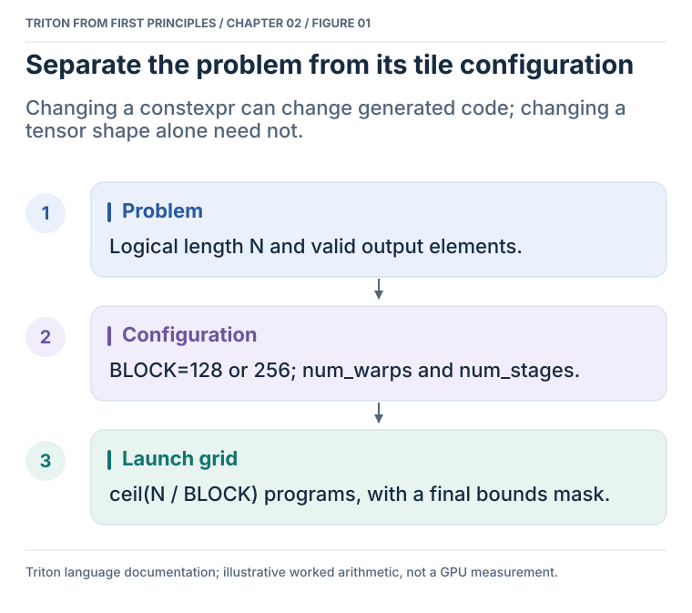

# Chapter 2: Kernel Parameterization

[](../images/ch02/01-concept.svg)

> "Mojo gives you a struct: write the layout once, and the compiler builds you a new type. Triton gives you no such thing — there is no keyword that hands you a new type at all. What it gives you instead is a kernel body that can be compiled into as many distinct, specialized versions of itself as you have combinations of compile-time values to feed it, plus a handful of ordinary Python objects to keep track of which combination is which. This chapter is about learning to see that as a feature, not an absence."

**What you will understand by the end of this chapter:**

- Why Triton has no `struct`, no `class` inside a kernel body, and no user-defined type at all in the language Mojo's Chapter 2 spends its whole length on — and why that's a real, load-bearing difference, not a gap this book is going to paper over
- What actually plays the role of a struct's fixed field layout in Triton: the full tuple of `tl.constexpr` values a kernel is compiled with, which fixes that compiled kernel's internal shape exactly as permanently as a struct's byte offsets fix its layout
- What `triton.Config` is, concretely — an ordinary Python object with named fields, used entirely on the host side to describe one way of compiling and launching a kernel — and how it differs from a Mojo struct in the one way that matters most: it has no fixed layout guarantee at all
- Why `@triton.autotune` is a real, direct analogue of Mojo's parametric-struct monomorphization — one generic kernel body, compiled into several fully separate specializations — even though this book cannot genuinely demonstrate *which* specialization wins without a real GPU to time them on
- Why Triton kernels need no RAII, no destructor, and no "did I forget to free this" discipline at all — not because the problem was solved, but because it was moved entirely to a different layer of the stack (PyTorch's allocator) that this book hasn't reached yet
- How Triton achieves the same goal Mojo's traits achieve — one piece of source code, many zero-runtime-cost specializations — through a completely different mechanism: constexpr-selected branches inside a single kernel, rather than dispatch across many types that satisfy one shared interface

**What you need to know first:**

- Chapter 1 in full — this chapter reuses its two-phase compile model (Section 1.1) and its `tl.constexpr` vs. runtime distinction (Section 1.2) without re-explaining them
- Familiarity with ordinary Python classes (`__init__`, keyword arguments) — nothing Triton-specific beyond Chapter 1

## 2.1 The `tl.constexpr` Signature as a Kernel's "Layout" `[FOUNDATIONAL]`

### Intuition

A blueprint fixes a house's layout once, for every house built from it — Mojo's Chapter 2 opens with exactly this image for a `struct`. Triton has nothing that fixes a *data* layout this way, because a kernel doesn't own any persistent data to lay out in the first place — it operates on whatever pointers it's handed. But a kernel does have a "shape" that gets fixed once and stays fixed: the complete set of `tl.constexpr` values it was compiled with. Two compilations of the same source with different constexpr values are, structurally, exactly as separate from each other as two different structs would be — different internal loop counts, different register allocations, potentially entirely different branches present or absent — sharing a Python definition and potentially many final instructions, while retaining distinct specialization keys.

### Background

| | Mojo `struct` field layout | Triton `tl.constexpr` signature |
|---|---|---|
| What gets fixed | Byte offsets of named fields | Loop bounds, buffer sizes, which branches exist |
| Fixed at | Struct definition + parameter instantiation (compile time) | First launch with a given combination (compile time) |
| Two different instantiations | Two separate compiled types (Section 2.3 in the Mojo edition) | Two separate compiled kernel binaries (Chapter 1, Section 1.1) |
| What identifies "which one this is" | The type name plus its parameters, e.g. `Vector[DType.float32, 4]` | The tuple of constexpr values plus argument types and specialization attributes used to key the compile cache |

Chapter 1's `_relu_toggle_kernel` already demonstrated this mechanism directly — `USE_RELU=True` and `USE_RELU=False` compiled to two kernels stored as distinct specialization artifacts; their final instruction sequences can overlap — without naming what that mechanism was standing in for. It's worth naming now, because the rest of this chapter builds directly on it: everywhere Mojo's Chapter 2 reaches for "a new struct instantiation," this book will reach for "a new constexpr combination."

### Worked Example 2.1.1 — Two `BLOCK` values, two compiled artifacts, traced through `tl.static_print`

```python
@triton.jit
def shape_kernel(x_ptr, out_ptr, n, BLOCK: tl.constexpr):
    tl.static_print("COMPILING a version with BLOCK =", BLOCK)
    pid = tl.program_id(0)
    offsets = pid * BLOCK + tl.arange(0, BLOCK)
    mask = offsets < n
    x = tl.load(x_ptr + offsets, mask=mask)
    tl.store(out_ptr + offsets, x * 2.0, mask=mask)
```

On the compiled path, `tl.static_print` is evaluated while generating a specialization. Under the interpreter it prints during interpreted program execution and does not demonstrate a compilation event. The historical interpreter transcript below uses the author's label `COMPILING`, but that label is literal text, not a report from the compiler. The two launches pass BLOCK=8 and BLOCK=16:

```
COMPILING a version with BLOCK = 8
BLOCK=8 result: [0.0, 2.0, 4.0, 6.0, 8.0, 10.0, 12.0, 14.0]
COMPILING a version with BLOCK = 16
BLOCK=16 result: [0.0, 2.0, 4.0, 6.0, 8.0, 10.0, 12.0, 14.0]
```

The numeric results match. On a compiled path the differing constexpr values select distinct specialization keys; whether their final instructions differ requires inspecting compiled artifacts. These interpreter messages show metadata values and arithmetic, not that two GPU binaries were built or cached.

### ASCII Diagram — one source, two compiled shapes, invisible from the output alone

```
def shape_kernel(x_ptr, out_ptr, n, BLOCK: tl.constexpr):   <- one source
    ...

        compiled separately, once per distinct BLOCK value
              /                                  \
             v                                    v
   shape_kernel<BLOCK=8>                shape_kernel<BLOCK=16>
   - 8-lane loads/stores per program    - 16-lane loads/stores per program
   - own cached binary                  - own cached binary

Both, given the same 8-element input, produce the identical
[0,2,4,6,8,10,12,14] -- the constexpr difference is real and
permanent in the compiled artifact, even though it's completely
invisible in this particular output.
```

> `[COMMON TRAP]` Because two different `BLOCK` values so often produce identical *numeric* output on small examples like this one, it's tempting to conclude the constexpr value "doesn't really matter" for correctness and is purely a performance knob. For a simple element-wise kernel that's nearly true. It stops being true the moment a kernel's logic depends on `BLOCK`'s actual value beyond just sizing a loop — a reduction kernel whose tree-reduction depth depends on `BLOCK`, or a matmul kernel whose tile shape must divide evenly into the problem size, can produce genuinely different (or genuinely broken) results for different `BLOCK` choices. Chapters 13 and 14 hit this directly. Treat every constexpr as part of the kernel's identity, not as free-floating tuning noise, even on the days it happens not to change the answer.

## 2.2 `triton.Config`: A Real Bundled Object, With No Layout Guarantee `[FOUNDATIONAL]`

### Intuition

Mojo's Chapter 2 contrasts a `struct`'s fixed, compiler-checked field layout against a Python `class`, whose fields live in a per-instance hash table with no fixed layout at all. Triton's actual, honest answer to "what's the struct-like bundled object in this ecosystem" is not a language feature at all — it's `triton.Config`, an ordinary Python object, and it is squarely on the Python-`class` side of that Mojo contrast, not the `struct` side. There is no fixed-layout guarantee anywhere in sight here; what makes `triton.Config` worth a section of its own is that it's the real, working pattern production Triton code uses to bundle a named set of compile-time choices together, in place of the type-level bundling a struct would provide.

### Background

A `triton.Config` bundles a `kwargs` dictionary (named `tl.constexpr` values to launch with — e.g. `{"BLOCK": 128}`) together with GPU scheduling parameters `num_warps` and `num_stages`. It exists purely on the host side, in ordinary Python; nothing about it is compiled, checked, or given a fixed memory layout — it is exactly the hash-table-backed object Mojo's Chapter 2 describes Python `class` instances as being, used here to describe *one point in a kernel's configuration space* rather than to model domain data.

| | Mojo `struct` (e.g. `Point2D`) | `triton.Config` |
|---|---|---|
| Field layout | Fixed byte offsets, compile-time checked | A Python dict under the hood — no fixed layout |
| What it describes | Domain data processed at runtime | Compile-time choices for how to build one kernel variant |
| Constructed how | `Point2D(3.0, 4.0)` — positional, type-checked | `triton.Config(kwargs={...}, num_warps=..., num_stages=...)` — keyword, unchecked until used |
| Checked against anything at construction time | Yes — field types are enforced | No — a typo'd key in `kwargs` is only caught when a kernel actually tries to use it |

### Worked Example 2.2.1 — Three configs, genuinely constructed and inspected

```python
configs = [
    triton.Config(kwargs={"BLOCK": 64}, num_warps=2),
    triton.Config(kwargs={"BLOCK": 128}, num_warps=4),
    triton.Config(kwargs={"BLOCK": 256}, num_warps=8),
]
for c in configs:
    print("kwargs:", c.kwargs, "num_warps:", c.num_warps, "num_stages:", c.num_stages)
```

Genuinely captured:

```
kwargs: {'BLOCK': 64} num_warps: 2 num_stages: 3
kwargs: {'BLOCK': 128} num_warps: 4 num_stages: 3
kwargs: {'BLOCK': 256} num_warps: 8 num_stages: 3
```

Notice `num_stages: 3` on all three, even though none of them specified it — `triton.Config`'s constructor fills in a default the same way any ordinary Python `__init__` with a default argument would. This is worth sitting with precisely because it looks, at a glance, like the kind of "multiple constructors" Mojo's Section 2.2 covers for a struct (several ways to build one, with defaults filling gaps) — and it genuinely is that pattern, just implemented with ordinary Python default arguments instead of compiler-checked overload resolution. Nothing here is verified against a real kernel signature yet; a `kwargs={"BLOKC": 64}` typo would construct this object without a single complaint; it would only surface as an error later, at the moment some kernel actually tries to look up a `BLOCK` argument that was never provided — runtime discovery, not compile-time rejection, exactly the Python-`class` column of Mojo's own comparison table.

> `[COMMON TRAP]` Because `triton.Config` objects are what real, production autotuning code is built from, it's easy to assume they carry some of Triton's compile-time rigor by association — that constructing one somehow validates the parameter names or values against the kernel they're meant for. They don't, and can't: a `Config` is built and can be inspected, copied, and passed around long before any kernel is even chosen to pair it with. The actual compile-time checking — whether `BLOCK` is a real parameter, whether it's used somewhere `tl.arange` requires a constexpr — only happens later, at the moment in Section 2.3 where a `Config`'s `kwargs` are finally handed to a real kernel launch.

## 2.3 Autotuning: Real Monomorphization, One Honest Gap `[FOUNDATIONAL]`

### Intuition

Section 2.3 of the Mojo edition compares a parametric struct to a fixed-size cookie-cutter mold: `Vector[DType.float32, 4]` and `Vector[DType.float64, 2]` are baked once each, as separate pieces, never reshaped at use time. `@triton.autotune` is the same mold-making process, run automatically over a whole rack of molds instead of the one or two a programmer picks by hand: hand it a list of `triton.Config`s, and for every distinct value of some "key" (typically a problem size), it compiles — genuinely, separately, exactly as Section 2.1 traced — one kernel variant per config, and keeps whichever one actually runs fastest for that key.

### Background

```python
@triton.autotune(
    configs=[
        triton.Config(kwargs={"BLOCK": 64}, num_warps=2),
        triton.Config(kwargs={"BLOCK": 128}, num_warps=4),
        triton.Config(kwargs={"BLOCK": 256}, num_warps=8),
    ],
    key=["n"],
)
@triton.jit
def autotuned_add(x_ptr, y_ptr, out_ptr, n, BLOCK: tl.constexpr):
    ...
```

The first time this kernel is launched for a given value of `n`, Triton compiles *all three* configs — three genuinely separate specializations, exactly as Section 2.1's `BLOCK=8` vs. `BLOCK=16` example produced two — actually runs each one on the GPU, times it, and caches whichever config won, keyed by `n`. A later launch with the same `n` skips straight to the cached winner, the same cache-hit behavior Chapter 1, Section 1.1 described for an ordinary `tl.constexpr` change. A launch with a *different* `n` (if `n` is large enough to change which tile size is actually fastest) repeats the whole search for that new key.

| | Mojo `Vector[dtype, size]` (Section 2.3) | `@triton.autotune` |
|---|---|---|
| How many specializations get compiled | One per combination the programmer actually writes in source | One per `Config` in the list, automatically |
| Who decides which specialization is "best" | The programmer, by choosing which to call | A real, timed benchmark run, chosen automatically |
| When does the decision happen | Never re-decided — it's whichever call site you wrote | Once per distinct `key` value, cached after that |
| Runtime cost after the decision is made | Zero — direct call to the chosen specialization | Zero — cached lookup straight to the winning compiled kernel |

### Where this book's setup runs out of road

Every other worked example in this book so far has been something genuinely executed and captured, with `TRITON_INTERPRET=1` standing in for a real GPU. Autotuning is the first thing this chapter cannot honestly do that with: `@triton.autotune`'s whole mechanism is *timing* each config against real hardware to decide a winner, and there is no hardware here to time against. Genuinely attempting to launch an autotuned kernel under this book's interpreter setup confirms exactly that, cleanly:

```
RuntimeError: 0 active drivers ([]). There should only be one.
```

Ordinary kernel launches in this book route around the missing GPU entirely, through the interpreter's Python-level simulation — that's the whole premise of this chapter's opening disclosure. `@triton.autotune` doesn't get that same accommodation: benchmarking a config is, by definition, a request to the real driver to run something and time it, and with zero drivers active, that request fails immediately and explicitly rather than producing a substitute result. Rather than fabricate a plausible-looking "and BLOCK=128 won by 1.3x" result this book never actually measured, this section stops at what genuinely was confirmed: `triton.Config` objects construct correctly (Worked Example 2.2.1), and `@triton.autotune`'s declared configs and key correctly describe *what* will be searched over, on a real GPU, the first time each key is seen. Chapter 18 returns to autotuning with real hardware in scope and picks this up properly.

> `[COMMON TRAP]` It's tempting to read the list of `configs=[...]` passed to `@triton.autotune` as documentation — "these are some reasonable choices" — rather than as an exhaustive, literal compile-and-benchmark instruction. It is not a hint or a search heuristic over a continuous space; Triton compiles and times *exactly* the configs listed, no others, and picks the best of only those. A `BLOCK` value you never included in the list is never tried, no matter how good it might have been — the quality of an autotuned kernel is bounded entirely by the quality of the list a human wrote by hand.

## 2.4 What Doesn't Carry Over: No RAII, Because Nothing to Own `[FOUNDATIONAL]`

### Intuition

Mojo's Chapter 1, Section 1.5 left a real gap open — `UnsafePointer.alloc()`/`.free()` pairs the programmer has to remember by hand — and Chapter 2, Section 2.4 closed it, wrapping the raw pointer in a struct whose destructor frees it automatically at scope end. A Triton kernel never opens that gap in the first place: it has no `alloc()` of its own to forget to pair with a `free()`, because a kernel never owns memory that outlives it. Whatever GPU memory a kernel reads from or writes to was allocated on the host, by PyTorch, before the kernel ever launched, and PyTorch's own reference counting decides when that memory actually gets freed — a decision made entirely outside Triton, by a system this book hasn't formally introduced yet (Chapter 6 does).

### Background

| | Mojo (Ch. 1.5 raw, Ch. 2.4 with RAII) | A Triton kernel's own local values | Persistent GPU memory a kernel reads/writes |
|---|---|---|---|
| Who allocates it | The programmer (`UnsafePointer.alloc`) or a struct's `__init__` | Nobody explicitly — registers/shared memory the compiler assigns for the kernel's duration | The host, before launch (`torch.empty`, `torch.zeros`, ...) |
| Lifetime | Until `.free()` is called, or a destructor runs at scope end | Exactly one kernel invocation — gone the instant the kernel returns | Until PyTorch's allocator decides to reclaim it (reference counting) |
| Can a kernel leak it | N/A to a kernel's own locals — nothing to leak | No — there's no persistent handle a kernel could fail to release | Not from inside the kernel — a kernel has no `free()`-equivalent to forget to call at all |
| What a kernel author needs to write to avoid a leak | `__del__`, correctly, on every owning struct | Nothing | Nothing — but forgetting to *keep a live Python reference* to a tensor on the host side can free it out from under a kernel that hasn't launched yet, which is a real, different mistake (Chapter 10) |

### Worked Example 2.4.1 — A kernel that needs scratch space, and where that space actually comes from

```python
def run_with_scratch(x: torch.Tensor) -> torch.Tensor:
    out = torch.empty_like(x)        # allocated by PyTorch, on the host, before launch
    scratch_kernel[(1,)](x, out, x.shape[0], BLOCK=x.shape[0])
    return out                        # `out` is a live Python reference -- PyTorch won't free it yet
```

Nothing in `scratch_kernel` allocates anything. `out`'s memory exists because `torch.empty_like` created it, exists for as long as some Python variable somewhere still refers to it, and will eventually be freed by PyTorch's caching allocator when the reference count reaches zero — the same reference-counting story Mojo's Chapter 1 attributes to *every* Python object, now applied specifically to the tensor's underlying storage rather than to a Mojo struct or a raw pointer. A Triton kernel body never sees any of this machinery; it only ever sees the pointer `out`'s storage happens to live at, for the duration of one launch.

> `[COMMON TRAP]` The absence of `alloc`/`free` inside a kernel body can read as "Triton solved memory management," the way Mojo's `__init__`/`__del__` genuinely does solve it for a struct's owned pointer. It didn't solve it — it relocated the entire problem to the host side, where PyTorch's tensors and their reference counts are now doing the job a Mojo destructor would have done. A kernel that receives a pointer to memory nothing on the host still references is reading or writing freed memory, exactly as certainly as Chapter 1's `heap_ptr` use-after-free — the mistake didn't go away, it just moved to a layer of the stack this book hasn't formally covered yet.

## 2.5 One Kernel, Many Branches: Triton's Substitute for Traits `[FOUNDATIONAL]`

### Intuition

Mojo's `trait` lets many different structs — `Rectangle`, `Circle`, anything else that implements `area()` and `draw()` — plug into one generic function, each one compiled to its own direct, monomorphized call with zero runtime dispatch cost. Triton reaches the identical destination — one piece of source, several zero-cost specializations, chosen with no runtime branch check surviving into the compiled kernel — by a completely different road: instead of many *types* satisfying one interface, Triton typically writes one *kernel body* with a `tl.constexpr` flag selecting which branch exists, and lets the compiler delete every branch that constexpr didn't select. Chapter 1's `USE_RELU` boolean was the simplest possible version of this; this section generalizes it to a string-valued flag choosing among three genuinely different formulas, the same shape of problem Mojo's `Rectangle`/`Circle` example solves with two different `area()` implementations behind one shared signature.

### Background

| | Mojo `trait` + generic dispatch | Triton `tl.constexpr` branch selection |
|---|---|---|
| What varies | Which *type* is passed in | Which *branch* of one kernel body is compiled |
| Mechanism | `fn draw_shape[T: Drawable](shape: T)`, monomorphized per `T` | `if ACTIVATION == "relu": ... elif ACTIVATION == "gelu": ...`, resolved at trace time |
| Runtime dispatch cost | Zero — direct call, no vtable | Zero — dead branches don't exist in the compiled kernel at all |
| How many compiled artifacts result | One per type actually used at a call site | One per distinct constexpr value actually launched |
| What has to satisfy a shared "contract" | Every conforming struct's method signatures | Nothing formal — the constexpr's possible values are only as documented as the `if`/`elif` chain checking them |

### Worked Example 2.5.1 — One kernel body, three specializations, one exact match against PyTorch

```python
@triton.jit
def fused_activation_kernel(x_ptr, out_ptr, n, ACTIVATION: tl.constexpr, BLOCK: tl.constexpr):
    offsets = tl.arange(0, BLOCK)
    mask = offsets < n
    x = tl.load(x_ptr + offsets, mask=mask)
    if ACTIVATION == "relu":
        x = tl.maximum(x, 0.0)
    elif ACTIVATION == "gelu":
        x = 0.5 * x * (1.0 + tl.math.erf(x * 0.7071067811865476))
    tl.store(out_ptr + offsets, x, mask=mask)
```

`ACTIVATION == "relu"` compares a `tl.constexpr` string against a literal — legal specifically *because* `ACTIVATION` is constexpr, resolved during tracing exactly like `USE_RELU` in Chapter 1; a runtime string comparison inside a kernel body would run straight into Chapter 1 Section 1.4's block-shaped-value problem. The `gelu` branch uses the exact error-function definition of GELU, `0.5x(1 + \mathrm{erf}(x/\sqrt2))` — the same formula PyTorch's own `torch.nn.functional.gelu` computes by default. Hand-checking one point first: at `x = 1.0`, `x/\sqrt2 \approx 0.70711`, `\mathrm{erf}(0.70711) \approx 0.68269`, giving `0.5 \times 1.0 \times 1.68269 \approx 0.841345`.

Genuinely captured, launching all three specializations against `x = [-2.0, -1.0, 0.0, 1.0, 2.0]`:

```
ACTIVATION='none'   -> [-2.0, -1.0, 0.0, 1.0, 2.0]
ACTIVATION='relu'   -> [0.0, 0.0, 0.0, 1.0, 2.0]
ACTIVATION='gelu'   -> [-0.0455, -0.158655, 0.0, 0.841345, 1.9545]
gelu reference (torch.nn.functional.gelu): [-0.0455, -0.158655, 0.0, 0.841345, 1.9545]
```

The `gelu` row matches PyTorch's own implementation exactly, to every digit shown, and the value at `x=1.0` matches the hand-check above. Three constexpr values, three separately compiled kernels, one of which was just cross-checked against an independent, trusted implementation rather than only against a hand trace.

### ASCII Diagram — one body, three constexpr-selected, mutually exclusive compiled paths

```
def fused_activation_kernel(..., ACTIVATION: tl.constexpr, ...):
    ...
    if ACTIVATION == "relu":      elif ACTIVATION == "gelu":     (else: neither branch)
        x = max(x, 0)                 x = 0.5*x*(1+erf(x/root2))

        compiled separately per ACTIVATION value actually launched
         /                              |                              \
        v                               v                               v
 ACTIVATION="none"            ACTIVATION="relu"               ACTIVATION="gelu"
 - neither branch's           - only the max(x,0)              - only the erf-based
   code exists in the           code exists                      formula's code exists
   compiled kernel             - no gelu code, no erf call       - no relu code at all
                                anywhere in this binary
```

> `[COMMON TRAP]` A Mojo `trait` gives the compiler something to check *before* you ever call `draw_shape` on the wrong type — conformance is verified once, at the struct's declaration. Triton's `if ACTIVATION == "relu": ... elif ACTIVATION == "gelu": ...` pattern checks nothing in advance: pass `ACTIVATION="softmax"` and, since no branch matches, the kernel silently falls through to whatever the *absence* of a match does (here, no activation is applied at all — identical to `"none"` — with no warning that `"softmax"` was never a recognized option). Where Mojo's trait system turns a typo into a compile error, Triton's constexpr-branch pattern turns the same kind of typo into a silent no-op, unless the author adds an explicit `else` branch that raises via `tl.static_assert(False, ...)` for anything unrecognized. Real fused kernels should do exactly that; this example didn't, specifically so this trap could be shown happening rather than only described.

## 2.6 Complete Runnable Code

Sections 2.1–2.5 walked through this chapter's ideas as isolated snippets. The files below are the complete, run-in-order source; `03_standalone_complete.py` combines everything into one script, and its output is reproduced in full afterward. All three were run with `TRITON_INTERPRET=1`, per Chapter 1's opening note — with one exception disclosed inline: `@triton.autotune`'s actual timed search is described but not executed, for the reason Section 2.3 explains.

### File: `01_constexpr_shape_and_config.py` — Sections 2.1 and 2.2

[Download the complete current reference](../examples/references/part0/02-kernel-parameterization/01_constexpr_shape_and_config.py) (interpreter mode; GPU portability is not established).

**Execution:** `TRITON_INTERPRET=1 python3 01_constexpr_shape_and_config.py`

```python
import torch
import triton
import triton.language as tl


@triton.jit
def shape_kernel(x_ptr, out_ptr, n, BLOCK: tl.constexpr):
    tl.static_print("COMPILING a version with BLOCK =", BLOCK)
    pid = tl.program_id(0)
    offsets = pid * BLOCK + tl.arange(0, BLOCK)
    mask = offsets < n
    x = tl.load(x_ptr + offsets, mask=mask)
    tl.store(out_ptr + offsets, x * 2.0, mask=mask)


def demo_constexpr_shape():
    print("=== Section 2.1: two constexpr signatures = two compiled artifacts ===")
    x = torch.arange(8, dtype=torch.float32)
    out8 = torch.empty_like(x)
    shape_kernel[(1,)](x, out8, 8, BLOCK=8)
    print("BLOCK=8 result:", out8.tolist())
    out16 = torch.empty_like(x)
    shape_kernel[(1,)](x, out16, 8, BLOCK=16)
    print("BLOCK=16 result:", out16.tolist())


def demo_config_objects():
    print("\n=== Section 2.2: triton.Config objects, genuinely constructed ===")
    configs = [
        triton.Config(kwargs={"BLOCK": 64}, num_warps=2),
        triton.Config(kwargs={"BLOCK": 128}, num_warps=4),
        triton.Config(kwargs={"BLOCK": 256}, num_warps=8),
    ]
    for c in configs:
        print("kwargs:", c.kwargs, "num_warps:", c.num_warps, "num_stages:", c.num_stages)


if __name__ == "__main__":
    demo_constexpr_shape()
    demo_config_objects()
```

### File: `02_activation_branches.py` — Section 2.5

[Download the complete current reference](../examples/references/part0/02-kernel-parameterization/02_activation_branches.py) (interpreter mode; GPU portability is not established).

**Execution:** `TRITON_INTERPRET=1 python3 02_activation_branches.py`

```python
import torch
import triton
import triton.language as tl


@triton.jit
def fused_activation_kernel(x_ptr, out_ptr, n, ACTIVATION: tl.constexpr, BLOCK: tl.constexpr):
    offsets = tl.arange(0, BLOCK)
    mask = offsets < n
    x = tl.load(x_ptr + offsets, mask=mask)
    if ACTIVATION == "relu":
        x = tl.maximum(x, 0.0)
    elif ACTIVATION == "gelu":
        x = 0.5 * x * (1.0 + tl.math.erf(x * 0.7071067811865476))
    tl.store(out_ptr + offsets, x, mask=mask)


def demo_activation_branches():
    print("=== Section 2.5: one kernel body, three constexpr-selected specializations ===")
    xv = torch.tensor([-2.0, -1.0, 0.0, 1.0, 2.0])
    n = xv.shape[0]
    for act in ["none", "relu", "gelu"]:
        outv = torch.empty_like(xv)
        fused_activation_kernel[(1,)](xv, outv, n, ACTIVATION=act, BLOCK=8)
        print(f"ACTIVATION={act!r:8s} ->", [round(v, 6) for v in outv.tolist()])
    print("gelu reference (torch.nn.functional.gelu):",
          [round(v, 6) for v in torch.nn.functional.gelu(xv).tolist()])


if __name__ == "__main__":
    demo_activation_branches()
```

### File: `03_standalone_complete.py` — the full chapter, one program

[Download the complete current reference](../examples/references/part0/02-kernel-parameterization/03_standalone_complete.py) (interpreter mode; GPU portability is not established).

**Execution:** `TRITON_INTERPRET=1 python3 03_standalone_complete.py`

```python
import torch
import triton
import triton.language as tl


@triton.jit
def shape_kernel(x_ptr, out_ptr, n, BLOCK: tl.constexpr):
    tl.static_print("COMPILING a version with BLOCK =", BLOCK)
    pid = tl.program_id(0)
    offsets = pid * BLOCK + tl.arange(0, BLOCK)
    mask = offsets < n
    x = tl.load(x_ptr + offsets, mask=mask)
    tl.store(out_ptr + offsets, x * 2.0, mask=mask)


@triton.jit
def fused_activation_kernel(x_ptr, out_ptr, n, ACTIVATION: tl.constexpr, BLOCK: tl.constexpr):
    offsets = tl.arange(0, BLOCK)
    mask = offsets < n
    x = tl.load(x_ptr + offsets, mask=mask)
    if ACTIVATION == "relu":
        x = tl.maximum(x, 0.0)
    elif ACTIVATION == "gelu":
        x = 0.5 * x * (1.0 + tl.math.erf(x * 0.7071067811865476))
    tl.store(out_ptr + offsets, x, mask=mask)


def run_with_scratch(x: torch.Tensor) -> torch.Tensor:
    """Section 2.4: PyTorch owns `out`'s memory; the kernel never allocates anything."""
    out = torch.empty_like(x)
    shape_kernel[(1,)](x, out, x.shape[0], BLOCK=x.shape[0])
    return out


def main():
    print("=== Section 2.1: two constexpr signatures = two compiled artifacts ===")
    x = torch.arange(8, dtype=torch.float32)
    out8 = torch.empty_like(x)
    shape_kernel[(1,)](x, out8, 8, BLOCK=8)
    print("BLOCK=8 result:", out8.tolist())
    out16 = torch.empty_like(x)
    shape_kernel[(1,)](x, out16, 8, BLOCK=16)
    print("BLOCK=16 result:", out16.tolist())

    print("\n=== Section 2.2: triton.Config objects, genuinely constructed ===")
    configs = [
        triton.Config(kwargs={"BLOCK": 64}, num_warps=2),
        triton.Config(kwargs={"BLOCK": 128}, num_warps=4),
        triton.Config(kwargs={"BLOCK": 256}, num_warps=8),
    ]
    for c in configs:
        print("kwargs:", c.kwargs, "num_warps:", c.num_warps, "num_stages:", c.num_stages)

    print("\n=== Section 2.4: scratch memory belongs to PyTorch, not the kernel ===")
    scratch_out = run_with_scratch(torch.arange(4, dtype=torch.float32))
    print("run_with_scratch result:", scratch_out.tolist())

    print("\n=== Section 2.5: one kernel body, three constexpr-selected specializations ===")
    xv = torch.tensor([-2.0, -1.0, 0.0, 1.0, 2.0])
    n = xv.shape[0]
    for act in ["none", "relu", "gelu"]:
        outv = torch.empty_like(xv)
        fused_activation_kernel[(1,)](xv, outv, n, ACTIVATION=act, BLOCK=8)
        print(f"ACTIVATION={act!r:8s} ->", [round(v, 6) for v in outv.tolist()])
    print("gelu reference (torch.nn.functional.gelu):",
          [round(v, 6) for v in torch.nn.functional.gelu(xv).tolist()])


if __name__ == "__main__":
    main()
```

### Expected Output for `03_standalone_complete.py`

```
=== Section 2.1: two constexpr signatures = two compiled artifacts ===
COMPILING a version with BLOCK = 8
BLOCK=8 result: [0.0, 2.0, 4.0, 6.0, 8.0, 10.0, 12.0, 14.0]
COMPILING a version with BLOCK = 16
BLOCK=16 result: [0.0, 2.0, 4.0, 6.0, 8.0, 10.0, 12.0, 14.0]

=== Section 2.2: triton.Config objects, genuinely constructed ===
kwargs: {'BLOCK': 64} num_warps: 2 num_stages: 3
kwargs: {'BLOCK': 128} num_warps: 4 num_stages: 3
kwargs: {'BLOCK': 256} num_warps: 8 num_stages: 3

=== Section 2.4: scratch memory belongs to PyTorch, not the kernel ===
COMPILING a version with BLOCK = 4
run_with_scratch result: [0.0, 2.0, 4.0, 6.0]

=== Section 2.5: one kernel body, three constexpr-selected specializations ===
ACTIVATION='none'   -> [-2.0, -1.0, 0.0, 1.0, 2.0]
ACTIVATION='relu'   -> [0.0, 0.0, 0.0, 1.0, 2.0]
ACTIVATION='gelu'   -> [-0.0455, -0.158655, 0.0, 0.841345, 1.9545]
gelu reference (torch.nn.functional.gelu): [-0.0455, -0.158655, 0.0, 0.841345, 1.9545]
```

Note the extra `COMPILING a version with BLOCK = 4` line in the Section 2.4 block: `run_with_scratch` calls `shape_kernel` with `BLOCK=x.shape[0]=4`, a signature never launched earlier in this same script, so it triggers its own genuine compilation — exactly the cache-keyed behavior Section 2.1 traced, showing up again, unprompted, later in the same program.

## Chapter Summary

Triton has no `struct`, no user-defined type, and nothing resembling Mojo's fixed field layout — a kernel operates on raw pointers, never on an instance of anything it defined itself. What plays the structural role a struct's layout plays is the full tuple of `tl.constexpr` values a kernel is compiled with: two different combinations are, functionally, two unrelated compiled artifacts, exactly as two struct instantiations would be, even when their output happens to look identical. `triton.Config` is the real, working object production code bundles those combinations into — but it is an ordinary, unchecked Python object, not a compiler-verified type, and Section 2.2's constructed examples showed exactly how little verification happens at the point a `Config` is built. `@triton.autotune` is genuine monomorphization — compiling every listed config separately and keeping whichever one measurably wins — but "measurably" requires a real GPU this book's setup doesn't have, which Section 2.3 disclosed rather than faked. RAII has nothing to attach to in a kernel body, because a kernel never owns memory that outlives its own single invocation; the allocation-and-freeing story Mojo's Chapter 2 closes with a destructor is, in Triton's world, PyTorch's problem, happening entirely on the host side. And where Mojo's traits let many types satisfy one interface with zero-cost dispatch, Triton reaches the same zero-cost-specialization destination by branching on `tl.constexpr` flags inside one kernel body instead — Section 2.5's three-way `ACTIVATION` split, verified digit-for-digit against PyTorch's own GELU, is that mechanism doing real work.

## Self-Check Questions

1. Two calls to the same `@triton.jit` kernel use `BLOCK=64` and `BLOCK=128` respectively, and happen to produce numerically identical output on a particular input. In what sense are these still "two different things," and what evidence from Section 2.1 would reveal that they are, even when their output doesn't?
2. A `triton.Config(kwargs={"BLOKC": 64})` (note the typo) is constructed successfully, with no error. Explain why this succeeds, and at what point — and why only at that point — the typo would actually cause a failure.
3. `@triton.autotune(configs=[...], key=["n"])` is described in this chapter as "real monomorphization," the same mechanism Mojo's parametric structs use. What, specifically, does autotuning do that a single hand-written `tl.constexpr` choice does not, and why couldn't this chapter genuinely demonstrate the part of that process that picks a winner?
4. A kernel writes into a tensor `out` that was allocated with `torch.empty_like(x)` before the kernel launched. If the only Python variable referring to `out` goes out of scope immediately after the kernel call returns, without the caller reading `out`'s contents first, what happens to that memory — and whose responsibility is it, in the vocabulary this chapter used for Mojo's `__init__`/`__del__` pair?
5. `fused_activation_kernel` is launched with `ACTIVATION="softmax"`, a value neither the `if` nor the `elif` branch checks for. What actually happens, and how does that differ from what a Mojo `trait` violation would do at the equivalent moment?

## Where We Go Next

Every parameter this chapter treated as a `tl.constexpr` — `BLOCK`, `USE_RELU`, `ACTIVATION` — has been a value with no shape or memory layout of its own: a size, a flag, a name. Chapter 3 turns to values that do have a shape and a layout — the actual pointers, strides, and offsets a kernel uses to read and write real memory — and asks the question Mojo's Chapter 3 (Memory Layout Strategies) asks next: given a block of memory, which arrangement of bytes makes reading it fast, and which arrangement quietly makes every access slower than it needs to be.

## Worked Solutions

**1.** On the compiled path the BLOCK values select distinct specialization keys; the generated instructions need not be disjoint. In this interpreter transcript no GPU artifact was compiled. The literal `COMPILING` message is not evidence of compilation or cache behavior.

**2.** `triton.Config` is an ordinary Python object; its constructor stores whatever `kwargs` dictionary it's handed without validating any of the keys against a real kernel's parameter names, because at construction time no particular kernel has even been associated with it yet — a `Config` can be built, inspected, and passed around long before it's ever paired with a kernel launch. The typo would only surface at the moment some kernel actually tries to launch using that `Config`'s `kwargs` and looks for a `BLOCK` argument that was never provided (finding `BLOKC` instead) — a runtime `TypeError` or missing-argument failure at launch time, not a compile-time or construction-time rejection.

**3.** A single hand-written `tl.constexpr` choice compiles exactly one specialization and commits to it, with no comparison against any alternative — the programmer is the one deciding, once, which value to use. `@triton.autotune` compiles *every* config in its list separately (genuine, independent compilations, each one exactly as real as Section 2.1's `BLOCK=8`/`BLOCK=16` pair) and then actually runs and times each one on real hardware to pick the fastest, repeating that timed search for every new value of the `key`. This chapter couldn't demonstrate the timing-and-selection part because it requires genuinely executing and measuring wall-clock kernel performance, which needs a real GPU — this book's setup, run entirely through Triton's CPU-based interpreter for the reason Chapter 1 disclosed, has no meaningful timing to measure at all, and fabricating a "winner" would mean reporting a number that was never actually measured.

**4.** The memory `out` points to does not vanish the instant the Python variable goes out of scope — it becomes eligible for PyTorch's allocator to reclaim once nothing references it anymore, the same reference-counting behavior Chapter 1 attributed to every Python object in general, now applied to the tensor's underlying GPU storage specifically. In the vocabulary this chapter used for Mojo, this is PyTorch's `__del__`-equivalent — automatic, tied to a reference count reaching zero rather than to a lexical scope ending deterministically — and it is squarely PyTorch's responsibility, not the kernel's: the kernel that wrote into `out` has already finished and returned by the time any of this reference-counting happens, and never had a release step of its own to perform in the first place.

**5.** Nothing raises, and nothing warns. `ACTIVATION="softmax"` matches neither `"relu"` nor `"gelu"`, so both branches are skipped entirely, and `x` passes through completely unmodified — identical output to `ACTIVATION="none"`, with no indication anywhere that `"softmax"` was never a recognized value at all. A Mojo `trait` violation is caught at compile time, before the program exists as a runnable artifact: attempting to use a struct that doesn't implement a required method fails the build outright. Triton's constexpr-branch pattern, as written here, checks nothing in advance and fails silently rather than loudly — the fix, noted in Section 2.5's `[COMMON TRAP]`, is an explicit `else` branch calling `tl.static_assert(False, ...)` for any value that doesn't match a known case, which turns this exact silent no-op into the compile-time error a real interface check would have produced.
