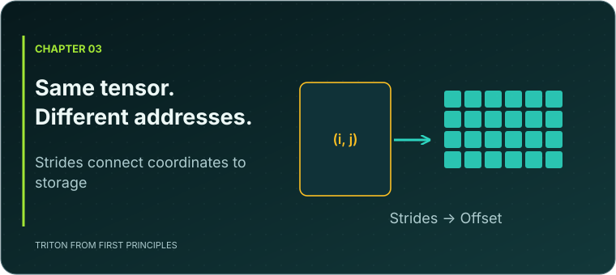
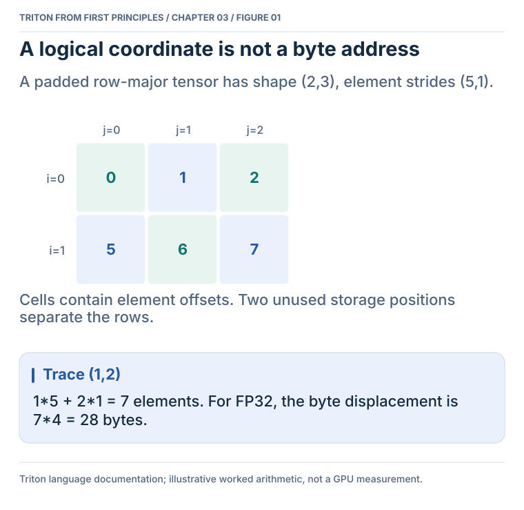

# Chapter 3: Strides, Pointers, and Block-Level Memory Layout

[](../images/chapter-openers/03.svg)

[](../images/ch03/01-concept.svg)

> "A pointer plus an offset is not an address until you multiply by a stride. Get the stride wrong, or assume one that was never actually there, and the kernel doesn't crash — it just quietly reads the wrong sixteen bytes, computes a perfectly plausible-looking wrong answer, and hands it back with no complaint at all."

**What you will understand by the end of this chapter:**

- Why bulk GPU kernels are usually limited by how many memory transactions the hardware issues, not by how much arithmetic runs once the data has arrived — the same memory-bandwidth-bound story Mojo's Chapter 3 tells for a CPU's memory bus, told here for a GPU's global memory instead
- How to compute, by hand, exactly what fraction of a set of fetched bytes a kernel actually uses — for both an Array-of-Structs-style layout and a Struct-of-Arrays-style layout of the same data
- Why reading one row of a row-major matrix and reading one column of that same matrix cost dramatically different numbers of memory transactions, even though both read the same count of elements
- Why a kernel that hardcodes its stride arithmetic instead of reading `.stride()` from the actual tensor it's given can compile fine, run without error, and still silently return the wrong answer
- How `tl.arange`'s broadcasting (`rows[:, None]`, `cols[None, :]`) builds a whole 2D tile of memory addresses from two 1D ranges, the pattern every matmul and reduction kernel from Part 2 onward is built on

**What you need to know first:**

- Chapter 1, Section 1.4 (every value in a kernel body is block-shaped) — this chapter's 2D tiles are built from exactly the same `tl.arange` mechanism, broadcast across two axes instead of one
- Chapter 2's `tl.constexpr` block-size parameters (`BLOCK`) — this chapter introduces `BLOCK_M` and `BLOCK_N`, the same idea applied to two dimensions

## 3.1 Memory Transactions: Every Segment Costs Bandwidth, Whether You Use It or Not `[FOUNDATIONAL]`

### Intuition

Mojo's Chapter 3 opens with movers who only carry pre-packed boxes: ask for the forks and the whole kitchen box comes along, plates and pots included, because they were packed together. A GPU's global memory system runs on the identical principle, one level up: it doesn't fetch individual bytes on request, it fetches fixed-size *segments* — and if the bytes eight, sixteen, or thirty-two different threads actually want are scattered across many segments instead of packed into a few, the hardware issues one expensive transaction per segment touched, whether or not most of each transaction's bytes were ever asked for.

### Background

Define **transaction utilization** for a group of threads reading memory simultaneously exactly the way Mojo's Chapter 3 defines bus utilization for a CPU:

```
transaction utilization = (bytes actually needed) / (bytes actually fetched)
```

This book uses a simplified, fixed 32-byte segment size to keep every calculation in this chapter exact and reproducible by hand — real GPUs service a warp's memory request in segments whose effective size depends on the specific access pattern and architecture, but the qualitative lesson (packed access is efficient, scattered access is wasteful) doesn't change with the exact number.

### Worked Example 3.1.1 — The same particle system, on a GPU instead of a CPU

Reuse Mojo Chapter 3's own running example directly: a 7-field particle record (`x, y, z, vx, vy, vz, mass`, each a 4-byte `float32`), and a kinetic-energy computation that only ever reads `vx`, `vy`, `vz`, `mass` — 4 of the 7 fields. Instead of one CPU core scanning the array, picture a group of 32 GPU threads (a **warp**, the real hardware group size), each one responsible for one particle, all reading the same field simultaneously.

**Array-of-Structs** — one row per particle, all 7 fields interleaved, row stride 28 bytes: thread `i`'s `vx` sits at byte address `i*28 + 12`. Genuinely computed, checking which 32-byte-aligned segments those 32 threads' addresses fall into, for all four needed fields:

```
AoS total: 28 distinct 32B segments = 896 bytes fetched
needed: 512 bytes -> utilization = 57.1%
```

**Struct-of-Arrays** — `vx`, `vy`, `vz`, `mass` each in their own contiguous 32-element array: thread `i`'s `vx` sits at byte address `i*4`, packed with every other thread's `vx` in the same handful of segments.

```
SoA total: 16 distinct 32B segments (across 4 separate arrays) = 512 bytes fetched
needed: 512 bytes -> utilization = 100.0%
```

`57.1%` is not a coincidence worth glossing over: it is the identical number Mojo's Chapter 3 computes for the same particle system on a CPU (`16,000 / 28,000 ≈ 57.1%`), because both numbers reduce to the same ratio — 4 useful fields out of 7 total fields in the record, `4/7 ≈ 0.571` — even though the *mechanism* wasting the other 42.9% is different in each case. On the CPU, the waste is unrelated fields riding along in the *same* fetch for *one* element. On the GPU, the waste is *separate* threads' scattered addresses forcing more transactions than a packed layout would need. Different hardware, different physical mechanism, same underlying principle: memory is fetched in fixed-size chunks, and a layout that doesn't pack the wanted bytes together pays for the unwanted ones riding along, one way or another.

### ASCII Diagram — 4 threads' worth of `vx` reads, AoS vs. SoA

```
AoS (row stride 28B, vx at offset+12): thread i's vx address = i*28+12
 thread:      0      1      2      3
 address:    12     40     68     96
 32B segment: 0      1      2      3     <- every thread lands in a DIFFERENT segment

SoA (vx array, 4B stride): thread i's vx address = i*4
 thread:      0      1      2      3
 address:     0      4      8     12
 32B segment: 0      0      0      0     <- all 4 threads land in the SAME segment
```

> `[COMMON TRAP]` "I'm only loading one field, `vx`, so the layout of the other six fields shouldn't matter" is the GPU version of Mojo's Chapter 3 trap, and it fails for the identical reason: whether those other six fields' bytes get fetched depends on *where the hardware's transaction boundaries fall relative to the addresses actually requested*, not on which field names appear in your kernel's source. In AoS, `vx`'s neighbors in the same 28-byte row are close enough to sometimes share a segment with it — but the rows themselves are far enough apart (28 bytes, not a divisor of 32) that consecutive threads' `vx` values almost never land in the same segment as each other, which is the actual, GPU-specific reason AoS loses here — a subtly different mechanism from the CPU case, arriving at the same wasted-bandwidth conclusion.

## 3.2 Row-Major, Column-Major, and the Stride That Decides Which One You Have `[FOUNDATIONAL]`

### Intuition

A spreadsheet stored "by row" — every cell of row 1, then every cell of row 2 — lets you read an entire row in one smooth pass down the page. Reading one *column* out of that same sheet means jumping to a completely different page for every single cell, because column members were never placed near each other in the first place. Nothing about the data changed between those two reads — only which direction through it happens to align with how it was actually laid out on the page.

A **stride** is the number that says how far apart, in memory, two logically-adjacent elements along a given axis actually sit. A contiguous row-major matrix has column-axis stride 1 (moving across a row) and row-axis stride equal to the column count (moving down a column) — and Worked Example 3.1.1's whole AoS-vs-SoA story is really just one particular case of this general fact.

### Background

For an `(M, N)` row-major matrix, `stride_row = N` elements and `stride_col = 1` element — moving to the next row means skipping `N` elements, moving to the next column means skipping just 1. PyTorch exposes this directly: `tensor.stride()` returns exactly these two numbers for any tensor, row-major or not, and a Triton kernel that wants to be correct for *any* layout — not just the one layout its author happened to test — has to read them from the tensor rather than assume them.

| | Reading one row (`N` contiguous elements) | Reading one column (`N` elements, stride `N` apart) |
|---|---|---|
| Address of element `i` | `base + i * 4` bytes | `base + i * N * 4` bytes |
| Adjacent elements' addresses | 4 bytes apart — tightly packed | `N * 4` bytes apart — scattered |
| Segments a 32-element read touches (32B segments) | Few — elements share segments | Many — often one segment per element |

### Worked Example 3.2.1 — One row vs. one column of a 32×32 matrix, genuinely counted

For a `(32, 32)` row-major `float32` matrix (`stride_row = 32` elements = 128 bytes, `stride_col = 1` element = 4 bytes), reading all 32 elements of row 0 (`addresses = [0, 4, 8, ..., 124]`) versus all 32 elements of column 0 (`addresses = [0, 128, 256, ..., 3968]`), genuinely computed:

```
Reading one row (32 contiguous fp32): 4 segments touched, 128 bytes fetched for 128 bytes needed -> 100.0%
Reading one column (32 fp32, stride 128B): 32 segments touched, 1024 bytes fetched for 128 bytes needed -> 12.5%
```

Both reads touch exactly 32 elements — 128 bytes of genuinely needed data, identical in both cases. The row read packs those 32 elements into just 4 segments (32 bytes ÷ 4 bytes/element = 8 elements per segment, `32 ÷ 8 = 4`). The column read, with each element 128 bytes from the next, lands in its own separate segment 32 times over — an 8× worse utilization than the row read, for reading the exact same *number* of elements.

> `[COMMON TRAP]` "Row-major" and "column-major" describe how a tensor's *logical* axes map to memory — they say nothing about which axis a given kernel actually iterates fastest across. A kernel can be handed a perfectly ordinary row-major matrix and still read it column-by-column if that's the loop it wrote, and Worked Example 3.2.1's 12.5% applies exactly as written the moment it does. The layout doesn't protect you from a bad access pattern; it only determines which access pattern happens to be the cheap one.

## 3.3 Pointer Arithmetic Must Use Real Strides, Not Assumed Ones `[FOUNDATIONAL]`

### Intuition

A shipping label that reads "third box from the left, second shelf down" only gets you the right box if the warehouse's shelves are actually arranged the way you assumed when you wrote that label. Move the shelves — keep the same boxes, same contents, just rearranged — and "third box from the left, second shelf down" now points at a completely different box, silently, with the label itself never indicating anything went wrong.

A Triton kernel that computes `ptrs = x_ptr + rows * N + cols` has hardcoded exactly this kind of shelf assumption: it assumes row `r`, column `c` sits at offset `r*N + c`, which is only true if the tensor it's handed is actually contiguous, row-major, with exactly `N` columns per row. Hand it a *view* of a tensor — a transpose, a slice, anything that changes the logical shape without physically rearranging the underlying bytes — and that formula silently computes the address of a completely different element.

### Background

`tensor.t()` in PyTorch does not move a single byte: it returns a new tensor object with the same underlying storage but swapped strides — `base.stride()` of `(4, 1)` becomes `base.t().stride()` of `(1, 4)` for a `(3,4)` matrix. The data an element-`(r,c)` lookup resolves to is entirely determined by which stride pair is used to compute its address; the same raw bytes, addressed with the *wrong* stride pair, resolve to a different, wrong element every time.

| | Hardcoded `ptrs = x_ptr + rows*N + cols` | `ptrs = x_ptr + rows*stride_row + cols*stride_col` |
|---|---|---|
| Correct on a contiguous row-major tensor | Yes | Yes |
| Correct on `.t()`, a slice, or any non-contiguous view | No — silently wrong, no error | Yes |
| Where the correct strides come from | Nowhere — assumed | `tensor.stride(0)`, `tensor.stride(1)`, passed in as ordinary runtime arguments |

### Worked Example 3.3.1 — The same kernel, two tensors, one silently wrong

```python
@triton.jit
def copy_2d_hardcoded_kernel(x_ptr, out_ptr, M, N, BLOCK_M: tl.constexpr, BLOCK_N: tl.constexpr):
    rows = tl.arange(0, BLOCK_M)
    cols = tl.arange(0, BLOCK_N)
    mask = (rows[:, None] < M) & (cols[None, :] < N)
    ptrs = x_ptr + rows[:, None] * N + cols[None, :]   # assumes row-major, stride_row=N
    x = tl.load(ptrs, mask=mask)
    ...
```

`base = torch.arange(12).reshape(3, 4)` is contiguous, so the hardcoded kernel copies it correctly. `t = base.t()` is the same 12 numbers, logically transposed to shape `(4, 3)` with `stride = (1, 4)` — genuinely captured:

```
base.t() shape: torch.Size([4, 3]) stride: (1, 4) is_contiguous: False
hardcoded kernel on base.t():
 tensor([[ 0.,  1.,  2.],
        [ 3.,  4.,  5.],
        [ 6.,  7.,  8.],
        [ 9., 10., 11.]])
matches base.t()? False
```

The kernel didn't crash, and it didn't produce garbage — it produced `base` reshaped to `(4,3)` in the wrong order entirely, which is what `rows*N + cols` (with `N=3`, the *new* shape's column count, since that's what was passed in) actually computes when the true layout doesn't match that assumption. This is a genuinely plausible-looking wrong answer: every number in the output is a real number that exists somewhere in `base`, just not in the position `base.t()` actually puts it.

Passing the tensor's real strides fixes it completely:

```python
copy_2d_strided_kernel[(1,)](t, out_strided, 4, 3, t.stride(0), t.stride(1), BLOCK_M=4, BLOCK_N=4)
```

```
stride-aware kernel on base.t():
 tensor([[ 0.,  4.,  8.],
        [ 1.,  5.,  9.],
        [ 2.,  6., 10.],
        [ 3.,  7., 11.]])
matches base.t()? True
```

Same kernel logic, same tensor, the only change is reading `1` and `4` from `t.stride()` instead of assuming `3` and `1` from the output shape — and the result now matches `base.t()` exactly.

> `[COMMON TRAP]` This exact bug is easy to write and easy to miss in testing, because it is invisible on every contiguous tensor — which is most tensors, most of the time, especially the ones a kernel author tests against first. It surfaces only the moment some caller passes a transpose, a `narrow()`, a `[::2]` slice, or any other stride-changing view — often in someone else's code, calling a kernel that was "tested and working" against contiguous inputs the whole time it was being developed. Passing actual strides makes the input address calculation correct for valid in-bounds strided views; output bounds, overlap and dtype still need their own checks; hardcoding them is a bet that no caller, ever, will hand this kernel anything but the one layout it was written against.

## 3.4 2D Blocks: Broadcasting Row and Column Offsets Into One Tile of Pointers `[FOUNDATIONAL]`

### Intuition

Chapter 1, Section 1.4 built a single 1D block of lane offsets from `tl.arange`. A 2D tile needs two of those at once, arranged so that every row-offset gets paired with every column-offset — the same relationship a spreadsheet's row and column headers have to each individual cell: cell `(r,c)` isn't stored at the intersection of two separate lists, it's computed by combining one number from each.

### Background

`rows[:, None]` reshapes a `BLOCK_M`-length 1D range into a `(BLOCK_M, 1)` column; `cols[None, :]` reshapes a `BLOCK_N`-length range into a `(1, BLOCK_N)` row. Triton's broadcasting rules (the same rules NumPy and PyTorch use) stretch each one across the other's missing dimension, so `rows[:, None] * stride_row + cols[None, :] * stride_col` produces a genuine `(BLOCK_M, BLOCK_N)` tile of addresses — one per combination — from just `BLOCK_M + BLOCK_N` numbers, not `BLOCK_M * BLOCK_N` numbers written out individually.

### Worked Example 3.4.1 — Hand-tracing a 2×2 corner of `copy_2d_strided_kernel`

For `base.t()` (`stride_row=1, stride_col=4`) and `BLOCK_M=BLOCK_N=2`, `rows = [0,1]`, `cols = [0,1]`. The broadcast address tile is:

```
ptrs[r,c] = base_addr + rows[r]*1 + cols[c]*4   (strides in elements, not yet bytes)

         c=0            c=1
r=0:  0*1+0*4=0      0*1+1*4=4
r=1:  1*1+0*4=1      1*1+1*4=5
```

Element `0` of the underlying flat buffer is `base`'s `(0,0)` = `0.0`; element `4` is `base`'s flat index 4, which is row 1, column 0 of the *original* `(3,4)` `base` = `4.0`; element `1` is `base`'s `(0,1)` = `1.0`; element `5` is `base`'s `(1,1)` = `5.0`. So this 2×2 tile of `base.t()` should read `[[0, 4], [1, 5]]` — which is exactly `base.t()`'s own top-left 2×2 corner, confirmed against the full genuinely-captured result in Worked Example 3.3.1 (`[[0,4,8],[1,5,9],...]` — its own top-left 2×2 block is `[[0,4],[1,5]]`, matching this hand trace exactly).

### ASCII Diagram — two 1D ranges, broadcast into one 2D tile of pointers

```
rows[:, None]          cols[None, :]           rows[:,None]*stride_row + cols[None,:]*stride_col
   +---+                +---+---+                      +----+----+
   | 0 |                | 0 | 1 |                       |  0 |  4 |   <- row 0: 0*1 + [0,1]*4
   +---+       and      +---+---+        combine  ->    +----+----+
   | 1 |                (broadcast down)                |  1 |  5 |   <- row 1: 1*1 + [0,1]*4
   +---+                                                 +----+----+
(broadcast right)

Two short 1D lists (2 + 2 = 4 numbers) produce a full 2x2 = 4-address
tile -- every cell computed, none of them stored individually.
```

Part 2's matmul kernel (Chapter 13) builds directly on this pattern, with a third broadcast dimension added for the reduction axis — everything here generalizes forward without needing to be relearned.

## 3.5 Complete Runnable Code

Sections 3.1–3.4 walked through this chapter's ideas as isolated snippets. The files below are the complete, run-in-order source; `03_standalone_complete.py` combines everything, and its output is reproduced in full afterward. All Python-level segment-counting in this chapter is exact, deterministic arithmetic on addresses — not a hardware measurement — computed the same way whether or not a GPU is present; the Triton kernels were run with `TRITON_INTERPRET=1`, per Chapter 1's opening note.

### File: `01_transaction_utilization.py` — Sections 3.1 and 3.2

[Download the complete current reference](../examples/references/part0/03-strides-pointers-memory-layout/01_transaction_utilization.py) (interpreter mode; GPU portability is not established).

**Execution:** `python3 01_transaction_utilization.py` (pure Python — no Triton launch needed for this file)

```python
SEG = 32  # bytes per memory transaction segment (simplified)
WARP = 32  # threads in a warp
FLOAT = 4  # bytes per float32
FIELDS = ["x", "y", "z", "vx", "vy", "vz", "mass"]
NEEDED = ["vx", "vy", "vz", "mass"]


def segments_touched(addresses):
    return sorted(set(a // SEG for a in addresses))


def demo_aos_vs_soa():
    print("=== Section 3.1: AoS vs. SoA, warp-wide field reads ===")
    row_stride = len(FIELDS) * FLOAT
    total_segs_aos = set()
    for f in NEEDED:
        col = FIELDS.index(f)
        addrs = [i * row_stride + col * FLOAT for i in range(WARP)]
        total_segs_aos.update(segments_touched(addrs))
    needed_bytes = WARP * len(NEEDED) * FLOAT
    aos_bytes = len(total_segs_aos) * SEG
    print(f"AoS total: {len(total_segs_aos)} distinct 32B segments = {aos_bytes} bytes fetched")
    print(f"needed: {needed_bytes} bytes -> utilization = {needed_bytes/aos_bytes*100:.1f}%")

    total_segs_soa = set()
    for fi, f in enumerate(NEEDED):
        addrs = [i * FLOAT for i in range(WARP)]
        total_segs_soa.update((fi, s) for s in segments_touched(addrs))
    soa_bytes = len(total_segs_soa) * SEG
    print(f"\nSoA total: {len(total_segs_soa)} distinct 32B segments = {soa_bytes} bytes fetched")
    print(f"needed: {needed_bytes} bytes -> utilization = {needed_bytes/soa_bytes*100:.1f}%")


def demo_row_vs_column():
    print("\n=== Section 3.2: one row vs. one column of a 32x32 row-major matrix ===")
    M, N = 32, 32
    row_stride, col_stride = N * 4, 4
    row_addrs = [c * col_stride for c in range(N)]
    col_addrs = [r * row_stride for r in range(M)]
    row_segs = segments_touched(row_addrs)
    col_segs = segments_touched(col_addrs)
    print(f"Reading one row: {len(row_segs)} segments, {len(row_segs)*SEG} bytes fetched "
          f"for {N*4} bytes needed -> {N*4/(len(row_segs)*SEG)*100:.1f}%")
    print(f"Reading one column: {len(col_segs)} segments, {len(col_segs)*SEG} bytes fetched "
          f"for {M*4} bytes needed -> {M*4/(len(col_segs)*SEG)*100:.1f}%")


if __name__ == "__main__":
    demo_aos_vs_soa()
    demo_row_vs_column()
```

### File: `02_stride_aware_kernels.py` — Sections 3.3 and 3.4

[Download the complete current reference](../examples/references/part0/03-strides-pointers-memory-layout/02_stride_aware_kernels.py) (interpreter mode; GPU portability is not established).

**Execution:** `TRITON_INTERPRET=1 python3 02_stride_aware_kernels.py`

```python
import torch
import triton
import triton.language as tl


@triton.jit
def copy_2d_hardcoded_kernel(x_ptr, out_ptr, M, N, BLOCK_M: tl.constexpr, BLOCK_N: tl.constexpr):
    rows = tl.arange(0, BLOCK_M)
    cols = tl.arange(0, BLOCK_N)
    mask = (rows[:, None] < M) & (cols[None, :] < N)
    ptrs = x_ptr + rows[:, None] * N + cols[None, :]   # assumes row-major, stride_row=N
    x = tl.load(ptrs, mask=mask)
    out_ptrs = out_ptr + rows[:, None] * N + cols[None, :]
    tl.store(out_ptrs, x, mask=mask)


@triton.jit
def copy_2d_strided_kernel(x_ptr, out_ptr, M, N, stride_row, stride_col,
                            BLOCK_M: tl.constexpr, BLOCK_N: tl.constexpr):
    rows = tl.arange(0, BLOCK_M)
    cols = tl.arange(0, BLOCK_N)
    mask = (rows[:, None] < M) & (cols[None, :] < N)
    ptrs = x_ptr + rows[:, None] * stride_row + cols[None, :] * stride_col
    x = tl.load(ptrs, mask=mask)
    out_ptrs = out_ptr + rows[:, None] * N + cols[None, :]
    tl.store(out_ptrs, x, mask=mask)


def demo_transpose_trap():
    print("=== Section 3.3: hardcoded strides vs. real strides ===")
    base = torch.arange(12, dtype=torch.float32).reshape(3, 4)

    out_contig = torch.empty(3, 4)
    copy_2d_hardcoded_kernel[(1,)](base, out_contig, 3, 4, BLOCK_M=4, BLOCK_N=4)
    print("hardcoded kernel on contiguous base, correct?", torch.equal(out_contig, base))

    t = base.t()
    print("base.t() shape:", t.shape, "stride:", t.stride(), "is_contiguous:", t.is_contiguous())

    out_hardcoded = torch.empty(4, 3)
    copy_2d_hardcoded_kernel[(1,)](t, out_hardcoded, 4, 3, BLOCK_M=4, BLOCK_N=4)
    print("hardcoded kernel on base.t(), correct?", torch.equal(out_hardcoded, t))

    out_strided = torch.empty(4, 3)
    copy_2d_strided_kernel[(1,)](t, out_strided, 4, 3, t.stride(0), t.stride(1), BLOCK_M=4, BLOCK_N=4)
    print("stride-aware kernel on base.t(), correct?", torch.equal(out_strided, t))
    return base, t


def demo_2d_tile(t):
    print("\n=== Section 3.4: a 2x2 tile of base.t(), read via the stride-aware kernel ===")
    out = torch.empty(2, 2)
    copy_2d_strided_kernel[(1,)](t, out, 2, 2, t.stride(0), t.stride(1), BLOCK_M=2, BLOCK_N=2)
    print("top-left 2x2 tile:", out.tolist(), "(expected [[0,4],[1,5]])")


if __name__ == "__main__":
    _, t = demo_transpose_trap()
    demo_2d_tile(t)
```

### File: `03_standalone_complete.py` — the full chapter, one program

[Download the complete current reference](../examples/references/part0/03-strides-pointers-memory-layout/03_standalone_complete.py) (interpreter mode; GPU portability is not established).

**Execution:** `TRITON_INTERPRET=1 python3 03_standalone_complete.py`

```python
import torch
import triton
import triton.language as tl

SEG = 32
WARP = 32
FLOAT = 4
FIELDS = ["x", "y", "z", "vx", "vy", "vz", "mass"]
NEEDED = ["vx", "vy", "vz", "mass"]


def segments_touched(addresses):
    return sorted(set(a // SEG for a in addresses))


@triton.jit
def copy_2d_hardcoded_kernel(x_ptr, out_ptr, M, N, BLOCK_M: tl.constexpr, BLOCK_N: tl.constexpr):
    rows = tl.arange(0, BLOCK_M)
    cols = tl.arange(0, BLOCK_N)
    mask = (rows[:, None] < M) & (cols[None, :] < N)
    ptrs = x_ptr + rows[:, None] * N + cols[None, :]
    x = tl.load(ptrs, mask=mask)
    out_ptrs = out_ptr + rows[:, None] * N + cols[None, :]
    tl.store(out_ptrs, x, mask=mask)


@triton.jit
def copy_2d_strided_kernel(x_ptr, out_ptr, M, N, stride_row, stride_col,
                            BLOCK_M: tl.constexpr, BLOCK_N: tl.constexpr):
    rows = tl.arange(0, BLOCK_M)
    cols = tl.arange(0, BLOCK_N)
    mask = (rows[:, None] < M) & (cols[None, :] < N)
    ptrs = x_ptr + rows[:, None] * stride_row + cols[None, :] * stride_col
    x = tl.load(ptrs, mask=mask)
    out_ptrs = out_ptr + rows[:, None] * N + cols[None, :]
    tl.store(out_ptrs, x, mask=mask)


def main():
    print("=== Section 3.1: AoS vs. SoA, warp-wide field reads ===")
    row_stride = len(FIELDS) * FLOAT
    total_segs_aos = set()
    for f in NEEDED:
        col = FIELDS.index(f)
        addrs = [i * row_stride + col * FLOAT for i in range(WARP)]
        total_segs_aos.update(segments_touched(addrs))
    needed_bytes = WARP * len(NEEDED) * FLOAT
    aos_bytes = len(total_segs_aos) * SEG
    print(f"AoS total: {len(total_segs_aos)} distinct 32B segments = {aos_bytes} bytes fetched")
    print(f"needed: {needed_bytes} bytes -> utilization = {needed_bytes/aos_bytes*100:.1f}%")

    total_segs_soa = set()
    for fi, f in enumerate(NEEDED):
        addrs = [i * FLOAT for i in range(WARP)]
        total_segs_soa.update((fi, s) for s in segments_touched(addrs))
    soa_bytes = len(total_segs_soa) * SEG
    print(f"SoA total: {len(total_segs_soa)} distinct 32B segments = {soa_bytes} bytes fetched")
    print(f"needed: {needed_bytes} bytes -> utilization = {needed_bytes/soa_bytes*100:.1f}%")

    print("\n=== Section 3.2: one row vs. one column of a 32x32 row-major matrix ===")
    M, N = 32, 32
    rs, cs = N * 4, 4
    row_addrs = [c * cs for c in range(N)]
    col_addrs = [r * rs for r in range(M)]
    row_segs = segments_touched(row_addrs)
    col_segs = segments_touched(col_addrs)
    print(f"row: {len(row_segs)} segments -> {N*4/(len(row_segs)*SEG)*100:.1f}% utilization")
    print(f"column: {len(col_segs)} segments -> {M*4/(len(col_segs)*SEG)*100:.1f}% utilization")

    print("\n=== Section 3.3: hardcoded strides vs. real strides ===")
    base = torch.arange(12, dtype=torch.float32).reshape(3, 4)
    out_contig = torch.empty(3, 4)
    copy_2d_hardcoded_kernel[(1,)](base, out_contig, 3, 4, BLOCK_M=4, BLOCK_N=4)
    print("hardcoded kernel on contiguous base, correct?", torch.equal(out_contig, base))

    t = base.t()
    out_hardcoded = torch.empty(4, 3)
    copy_2d_hardcoded_kernel[(1,)](t, out_hardcoded, 4, 3, BLOCK_M=4, BLOCK_N=4)
    print("hardcoded kernel on base.t(), correct?", torch.equal(out_hardcoded, t))

    out_strided = torch.empty(4, 3)
    copy_2d_strided_kernel[(1,)](t, out_strided, 4, 3, t.stride(0), t.stride(1), BLOCK_M=4, BLOCK_N=4)
    print("stride-aware kernel on base.t(), correct?", torch.equal(out_strided, t))

    print("\n=== Section 3.4: a 2x2 tile of base.t() ===")
    out_tile = torch.empty(2, 2)
    copy_2d_strided_kernel[(1,)](t, out_tile, 2, 2, t.stride(0), t.stride(1), BLOCK_M=2, BLOCK_N=2)
    print("top-left 2x2 tile:", out_tile.tolist(), "(expected [[0,4],[1,5]])")


if __name__ == "__main__":
    main()
```

### Expected Output for `03_standalone_complete.py`

```
=== Section 3.1: AoS vs. SoA, warp-wide field reads ===
AoS total: 28 distinct 32B segments = 896 bytes fetched
needed: 512 bytes -> utilization = 57.1%
SoA total: 16 distinct 32B segments = 512 bytes fetched
needed: 512 bytes -> utilization = 100.0%

=== Section 3.2: one row vs. one column of a 32x32 row-major matrix ===
row: 4 segments -> 100.0% utilization
column: 32 segments -> 12.5% utilization

=== Section 3.3: hardcoded strides vs. real strides ===
hardcoded kernel on contiguous base, correct? True
hardcoded kernel on base.t(), correct? False
stride-aware kernel on base.t(), correct? True

=== Section 3.4: a 2x2 tile of base.t() ===
top-left 2x2 tile: [[0.0, 4.0], [1.0, 5.0]] (expected [[0,4],[1,5]])
```

Every number here was independently hand-traced earlier in this chapter: the 57.1%/100.0% split in Section 3.1 (matching Mojo's own particle-system numbers exactly), the 100.0%/12.5% row-vs-column split in Section 3.2, the transpose-correctness booleans in Section 3.3, and the 2×2 tile in Section 3.4.

## Chapter Summary

GPU global memory, like a CPU's memory bus, moves data in fixed-size chunks — this chapter's simplified 32-byte segments — and a memory access pattern is only as efficient as the fraction of each fetched chunk it actually needed. Section 3.1 reran Mojo Chapter 3's own particle-system example on a simulated warp of GPU threads and landed on the identical 57.1%-versus-100% split, for a related but mechanically distinct reason: AoS wastes CPU bus bandwidth by fetching unwanted neighboring fields in one thread's access, while it wastes GPU transaction bandwidth by scattering many threads' wanted fields across many separate segments. Section 3.2 showed the same principle applies to something as simple as which direction you read a matrix: a row read and a column read of the same 32×32 tensor differ by 8× in transaction utilization, purely because of which axis happens to be contiguous. Section 3.3 showed that a kernel's stride arithmetic is either read from the real tensor it's given or it's a bet — a bet that silently loses, with no error and a plausible-looking wrong answer, the moment anyone hands it a transpose or any other non-contiguous view. And Section 3.4 named the broadcasting mechanism — `rows[:, None]`, `cols[None, :]` — that every 2D-tile kernel from here through the end of Part 2 is built from.

## Self-Check Questions

1. Section 3.1 computes identical `57.1%` utilization figures for AoS on both a CPU (Mojo's Chapter 3) and a simulated GPU warp (this chapter). Are these two `57.1%`s measuring the same physical waste? If not, what's actually different underneath the matching number?
2. A `(64, 64)` row-major `float32` matrix is read one full row at a time in one kernel, and one full column at a time in another. Without recomputing exact segment counts, which one has higher transaction utilization, and why does the *row-major* label alone determine the answer?
3. `ptrs = x_ptr + rows[:, None] * N + cols[None, :]` produced the correct result when tested against a contiguous `(3,4)` tensor. Explain precisely why that successful test does not prove the kernel is correct in general, and what specific kind of input would have caught the bug immediately.
4. What are `t.stride(0)` and `t.stride(1)` for `t = base.t()`, where `base` is a contiguous `(3,4)` tensor, and why are they in that specific order rather than matching `base`'s own strides directly?
5. `rows[:, None]` has shape `(BLOCK_M, 1)` and `cols[None, :]` has shape `(1, BLOCK_N)`. Explain what broadcasting rule allows `rows[:, None] * stride_row + cols[None, :] * stride_col` to produce a `(BLOCK_M, BLOCK_N)` result, and why writing out all `BLOCK_M * BLOCK_N` addresses individually would compute the identical values.

## Where We Go Next

This chapter treated the pointers flowing into every kernel as given — `x_ptr`, `out_ptr` — without asking where PyTorch actually got the memory those pointers point at, or what a Triton kernel is allowed to assume about a tensor it's handed beyond its strides. Chapter 4 turns to the actual programming model underneath all of this: what `tl.program_id`, a launch grid, and a "block" genuinely correspond to on real GPU hardware, which is the piece this chapter's transaction-counting arguments have been leaning on without yet defining precisely.

## Worked Solutions

**1.** No — the two `57.1%`s share a numeric value (both reduce to the same `4/7` ratio of useful-to-total fields) but measure different physical waste. On the CPU, the waste is that one core's single fetch for `vx` also drags along the interleaved `x`, `y`, `z` bytes sitting in the same cache line, for that one element. On the simulated GPU warp, the waste is that *32 different threads'* `vx` reads, each individually only 4 bytes, land in 28 separate 32-byte segments instead of a packed few, because the 28-byte row stride keeps consecutive threads' addresses far enough apart that they rarely share a segment. Same ratio, same underlying "fixed fetch granularity punishes unpacked data" principle, different mechanism.

**2.** The row read has higher utilization, and this follows from the row-major label alone (no recomputation needed) because row-major means consecutive *column* indices are the ones stored contiguously — reading across a row moves through memory 4 bytes at a time, packing many elements per segment; reading down a column jumps a full row's worth of bytes (`64 × 4 = 256` bytes) between each element, guaranteeing most or all of those elements land in separate segments. The label "row-major" is, by definition, a direct statement about which access direction is contiguous.

**3.** A contiguous `(3,4)` tensor is exactly the one case where the hardcoded formula `rows*N + cols` happens to equal the tensor's true address formula `rows*stride_row + cols*stride_col`, because a contiguous row-major tensor's `stride_row` genuinely equals `N`. The test passing only confirms the formula is correct *for that one specific stride pair* — it says nothing about any other stride pair, and cannot, because no other pair was ever exercised. A transposed view (`tensor.t()`), a non-contiguous slice, or any tensor whose `stride_row` isn't equal to its column count would have caught the bug immediately, exactly as Worked Example 3.3.1's `base.t()` did.

**4.** `t.stride(0) = 1` and `t.stride(1) = 4`. This is `base`'s own strides, `(4, 1)`, with the two entries swapped — because `.t()` doesn't move data, it only relabels which axis is "rows" and which is "columns" while keeping the same underlying bytes, so whichever stride used to describe "moving along columns" in `base` now describes "moving along rows" in `t`, and vice versa. They aren't a fresh pair computed for the new shape; they are `base`'s original pair, reassigned to the swapped axes.

**5.** Triton follows the same broadcasting rule NumPy and PyTorch use: when combining two arrays whose shapes differ, any dimension of size `1` is treated as if it were repeated to match the other operand's size along that dimension, without actually copying data to do it. `rows[:, None]` (shape `(BLOCK_M, 1)`) is broadcast across `BLOCK_N` columns, and `cols[None, :]` (shape `(1, BLOCK_N)`) is broadcast across `BLOCK_M` rows, so their sum has shape `(BLOCK_M, BLOCK_N)` with entry `(r, c)` equal to `rows[r]*stride_row + cols[c]*stride_col` — precisely the formula that would result from writing out all `BLOCK_M * BLOCK_N` combinations individually, because broadcasting is defined to produce exactly that pairwise combination, just without a human (or the compiler) ever writing each one out by hand.
