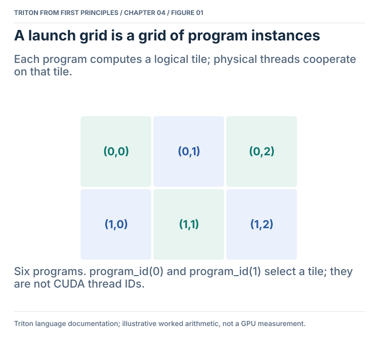

# Chapter 4: The Triton Programming Model

[](../images/ch04/01-concept.svg)

> "CUDA hands you one soldier and asks you to figure out the army. Triton hands you the platoon directly, already organized, and asks a different question: given that every program you write already thinks in whole blocks of data at once, what exactly did you stop having to write by hand?"

**What you will understand by the end of this chapter:**

- Why Triton has no `thread_idx` anywhere in its language, and what that means about the level Triton's programming model actually operates at compared to raw CUDA or Mojo's GPU kernels
- That the formula this book has used since Chapter 1 — `offsets = pid * BLOCK + tl.arange(0, BLOCK)` — *is* the GPU thread-hierarchy identity formula, computed for a whole block of virtual workers in one line instead of separately by each of them
- How PyTorch mediates the host/device split that Mojo's Chapter 4 covers explicitly with manual allocation and copy calls — and why `triton.cdiv` reproduces, number for number, the exact ceiling-division launch-configuration example Mojo's Chapter 4 hand-traces
- Which parts of a GPU's memory hierarchy (global, shared, per-thread/register) a Triton kernel author can see and name directly, and which ones Triton's compiler manages invisibly, with no equivalent of CUDA's explicit `__shared__` declaration
- How a granularity shift — from "one thread computes one output element" to "one program computes one block's worth of output" — changes what a kernel author has to write by hand for something as ordinary as a single dot product

**What you need to know first:**

- Chapter 1, Section 1.1 (the two-phase compile model) and Section 1.4 (block-shaped values) — this chapter names the hardware reality those sections were already relying on
- Chapter 3 (strides, pointer arithmetic, 2D broadcasting) — this chapter's worked examples build directly on `tl.arange` and the `[:, None]`/`[None, :]` broadcasting pattern introduced there

## 4.1 The Program Hierarchy: Grid and Program, Not Grid/Block/Thread `[FOUNDATIONAL]`

### Intuition

Mojo's Chapter 4 organizes a GPU kernel launch the way an army is organized: a grid of blocks, each block a platoon of up to 1024 individual soldiers, each soldier tracking their own seat number. Triton skips the soldier entirely. A Triton **program** — one entry in the launch grid, identified by `tl.program_id` — is handed straight to you as an already-organized platoon: everything inside it operates on a whole block of data simultaneously, through the same `tl.arange`-built vector this book has used in every kernel since Chapter 1. There is no `thread_idx` to query, because there is no single-soldier view of the world anywhere in the language.

### Background

| | Mojo / raw CUDA | Triton |
|---|---|---|
| Smallest addressable unit of work you write code for | One thread | One program, operating on a whole `BLOCK`-shaped tile |
| Identifies "which chunk of work is this" | `block_idx` (which block) + `thread_idx` (which seat within it) | `tl.program_id(axis)` alone — one integer per program |
| Formula mapping identity to data | `global_id = block_idx * block_dim + thread_idx`, computed once per thread | `offsets = pid * BLOCK + tl.arange(0, BLOCK)`, computed once per **program**, for its *entire* block at once |
| How many "workers" one launched unit corresponds to | Exactly 1 (one thread) | `BLOCK` of them, handled as one vectorized computation — the actual hardware threads cooperating underneath are chosen by `num_warps` (Chapter 2), not written in source |

Mojo's `global_id = block_idx * block_dim + thread_idx` and Triton's `offsets = pid * BLOCK + tl.arange(0, BLOCK)` are the identical formula, computed at a different grain: Mojo's version runs once per individual thread, each thread contributing its own single `global_id`; Triton's version runs once per program, and produces an entire block's worth of "which elements are mine" answers as one `BLOCK`-shaped vector in a single line.

### Worked Example 4.1.1 — Reproducing Mojo's exact 4×8 example, one program at a time

```python
@triton.jit
def global_id_kernel(out_ptr, BLOCK: tl.constexpr):
    pid = tl.program_id(0)
    offsets = pid * BLOCK + tl.arange(0, BLOCK)
    tl.store(out_ptr + offsets, offsets)
```

Launched with a grid of 4 programs and `BLOCK=8` — deliberately the same `4 blocks × 8` shape Mojo's Chapter 4, Section 4.1 hand-traces for its own 32-thread example. Genuinely captured:

```
all global ids: [0, 1, 2, 3, 4, 5, 6, 7, 8, 9, 10, 11, 12, 13, 14, 15, 16, 17, 18, 19, 20, 21, 22, 23, 24, 25, 26, 27, 28, 29, 30, 31]
program 2's slice (expect 16..23): [16, 17, 18, 19, 20, 21, 22, 23]
```

Program 2 owns global IDs `16` through `23` — the exact same range Mojo's Chapter 4 computes by hand for "block 2" in its own identical 4×8 configuration (`block_idx=2` → global IDs `16..23`). The two books are computing the same partition of `0..31` into 4 groups of 8; Mojo's version required tracing 32 separate `(block_idx, thread_idx)` pairs to see it, and this one line of Triton code produced all 32 answers in 4 calls, one per program.

### ASCII Diagram — 4 programs, each computing its own 8-wide slice in one step

```
Program 0:  offsets = 0*8 + [0,1,2,3,4,5,6,7]  = [ 0  1  2  3  4  5  6  7]
Program 1:  offsets = 1*8 + [0,1,2,3,4,5,6,7]  = [ 8  9 10 11 12 13 14 15]
Program 2:  offsets = 2*8 + [0,1,2,3,4,5,6,7]  = [16 17 18 19 20 21 22 23]  <- one line, 8 answers at once
Program 3:  offsets = 3*8 + [0,1,2,3,4,5,6,7]  = [24 25 26 27 28 29 30 31]
```

> `[COMMON TRAP]` It's tempting to read `tl.program_id(0)` as Triton's version of `thread_idx` and expect it to reset within some larger grouping the way `thread_idx` resets at every block boundary in Mojo's model. It doesn't — there is no larger grouping above "program" in Triton's own vocabulary that a kernel author writes code against. `tl.program_id(0)` is unique across the *entire* grid on its axis, from `0` to however many programs were launched on that axis, with no analogue of Mojo's "which platoon, which seat within it" two-level naming. The two-level structure didn't disappear; it moved entirely inside `tl.arange(0, BLOCK)`, which is doing the job Mojo's `thread_idx` did, for a whole block at once, invisibly.

## 4.2 Host and Device, Mediated by PyTorch `[FOUNDATIONAL]`

### Intuition

Mojo's Chapter 4 casts the CPU as a foreman who allocates memory, copies data to the GPU, launches the kernel, and copies the result back — every one of those steps written out explicitly. In a Triton program, PyTorch plays the foreman, and most of those explicit steps disappear into ordinary tensor operations: `torch.empty(..., device="cuda")` allocates device memory without a separate copy call, a tensor already on the GPU stays there across kernel launches with no explicit transfer, and `kernel[grid](tensor_a, tensor_b, ...)` hands raw pointers to the kernel directly from Python. The foreman still exists — it's just PyTorch's runtime doing the job rather than hand-written host code.

### Background

`triton.cdiv(n, BLOCK)` — ceiling division — answers exactly the question Mojo's Chapter 4 answers by hand for its vector-add example: how many blocks of size `BLOCK` does it take to cover `n` elements, rounding up so that no element is left uncovered, at the cost of the last block having some idle workers.

| | Mojo Chapter 4's vector-add launch | Triton |
|---|---|---|
| Elements to cover | 1000 | 1000 (same example, deliberately) |
| Threads/lanes per block | 256 | `BLOCK=256` |
| Number of blocks/programs needed | `⌈1000/256⌉ = 4`, computed by hand | `triton.cdiv(1000, 256) = 4` |
| Total workers actually launched | `4 × 256 = 1024` | `4 × 256 = 1024` |
| Idle workers, protected by a bounds check | `24` (`1024 - 1000`) | `24` (`1024 - 1000`), protected by `mask = offsets < n` |

### Worked Example 4.2.1 — The identical 1000-element example, genuinely run

```python
n, BLOCK = 1000, 256
grid = (triton.cdiv(n, BLOCK),)
```

Genuinely captured:

```
triton.cdiv(1000, 256) = 4 -> grid = (4,)
correct? True
total thread-slots launched: 4 programs x 256 = 1024, needed: 1000, idle (masked off): 24
```

Every number matches Mojo's Chapter 4, Section 4.2 hand trace exactly: 4 blocks, 1024 total workers launched, 24 sitting idle behind a bounds check that never lets them touch memory outside the real 1000-element array. `triton.cdiv` is not new arithmetic — it is the same `⌈n/BLOCK⌉` computation Mojo's example performs by hand, wrapped in a one-line helper because it's needed on nearly every kernel launch in this book from here on.

> `[COMMON TRAP]` Writing `grid = (n // BLOCK,)` instead of `triton.cdiv(n, BLOCK)` is an easy substitution to make, since `triton.cdiv` is "only" ceiling division — but plain `//` *truncates*, and for `n=1000, BLOCK=256`, `1000 // 256 = 3`, one block short of the `4` actually needed. That missing 4th block would leave global IDs `768` through `999` — 232 real elements — never launched at all, silently producing an output tensor whose last 232 entries are whatever uninitialized memory `torch.empty` happened to hand back, with no error anywhere pointing at the off-by-one grid size that caused it.

## 4.3 The Memory Hierarchy: What's Visible, and What Triton Manages For You `[FOUNDATIONAL]`

### Intuition

Mojo's Chapter 4 extends Chapter 1's hotel-room picture across a city: global memory is a shared public warehouse, shared memory is a supply closet built into one platoon's own barracks, and local memory is the single backpack strapped to one soldier's back. All three tiers genuinely exist on the hardware underneath a Triton kernel too — but only one of them, global memory, is something a Triton kernel author explicitly names and manages. The supply closet is still there; Triton's compiler just decides on its own when to use it, and never asks you to declare it.

### Background

| | Global memory | Shared memory | Register / local memory |
|---|---|---|---|
| Visible to | Every program in the grid | Threads cooperating within one program's block (raw CUDA/Mojo: within one *block*) | One thread's own computation |
| Who declares it in Mojo/CUDA | The host, via allocation | The kernel author, explicitly (`__shared__`, or Mojo's equivalent) | Implicitly, for any ordinary local variable |
| Who declares it in Triton | The host, via `torch.empty(..., device="cuda")` — a kernel only ever receives a pointer to it | **Nobody, explicitly** — the compiler decides when a value benefits from staying on-chip between operations like `tl.load`, `tl.dot`, and a reduction, and stages it there on its own | Nobody — an ordinary Python variable inside a kernel body (`x = tl.load(...)`) lives here for as long as the program needs it |
| A kernel author's actual point of control | Which pointer and strides to pass in (Chapter 3) | `num_warps`, `num_stages` (Chapter 2's `Config`), and block size choices — indirect knobs, not explicit placement | None needed — this is exactly as automatic as Mojo's own local-variable stack slots |

### Worked Example 4.3.1 — Where Section 4.2's vector-add data actually lives, and what doesn't need to be said

`a`, `b`, and `out` in Section 4.2's kernel are all global memory — real GPU DRAM, allocated by PyTorch before the kernel ever launched, visible to every one of the 4 programs. `x = tl.load(a_ptr + offsets, mask=mask)` inside the kernel body pulls a `BLOCK`-shaped slice of that global memory into registers — the fastest tier, Mojo's "backpack" — for the duration of this one program's execution, and nothing in the kernel's source ever says the word "register" to make that happen. Chapter 11 (Shared Memory, Register Pressure, and the Kernel Cache) returns to this precise boundary — what actually lives in registers versus what the compiler chooses to stage through shared memory, and why a kernel author's block-size choices influence that decision indirectly even without ever writing to shared memory by name.

> `[COMMON TRAP]` Coming from raw CUDA or Mojo's explicit `__shared__`-style GPU code, it's natural to look for the equivalent declaration in Triton and, finding none, either assume Triton kernels never use shared memory at all, or hunt for a way to force a value into it manually the way CUDA requires. Neither is right: Triton kernels use shared memory constantly — the moment Part 2's matmul kernel loads tiles for `tl.dot`, staging through shared memory is exactly how the hardware achieves the reuse that makes tiling fast — but the *decision* of what goes there and when belongs to the compiler, driven by the shape of your `tl.load`/`tl.dot` calls and your `num_stages` choice, not to an explicit keyword you write.

## 4.4 One Program, One Row: A Naive Matmul and Where Real Cooperation Hides `[FOUNDATIONAL]`

### Intuition

Mojo's Chapter 4 closes with the simplest possible correct matrix multiply: one thread per output cell, each running its own small loop summing `A`'s row against `B`'s column, with every thread reading straight from global memory and no thread ever needing to know another thread exists. Triton's version of "the simplest possible correct matmul" shifts up one level of granularity: instead of one program per output *cell*, this section uses one program per output *row* — and instead of a hand-written loop over `k`, the whole row-times-matrix reduction happens through `tl.load` plus `tl.sum`, block-vectorized, with the underlying thread cooperation Mojo's version leaves entirely to the programmer hidden inside those two calls.

### Background

| | Mojo Chapter 4's naive matmul | This chapter's naive matmul |
|---|---|---|
| Granularity | One thread, one output cell `(row, col)` | One program, one full output row |
| How the dot product is computed | An explicit `for k in range(K):` loop, written by hand, one multiply-add at a time | `tl.sum(a_row[:, None] * b_tile, axis=0)` — one block-vectorized reduction |
| Where thread cooperation is written | Nowhere yet — Mojo's Chapter 9 adds shared-memory tiling later | Nowhere here either — but for a different reason: it's already hidden inside `tl.sum`, compiled to real intra-block cooperation (warp shuffles, on real hardware) the kernel author never writes |
| What's identical between the two | The actual arithmetic: same numbers, same order of operations conceptually — sum of elementwise products | (same) |

### Worked Example 4.4.1 — The exact 2×2 case from Mojo's Chapter 4, one program per row

```python
@triton.jit
def naive_matmul_row_kernel(a_ptr, b_ptr, c_ptr, M, N, K,
                             stride_am, stride_ak, stride_bk, stride_bn, stride_cm,
                             BLOCK_N: tl.constexpr, BLOCK_K: tl.constexpr):
    row = tl.program_id(0)
    n_offsets = tl.arange(0, BLOCK_N)
    k_offsets = tl.arange(0, BLOCK_K)
    a_row = tl.load(a_ptr + row * stride_am + k_offsets * stride_ak, mask=k_offsets < K, other=0.0)
    b_tile = tl.load(b_ptr + k_offsets[:, None] * stride_bk + n_offsets[None, :] * stride_bn,
                      mask=(k_offsets[:, None] < K) & (n_offsets[None, :] < N), other=0.0)
    acc = tl.sum(a_row[:, None] * b_tile, axis=0)
    tl.store(c_ptr + row * stride_cm + n_offsets, acc, mask=n_offsets < N)
```

With `A = [[1,2],[3,4]]`, `B = [[5,6],[7,8]]` — Mojo Chapter 4's own `2×2` example — program `row=0` loads `a_row = [1, 2]` and the full `b_tile = [[5,6],[7,8]]`, computes `a_row[:, None] * b_tile = [[1*5, 1*6], [2*7, 2*8]] = [[5,6],[14,16]]`, and sums along `axis=0` to get `[5+14, 6+16] = [19, 22]` — Mojo's `Thread(0,0)=19` and `Thread(0,1)=22`, produced together, in one program, by one reduction, instead of two separate threads each running their own 2-term loop. Genuinely captured:

```
C (Triton):
 tensor([[19., 22.],
        [43., 50.]])
C (torch @):
 tensor([[19., 22.],
        [43., 50.]])
match? True
```

Every entry matches both Mojo's hand-traced `[[19,22],[43,50]]` and PyTorch's own `A @ B`.

### ASCII Diagram — one program's reduction replaces two threads' separate loops

```
Mojo (2 threads for row 0):                 This chapter (1 program for row 0):
 Thread(0,0): 1*5+2*7=19                     a_row=[1,2], b_tile=[[5,6],[7,8]]
 Thread(0,1): 1*6+2*8=22                     a_row[:,None]*b_tile = [[5,6],[14,16]]
 (two separate loops,                        tl.sum(axis=0) = [19, 22]
  two separate threads)                      (one program, one vectorized reduction,
                                               both outputs together)
```

> `[COMMON TRAP]` `tl.sum(a_row[:, None] * b_tile, axis=0)` looks like ordinary array arithmetic, and it's tempting to assume it costs whatever a NumPy-style reduction on the CPU would cost — some sequential work, however it's implemented. On real GPU hardware it does not run as a sequential accumulation at all: threads within the compiled kernel cooperate through warp-level shuffle instructions and, for larger reductions, shared memory, to sum in a logarithmic number of steps rather than a linear one — genuine parallel hardware cooperation, exactly the kind of coordination Mojo's naive per-thread loop doesn't yet have and its Chapter 9 has to add by hand. `tl.sum` isn't a shortcut around that cooperation; it's Triton generating that same cooperation for you, which is precisely why this section never had to write a single word about synchronizing threads.

## 4.5 Complete Runnable Code

Sections 4.1–4.4 walked through this chapter's ideas as isolated snippets. The files below are the complete, run-in-order source; `03_standalone_complete.py` combines everything, and its output is reproduced in full afterward. All were run with `TRITON_INTERPRET=1`, per Chapter 1's opening note.

### File: `01_program_hierarchy_and_grid.py` — Sections 4.1 and 4.2

[Download the complete current reference](../examples/references/part0/04-triton-programming-model/01_program_hierarchy_and_grid.py) (interpreter mode; GPU portability is not established).

**Execution:** `TRITON_INTERPRET=1 python3 01_program_hierarchy_and_grid.py`

```python
import torch
import triton
import triton.language as tl


@triton.jit
def global_id_kernel(out_ptr, BLOCK: tl.constexpr):
    pid = tl.program_id(0)
    offsets = pid * BLOCK + tl.arange(0, BLOCK)
    tl.store(out_ptr + offsets, offsets)


@triton.jit
def add_kernel(a_ptr, b_ptr, out_ptr, n, BLOCK: tl.constexpr):
    pid = tl.program_id(0)
    offsets = pid * BLOCK + tl.arange(0, BLOCK)
    mask = offsets < n
    a = tl.load(a_ptr + offsets, mask=mask)
    b = tl.load(b_ptr + offsets, mask=mask)
    tl.store(out_ptr + offsets, a + b, mask=mask)


def demo_program_hierarchy():
    print("=== Section 4.1: grid of 4 programs, BLOCK=8 ===")
    out = torch.empty(32, dtype=torch.int32)
    global_id_kernel[(4,)](out, BLOCK=8)
    print("all global ids:", out.tolist())
    print("program 2's slice (expect 16..23):", out[16:24].tolist())


def demo_ceiling_division_grid():
    print("\n=== Section 4.2: ceiling-division grid, 1000 elements, BLOCK=256 ===")
    n, BLOCK = 1000, 256
    grid = (triton.cdiv(n, BLOCK),)
    print("triton.cdiv(1000, 256) =", triton.cdiv(n, BLOCK), "-> grid =", grid)
    a = torch.arange(n, dtype=torch.float32)
    b = torch.arange(n, dtype=torch.float32) * 2
    out = torch.empty(n, dtype=torch.float32)
    add_kernel[grid](a, b, out, n, BLOCK=BLOCK)
    print("correct?", torch.equal(out, a + b))
    total = grid[0] * BLOCK
    print(f"total thread-slots launched: {grid[0]} programs x {BLOCK} = {total}, "
          f"needed: {n}, idle (masked off): {total - n}")


if __name__ == "__main__":
    demo_program_hierarchy()
    demo_ceiling_division_grid()
```

### File: `02_naive_matmul_one_row.py` — Section 4.4

[Download the complete current reference](../examples/references/part0/04-triton-programming-model/02_naive_matmul_one_row.py) (interpreter mode; GPU portability is not established).

**Execution:** `TRITON_INTERPRET=1 python3 02_naive_matmul_one_row.py`

```python
import torch
import triton
import triton.language as tl


@triton.jit
def naive_matmul_row_kernel(a_ptr, b_ptr, c_ptr, M, N, K,
                             stride_am, stride_ak, stride_bk, stride_bn, stride_cm,
                             BLOCK_N: tl.constexpr, BLOCK_K: tl.constexpr):
    row = tl.program_id(0)
    n_offsets = tl.arange(0, BLOCK_N)
    k_offsets = tl.arange(0, BLOCK_K)
    n_mask = n_offsets < N
    k_mask = k_offsets < K

    a_row = tl.load(a_ptr + row * stride_am + k_offsets * stride_ak, mask=k_mask, other=0.0)
    b_tile = tl.load(
        b_ptr + k_offsets[:, None] * stride_bk + n_offsets[None, :] * stride_bn,
        mask=(k_mask[:, None] & n_mask[None, :]), other=0.0,
    )
    acc = tl.sum(a_row[:, None] * b_tile, axis=0)
    tl.store(c_ptr + row * stride_cm + n_offsets, acc, mask=n_mask)


def demo_naive_matmul():
    print("=== Section 4.4: naive matmul, one program per output row ===")
    A = torch.tensor([[1.0, 2.0], [3.0, 4.0]])
    B = torch.tensor([[5.0, 6.0], [7.0, 8.0]])
    M, K = A.shape
    _, N = B.shape
    C = torch.empty(M, N)
    naive_matmul_row_kernel[(M,)](
        A, B, C, M, N, K,
        A.stride(0), A.stride(1), B.stride(0), B.stride(1), C.stride(0),
        BLOCK_N=2, BLOCK_K=2,
    )
    print("C (Triton):\n", C)
    print("C (torch @):\n", A @ B)
    print("match?", torch.equal(C, A @ B))


if __name__ == "__main__":
    demo_naive_matmul()
```

### File: `03_standalone_complete.py` — the full chapter, one program

[Download the complete current reference](../examples/references/part0/04-triton-programming-model/03_standalone_complete.py) (interpreter mode; GPU portability is not established).

**Execution:** `TRITON_INTERPRET=1 python3 03_standalone_complete.py`

```python
import torch
import triton
import triton.language as tl


@triton.jit
def global_id_kernel(out_ptr, BLOCK: tl.constexpr):
    pid = tl.program_id(0)
    offsets = pid * BLOCK + tl.arange(0, BLOCK)
    tl.store(out_ptr + offsets, offsets)


@triton.jit
def add_kernel(a_ptr, b_ptr, out_ptr, n, BLOCK: tl.constexpr):
    pid = tl.program_id(0)
    offsets = pid * BLOCK + tl.arange(0, BLOCK)
    mask = offsets < n
    a = tl.load(a_ptr + offsets, mask=mask)
    b = tl.load(b_ptr + offsets, mask=mask)
    tl.store(out_ptr + offsets, a + b, mask=mask)


@triton.jit
def naive_matmul_row_kernel(a_ptr, b_ptr, c_ptr, M, N, K,
                             stride_am, stride_ak, stride_bk, stride_bn, stride_cm,
                             BLOCK_N: tl.constexpr, BLOCK_K: tl.constexpr):
    row = tl.program_id(0)
    n_offsets = tl.arange(0, BLOCK_N)
    k_offsets = tl.arange(0, BLOCK_K)
    n_mask = n_offsets < N
    k_mask = k_offsets < K
    a_row = tl.load(a_ptr + row * stride_am + k_offsets * stride_ak, mask=k_mask, other=0.0)
    b_tile = tl.load(
        b_ptr + k_offsets[:, None] * stride_bk + n_offsets[None, :] * stride_bn,
        mask=(k_mask[:, None] & n_mask[None, :]), other=0.0,
    )
    acc = tl.sum(a_row[:, None] * b_tile, axis=0)
    tl.store(c_ptr + row * stride_cm + n_offsets, acc, mask=n_mask)


def main():
    print("=== Section 4.1: grid of 4 programs, BLOCK=8 ===")
    out = torch.empty(32, dtype=torch.int32)
    global_id_kernel[(4,)](out, BLOCK=8)
    print("all global ids:", out.tolist())
    print("program 2's slice (expect 16..23):", out[16:24].tolist())

    print("\n=== Section 4.2: ceiling-division grid, 1000 elements, BLOCK=256 ===")
    n, BLOCK = 1000, 256
    grid = (triton.cdiv(n, BLOCK),)
    print("triton.cdiv(1000, 256) =", triton.cdiv(n, BLOCK), "-> grid =", grid)
    a = torch.arange(n, dtype=torch.float32)
    b = torch.arange(n, dtype=torch.float32) * 2
    out2 = torch.empty(n, dtype=torch.float32)
    add_kernel[grid](a, b, out2, n, BLOCK=BLOCK)
    print("correct?", torch.equal(out2, a + b))
    total = grid[0] * BLOCK
    print(f"total thread-slots launched: {grid[0]} programs x {BLOCK} = {total}, "
          f"needed: {n}, idle (masked off): {total - n}")

    print("\n=== Section 4.4: naive matmul, one program per output row ===")
    A = torch.tensor([[1.0, 2.0], [3.0, 4.0]])
    B = torch.tensor([[5.0, 6.0], [7.0, 8.0]])
    M, K = A.shape
    _, N = B.shape
    C = torch.empty(M, N)
    naive_matmul_row_kernel[(M,)](
        A, B, C, M, N, K,
        A.stride(0), A.stride(1), B.stride(0), B.stride(1), C.stride(0),
        BLOCK_N=2, BLOCK_K=2,
    )
    print("C (Triton):\n", C)
    print("C (torch @):\n", A @ B)
    print("match?", torch.equal(C, A @ B))


if __name__ == "__main__":
    main()
```

### Expected Output for `03_standalone_complete.py`

```
=== Section 4.1: grid of 4 programs, BLOCK=8 ===
all global ids: [0, 1, 2, 3, 4, 5, 6, 7, 8, 9, 10, 11, 12, 13, 14, 15, 16, 17, 18, 19, 20, 21, 22, 23, 24, 25, 26, 27, 28, 29, 30, 31]
program 2's slice (expect 16..23): [16, 17, 18, 19, 20, 21, 22, 23]

=== Section 4.2: ceiling-division grid, 1000 elements, BLOCK=256 ===
triton.cdiv(1000, 256) = 4 -> grid = (4,)
correct? True
total thread-slots launched: 4 programs x 256 = 1024, needed: 1000, idle (masked off): 24

=== Section 4.4: naive matmul, one program per output row ===
C (Triton):
 tensor([[19., 22.],
        [43., 50.]])
C (torch @):
 tensor([[19., 22.],
        [43., 50.]])
match? True
```

Every number here traces back to a hand-check earlier in this chapter, and two of these blocks — the 32-element global-ID partition and the `[[19,22],[43,50]]` matmul result — are the exact same numbers Mojo's Chapter 4 computes for its own, differently-grained version of the identical problem.

## Chapter Summary

Triton's programming model operates one level of abstraction above raw CUDA or Mojo's GPU kernels: there is no `thread_idx`, because there is no per-thread view of the world in the language at all — `tl.program_id` identifies one program, and `tl.arange` produces that program's entire block of work in one step, doing in a single line what Mojo's Chapter 4 does once per individual thread. The host/device split Mojo covers with explicit allocation and copy calls is, in Triton's world, mediated by PyTorch — tensors already carry their device placement, and `triton.cdiv` reproduces Mojo's own ceiling-division launch-configuration arithmetic exactly, down to the same 4-blocks/1024-slots/24-idle numbers for the same 1000-element example. The memory hierarchy underneath is identical hardware — global, shared, and register memory all genuinely exist — but only global memory (via pointers and strides) is something a Triton kernel author names directly; shared memory is staged by the compiler's own decisions, not by an explicit keyword. And the granularity shift from "one thread, one output cell" to "one program, one block of output" is exactly why Section 4.4's matmul needed no explicit thread-cooperation code at all: `tl.sum` is Triton generating that cooperation on your behalf, in the same place Mojo's naive version leaves it for a later chapter to add by hand.

## Self-Check Questions

1. Mojo's Chapter 4 computes a "block 2, thread 5" global ID by hand as a single number. What is the closest Triton equivalent of that same computation, and why does Triton's version produce more than one answer at once even though it's "doing the same thing"?
2. A kernel is launched with `grid = (n // BLOCK,)` instead of `grid = (triton.cdiv(n, BLOCK),)`, for `n=1000, BLOCK=256`. What is the actual grid size in each case, and what specifically goes wrong with the first one?
3. Section 4.3's table lists global memory as something a Triton kernel author explicitly manages, and shared memory as something the compiler manages instead. What, concretely, does "explicitly manage" mean for global memory in a Triton kernel, given that there's no `cudaMalloc`-style call anywhere in the kernel's own source?
4. `tl.sum(a_row[:, None] * b_tile, axis=0)` computes a full row of a naive matmul's output in one call. What did Mojo's Chapter 4 naive matmul require the programmer to write instead, to get the same numeric result?
5. Why is there no version of Mojo's "thread 5 in block 0 vs. thread 5 in block 2 are different workers" trap for `tl.program_id` in Triton?

## Where We Go Next

Every worked example in this chapter has used a pointer straight to a `torch.Tensor`'s underlying storage, with strides read either from the tensor itself (Chapter 3) or hardcoded to match a specific test case. Part 1 turns to the other side of that relationship: what a Triton kernel is actually allowed to assume about the tensor a caller hands it, how PyTorch's own tensor object relates to the raw pointer a kernel receives, and what it means to say a kernel "consumes" a tensor rather than owning one — the pointer-and-stride contract this book's whole Part 1 is built around, starting with Chapter 6.

## Worked Solutions

**1.** The closest Triton equivalent is `offsets = pid * BLOCK + tl.arange(0, BLOCK)`, evaluated once for `pid=2, BLOCK=8` — which produces `[16, 17, 18, 19, 20, 21, 22, 23]`, the entry at index 5 of which (`21`) is exactly Mojo's "block 2, thread 5 → global ID 21." Triton's version produces 8 answers at once, not 1, because Triton has no per-thread granularity to compute a single answer *at* — `tl.arange` always produces the whole block's worth of offsets in one step, and Mojo's single "thread 5" answer is just one entry sitting inside that same 8-wide vector, never computed on its own.

**2.** `n // BLOCK` (integer floor division) gives `1000 // 256 = 3`, while `triton.cdiv(1000, 256) = 4`. With a grid size of 3, only `3 × 256 = 768` global IDs (`0` through `767`) are ever launched — elements `768` through `999`, 232 real elements, are never touched by any program at all, and the corresponding entries in the output tensor are left as whatever uninitialized memory `torch.empty` originally allocated, with no error or warning pointing at the undersized grid.

**3.** "Explicitly manage" means the kernel author decides, on the host side in ordinary Python, what gets allocated (`torch.empty(..., device="cuda")`), what pointer and strides get passed into the kernel launch, and which values end up in which tensor arguments — the kernel body itself only ever receives an address and reads/writes through it. There's no `cudaMalloc`-style call inside the *kernel* because that call already happened on the host, in PyTorch, before the kernel was ever launched — the "explicit management" is the host-side allocation and argument-passing decisions, not anything written inside `@triton.jit`.

**4.** Mojo's Chapter 4 naive matmul requires an explicit `for k in range(K):` loop inside each of the `M × N` per-thread computations, manually accumulating `A[row][k] * B[k][col]` one term at a time for every single output cell separately. `tl.sum(a_row[:, None] * b_tile, axis=0)` replaces that entire per-cell loop with one block-vectorized reduction that produces an entire output row's worth of dot products together, in one call, with the underlying summation-order cooperation handled by the compiler rather than written out as an explicit loop.

**5.** Mojo's trap exists because `thread_idx` genuinely resets to `0` at the start of every block, so the same-looking name ("thread 5") refers to a different worker depending on which block it's read in — the ambiguity comes from a two-level naming scheme where only the combination of both levels is unique. `tl.program_id(axis)` has no second level to reset against: it is a single, flat identifier, unique across the entire grid on that axis from the moment a kernel launches to the moment it finishes, so there is no equivalent pair of "same number, different worker" values for it to be confused with.
