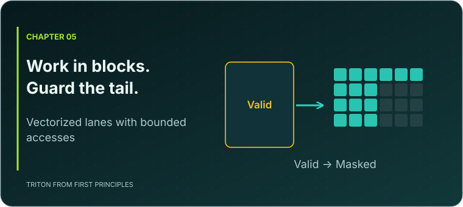
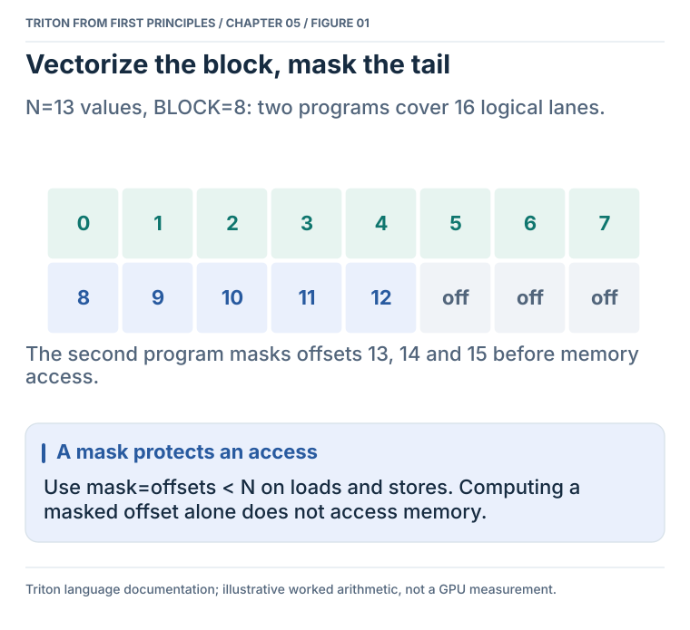

# Chapter 5: Block-Level Vectorization and the SPMD Model

[](../images/chapter-openers/05.svg)

[](../images/ch05/01-concept.svg)

> "SIMD and SPMD look like near-anagrams because they're describing the same instinct — do many things at once — at two different scales. Confuse which scale you're actually operating at, and you'll reach for a remainder loop Triton never needed, or assume two programs are running in lockstep when they were never promised to be."

**What you will understand by the end of this chapter:**

- Why `tl.arange(0, BLOCK)` requires `BLOCK` to be a power of two, for a reason that's related to Mojo's legal-SIMD-width rule but not identical to it
- **SIMD** (one instruction, many data lanes, in lockstep, inside one execution unit) versus **SPMD** (the same program, run independently many times, with no lockstep guarantee between runs) — the actual difference the acronyms are pointing at, and where each one is genuinely happening inside a single Triton kernel launch
- Why Triton's masking eliminates the separate "remainder loop" Mojo's vectorized-loop shape always needs — one masked pass handles every size, not a main loop plus a scalar tail
- The accumulate-wide, reduce-narrow reduction pattern, traced through a genuine grid of fixed tiles that sums 1000 elements in 8 chunks of 128 before ever collapsing to one number
- How assigning one program per output tile — rather than one thread per output element (Chapter 4) or one instruction per data lane (this chapter's SIMD side) — is SPMD applied to a concrete problem: transposing a matrix block by block

**What you need to know first:**

- Chapter 1, Section 1.4 (every value in a kernel body is block-shaped) — this chapter is a direct continuation of that lane model, now asking which parts of it are SIMD and which are SPMD
- Chapter 3 (strides and 2D broadcasting) and Chapter 4 (the program hierarchy, `triton.cdiv`) — this chapter's reduction and transpose examples reuse both directly

!!! info "Output provenance and rerun scope"
    Historical output blocks below may be abridged, reformatted or manually illustrated; they are not promised verbatim raw captures. The [execution record](../execution-2026-11-21.md) links untouched rerun logs and explains version/environment differences. Corrected sources marked pending are not validated by older logs.

## 5.1 SIMD vs. SPMD: Two Different Meanings of "Parallel" `[FOUNDATIONAL]`

### Intuition

Four workers stapling in perfect lockstep — same motion, same instant, one shared instruction — is Chapter 1.4's SIMD picture, and it only works because all four sit on one fixed-width assembly line with a fixed number of equally-sized slots. Now picture something different: four separate kitchens, each following the identical recipe card, each cooking on its own schedule with no requirement that they chop their onions at the same moment as any other kitchen. That's SPMD — **Single Program, Multiple Data** — and it's a genuinely different kind of parallelism than SIMD's lockstep lanes, even though both names describe "many things happening at once."

A single Triton kernel launch does *both*, at two different scales, simultaneously. Across **programs** — `tl.program_id(0)=0`, `=1`, `=2`, ... — Triton is SPMD: the identical kernel body runs once per program, on genuinely independent, unsynchronized schedules, exactly like the separate kitchens. *Within* one program's `BLOCK`-shaped values — the `tl.arange(0, BLOCK)` vector every kernel in this book has used since Chapter 1 — the compiler distributes those logical elements over threads and independently scheduled warps; this is not a block-wide lockstep guarantee. A loose analogy is the SIMD/SIMT style Mojo's Chapter 1.4 and Chapter 5 describe for a CPU's vector registers.

### Background

| | SIMD (Mojo `SIMD[dtype, width]`) | SPMD (Triton's grid of programs) |
|---|---|---|
| What's shared across the parallel units | One instruction, issued once, for all lanes | One *program's source code* — each instance fetches and executes it independently |
| Synchronization between units | Logical vector semantics; not a Triton block-wide hardware scheduling guarantee | None guaranteed — one program can finish before another one starts, on real hardware |
| Where it happens in one Triton kernel | *Within* one program, across a `BLOCK`-shaped value | *Across* programs, via `tl.program_id` |
| Legal "width"/count | Powers of two, tied to physical register width (Mojo Chapter 5) | Any grid size at all — a program count isn't a hardware register width |

### Worked Example 5.1.1 — `tl.arange`'s power-of-two requirement, genuinely triggered

```python
@triton.jit
def double_kernel(x_ptr, out_ptr, n, BLOCK: tl.constexpr):
    offsets = tl.arange(0, BLOCK)
    mask = offsets < n
    x = tl.load(x_ptr + offsets, mask=mask, other=0.0)
    tl.store(out_ptr + offsets, x * 2.0, mask=mask)
```

historical illustrated output:

```
BLOCK=7 -> InterpreterError: ValueError("arange's range must be a power of 2")
BLOCK=8 (next power of 2, masked down to n=7): [0.0, 2.0, 4.0, 6.0, 8.0, 10.0, 12.0]
```

`BLOCK` inherits a real power-of-two restriction, and Worked Example 5.1.1 confirms it fires exactly the way Mojo's Chapter 5 predicts for `SIMD` widths — but for a related, not identical, reason. Mojo's restriction traces to a *physical* fact: a fixed-bit-width hardware register only splits evenly at power-of-two lane counts. `tl.arange`'s restriction is enforced by Triton's *compiler*, for its own internal indexing and code-generation reasons, independent of whatever the target GPU's actual warp width happens to be (32, on essentially all current NVIDIA hardware, itself a power of two). The two rules point the same direction — round `BLOCK` up to a power of two — but one is baked into silicon and the other is a compiler-enforced convention; `BLOCK=8` here works whether or not it happens to divide any specific register width evenly, because there's no register being sliced at all, only a compiler that requires it.

### ASCII Diagram — where SIMD and SPMD each operate in one launch

```
grid = (3,)   <- 3 programs, SPMD: independent, no lockstep between them
 Program 0: BLOCK=8 lanes, logical block values; mapped over threads/warps   -----+
 Program 1: BLOCK=8 lanes, logical block values; mapped over threads/warps        |-- SPMD across these 3
 Program 2: BLOCK=8 lanes, logical block values; mapped over threads/warps   -----+

Zoom into Program 1's own 8 lanes:
 lane: 0  1  2  3  4  5  6  7      <- SIMD/SIMT: one instruction, all 8 at once
```

> `[COMMON TRAP]` Mojo's Chapter 5 warns that `a == b` on two `SIMD` vectors produces a lane-wise vector of booleans, not one `Bool` — and Chapter 1, Section 1.4 of this book already showed the identical fact for Triton's block-shaped values (`if mask:` silently doing the wrong thing). It's worth stating the SIMD/SPMD distinction precisely so that trap doesn't get misfiled: that mistake belongs entirely to the *SIMD* side of this section's table — it's about one program's `BLOCK`-shaped lanes disagreeing with each other. It has nothing to do with SPMD, where two different *programs* disagreeing with each other isn't a bug at all; it's the entire point of launching more than one.

## 5.2 One Masked Pass Instead of Two: Why Triton Has No Remainder Loop `[FOUNDATIONAL]`

### Intuition

Mojo's Chapter 5 vectorized-loop shape is two loops glued together: a main loop consuming the data `width` elements at a time for as long as a full `width`-wide chunk remains, then a second, separate scalar loop mopping up whatever's left over — because a fixed-width hardware SIMD instruction has no "partial" mode; it either operates on a full register's worth of lanes or it doesn't run at all. A mask doesn't have that restriction: `mask = offsets < n` is just as happy describing "6 of these 8 lanes are real" as "all 8 are real," so the same single kernel body handles a perfectly-divisible size and a ragged one identically, with no second code path.

### Background

| | Mojo's vectorized-loop shape | Triton's masked kernel |
|---|---|---|
| Handles a size divisible by the width/BLOCK | Main loop only, remainder loop runs zero times | Same kernel, same mask logic, `mask` happens to be all-`True` on the last program |
| Handles a size *not* divisible | Main loop runs `size // width` times, then a **separate scalar loop** runs `size % width` more times | Same kernel, same `BLOCK`, `mask` is partially `False` on the last program — no second loop, no second code path |
| Number of distinct code paths a kernel author writes | 2 (vectorized main + scalar remainder) | 1 |

### Worked Example 5.2.1 — 10 elements, `BLOCK=8`, one kernel, no remainder

```python
n, BLOCK = 10, 8
grid = (triton.cdiv(n, BLOCK),)   # triton.cdiv(10, 8) = 2
```

historical illustrated output:

```
n=10, BLOCK=8, grid=(2,) -> one kernel, no separate remainder kernel
result: [0.0, 2.0, 4.0, 6.0, 8.0, 10.0, 12.0, 14.0, 16.0, 18.0] correct? True
```

Program 0 handles elements `0..7` with `mask` entirely `True` — the "main loop" shape. Program 1 handles elements `8..15`, but `mask = offsets < 10` is `[True, True, False, False, False, False, False, False]` for that program — exactly Mojo's "remainder" case, `10 % 8 = 2` leftover elements — and it's handled by the *exact same compiled kernel body* as program 0, not a second, differently-shaped one. Nothing in this kernel's source distinguishes "the full case" from "the ragged case" at all.

> `[COMMON TRAP]` It's tempting to conclude from this that masking is strictly better than Mojo's two-loop shape in every sense, including performance — it isn't, and this book won't claim it is without measuring it, which Chapter 1's interpreter-only setup can't honestly do. What masking genuinely buys is *source simplicity*: one code path instead of two, for the kernel author to write, read, and get right. Whether a masked lane costs anything at the hardware level compared to a genuinely absent one is a real question with a real, architecture-dependent answer — one Chapter 19 (Benchmarking Correctly) is positioned to actually measure once real hardware is in scope.

## 5.3 Reduction: Accumulate Wide, Reduce Narrow, One Block at a Time `[FOUNDATIONAL]`

### Intuition

Mojo's Chapter 5 draws a sharp line between two ways to sum a long vector with a `width`-wide SIMD register: reduce to a single number after *every* chunk (paying the "collapse many lanes into one" cost repeatedly), versus accumulate into a `width`-wide running total across *all* chunks and reduce to one number only once, at the very end. The second is `width` times less reduction work for the identical answer. Triton's version of this looks almost identical in shape, just with `BLOCK` standing in for `width` and a genuine grid of fixed tiles standing in for Mojo's chunked main loop.

### Background

`tl.zeros((BLOCK,), dtype=tl.float32)` creates a `BLOCK`-wide accumulator — Mojo's "wide" register, in software form. A loop over `NUM_CHUNKS = ⌈n / BLOCK⌉` chunks (the same ceiling-division from Chapter 4) adds each chunk's masked load directly into that wide accumulator, lane-for-lane, without ever collapsing to a scalar mid-loop. Only after every chunk has been folded in does `tl.sum(acc, axis=0)` perform the one reduction this whole computation needed.

### Worked Example 5.3.1 — Summing 1000 elements, 8 wide chunks, one narrow reduction

```python
@triton.jit
def sum_gridstride_kernel(x_ptr, out_ptr, n, BLOCK: tl.constexpr, NUM_CHUNKS: tl.constexpr):
    offsets0 = tl.arange(0, BLOCK)
    acc = tl.zeros((BLOCK,), dtype=tl.float32)
    for c in range(NUM_CHUNKS):
        offsets = c * BLOCK + offsets0
        mask = offsets < n
        acc += tl.load(x_ptr + offsets, mask=mask, other=0.0)
    total = tl.sum(acc, axis=0)
    tl.store(out_ptr, total)
```

For `N=1000, BLOCK=128`: `NUM_CHUNKS = triton.cdiv(1000, 128) = 8`. historical illustrated output:

```
N=1000, BLOCK=128, NUM_CHUNKS=8
triton sum: 499500.0 torch sum: 499500.0
```

`sum(range(1000)) = 999×1000/2 = 499500` by the standard closed-form sum, matching both the Triton kernel and PyTorch's own `.sum()` exactly. Only one `tl.sum` call executes in this entire kernel, no matter how many of the 8 chunks were folded into `acc` first — the "accumulate wide, reduce narrow" saving Mojo's Chapter 5 argues for is structurally present here: 8 wide vector-adds into `acc`, then exactly 1 reduction, rather than 8 separate reductions.

### ASCII Diagram — 8 chunks folded into one 128-wide accumulator, reduced once

```
acc (128 lanes, starts at 0) after each chunk folded in:
  chunk 0 (elems   0..127):  acc += [x0, x1, ..., x127]
  chunk 1 (elems 128..255):  acc += [x128, ..., x255]     <- SAME 128 lanes, accumulating
  ...
  chunk 7 (elems 896..999):  acc += [x896, ..., x999, 0,0,...,0]   <- masked tail, padded with 0

                    only AFTER all 8 folds:
                    total = tl.sum(acc, axis=0)   <- ONE reduction, not 8
```

## 5.4 Many Programs, One Tile Each: SPMD Applied to a Block Transpose `[FOUNDATIONAL]`

### Intuition

Mojo's Chapter 5 nests its vectorized-loop shape inside a matmul's row/column loops and a transpose's row loop — SIMD width reused as a sub-component of a bigger, still fundamentally loop-based structure. Triton's SPMD model answers the same "transpose a matrix" problem completely differently: instead of one core working through nested loops, assign one *program* per output tile, launch all of them at once, and let each program's own `BLOCK_M × BLOCK_N` worth of work be exactly Section 5.1's logical tile, with SPMD covering the *many tiles running independently* layer on top.

### Background

A `(4, 6)` matrix, transposed in `2×2` tiles, needs `⌈4/2⌉ × ⌈6/2⌉ = 2 × 3 = 6` programs — one per tile, addressed with a **2D grid**, `tl.program_id(0)` for the tile row and `tl.program_id(1)` for the tile column. Each program reads its own `2×2` input tile (Chapter 3's broadcasting) and writes it to the corresponding transposed position — rows become columns, columns become rows — with zero coordination between the 6 programs, because each one owns a disjoint region of both the input and the output.

### Worked Example 5.4.1 — A `4×6` transpose, 6 independent programs, genuinely verified

```python
grid_t = (triton.cdiv(M, BLOCK_M), triton.cdiv(N, BLOCK_N))   # (2, 3)
```

historical illustrated output:

```
grid (programs): (2, 3) = 6 programs total
A:
 tensor([[ 0.,  1.,  2.,  3.,  4.,  5.],
        [ 6.,  7.,  8.,  9., 10., 11.],
        [12., 13., 14., 15., 16., 17.],
        [18., 19., 20., 21., 22., 23.]])
Triton transpose:
 tensor([[ 0.,  6., 12., 18.],
        [ 1.,  7., 13., 19.],
        [ 2.,  8., 14., 20.],
        [ 3.,  9., 15., 21.],
        [ 4., 10., 16., 22.],
        [ 5., 11., 17., 23.]])
matches A.t()? True
```

6 programs, each reading one `2×2` corner of `A` and writing it — rows and columns swapped, via `out_ptr + cols[None,:]*stride_om + rows[:,None]*stride_on` deliberately reversing which broadcast axis pairs with which stride — to the matching corner of the output. No program ever reads a byte another program wrote, and the result matches PyTorch's own `A.t()` exactly, confirming the tile-by-tile assembly reproduces the whole transpose correctly with zero inter-program coordination.

> `[COMMON TRAP]` It's easy to assume 6 independent programs implies some risk of a race — two programs stepping on the same memory. There isn't one here, and recognizing *why* not is the actual lesson: each program's `rows`/`cols` are computed from its own, distinct `(pid_m, pid_n)`, so the six programs' read regions in `A` are disjoint and their write regions in `out` are disjoint by construction — SPMD's independence is only actually safe when the *tiling itself* guarantees no overlap, and this section's grid does, deliberately. A tiling scheme where two programs' regions genuinely overlapped would turn this same "no coordination needed" assumption into a real, silent race — a distinction Chapter 11 returns to once shared, not just disjoint, memory enters the picture.

## 5.5 Complete Runnable Code

Sections 5.1–5.4 walked through this chapter's ideas as isolated snippets. The files below are the complete, run-in-order source; `03_standalone_complete.py` combines everything, and its output is reproduced in full afterward. All were run with `TRITON_INTERPRET=1`, per Chapter 1's opening note.

### File: `01_simd_vs_spmd.py` — Sections 5.1 and 5.2

[Download the complete current reference](../examples/references/part0/05-block-vectorization-spmd/01_simd_vs_spmd.py) (interpreter mode; GPU portability is not established).

**Execution:** `TRITON_INTERPRET=1 python3 01_simd_vs_spmd.py`

```python
import torch
import triton
import triton.language as tl


@triton.jit
def double_kernel(x_ptr, out_ptr, n, BLOCK: tl.constexpr):
    offsets = tl.arange(0, BLOCK)
    mask = offsets < n
    x = tl.load(x_ptr + offsets, mask=mask, other=0.0)
    tl.store(out_ptr + offsets, x * 2.0, mask=mask)


@triton.jit
def double_kernel_grid(x_ptr, out_ptr, n, BLOCK: tl.constexpr):
    pid = tl.program_id(0)
    offsets = pid * BLOCK + tl.arange(0, BLOCK)
    mask = offsets < n
    x = tl.load(x_ptr + offsets, mask=mask, other=0.0)
    tl.store(out_ptr + offsets, x * 2.0, mask=mask)


def demo_power_of_two():
    print("=== Section 5.1: BLOCK must be a power of 2 ===")
    x7 = torch.arange(7, dtype=torch.float32)
    out7 = torch.empty(7)
    try:
        double_kernel[(1,)](x7, out7, 7, BLOCK=7)
        print("BLOCK=7 succeeded:", out7.tolist())
    except Exception as e:
        print(f"BLOCK=7 -> {type(e).__name__}: {e}")

    out7b = torch.empty(7)
    double_kernel[(1,)](x7, out7b, 7, BLOCK=8)
    print("BLOCK=8 (next power of 2, masked down to n=7):", out7b.tolist())


def demo_no_remainder_loop():
    print("\n=== Section 5.2: one masked kernel handles the 'remainder' automatically ===")
    n, BLOCK = 10, 8
    grid = (triton.cdiv(n, BLOCK),)
    x10 = torch.arange(10, dtype=torch.float32)
    out10 = torch.empty(10)
    double_kernel_grid[grid](x10, out10, n, BLOCK=BLOCK)
    print(f"n={n}, BLOCK={BLOCK}, grid={grid} -> one kernel, no separate remainder kernel")
    print("result:", out10.tolist(), "correct?", torch.equal(out10, x10 * 2))


if __name__ == "__main__":
    demo_power_of_two()
    demo_no_remainder_loop()
```

### File: `02_reduction_and_transpose.py` — Sections 5.3 and 5.4

[Download the complete current reference](../examples/references/part0/05-block-vectorization-spmd/02_reduction_and_transpose.py) (interpreter mode; GPU portability is not established).

**Execution:** `TRITON_INTERPRET=1 python3 02_reduction_and_transpose.py`

```python
import torch
import triton
import triton.language as tl


@triton.jit
def sum_gridstride_kernel(x_ptr, out_ptr, n, BLOCK: tl.constexpr, NUM_CHUNKS: tl.constexpr):
    offsets0 = tl.arange(0, BLOCK)
    acc = tl.zeros((BLOCK,), dtype=tl.float32)
    for c in range(NUM_CHUNKS):
        offsets = c * BLOCK + offsets0
        mask = offsets < n
        acc += tl.load(x_ptr + offsets, mask=mask, other=0.0)
    total = tl.sum(acc, axis=0)
    tl.store(out_ptr, total)


@triton.jit
def transpose_tile_kernel(x_ptr, out_ptr, M, N,
                           stride_xm, stride_xn, stride_om, stride_on,
                           BLOCK_M: tl.constexpr, BLOCK_N: tl.constexpr):
    pid_m = tl.program_id(0)
    pid_n = tl.program_id(1)
    rows = pid_m * BLOCK_M + tl.arange(0, BLOCK_M)
    cols = pid_n * BLOCK_N + tl.arange(0, BLOCK_N)
    mask = (rows[:, None] < M) & (cols[None, :] < N)
    x_ptrs = x_ptr + rows[:, None] * stride_xm + cols[None, :] * stride_xn
    tile = tl.load(x_ptrs, mask=mask, other=0.0)
    out_ptrs = out_ptr + cols[None, :] * stride_om + rows[:, None] * stride_on
    tl.store(out_ptrs, tile, mask=mask)


def demo_reduction():
    print("=== Section 5.3: accumulate wide, reduce narrow ===")
    N, BLOCK = 1000, 128
    NUM_CHUNKS = triton.cdiv(N, BLOCK)
    xN = torch.arange(N, dtype=torch.float32)
    out_sum = torch.empty(1, dtype=torch.float32)
    sum_gridstride_kernel[(1,)](xN, out_sum, N, BLOCK=BLOCK, NUM_CHUNKS=NUM_CHUNKS)
    print(f"N={N}, BLOCK={BLOCK}, NUM_CHUNKS={NUM_CHUNKS}")
    print("triton sum:", out_sum.item(), "torch sum:", xN.sum().item())


def demo_transpose():
    print("\n=== Section 5.4: SPMD block transpose, one program per tile ===")
    M, N = 4, 6
    BLOCK_M, BLOCK_N = 2, 2
    A = torch.arange(M * N, dtype=torch.float32).reshape(M, N)
    out_t = torch.empty(N, M, dtype=torch.float32)
    grid_t = (triton.cdiv(M, BLOCK_M), triton.cdiv(N, BLOCK_N))
    print("grid (programs):", grid_t, "=", grid_t[0] * grid_t[1], "programs total")
    transpose_tile_kernel[grid_t](
        A, out_t, M, N,
        A.stride(0), A.stride(1), out_t.stride(0), out_t.stride(1),
        BLOCK_M=BLOCK_M, BLOCK_N=BLOCK_N,
    )
    print("matches A.t()?", torch.equal(out_t, A.t()))


if __name__ == "__main__":
    demo_reduction()
    demo_transpose()
```

### File: `03_standalone_complete.py` — the full chapter, one program

[Download the complete current reference](../examples/references/part0/05-block-vectorization-spmd/03_standalone_complete.py) (interpreter mode; GPU portability is not established).

**Execution:** `TRITON_INTERPRET=1 python3 03_standalone_complete.py`

```python
import torch
import triton
import triton.language as tl


@triton.jit
def double_kernel(x_ptr, out_ptr, n, BLOCK: tl.constexpr):
    offsets = tl.arange(0, BLOCK)
    mask = offsets < n
    x = tl.load(x_ptr + offsets, mask=mask, other=0.0)
    tl.store(out_ptr + offsets, x * 2.0, mask=mask)


@triton.jit
def double_kernel_grid(x_ptr, out_ptr, n, BLOCK: tl.constexpr):
    pid = tl.program_id(0)
    offsets = pid * BLOCK + tl.arange(0, BLOCK)
    mask = offsets < n
    x = tl.load(x_ptr + offsets, mask=mask, other=0.0)
    tl.store(out_ptr + offsets, x * 2.0, mask=mask)


@triton.jit
def sum_gridstride_kernel(x_ptr, out_ptr, n, BLOCK: tl.constexpr, NUM_CHUNKS: tl.constexpr):
    offsets0 = tl.arange(0, BLOCK)
    acc = tl.zeros((BLOCK,), dtype=tl.float32)
    for c in range(NUM_CHUNKS):
        offsets = c * BLOCK + offsets0
        mask = offsets < n
        acc += tl.load(x_ptr + offsets, mask=mask, other=0.0)
    total = tl.sum(acc, axis=0)
    tl.store(out_ptr, total)


@triton.jit
def transpose_tile_kernel(x_ptr, out_ptr, M, N,
                           stride_xm, stride_xn, stride_om, stride_on,
                           BLOCK_M: tl.constexpr, BLOCK_N: tl.constexpr):
    pid_m = tl.program_id(0)
    pid_n = tl.program_id(1)
    rows = pid_m * BLOCK_M + tl.arange(0, BLOCK_M)
    cols = pid_n * BLOCK_N + tl.arange(0, BLOCK_N)
    mask = (rows[:, None] < M) & (cols[None, :] < N)
    x_ptrs = x_ptr + rows[:, None] * stride_xm + cols[None, :] * stride_xn
    tile = tl.load(x_ptrs, mask=mask, other=0.0)
    out_ptrs = out_ptr + cols[None, :] * stride_om + rows[:, None] * stride_on
    tl.store(out_ptrs, tile, mask=mask)


def main():
    print("=== Section 5.1: BLOCK must be a power of 2 ===")
    x7 = torch.arange(7, dtype=torch.float32)
    out7 = torch.empty(7)
    try:
        double_kernel[(1,)](x7, out7, 7, BLOCK=7)
        print("BLOCK=7 succeeded:", out7.tolist())
    except Exception as e:
        print(f"BLOCK=7 -> {type(e).__name__}: {e}")
    out7b = torch.empty(7)
    double_kernel[(1,)](x7, out7b, 7, BLOCK=8)
    print("BLOCK=8 (next power of 2, masked down to n=7):", out7b.tolist())

    print("\n=== Section 5.2: one masked kernel handles the 'remainder' automatically ===")
    n, BLOCK = 10, 8
    grid = (triton.cdiv(n, BLOCK),)
    x10 = torch.arange(10, dtype=torch.float32)
    out10 = torch.empty(10)
    double_kernel_grid[grid](x10, out10, n, BLOCK=BLOCK)
    print(f"n={n}, BLOCK={BLOCK}, grid={grid} -> one kernel, no separate remainder kernel")
    print("result:", out10.tolist(), "correct?", torch.equal(out10, x10 * 2))

    print("\n=== Section 5.3: accumulate wide, reduce narrow ===")
    N, BLOCK = 1000, 128
    NUM_CHUNKS = triton.cdiv(N, BLOCK)
    xN = torch.arange(N, dtype=torch.float32)
    out_sum = torch.empty(1, dtype=torch.float32)
    sum_gridstride_kernel[(1,)](xN, out_sum, N, BLOCK=BLOCK, NUM_CHUNKS=NUM_CHUNKS)
    print(f"N={N}, BLOCK={BLOCK}, NUM_CHUNKS={NUM_CHUNKS}")
    print("triton sum:", out_sum.item(), "torch sum:", xN.sum().item())

    print("\n=== Section 5.4: SPMD block transpose, one program per tile ===")
    M, N2 = 4, 6
    BLOCK_M, BLOCK_N = 2, 2
    A = torch.arange(M * N2, dtype=torch.float32).reshape(M, N2)
    out_t = torch.empty(N2, M, dtype=torch.float32)
    grid_t = (triton.cdiv(M, BLOCK_M), triton.cdiv(N2, BLOCK_N))
    print("grid (programs):", grid_t, "=", grid_t[0] * grid_t[1], "programs total")
    transpose_tile_kernel[grid_t](
        A, out_t, M, N2,
        A.stride(0), A.stride(1), out_t.stride(0), out_t.stride(1),
        BLOCK_M=BLOCK_M, BLOCK_N=BLOCK_N,
    )
    print("matches A.t()?", torch.equal(out_t, A.t()))


if __name__ == "__main__":
    main()
```

### Expected Output for `03_standalone_complete.py`

```
=== Section 5.1: BLOCK must be a power of 2 ===
BLOCK=7 -> InterpreterError: ValueError("arange's range must be a power of 2")
BLOCK=8 (next power of 2, masked down to n=7): [0.0, 2.0, 4.0, 6.0, 8.0, 10.0, 12.0]

=== Section 5.2: one masked kernel handles the 'remainder' automatically ===
n=10, BLOCK=8, grid=(2,) -> one kernel, no separate remainder kernel
result: [0.0, 2.0, 4.0, 6.0, 8.0, 10.0, 12.0, 14.0, 16.0, 18.0] correct? True

=== Section 5.3: accumulate wide, reduce narrow ===
N=1000, BLOCK=128, NUM_CHUNKS=8
triton sum: 499500.0 torch sum: 499500.0

=== Section 5.4: SPMD block transpose, one program per tile ===
grid (programs): (2, 3) = 6 programs total
matches A.t()? True
```

## Chapter Summary

SIMD and SPMD are two distinct kinds of "many things at once," and a single Triton kernel launch genuinely contains both: SPMD across the grid's independent programs, no synchronization implied or provided between them, and SIMD/SIMT within one program's `BLOCK`-shaped lanes, with compiler-managed thread/warp mapping. `tl.arange`'s power-of-two requirement echoes Mojo's hardware-register-width rule in shape but not in cause — one is silicon, the other is a compiler convention — and Section 5.1 triggered the real error to prove it's enforced, not just documented. Masking collapses Mojo's two-part vectorized-loop shape (a full-width main loop plus a scalar remainder loop) into one code path that handles any size identically, ragged or not, which Section 5.2 confirmed by running the exact same kernel body across a perfectly-divisible program and a partially-masked one. The accumulate-wide-reduce-narrow reduction pattern carries over with `tl.zeros`/`tl.sum` standing in for Mojo's wide register and final collapse, verified against `1000 × 999 / 2 = 499500` exactly. And Section 5.4's transpose showed SPMD's independence guarantee is only as real as the tiling that backs it — six programs ran with zero coordination specifically because their read and write regions were disjoint by construction, not because SPMD promises safety on its own.

## Self-Check Questions

1. Both Mojo's `SIMD[dtype, width]` and Triton's `BLOCK` in `tl.arange(0, BLOCK)` require power-of-two values. Are these two restrictions enforced for the same underlying reason? If not, what's actually different?
2. A kernel is launched with a 3-program grid. Is it safe to assume program 0 finishes before program 1 starts? Why or why not, and which of this chapter's two kinds of parallelism does the answer come from?
3. Mojo's Chapter 5 vectorized-loop shape always has two parts: a main loop and a remainder loop. Section 5.2's masked Triton kernel handles a ragged size (`n=10, BLOCK=8`) with no such second part. What replaced the remainder loop's job, and where does it live in the kernel's source?
4. In `sum_gridstride_kernel`, `acc` is `BLOCK`-shaped (128 lanes) throughout the entire loop over `NUM_CHUNKS`, and `tl.sum` is called exactly once, after the loop. What would change, numerically, if `tl.sum(acc, axis=0)` were instead called once per chunk, accumulating a running scalar total across chunks — and why does Section 5.3 avoid that structure?
5. Section 5.4's 6 transpose programs run with no coordination between them, and the `[COMMON TRAP]` states this safety isn't automatic. What specific property of the `rows`/`cols` computation, per program, is what actually guarantees no two programs read or write the same memory?

## Where We Go Next

Every kernel since Chapter 1 has consumed a `torch.Tensor` it didn't create and never had to think about where that tensor's memory came from beyond reading its pointer and strides. Part 1 turns to that question directly, starting with Chapter 6: what a Triton kernel is actually handed when it receives a tensor argument, and what "the pointer-and-stride contract" — the phrase this book has been using informally since Chapter 3 — commits a kernel author to, precisely.

## Worked Solutions

**1.** No — they share a shape (both require a power of two) but not a cause. Mojo's `SIMD[dtype, width]` restriction is physical: a fixed-bit-width hardware vector register only splits into equal-sized lanes at power-of-two counts, so a width of 3 or 5 corresponds to no real way of slicing an actual register. `tl.arange`'s restriction is a compiler-level rule in Triton's frontend, enforced (as Worked Example 5.1.1 historical illustrated output) independent of any specific GPU's actual warp width — it would reject `BLOCK=7` even if some hypothetical target hardware could handle a 7-wide operation natively, because the restriction lives in Triton's own indexing and code-generation logic, not in a register Triton is trying to fit `BLOCK` into.

**2.** No, it is not safe to assume any ordering — this is the SPMD side of Section 5.1's table, and SPMD explicitly does not guarantee synchronization between separate program instances. Program 0 and program 1 might run on different streaming multiprocessors at different times, with no ordering promised by the programming model; there is no block-wide lockstep guarantee either: logical vector semantics must not be confused with hardware scheduling.

**3.** The `mask = offsets < n` computation replaced the remainder loop's job, living inline in the exact same kernel body that also handles the "main loop" case — there is no second function, no second code path, and no separate launch for the ragged portion. Program 1 in Worked Example 5.2.1's `n=10, BLOCK=8` case computes `mask = [True, True, False, False, False, False, False, False]`, and that single mask value does the entire job Mojo's separate scalar remainder loop exists to do: correctly handle the 2 real elements and skip the 6 that don't exist, using the identical compiled instructions as every other program in the grid.

**4.** Calling `tl.sum` once per chunk instead of once total would not change the *final numeric answer* — summation is associative in real arithmetic; floating-point addition is not, so adding up 8 partial sums equals summing everything at once, `499500` either way. What changes is the amount of reduction work performed: 8 separate reductions (each collapsing 128 lanes to 1 number) instead of 1, exactly the "reduce after every chunk" pattern Mojo's Chapter 5 contrasts against "reduce once, at the end." Section 5.3 avoids it because folding chunks into a still-wide accumulator and reducing only once is strictly less reduction work for the identical result — the entire motivation behind naming this pattern "accumulate wide, reduce narrow" in the first place.

**5.** Each program computes its own `rows = pid_m * BLOCK_M + tl.arange(0, BLOCK_M)` and `cols = pid_n * BLOCK_N + tl.arange(0, BLOCK_N)` from its *own*, distinct `(pid_m, pid_n)` pair — and because `BLOCK_M` and `BLOCK_N` are fixed, non-overlapping strides between tiles, two different `(pid_m, pid_n)` pairs always produce two disjoint `rows`/`cols` ranges, which in turn address two disjoint regions of both `A` and `out`. The safety comes specifically from the tiling arithmetic guaranteeing no two programs' index ranges ever intersect — not from any promise SPMD itself makes, which, as the trap notes, guarantees nothing about memory safety on its own.
