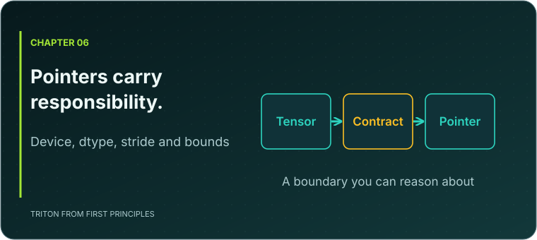
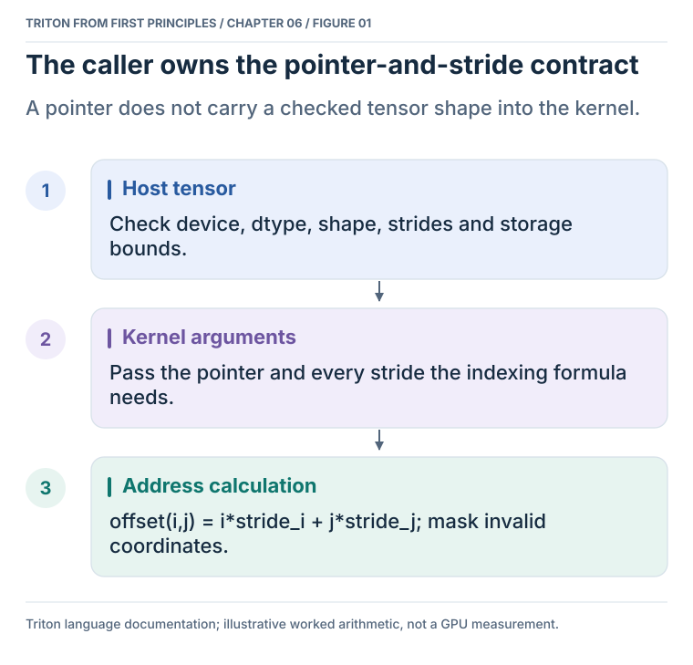

# Chapter 6: The Pointer+Stride Contract

[](../images/chapter-openers/06.svg)

[](../images/ch06/01-concept.svg)

> "A `torch.Tensor` walks up to the kernel boundary carrying a shape, a set of strides, a dtype, and a device. Only one of those four crosses. The other three are a promise you type in by hand, and nothing on the other side checks whether you kept it."

**What you will understand by the end of this chapter:**

- Exactly what a `@triton.jit` kernel receives when you pass it a `torch.Tensor` argument — and why "a raw pointer, nothing else" is not an approximation but the literal truth
- Why shape and stride arguments (`M`, `N`, `stride_row`, `stride_col`, and so on) are ordinary runtime integers you type by hand into a launch call, with no language-level connection to the tensor they describe — and what happens when those integers are wrong
- Why dtype is the one part of this contract Triton actually enforces automatically, triggering a genuinely separate compiled specialization per dtype, and why that enforcement is narrower than it sounds
- Why the Python wrapper function you write around a kernel launch — not any language feature — is the real place where "this pointer, these strides, this dtype" gets assembled back into something that behaves like a tensor
- How to read this chapter's findings against Mojo's `Tensor[dtype]` struct, which bundles exactly these same four pieces of information into a single type-checked object at compile time, and why Triton has no equivalent

**What you need to know first:**

- Chapter 1's two-phase model (a `@triton.jit` kernel is compiled once per distinct combination of argument argument types, constexpr values, target/options and specialization attributes) — this chapter is largely about *which* of a tensor's properties feed into that combination and which don't
- Chapter 4's SPMD programming model (`tl.program_id`, `tl.arange`, pointer arithmetic) — every worked example below is built from exactly these primitives
- Chapter 5's masking discipline (`mask=`, `other=`) — used throughout without further explanation
- If you've read the Mojo edition of this book, Chapter 6 there ("The Tensor") builds `Tensor[dtype]` as a `struct` with `TensorShape`, `TensorStrides`, a raw pointer, and a dtype, all bundled into one compile-time-checked type. This chapter covers the same four concepts from the opposite direction: Triton never bundles them at all, and Part 1 of this book is largely about what that costs you and what you do about it.

## 6.1 What Actually Crosses the Kernel Boundary: A Raw Pointer `[FOUNDATIONAL]`

### Intuition

A courier handed a package addressed only to "412 Birch Street" knows exactly one thing: where to knock. Nothing on the package tells the courier how many rooms are behind that door, how they're arranged, or what's stored in which one — that information exists, but it lives with the building's owner, not with the delivery. If the courier needs to know how many rooms there are, someone has to tell them separately, in words, at the same time they're given the address.

Passing a `torch.Tensor` as an argument to a `@triton.jit` kernel is handing over the address and nothing else. Triton's launcher looks at the tensor, extracts its underlying data pointer, and that pointer — a single integer memory address — is the entire thing the kernel body ever sees under that argument's name. The tensor's `.shape`, its `.stride()`, even its `.dtype` as a rich Python object: none of it rides along. What *does* still shape the compiled kernel is covered in Sections 6.2 and 6.3 below — but it doesn't arrive attached to the pointer, it arrives as separate information you provide yourself.

### Background

| | Host-side `torch.Tensor` object | What the kernel body receives under the same argument name |
|---|---|---|
| `.shape` | A real `torch.Size` | Not present at all — see Worked Example 6.1.1 |
| `.stride()` | A real tuple of strides | Not present at all |
| `.dtype` | A real `torch.dtype` object | Only indirectly, through the compiled specialization (Section 6.3) — never as a queryable attribute of the pointer value itself |
| The underlying data | Owned, reference-counted, tracked by PyTorch's allocator | A bare address — `x_ptr + offsets` is pointer arithmetic, with no bounds anywhere in the language to stop it |
| Mojo's `Tensor[dtype]` equivalent | — | Bundles shape, strides, and dtype into the type itself (Chapter 6 of the Mojo edition); there is no Triton analogue at the kernel-body level |

The mechanism is simple: Triton's launcher recognizes a `torch.Tensor` argument and automatically substitutes its `.data_ptr()` for it before the kernel actually runs. Every other kernel argument — `n`, `BLOCK`, and anything else you wrote into the call — is passed exactly as given, by value. There is no special "tensor argument" type inside a kernel body; there is only a pointer argument, indistinguishable in kind from a `program_id`-derived integer.

### Worked Example 6.1.1 — probing what the kernel actually has access to

```python
@triton.jit
def introspect_kernel(x_ptr, out_ptr, n, BLOCK: tl.constexpr):
    offsets = tl.arange(0, BLOCK)
    mask = offsets < n
    x = tl.load(x_ptr + offsets, mask=mask)
    tl.static_print("x_ptr type:", x_ptr)
    tl.store(out_ptr + offsets, x, mask=mask)
```

Launched on a real `x = torch.randn(4)` — a tensor with genuine `.shape == torch.Size([4])`, `.stride() == (1,)`, `.dtype == torch.float32` — the `tl.static_print` fires during tracing and reports `x_ptr` not as anything resembling a tensor, but as a bare integer address:

```
host-side: x.shape = torch.Size([4])  x.stride() = (1,)  x.dtype = torch.float32
x_ptr type: [527455040]
```

Pushing further, a second kernel probes `x_ptr.shape` directly — the most direct possible test of whether shape metadata survived the crossing:

```python
@triton.jit
def shape_probe_kernel(x_ptr, out_ptr, BLOCK: tl.constexpr):
    tl.static_print("x_ptr.shape as seen inside the kernel:", x_ptr.shape)
    tl.store(out_ptr, 0.0)
```

Genuinely captured:

```
x_ptr.shape as seen inside the kernel: []
(the real tensor's shape is [4] -- compare against what the kernel saw above)
```

`x_ptr.shape` doesn't raise an error — Triton's pointer type happens to expose a `.shape` attribute for its own internal reasons — but the value it returns is an empty shape, not the tensor's real `[4]`. This is worth sitting with precisely because it *doesn't* fail loudly: a shape-shaped attribute exists, it just reports nothing true about the tensor you actually passed.

### ASCII Diagram — everything a tensor carries, and the one piece that crosses

```
  Host side (torch.Tensor object)              Kernel body (x_ptr argument)
  +----------------------------+                +----------------------+
  | .shape   = torch.Size([4]) |                |                      |
  | .stride()= (1,)            |     ---->      |   x_ptr = <address>  |
  | .dtype   = torch.float32   |   (only the     |   (a bare pointer,  |
  | data_ptr()= 0x1F6C7A40     |   data_ptr()    |    nothing else)     |
  | (owned, refcounted by      |   crosses)      |                      |
  |  PyTorch's allocator)      |                |                      |
  +----------------------------+                +----------------------+
       shape, stride, dtype,                     everything else has to be
       ownership: all stay behind                re-supplied by hand, as
                                                  separate arguments (6.2, 6.3)
```

> `[COMMON TRAP]` Coming from host-side PyTorch code, it's natural to reach for `x_ptr.shape[0]` or `x_ptr.numel()` inside a kernel the same way you would on the original tensor. Section 6.1's finding is that this is never meaningful: whatever attribute access happens not to raise an error, it cannot report the real tensor's shape, because that information was never transmitted in the first place. Any shape or size a kernel needs has to arrive as its own explicit scalar argument — which is exactly what every kernel since Chapter 4 has already been doing with `n`, without previously naming why it was necessary.

## 6.2 Shape and Strides Are a Separate, Unverified Promise `[FOUNDATIONAL]`

### Intuition

A shipping pallet arrives with a paper manifest stapled to its side: "40 boxes, arranged 10 per row." Nothing about the pallet itself enforces that the manifest is accurate — a warehouse worker could staple the wrong manifest to the right pallet, and the boxes would still unload exactly the same way; whoever reads the manifest afterward has no way to tell, just by looking, that the paperwork lied.

`M`, `N`, `stride_row`, `stride_col` — the shape and stride arguments you type into a launch call — are that stapled manifest. They are ordinary runtime integers, computed however you like (often, correctly, from `tensor.shape` and `tensor.stride()`, but Triton has no way to know that's where they came from) and handed to the kernel with no more scrutiny than any other integer argument. The kernel trusts them completely, because there is nothing else it could do — from inside the kernel body, a stride argument and a "how many elements to process" argument are indistinguishable in kind.

### Background

| | Mojo's `Tensor[dtype]` (Chapter 6 of the Mojo edition) | Triton's shape/stride arguments |
|---|---|---|
| Where shape/strides live | Fields of the `Tensor[dtype]` struct itself, computed once at construction and carried with the object | Ordinary runtime integers, retyped by hand at every kernel launch |
| Connection to the underlying data | Enforced by construction — a `Tensor[dtype]` cannot exist with shape/strides that don't match how it was allocated | None — nothing prevents `stride_row=999` on a tensor whose real row stride is `4` |
| What happens if they're wrong | Not generally possible without deliberately unsafe code, since the struct's invariants are established once, at one place, by the constructor | Compiles and runs without complaint — Worked Example 6.2.1 shows exactly this |
| Who is responsible for correctness | The struct's constructor / factory functions | Whoever writes the Python wrapper function launching the kernel (Section 6.4) |

### Worked Example 6.2.1 — a kernel that believes whatever shape you tell it

```python
@triton.jit
def copy_2d_strided_kernel(x_ptr, out_ptr, M, N, stride_row, stride_col,
                            BLOCK_M: tl.constexpr, BLOCK_N: tl.constexpr):
    rows = tl.arange(0, BLOCK_M)
    cols = tl.arange(0, BLOCK_N)
    mask = (rows[:, None] < M) & (cols[None, :] < N)
    ptrs = x_ptr + rows[:, None] * stride_row + cols[None, :] * stride_col
    v = tl.load(ptrs, mask=mask)
    out_ptrs = out_ptr + rows[:, None] * N + cols[None, :]
    tl.store(out_ptrs, v, mask=mask)
```

Against a genuine `(3, 4)` row-major tensor `real = torch.arange(12).reshape(3, 4)` — whose true strides are `(4, 1)` — launching with the correct `M=3, N=4, stride_row=4, stride_col=1` reproduces `real` exactly. Then, launching the *same kernel on the same underlying data* with `M=4, N=3, stride_row=3, stride_col=1` — a shape that does not describe this tensor at all — produces no error whatsoever:

```
real tensor (3x4):
 tensor([[ 0.,  1.,  2.,  3.],
        [ 4.,  5.,  6.,  7.],
        [ 8.,  9., 10., 11.]])
correct M,N,strides -> matches? True
LIED shape (4,3) on a real (3,4) tensor, result:
 tensor([[ 0.,  1.,  2.],
        [ 3.,  4.,  5.],
        [ 6.,  7.,  8.],
        [ 9., 10., 11.]])
(no error raised anywhere -- just a differently-shaped reinterpretation of the same bytes)
```

Hand-trace why this specific result appears. The real tensor's 12 values live in one flat, contiguous run of memory: `0, 1, 2, 3, 4, 5, 6, 7, 8, 9, 10, 11`, in that order, regardless of how you *describe* its shape. The lied call computes `ptrs = x_ptr + row*3 + col*1` for `row` in `0..3` and `col` in `0..2`: row 0 reads flat offsets `0, 1, 2` → values `0, 1, 2`; row 1 reads offsets `3, 4, 5` → values `3, 4, 5`; row 2 reads offsets `6, 7, 8`; row 3 reads offsets `9, 10, 11`. That is precisely a row-major `(4, 3)` reinterpretation of the identical 12 bytes — not a computed transpose, not a crash, just a different, entirely self-consistent walk over the same flat buffer. The kernel did exactly what its arguments told it to do; the arguments were the part that lied.

> `[COMMON TRAP]` This trap is at its most dangerous with a *non-contiguous* tensor — a transposed view, a slice, a tensor produced by `.permute()` — where the "obvious" stride guess (row-major, computed from shape alone) is simply wrong. `real.t()` has the same data pointer as `real` but swapped strides; a wrapper function that reflexively assumes `(N, 1)` strides for an `(M, N)` tensor instead of reading `tensor.stride()` will produce Worked Example 6.2.1's silent reinterpretation on completely ordinary, correctly-shaped PyTorch code, with no transpose or reshape visible anywhere in the calling code to explain it.

## 6.3 dtype: The One Piece of the Contract Triton Actually Checks `[FOUNDATIONAL]`

### Intuition

A customs officer who never once glances at a shipping manifest's declared quantity or arrangement will still, reliably, scan the barcode on every crate that crosses the border — not because quantity doesn't matter, but because the barcode scan is automatic and built into the crossing itself, while the manifest is a piece of paper nobody is required to double-check.

dtype is Triton's barcode scan. Unlike shape and strides, which arrive as ordinary integers you typed by hand, a tensor's dtype flows into the kernel through the *type* of the pointer itself — Triton's compiler reads it directly off the `torch.Tensor` you passed, and it becomes part of the compiled kernel's identity, exactly the way a `tl.constexpr` value does (Chapter 1, Section 1.2). You cannot lie about a tensor's dtype the way you can lie about its shape, because there is no separate "declare the dtype" argument to lie in — it's read straight from the object.

### Background

| | Shape / strides (Section 6.2) | dtype |
|---|---|---|
| How it reaches the kernel | Ordinary runtime integer arguments, typed by hand | Read directly off the `torch.Tensor` object by Triton's launcher |
| Can you provide a value that doesn't match reality? | Yes, trivially — Worked Example 6.2.1 | No separate value to provide; it comes from the tensor itself |
| Effect of a mismatch/change | None enforced — silent reinterpretation | Triggers a genuinely distinct compiled kernel specialization, the same cache-key mechanism as a `tl.constexpr` change (Chapter 1) |
| What this buys you | Nothing — see the Common Trap in 6.2 | Confidence that `x.dtype` inside the kernel always matches the real tensor's dtype |

### Worked Example 6.3.1 — three tensors, three genuinely separate compilations

```python
@triton.jit
def dtype_report_kernel(x_ptr, out_ptr, n, BLOCK: tl.constexpr):
    offsets = tl.arange(0, BLOCK)
    mask = offsets < n
    x = tl.load(x_ptr + offsets, mask=mask)
    tl.static_print("compiled specialization for dtype:", x.dtype)
    tl.store(out_ptr + offsets, x, mask=mask)
```

Launching this one kernel definition against an `fp32` tensor, then an `fp16` tensor, then an `int32` tensor produces the following historical interpreter messages. These show three loaded dtypes, not three GPU compilations:

```
compiled specialization for dtype: fp32
compiled specialization for dtype: fp16
compiled specialization for dtype: int32
```

On the compiled path, pointer element types participate in specialization. In interpreter mode, `static_print` executes as an ordinary print; this transcript establishes neither cache entries nor compilation counts. See the [interpreter's documented scope](https://triton-lang.org/main/programming-guide/chapter-3/debugging.html).

That said, this enforcement is narrower than it might sound: dtype specialization guarantees the *compiled code* matches the *tensor's actual dtype*, but it does not check whether the kernel's logic is *meaningful* for that dtype. `dtype_report_kernel` above uses only `tl.load` and `tl.store` — operations that typecheck equally well for floats and integers — so on a compiled backend, a supported `int32` launch would create a distinct typed specialization; the interpreter messages above do not demonstrate that compilation, even though nothing about this kernel was written with integers in mind. dtype checking tells you the pointer type and the tensor's real dtype never disagree; it does not tell you the kernel author intended this dtype to be here.

> `[COMMON TRAP]` It's tempting to read Section 6.3 as "dtype is safe, shape/strides aren't" and stop there. The more precise statement is narrower: dtype *mismatches between the pointer and the underlying tensor* cannot happen, because there's no separate channel to introduce one. Whether a given kernel's *arithmetic* makes sense for a given dtype — mixing signed and unsigned integers, applying a floating-point-only function like `tl.math.erf` to integer data — is a completely separate question that dtype specialization does not answer, and that later chapters (particularly Chapter 20, on quantization) return to directly.

## 6.4 The Wrapper Function: Where the Contract Actually Gets Assembled `[FOUNDATIONAL]`

### Intuition

Mojo's `Tensor[dtype]` struct (Chapter 6 of the Mojo edition) is a single compile-time-checked object: shape, strides, a raw pointer, and a dtype, all bundled into one type, with a constructor responsible for making sure those four pieces stay consistent with each other for as long as the object exists. There is no equivalent object anywhere in Triton — no type the compiler tracks that bundles a pointer with its shape and strides. What exists instead is a convention: an ordinary Python function, written by you, that takes `torch.Tensor` arguments, pulls `.shape`, `.stride()`, and `.dtype` off them by hand, and passes the results as separate positional arguments into `kernel[grid](...)`. This function — not any Triton language feature — is the actual place where "this pointer, these strides, this dtype" gets reassembled into something a caller can use like a tensor operation.

### Background

| | Mojo's `Tensor[dtype]` struct | Triton's wrapper function |
|---|---|---|
| What enforces shape/stride/dtype consistency | The type system, via the struct's constructor, every time an instance exists | Nothing, unless the wrapper function's author writes checks by hand |
| Where validation logic lives | Baked into the type itself, impossible to bypass by construction | An ordinary `assert`, easy to omit, easy to forget |
| Is it possible to call the kernel while skipping validation? | Not without deliberately unsafe code | Yes — nothing stops calling `kernel[grid](...)` directly, bypassing any wrapper entirely |
| What breaks if the composition step is skipped | Not applicable — the struct always composes these fields | Worked Example 6.4.2 — a silent, wrong result with no error anywhere |

### Worked Example 6.4.1 — a wrapper function that checks before it launches

```python
def add(x: torch.Tensor, y: torch.Tensor) -> torch.Tensor:
    assert x.shape == y.shape, f"shape mismatch: {x.shape} vs {y.shape}"
    assert x.dtype == y.dtype, f"dtype mismatch: {x.dtype} vs {y.dtype}"
    out = torch.empty_like(x)
    n = x.numel()
    BLOCK = triton.next_power_of_2(n)
    grid = (triton.cdiv(n, BLOCK),)
    add_kernel[grid](x, y, out, n, BLOCK=BLOCK)
    return out
```

This is where the actual composition happens: `add` reads `x.shape`, computes `BLOCK` and `grid` from it, and only then launches the kernel — everything Section 6.1 showed does *not* automatically cross the boundary is gathered here, by hand, once, before the launch. Genuinely captured:

```
a = [1.0, 2.0, 3.0, 4.0], b = [10.0, 20.0, 30.0, 40.0]
add(a, b) = [11.0, 22.0, 33.0, 44.0]

wrapper catches a shape mismatch BEFORE the kernel ever launches:
AssertionError: shape mismatch: torch.Size([4]) vs torch.Size([3])
```

The `assert` fires in ordinary Python, on the host side, before `add_kernel[grid](...)` is ever indexed — the kernel never traces, never compiles, never runs. This is the *only* place in the entire stack where that check exists.

### Worked Example 6.4.2 — the same kernel, launched without the wrapper's checks

```python
def add_unchecked(x: torch.Tensor, y: torch.Tensor) -> torch.Tensor:
    out = torch.empty_like(x)
    n = x.numel()
    BLOCK = triton.next_power_of_2(n)
    grid = (triton.cdiv(n, BLOCK),)
    add_kernel[grid](x, y, out, n, BLOCK=BLOCK)
    return out
```

Removing only the two `assert` lines, then calling `add_unchecked(a, d)` where `a` has 4 elements and `d = torch.tensor([100.0, 200.0])` has only 2, genuinely produces:

```
add_unchecked(a, d) where a has 4 elements, d has 2: [101.0, 202.0, 3.0, 4.0]
(reads whatever garbage/adjacent memory lies past d's 2 elements -- no error)
```

Nothing raises. `n = x.numel() = 4` comes from `a`, not `d`, so `add_kernel`'s mask (`offsets < n`) treats all 4 lanes as valid for *both* pointers — including the two lanes where `y_ptr + offsets` reads past the end of `d`'s actual 2-element allocation. In this particular run, those out-of-bounds reads happened to come back as `0.0`, so lanes 2 and 3 landed on `x + 0 = x` unchanged (`3.0` and `4.0`); that specific value is an accident of what happened to occupy nearby memory at the time, not a guarantee — a different allocation history could just as easily have produced nonzero garbage there instead. This observed silent failure is not guaranteed. Out-of-bounds access is invalid: another run or backend may fault, corrupt data, return arbitrary values or appear to work. A shape or dtype check does not make unchecked accesses safe.

### ASCII Diagram — one struct vs. one convention

```
  Mojo:  one type, enforced everywhere it's used

     +-------------------------------+
     |        Tensor[dtype]          |
     |  shape:   TensorShape         |   <- compiler-checked bundle;
     |  strides: TensorStrides       |      every function taking a
     |  data:    UnsafePointer[dtype]|      Tensor[dtype] gets all four
     |  dtype:   (part of the type)  |      fields, correctly related,
     +-------------------------------+      by construction

  Triton: four separate values, reassembled by convention, per call site

     torch.Tensor  ---.
                       |    def add(x, y):                 kernel[grid](
     .shape       -----+->    n = x.numel()                  x, y, out, n,
     .stride()    -----+->    BLOCK = next_pow2(n)  ------->  BLOCK=BLOCK
     .dtype       -----+->    grid = (cdiv(n,BLOCK),)       )
     .data_ptr()  -----'      assert x.shape==y.shape   <- opt-in,
                               assert x.dtype==y.dtype      easy to omit
```

> `[COMMON TRAP]` "It ran without an error" is not evidence of correctness anywhere in this stack — Worked Example 6.4.2 is exactly a case where it should feel like it ought to fail and doesn't. The wrapper function is the only checkpoint that exists between "arbitrary Python code calling `add(x, y)`" and "a kernel launches with whatever pointers, shapes, and strides someone computed" — skip writing checks into it, and you have not made the kernel more permissive, you have removed the only place a mistake could have been caught at all.

## 6.5 Complete Runnable Code

Sections 6.1–6.4 built up this chapter's findings as isolated probes. The files below are the actual, complete, run-in-order source — each one adds exactly one more idea on top of the last. `04_standalone_complete.py` combines everything from Sections 6.1 through 6.4 into a single script; its output is reproduced in full afterward. All four were run exactly as shown, with `TRITON_INTERPRET=1` set, per Chapter 1's opening disclosure.

### File: `01_pointer_boundary.py` — Section 6.1

[Download the complete current reference](../examples/references/part1/01-pointer-stride-contract/01_pointer_boundary.py) (interpreter mode; GPU portability is not established).

**Execution:** `TRITON_INTERPRET=1 python3 01_pointer_boundary.py`

```python
import torch
import triton
import triton.language as tl


@triton.jit
def introspect_kernel(x_ptr, out_ptr, n, BLOCK: tl.constexpr):
    offsets = tl.arange(0, BLOCK)
    mask = offsets < n
    x = tl.load(x_ptr + offsets, mask=mask)
    tl.static_print("x_ptr type:", x_ptr)
    tl.store(out_ptr + offsets, x, mask=mask)


@triton.jit
def shape_probe_kernel(x_ptr, out_ptr, BLOCK: tl.constexpr):
    tl.static_print("x_ptr.shape as seen inside the kernel:", x_ptr.shape)
    tl.store(out_ptr, 0.0)


def demo_pointer_boundary():
    print("=== Section 6.1: what actually crosses into the kernel ===")
    x = torch.randn(4)
    out = torch.empty(4)
    print("host-side: x.shape =", x.shape, " x.stride() =", x.stride(), " x.dtype =", x.dtype)
    introspect_kernel[(1,)](x, out, 4, BLOCK=4)

    shape_probe_kernel[(1,)](x, out, BLOCK=4)
    print("(the real tensor's shape is [4] -- compare against what the kernel saw above)")


if __name__ == "__main__":
    demo_pointer_boundary()
```

### File: `02_shape_stride_promise.py` — Section 6.2

[Download the complete current reference](../examples/references/part1/01-pointer-stride-contract/02_shape_stride_promise.py) (interpreter mode; GPU portability is not established).

**Execution:** `TRITON_INTERPRET=1 python3 02_shape_stride_promise.py`

```python
import torch
import triton
import triton.language as tl


@triton.jit
def copy_2d_strided_kernel(x_ptr, out_ptr, M, N, stride_row, stride_col,
                            BLOCK_M: tl.constexpr, BLOCK_N: tl.constexpr):
    rows = tl.arange(0, BLOCK_M)
    cols = tl.arange(0, BLOCK_N)
    mask = (rows[:, None] < M) & (cols[None, :] < N)
    ptrs = x_ptr + rows[:, None] * stride_row + cols[None, :] * stride_col
    v = tl.load(ptrs, mask=mask)
    out_ptrs = out_ptr + rows[:, None] * N + cols[None, :]
    tl.store(out_ptrs, v, mask=mask)


def demo_shape_stride_promise():
    print("=== Section 6.2: lying about the shape/stride arguments ===")
    real = torch.arange(12, dtype=torch.float32).reshape(3, 4)
    print("real tensor (3x4):\n", real)

    out_correct = torch.empty(3, 4)
    copy_2d_strided_kernel[(1,)](real, out_correct, 3, 4, real.stride(0), real.stride(1), BLOCK_M=4, BLOCK_N=4)
    print("correct M,N,strides -> matches?", torch.equal(out_correct, real))

    out_lied = torch.empty(4, 3)
    copy_2d_strided_kernel[(1,)](real, out_lied, 4, 3, 3, 1, BLOCK_M=4, BLOCK_N=4)
    print("LIED shape (4,3) on a real (3,4) tensor, result:\n", out_lied)
    print("(no error raised anywhere -- just a differently-shaped reinterpretation of the same bytes)")


if __name__ == "__main__":
    demo_shape_stride_promise()
```

### File: `03_dtype_specialization.py` — Section 6.3

[Download the complete current reference](../examples/references/part1/01-pointer-stride-contract/03_dtype_specialization.py) (interpreter mode; GPU portability is not established).

**Execution:** `TRITON_INTERPRET=1 python3 03_dtype_specialization.py`

```python
import torch
import triton
import triton.language as tl


@triton.jit
def dtype_report_kernel(x_ptr, out_ptr, n, BLOCK: tl.constexpr):
    offsets = tl.arange(0, BLOCK)
    mask = offsets < n
    x = tl.load(x_ptr + offsets, mask=mask)
    tl.static_print("compiled specialization for dtype:", x.dtype)
    tl.store(out_ptr + offsets, x, mask=mask)


def demo_dtype_specialization():
    print("=== Section 6.3: dtype triggers its own specialization, automatically ===")
    xf32 = torch.randn(4, dtype=torch.float32)
    outf32 = torch.empty(4, dtype=torch.float32)
    dtype_report_kernel[(1,)](xf32, outf32, 4, BLOCK=4)

    xf16 = torch.randn(4, dtype=torch.float16)
    outf16 = torch.empty(4, dtype=torch.float16)
    dtype_report_kernel[(1,)](xf16, outf16, 4, BLOCK=4)

    xi32 = torch.arange(4, dtype=torch.int32)
    outi32 = torch.empty(4, dtype=torch.int32)
    dtype_report_kernel[(1,)](xi32, outi32, 4, BLOCK=4)


if __name__ == "__main__":
    demo_dtype_specialization()
```

### File: `04_standalone_complete.py` — the full chapter, one program

[Download the complete current reference](../examples/references/part1/01-pointer-stride-contract/04_standalone_complete.py) (interpreter mode; GPU portability is not established).

**Execution:** `TRITON_INTERPRET=1 python3 04_standalone_complete.py`

```python
import torch
import triton
import triton.language as tl


@triton.jit
def introspect_kernel(x_ptr, out_ptr, n, BLOCK: tl.constexpr):
    offsets = tl.arange(0, BLOCK)
    mask = offsets < n
    x = tl.load(x_ptr + offsets, mask=mask)
    tl.static_print("x_ptr type:", x_ptr)
    tl.store(out_ptr + offsets, x, mask=mask)


@triton.jit
def shape_probe_kernel(x_ptr, out_ptr, BLOCK: tl.constexpr):
    tl.static_print("x_ptr.shape as seen inside the kernel:", x_ptr.shape)
    tl.store(out_ptr, 0.0)


@triton.jit
def copy_2d_strided_kernel(x_ptr, out_ptr, M, N, stride_row, stride_col,
                            BLOCK_M: tl.constexpr, BLOCK_N: tl.constexpr):
    rows = tl.arange(0, BLOCK_M)
    cols = tl.arange(0, BLOCK_N)
    mask = (rows[:, None] < M) & (cols[None, :] < N)
    ptrs = x_ptr + rows[:, None] * stride_row + cols[None, :] * stride_col
    v = tl.load(ptrs, mask=mask)
    out_ptrs = out_ptr + rows[:, None] * N + cols[None, :]
    tl.store(out_ptrs, v, mask=mask)


@triton.jit
def dtype_report_kernel(x_ptr, out_ptr, n, BLOCK: tl.constexpr):
    offsets = tl.arange(0, BLOCK)
    mask = offsets < n
    x = tl.load(x_ptr + offsets, mask=mask)
    tl.static_print("compiled specialization for dtype:", x.dtype)
    tl.store(out_ptr + offsets, x, mask=mask)


@triton.jit
def add_kernel(x_ptr, y_ptr, out_ptr, n, BLOCK: tl.constexpr):
    offsets = tl.arange(0, BLOCK)
    mask = offsets < n
    x = tl.load(x_ptr + offsets, mask=mask)
    y = tl.load(y_ptr + offsets, mask=mask)
    tl.store(out_ptr + offsets, x + y, mask=mask)


def add(x: torch.Tensor, y: torch.Tensor) -> torch.Tensor:
    assert x.shape == y.shape, f"shape mismatch: {x.shape} vs {y.shape}"
    assert x.dtype == y.dtype, f"dtype mismatch: {x.dtype} vs {y.dtype}"
    out = torch.empty_like(x)
    n = x.numel()
    BLOCK = triton.next_power_of_2(n)
    grid = (triton.cdiv(n, BLOCK),)
    add_kernel[grid](x, y, out, n, BLOCK=BLOCK)
    return out


def add_unchecked(x: torch.Tensor, y: torch.Tensor) -> torch.Tensor:
    out = torch.empty_like(x)
    n = x.numel()
    BLOCK = triton.next_power_of_2(n)
    grid = (triton.cdiv(n, BLOCK),)
    add_kernel[grid](x, y, out, n, BLOCK=BLOCK)
    return out


def main():
    print("=== Section 6.1: what actually crosses into the kernel ===")
    x = torch.randn(4)
    out = torch.empty(4)
    print("host-side: x.shape =", x.shape, " x.stride() =", x.stride(), " x.dtype =", x.dtype)
    introspect_kernel[(1,)](x, out, 4, BLOCK=4)
    shape_probe_kernel[(1,)](x, out, BLOCK=4)
    print("(the real tensor's shape is [4] -- compare against what the kernel saw above)")

    print("\n=== Section 6.2: lying about the shape/stride arguments ===")
    real = torch.arange(12, dtype=torch.float32).reshape(3, 4)
    print("real tensor (3x4):\n", real)
    out_correct = torch.empty(3, 4)
    copy_2d_strided_kernel[(1,)](real, out_correct, 3, 4, real.stride(0), real.stride(1), BLOCK_M=4, BLOCK_N=4)
    print("correct M,N,strides -> matches?", torch.equal(out_correct, real))
    out_lied = torch.empty(4, 3)
    copy_2d_strided_kernel[(1,)](real, out_lied, 4, 3, 3, 1, BLOCK_M=4, BLOCK_N=4)
    print("LIED shape (4,3) on a real (3,4) tensor, result:\n", out_lied)

    print("\n=== Section 6.3: dtype triggers its own specialization, automatically ===")
    xf32 = torch.randn(4, dtype=torch.float32)
    outf32 = torch.empty(4, dtype=torch.float32)
    dtype_report_kernel[(1,)](xf32, outf32, 4, BLOCK=4)
    xf16 = torch.randn(4, dtype=torch.float16)
    outf16 = torch.empty(4, dtype=torch.float16)
    dtype_report_kernel[(1,)](xf16, outf16, 4, BLOCK=4)
    xi32 = torch.arange(4, dtype=torch.int32)
    outi32 = torch.empty(4, dtype=torch.int32)
    dtype_report_kernel[(1,)](xi32, outi32, 4, BLOCK=4)

    print("\n=== Section 6.4: the wrapper function is the real composition site ===")
    a = torch.tensor([1.0, 2.0, 3.0, 4.0])
    b = torch.tensor([10.0, 20.0, 30.0, 40.0])
    result = add(a, b)
    print("add(a, b) =", result.tolist())

    c = torch.tensor([1.0, 2.0, 3.0])
    try:
        add(a, c)
    except AssertionError as e:
        print(f"AssertionError: {e}")

    d = torch.tensor([100.0, 200.0])
    r2 = add_unchecked(a, d)
    print("add_unchecked(a, d) where a has 4 elements, d has 2:", r2.tolist())


if __name__ == "__main__":
    main()
```

### Expected Output for `04_standalone_complete.py`

```
=== Section 6.1: what actually crosses into the kernel ===
host-side: x.shape = torch.Size([4])  x.stride() = (1,)  x.dtype = torch.float32
x_ptr type: [527455040]
x_ptr.shape as seen inside the kernel: []
(the real tensor's shape is [4] -- compare against what the kernel saw above)

=== Section 6.2: lying about the shape/stride arguments ===
real tensor (3x4):
 tensor([[ 0.,  1.,  2.,  3.],
        [ 4.,  5.,  6.,  7.],
        [ 8.,  9., 10., 11.]])
correct M,N,strides -> matches? True
LIED shape (4,3) on a real (3,4) tensor, result:
 tensor([[ 0.,  1.,  2.],
        [ 3.,  4.,  5.],
        [ 6.,  7.,  8.],
        [ 9., 10., 11.]])

=== Section 6.3: dtype triggers its own specialization, automatically ===
compiled specialization for dtype: fp32
compiled specialization for dtype: fp16
compiled specialization for dtype: int32

=== Section 6.4: the wrapper function is the real composition site ===
add(a, b) = [11.0, 22.0, 33.0, 44.0]
AssertionError: shape mismatch: torch.Size([4]) vs torch.Size([3])
add_unchecked(a, d) where a has 4 elements, d has 2: [101.0, 202.0, 3.0, 4.0]
```

The exact integer printed for `x_ptr type:` is a raw memory address and will differ on every run and every machine — only its well-defined arithmetic portions are expected to reproduce; addresses and invalid-access outcomes are run-dependent. As with earlier chapters, the specific out-of-bounds values in the final line (`3.0, 4.0` for the two lanes past `d`'s real length) are an artifact of this run's memory layout, not a guarantee; the important contract violation is an out-of-bounds access; its visible outcome is not reproducible or guaranteed.

## Chapter Summary

A `torch.Tensor` argument to a `@triton.jit` kernel crosses the boundary as exactly one thing: a raw pointer, extracted automatically by Triton's launcher — Section 6.1 confirmed this directly by showing that a kernel-side probe of `x_ptr.shape` returns an empty shape, not the real tensor's shape. Shape and stride information has to be re-supplied by hand as ordinary runtime integer arguments, and Section 6.2 showed nothing checks that those integers actually describe the tensor you meant: a kernel launched with a "lied" shape produces a differently-shaped, silently wrong reinterpretation of the same underlying bytes, with no error anywhere. dtype is the one piece of this contract Triton does enforce automatically, because it flows through the pointer's compiled type rather than through a separate hand-typed argument — Section 6.3 showed three dtype messages in interpreter mode; actual compilation was not observed there — though that enforcement only guarantees the pointer type matches the tensor's real dtype, not that the kernel's logic is meaningful for it. And because Triton has no `Tensor[dtype]`-style struct to bundle pointer, shape, strides, and dtype together the way Mojo's does, Section 6.4 showed that job falls entirely to an ordinary Python wrapper function you write yourself — a convention, not a language guarantee, and one that provides exactly as much safety as the `assert` statements you remembered to put in it.

## Self-Check Questions

1. A kernel argument `x_ptr` corresponds to a real `torch.Tensor` with `.shape == torch.Size([8, 4])`. What, precisely, does the kernel body actually receive under the name `x_ptr`, and what happens if the kernel body tries to read `x_ptr.shape`?
2. A wrapper function launches a kernel with `stride_row` and `stride_col` swapped relative to the tensor's real `.stride()` values. Does the kernel raise an error? What actually happens to the result?
3. Why can a kernel author "lie" about a tensor's shape and strides by passing the wrong integers, but cannot similarly lie about its dtype?
4. `dtype_report_kernel` from Section 6.3 was launched successfully against an `int32` tensor even though it was never designed with integers in mind. Does this successful launch mean the kernel's logic is correct for integer inputs? Why or why not?
5. In Mojo's `Tensor[dtype]` struct, shape/stride/dtype consistency is enforced by the type system itself. What plays that role in Triton, and what specifically goes wrong if that role is skipped, as in `add_unchecked` from Section 6.4?

## Where We Go Next

This chapter established the pointer+stride contract for the simplest possible case: a single, densely-packed tensor, read and written along its natural row-major layout. Chapter 7 pushes on the same contract from two directions Triton kernels constantly need in practice. First, broadcasting — combining a `(BLOCK_M, 1)`-shaped quantity with a `(1, BLOCK_N)`-shaped one requires exactly the kind of explicit, hand-written shape reasoning Section 6.2 showed has no safety net, and getting it wrong produces the same kind of silent, differently-shaped result. Second, alignment and block pointers — Triton's `tl.make_block_ptr` API, an alternative to raw pointer arithmetic that reintroduces some of the shape/stride bundling Section 6.4 showed is otherwise entirely manual, at the cost of new constraints of its own.

## Worked Solutions

**1.** The kernel body receives a bare pointer — a single memory address — under the name `x_ptr`, with no accompanying shape, stride, or dtype metadata. Attempting `x_ptr.shape` does not raise an error (Triton's pointer type happens to expose a `.shape` attribute), but the value it returns is an empty shape (`[]`), not the real tensor's `[8, 4]` — the attribute access "succeeds" while reporting nothing true about the underlying tensor, exactly as Worked Example 6.1.1 demonstrated with a `[4]`-shaped tensor.

**2.** No error is raised. Exactly as Worked Example 6.2.1 showed, the kernel computes `ptrs = x_ptr + row*stride_row + col*stride_col` using whatever integers it was given, with no way to check them against the tensor's real layout — swapping `stride_row` and `stride_col` produces a differently-shaped reinterpretation of the same flat buffer (effectively transposing which direction each index walks through memory), not a crash, not a warning, just a wrong tensor with a perfectly normal shape and dtype.

**3.** Shape and stride values are ordinary runtime integer arguments, typed by hand into the launch call, with no language-level connection back to the tensor they're meant to describe — there is a separate channel (the integer argument) that can simply disagree with reality. dtype has no such separate channel: it is read directly off the `torch.Tensor` object by Triton's launcher and becomes part of the compiled kernel's identity (Section 6.3), the same mechanism that keys the compilation cache on `tl.constexpr` values (Chapter 1). There is no "declare the dtype" argument to lie in, because dtype isn't declared separately at all — it's read straight from the tensor.

**4.** No — a successful launch only confirms that the kernel's *operations* (`tl.load`, `tl.store`, in this specific kernel) typecheck for `int32`, which they do, since neither operation cares whether the values being moved are floats or integers. It says nothing about whether the kernel's *intended arithmetic* is meaningful for integers — a kernel written assuming floating-point semantics (division that should produce fractional results, a call to `tl.math.erf`, an activation function) could compile and run against `int32` data with no complaint at all while producing results that don't mean what the author intended. dtype specialization guarantees the pointer type matches the tensor's real dtype; it does not audit whether the kernel logic is sensible for that dtype.

**5.** In Triton, the ordinary Python wrapper function you write around a kernel launch — the one that pulls `.shape`, `.stride()`, and `.dtype` off the incoming tensors and passes them as separate arguments — plays the role Mojo's `Tensor[dtype]` struct plays automatically. It is a convention enforced by the wrapper's author, not a guarantee enforced by the language. Skipping it, as `add_unchecked` does by omitting the `assert` checks `add` has, removes the only checkpoint anywhere in the stack: Worked Example 6.4.2 showed `add_unchecked(a, d)` with mismatched-length tensors run to completion with no exception, silently reading past the shorter tensor's real allocation and returning a normally-shaped, wrong result.
