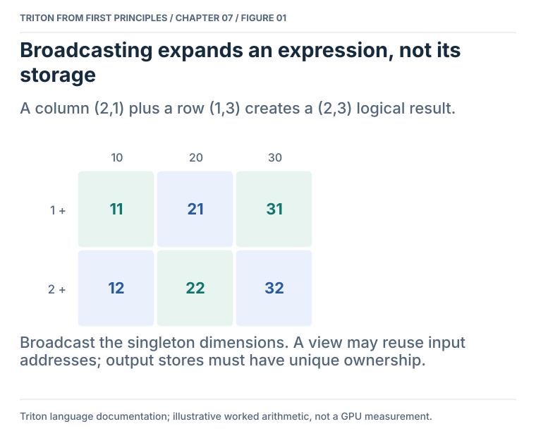

# Chapter 7: Broadcasting, Alignment, and Block Pointers

[](../images/chapter-openers/07.svg)

[](../images/ch07/01-concept.svg)

> "Three things happen when you combine or access block-shaped values in Triton: one is checked at trace time and refuses to compile if you get it wrong, one is a promise you make to the compiler that nothing on the interpreter can ever verify, and one is an API that bundles shape and strides back together — but only for the specific rectangular tile it was built for, and only as far as you hand-typed those numbers correctly in the first place."

**What you will understand by the end of this chapter:**

- Exactly how Triton combines two block-shaped values of different shapes through `None`-indexing (`rows[:, None]`, `cols[None, :]`), and why this is one of the few places in the language where a shape mistake is caught immediately rather than silently miscomputed
- The specific, easy-to-make mistake of forgetting a `None` index — and why it doesn't raise an error the way an incompatible-shape mistake does, because the shapes happen to already match
- What `tl.multiple_of` and `tl.max_contiguous` actually are: compiler hints you assert about a value's numeric properties, not checks the compiler performs on your behalf — and why this book's interpreter genuinely cannot demonstrate the failure mode a false hint creates on real hardware
- `tl.make_block_ptr`, Triton's block-pointer API — a way of describing a rectangular tile access that bundles a base pointer, shape, strides, and block shape into a single object, and exactly how much of Chapter 6's pointer+stride contract it does and does not fix
- Why passing a wrong shape or stride into `tl.make_block_ptr` produces the identical silent failure Chapter 6, Section 6.2 already demonstrated with raw pointer arithmetic — bundling the numbers into one call does not make them any more verified

**What you need to know first:**

- Chapter 4's SPMD model and Chapter 5's masking discipline (`mask=`, `other=`) — this chapter's `[:, None]` / `[None, :]` pattern has already appeared, unexplained, in every 2D kernel since Chapter 6
- Chapter 6's pointer+stride contract in full — Section 7.3 of this chapter is best read as a direct continuation of Chapter 6, Section 6.2's finding that shape and strides are unverified, hand-typed promises
- No new Triton primitives are assumed beyond what Chapters 1–6 already introduced

## 7.1 Broadcasting: Implicit Shape Expansion via `None`-Indexing `[FOUNDATIONAL]`

### Intuition

A carpenter with a column of six board heights and a row of four board widths doesn't write out all twenty-four height-plus-width sums by hand — laying the heights down one way and the widths down the other, at right angles to each other, and reading off every cell of the resulting grid produces all twenty-four combinations from two short lists, with no list ever needing to be as long as the grid it produces.

`rows[:, None]` and `cols[None, :]` are exactly this right-angle layout. `rows = tl.arange(0, BLOCK_M)` is a plain `(BLOCK_M,)`-shaped list; indexing it with `[:, None]` reshapes it to `(BLOCK_M, 1)` — a column. `cols[None, :]` reshapes `(BLOCK_N,)` to `(1, BLOCK_N)` — a row. Adding a `(BLOCK_M, 1)` column to a `(1, BLOCK_N)` row doesn't fail because the shapes don't match exactly — Triton *broadcasts* each one out along its size-`1` dimension until both are `(BLOCK_M, BLOCK_N)`, and only then adds them elementwise. This is the same broadcasting rule NumPy and PyTorch already use on the host side; Triton applies it identically inside a kernel body.

### Background

| | Shapes that broadcast | Shapes that don't |
|---|---|---|
| Rule | Two dimensions are compatible if they're equal, or if either one is `1` | Any dimension where both sides disagree and neither is `1` |
| `(BLOCK_M, 1) + (1, BLOCK_N)` | Compatible — broadcasts to `(BLOCK_M, BLOCK_N)` | — |
| `(4,) + (4,)` | Compatible — same shape, ordinary elementwise add, **not** a broadcast at all | — |
| `(4,) + (8,)` | — | Incompatible — neither dimension is `1` and they disagree; Section 7.1's second worked example shows this rejected outright |
| When is this checked | At trace time, before the kernel is compiled | Same — this is one of the few shape-related checks Triton performs unconditionally |

This is worth contrasting directly with Chapter 6: a *stride* argument that doesn't match the real tensor compiles and runs with no complaint at all (Section 6.2). A *shape* mismatch between two block-shaped values inside a kernel body, by contrast, is caught immediately, because broadcasting compatibility is a property the compiler can check entirely from the shapes it already knows at trace time — no external tensor to lie about, just two block shapes it can compare directly.

### Worked Example 7.1.1 — building a 2D grid from two 1D ranges

```python
rows = tl.arange(0, BLOCK_M)          # shape (BLOCK_M,)
cols = tl.arange(0, BLOCK_N)          # shape (BLOCK_N,)
row_col = rows[:, None]               # shape (BLOCK_M, 1)
col_row = cols[None, :]               # shape (1, BLOCK_N)
combined = row_col + col_row          # broadcasts to (BLOCK_M, BLOCK_N)
```

With `BLOCK_M = BLOCK_N = 4`, hand-trace `combined[i, j] = rows[i] + cols[j] = i + j`. Genuinely captured, with `tl.static_print` confirming each intermediate shape during tracing:

```
row_col shape: ['constexpr[4]', 'constexpr[1]']
col_row shape: ['constexpr[1]', 'constexpr[4]']
combined shape: ['constexpr[4]', 'constexpr[4]']
broadcast result (row+col):
 tensor([[0, 1, 2, 3],
        [1, 2, 3, 4],
        [2, 3, 4, 5]], dtype=torch.int32)
```

Row 0 is `[0+0, 0+1, 0+2, 0+3] = [0,1,2,3]`; row 1 is `[1+0, 1+1, 1+2, 1+3] = [1,2,3,4]`; row 2 is `[2,3,4,5]` — exactly the hand trace, and exactly the same `rows[:, None] * stride + cols[None, :]` pattern every 2D kernel since Chapter 6 has been using to compute pointer offsets, now shown for what it actually is: an ordinary broadcasted add.

### Worked Example 7.1.2 — an incompatible shape, rejected at trace time

```python
a = tl.arange(0, BLOCK_A)   # shape (BLOCK_A,)
b = tl.arange(0, BLOCK_B)   # shape (BLOCK_B,)
c = a + b                  # illegal unless BLOCK_A == BLOCK_B
```

Launched with `BLOCK_A=4, BLOCK_B=8` — two 1D shapes, neither equal nor equal to `1` — genuinely captured:

```
InterpreterError: ValueError('Cannot make_shape_compatible: incompatible dimensions at index 0: 4 and 8')
```

This is a real, unconditional rejection, not a permissive interpreter quirk the way Chapter 1's `if mask:` trap was — a genuinely compiled build rejects this exact combination the same way, because broadcasting compatibility is decided entirely from the two operands' own shapes, which the compiler always has in hand.

### ASCII Diagram — the right-angle layout

```
  rows[:, None]              cols[None, :]                combined = rows[:,None] + cols[None,:]
  shape (4, 1)                shape (1, 4)                          shape (4, 4)

  +---+                +---+---+---+---+                +---+---+---+---+
  | 0 |                | 0 | 1 | 2 | 3 |                | 0 | 1 | 2 | 3 |
  +---+                +---+---+---+---+                +---+---+---+---+
  | 1 |    broadcast   (repeated down                    | 1 | 2 | 3 | 4 |
  +---+    each other's                                  +---+---+---+---+
  | 2 |    missing axis)                                  | 2 | 3 | 4 | 5 |
  +---+                                                    +---+---+---+---+
  | 3 |                                                    | 3 | 4 | 5 | 6 |
  +---+                                                    +---+---+---+---+
  (repeated across)
```

> `[COMMON TRAP]` Worked Example 7.1.2's error only fires when the two shapes genuinely disagree. Forgetting the `[:, None]` / `[None, :]` entirely — writing `rows + cols` where both are plain `(BLOCK,)`-shaped ranges of the *same* length — produces no error at all, because two identical 1D shapes are perfectly valid to add elementwise. Genuinely captured from exactly that mistake, with `BLOCK=4` on both sides:
>
> ```
> combined shape (forgot None-indexing): ['constexpr[4]']
> forgot-None result (1D, NOT the 4x4 outer grid you probably wanted): [0, 2, 4, 6]
> ```
>
> That result is `rows[i] + cols[i]` for four values of `i` — a legitimate elementwise sum, just not the sixteen-element outer grid the surrounding code almost certainly needed. Nothing about this output looks obviously broken; it's a plausible list of four numbers. This is precisely why Worked Example 7.1.2's check is not a substitute for understanding what you're asking for: broadcasting compatibility catches shapes that *can't* be combined, not shapes that combine into something other than what you meant.

## 7.2 Alignment Hints: `tl.multiple_of` and `tl.max_contiguous` `[FOUNDATIONAL]`

### Intuition

A shipping manifest that says "this pallet is exactly 40 boxes, arranged in neat rows of 8" tells the forklift operator something they could act on faster than checking box-by-box — but only if it's true. If it's false, the forklift doesn't necessarily crash; a human forklift operator would probably notice something looked off. An automated loading system that's been *told*, and trusts, that the pallet is a neat 8-wide grid might load it in one confident sweep, and if the pallet was actually irregular, it fails in whatever way an automated system fails when a hard assumption turns out to be wrong.

`tl.multiple_of(x, value)` and `tl.max_contiguous(x, value)` are exactly this manifest label, attached to a tensor of offsets rather than a physical pallet: `tl.multiple_of(offsets, 16)` tells the compiler "every value in this block is a multiple of 16," and `tl.max_contiguous(offsets, 16)` tells it "the first 16 of these values increase by exactly 1 each." Both are assertions you make about numeric properties the compiler could not otherwise prove from the code alone — and, like the shape and stride arguments in Chapter 6, both are trusted completely.

### Background

| | `tl.multiple_of` / `tl.max_contiguous` | Chapter 6's shape/stride arguments |
|---|---|---|
| What it is | A hint asserting a numeric property of an offsets tensor | A hint asserting the layout of a tensor |
| Who checks it | Nobody — the compiler uses it to justify optimizations (wider vectorized loads, better memory coalescing) it otherwise couldn't | Nobody — Chapter 6, Section 6.2 |
| What happens if it's true | Better-optimized generated code, same result | Correct results |
| What happens if it's false | Undefined on real hardware — the generated code may assume an access pattern that doesn't hold, from a subtly wrong result to a genuine misaligned-memory fault | A silently, differently-shaped wrong result — Section 6.2 |
| Can this book's interpreter demonstrate the failure? | **No** — see below | Yes — Section 6.2's demonstration ran cleanly under the interpreter |

### Worked Example 7.2.1 — the hints in ordinary, truthful use

```python
pid = tl.program_id(0)
offsets = pid * BLOCK + tl.arange(0, BLOCK)
offsets = tl.multiple_of(offsets, BLOCK)
offsets = tl.max_contiguous(offsets, BLOCK)
mask = offsets < n
x = tl.load(x_ptr + offsets, mask=mask, other=0.0)
tl.store(out_ptr + offsets, x * 2.0, mask=mask)
```

With `n=16`, `BLOCK=8`, launched across a grid of 2 program instances, this behaves identically to every masked doubling kernel since Chapter 5 — the hints don't change the result, only (on a real compiled build) how efficiently the compiler is able to generate the load and store. Genuinely captured:

```
hinted kernel result: [0.0, 2.0, 4.0, 6.0, 8.0, 10.0, 12.0, 14.0, 16.0, 18.0, 20.0, 22.0, 24.0, 26.0, 28.0, 30.0]
matches x*2? True
```

### Worked Example 7.2.2 — a false hint, and the honest limit of what this book can show you

```python
offsets = tl.arange(0, BLOCK) + 3          # NOT a multiple of BLOCK in general
offsets = tl.multiple_of(offsets, BLOCK)   # lie: claim it is anyway
```

With `BLOCK=8`, `offsets = [3, 4, 5, 6, 7, 8, 9, 10]` — genuinely not a multiple of 8 in the way `tl.multiple_of` is claiming. Genuinely captured, running exactly this lie under this book's interpreter:

```
lied multiple_of result: [0.0, 0.0, 0.0, 6.0, 8.0, 10.0, 12.0, 14.0, 16.0, 18.0, 20.0, 0.0, 0.0, 0.0, 0.0, 0.0]
(no error raised -- multiple_of/max_contiguous are unchecked compiler hints, not assertions)
```

That output is, in fact, **correct** — positions 3 through 10 hold `x[3..10] * 2`, exactly as the (otherwise ordinary) kernel logic asks for. This is the honest limit of what this chapter's interpreter-only setup can demonstrate: `tl.multiple_of` and `tl.max_contiguous` are hints consumed by the real GPU compiler's optimization passes — instruction selection, vectorization width, memory coalescing — which this book's interpreter does not perform at all. Lying to the interpreter about these properties costs nothing, because the interpreter was never going to act on the hint in the first place. On a real compiled build, the same lie can cause the compiler to emit a load or store instruction that assumes an alignment or contiguity pattern the actual data doesn't have, and the failure mode ranges from a subtly wrong result to a genuine misaligned-access fault — this book cannot honestly show you that failure without a real GPU to compile for, and says so rather than fabricating a plausible-looking crash.

> `[COMMON TRAP]` Because these hints look like assertions — `tl.multiple_of`, a name that sounds like it's *checking* something — it's tempting to treat a call to them as a safety net, the way an `assert` statement is in ordinary Python. It is the opposite: it is you making a promise *to* the compiler, not the compiler checking a promise *from* your data. Chapter 6 already established this exact pattern with shape and stride arguments; `tl.multiple_of` and `tl.max_contiguous` are the same unverified-promise shape applied to alignment and contiguity instead.

## 7.3 Block Pointers: Bundling Shape and Strides Back Together, Partially `[FOUNDATIONAL]`

### Intuition

Chapter 6, Section 6.4 ended on a specific complaint: Triton has no type that bundles a pointer with its shape and strides the way Mojo's `Tensor[dtype]` struct does, so that job falls entirely to a Python wrapper function you write yourself, with no help from the language. `tl.make_block_ptr` is Triton's partial answer to exactly that complaint — a single kernel-body object that packages a base pointer, a shape, a set of strides, an offset, and a block shape together, so that loading or storing a rectangular tile becomes one call instead of hand-built pointer arithmetic and a hand-built mask. It is closer to Mojo's bundle than anything Chapters 1–6 have shown — but, as Worked Example 7.3.2 shows directly, it does not restore the one thing that actually matters: nobody checks whether the shape and strides you hand it are true.

### Background

| | Raw pointer arithmetic (Chapters 4–6) | `tl.make_block_ptr` |
|---|---|---|
| How you access a 2D tile | Compute `ptrs = x_ptr + rows[:, None]*stride_row + cols[None,:]*stride_col` and a `mask` by hand | One object: `tl.make_block_ptr(base=x_ptr, shape=(M,N), strides=(sm,sn), offsets=(0,0), block_shape=(BM,BN), order=(1,0))` |
| Out-of-bounds handling | A hand-built `mask=` argument on every `tl.load`/`tl.store` | `boundary_check=(0, 1)` on the load/store, generated from the block pointer's own shape |
| Are the `shape`/`strides` arguments still hand-typed integers? | Yes | **Yes — identical to Chapter 6, Section 6.2, just gathered into one call instead of several** |
| Does it verify those integers against the real tensor? | No | No |
| Current status in Triton (version 3.7) | Fully supported | Emits a deprecation warning — `TensorDescriptor` / `tl.make_tensor_descriptor` is the newer, related API, built for the same TMA-style hardware paths later chapters touch on performance grounds; this book uses `make_block_ptr` here because it is still the clearest illustration of the bundling idea, and flags the newer name so it isn't a surprise later |

### Worked Example 7.3.1 — the same 3×4 copy from Chapter 6, without hand-built masks

```python
x_block_ptr = tl.make_block_ptr(
    base=x_ptr, shape=(M, N), strides=(stride_m, stride_n),
    offsets=(0, 0), block_shape=(BLOCK_M, BLOCK_N), order=(1, 0),
)
tile = tl.load(x_block_ptr, boundary_check=(0, 1))
out_block_ptr = tl.make_block_ptr(
    base=out_ptr, shape=(out_M, out_N), strides=(out_N, 1),
    offsets=(0, 0), block_shape=(BLOCK_M, BLOCK_N), order=(1, 0),
)
tl.store(out_block_ptr, tile, boundary_check=(0, 1))
```

Against `real = torch.arange(12).reshape(3, 4)`, with correct shape/stride arguments (`M=3, N=4`, `real.stride()`), genuinely captured:

```
correct block_ptr shape/strides -> matches? True
```

`boundary_check=(0, 1)` tells Triton to automatically mask out any lane in dimensions 0 and 1 that would fall outside the declared `shape` — the equivalent of Chapter 6's hand-written `(rows[:, None] < M) & (cols[None, :] < N)`, generated for you from information the block pointer already has.

### Worked Example 7.3.2 — the same lie from Chapter 6, told to a block pointer instead

Passing `M=4, N=3, stride_m=3, stride_n=1` for the *out* block pointer's shape — describing the same real `(3, 4)` tensor as if it were `(4, 3)`, exactly Chapter 6, Section 6.2's lie — genuinely captured:

```
LIED shape (4,3) via block_ptr on a real (3,4) tensor, result:
 tensor([[ 0.,  1.,  2.],
        [ 3.,  4.,  5.],
        [ 6.,  7.,  8.],
        [ 9., 10., 11.]])
(block_ptr still trusts whatever shape/strides you hand it -- same vulnerability as Chapter 6.2)
```

This is byte-for-byte the same result Chapter 6, Section 6.2 produced with raw pointer arithmetic, because it's the same underlying mistake wearing a tidier API: `tl.make_block_ptr` gathers `shape` and `strides` into one call and generates the mask for you, which is a genuine, welcome reduction in boilerplate — but the `shape=(M, N)` and `strides=(sm, sn)` arguments are still ordinary Python values you typed by hand, with exactly as little connection to the real tensor as before.

### ASCII Diagram — what moved into the object, and what didn't

```
  Raw pointer arithmetic                    tl.make_block_ptr
  (every kernel since Ch. 4)                (this section)

  ptrs = x_ptr                              block_ptr = tl.make_block_ptr(
       + rows[:,None]*stride_row               base=x_ptr,
       + cols[None,:]*stride_col               shape=(M, N),        <-- still hand-typed
  mask = (rows[:,None]<M)                      strides=(sm, sn),    <-- still hand-typed
       & (cols[None,:]<N)                      offsets=(0,0),
  tl.load(ptrs, mask=mask)                     block_shape=(BM,BN),
                                                order=(1,0),
                                             )
                                             tl.load(block_ptr, boundary_check=(0,1))

  Every number that could be wrong in the left column is still a number
  you typed by hand in the right column -- it's just gathered into one
  call, with the mask generated from shape/block_shape instead of
  written out by hand.
```

> `[COMMON TRAP]` It's easy to read "bundled into one object" as "verified by one object" — Chapter 6 spent an entire chapter establishing that nothing in Triton verifies shape or stride arguments against reality, and `tl.make_block_ptr` does not change that fact, it only changes how many lines of code the (still entirely unverified) numbers pass through. If a wrapper function's `.stride()` call has a bug, `tl.make_block_ptr` will describe the wrong tile just as confidently, and just as silently, as the raw pointer arithmetic it replaced.

## 7.4 Complete Runnable Code

Sections 7.1–7.3 built up this chapter's findings as isolated probes. The files below are the actual, complete, run-in-order source. `04_standalone_complete.py` combines everything from Sections 7.1 through 7.3 into a single script; its output is reproduced in full afterward. All were run exactly as shown, with `TRITON_INTERPRET=1` set, per Chapter 1's opening disclosure.

### File: `01_broadcasting.py` — Section 7.1

[Download the complete current reference](../examples/references/part1/02-broadcasting-alignment-block-pointers/01_broadcasting.py) (interpreter mode; GPU portability is not established).

**Execution:** `TRITON_INTERPRET=1 python3 01_broadcasting.py`

```python
import torch
import triton
import triton.language as tl


@triton.jit
def broadcast_add_kernel(out_ptr, M, N, BLOCK_M: tl.constexpr, BLOCK_N: tl.constexpr):
    rows = tl.arange(0, BLOCK_M)
    cols = tl.arange(0, BLOCK_N)
    row_col = rows[:, None]
    col_row = cols[None, :]
    tl.static_print("row_col shape:", row_col.shape)
    tl.static_print("col_row shape:", col_row.shape)
    combined = row_col + col_row
    tl.static_print("combined shape:", combined.shape)
    mask = (rows[:, None] < M) & (cols[None, :] < N)
    out_ptrs = out_ptr + rows[:, None] * N + cols[None, :]
    tl.store(out_ptrs, combined, mask=mask)


@triton.jit
def bad_broadcast_kernel(out_ptr, BLOCK_A: tl.constexpr, BLOCK_B: tl.constexpr):
    a = tl.arange(0, BLOCK_A)
    b = tl.arange(0, BLOCK_B)
    c = a + b
    tl.store(out_ptr + tl.arange(0, BLOCK_A), c)


@triton.jit
def forgot_none_kernel(out_ptr, BLOCK: tl.constexpr):
    rows = tl.arange(0, BLOCK)
    cols = tl.arange(0, BLOCK)
    combined = rows + cols
    tl.static_print("combined shape (forgot None-indexing):", combined.shape)
    tl.store(out_ptr + tl.arange(0, BLOCK), combined)


def demo_broadcasting():
    print("=== Section 7.1: broadcasting a (BLOCK_M,1) column against a (1,BLOCK_N) row ===")
    out = torch.empty(3, 4, dtype=torch.int32)
    broadcast_add_kernel[(1,)](out, 3, 4, BLOCK_M=4, BLOCK_N=4)
    print("broadcast result (row+col):\n", out)

    print("\n=== incompatible shapes, rejected at trace time ===")
    out2 = torch.empty(4, dtype=torch.int32)
    try:
        bad_broadcast_kernel[(1,)](out2, BLOCK_A=4, BLOCK_B=8)
        print("unexpectedly succeeded:", out2.tolist())
    except Exception as e:
        print(f"{type(e).__name__}: {e}")

    print("\n=== the trap: forgetting None-indexing on equal-length ranges ===")
    out3 = torch.empty(4, dtype=torch.int32)
    forgot_none_kernel[(1,)](out3, BLOCK=4)
    print("forgot-None result (1D, NOT the 4x4 outer grid you probably wanted):", out3.tolist())


if __name__ == "__main__":
    demo_broadcasting()
```

### File: `02_alignment_hints.py` — Section 7.2

[Download the complete current reference](../examples/references/part1/02-broadcasting-alignment-block-pointers/02_alignment_hints.py) (interpreter mode; GPU portability is not established).

**Execution:** `TRITON_INTERPRET=1 python3 02_alignment_hints.py`

```python
import torch
import triton
import triton.language as tl


@triton.jit
def hinted_kernel(x_ptr, out_ptr, n, BLOCK: tl.constexpr):
    pid = tl.program_id(0)
    offsets = pid * BLOCK + tl.arange(0, BLOCK)
    offsets = tl.multiple_of(offsets, BLOCK)
    offsets = tl.max_contiguous(offsets, BLOCK)
    mask = offsets < n
    x = tl.load(x_ptr + offsets, mask=mask, other=0.0)
    tl.store(out_ptr + offsets, x * 2.0, mask=mask)


@triton.jit
def lying_multiple_of_kernel(x_ptr, out_ptr, n, BLOCK: tl.constexpr):
    offsets = tl.arange(0, BLOCK) + 3
    offsets = tl.multiple_of(offsets, BLOCK)
    mask = offsets < n
    x = tl.load(x_ptr + offsets, mask=mask, other=0.0)
    tl.store(out_ptr + offsets, x * 2.0, mask=mask)


def demo_alignment_hints():
    print("=== Section 7.2: tl.multiple_of / tl.max_contiguous, told the truth ===")
    n = 16
    x = torch.arange(n, dtype=torch.float32)
    out = torch.empty(n)
    BLOCK = 8
    grid = (triton.cdiv(n, BLOCK),)
    hinted_kernel[grid](x, out, n, BLOCK=BLOCK)
    print("hinted kernel result:", out.tolist())
    print("matches x*2?", torch.equal(out, x * 2))

    print("\n=== a false tl.multiple_of hint -- costs nothing under the interpreter ===")
    out2 = torch.zeros(n)
    lying_multiple_of_kernel[(1,)](x, out2, n, BLOCK=8)
    print("lied multiple_of result:", out2.tolist())
    print("(no error raised -- multiple_of/max_contiguous are unchecked compiler hints, not assertions)")


if __name__ == "__main__":
    demo_alignment_hints()
```

### File: `03_block_pointers.py` — Section 7.3

[Download the complete current reference](../examples/references/part1/02-broadcasting-alignment-block-pointers/03_block_pointers.py) (interpreter mode; GPU portability is not established).

**Execution:** `TRITON_INTERPRET=1 python3 03_block_pointers.py`

```python
import torch
import triton
import triton.language as tl


@triton.jit
def copy_block_ptr_kernel(x_ptr, out_ptr, M, N, stride_m, stride_n,
                           out_M, out_N,
                           BLOCK_M: tl.constexpr, BLOCK_N: tl.constexpr):
    x_block_ptr = tl.make_block_ptr(
        base=x_ptr, shape=(M, N), strides=(stride_m, stride_n),
        offsets=(0, 0), block_shape=(BLOCK_M, BLOCK_N), order=(1, 0),
    )
    tile = tl.load(x_block_ptr, boundary_check=(0, 1))
    out_block_ptr = tl.make_block_ptr(
        base=out_ptr, shape=(out_M, out_N), strides=(out_N, 1),
        offsets=(0, 0), block_shape=(BLOCK_M, BLOCK_N), order=(1, 0),
    )
    tl.store(out_block_ptr, tile, boundary_check=(0, 1))


def demo_block_pointers():
    print("=== Section 7.3: tl.make_block_ptr, told the truth ===")
    real = torch.arange(12, dtype=torch.float32).reshape(3, 4)
    out_correct = torch.empty(3, 4)
    copy_block_ptr_kernel[(1,)](real, out_correct, 3, 4, real.stride(0), real.stride(1), 3, 4, BLOCK_M=4, BLOCK_N=4)
    print("correct block_ptr shape/strides -> matches?", torch.equal(out_correct, real))

    print("\n=== the same Chapter 6 lie, told to a block pointer instead ===")
    out_lied = torch.empty(4, 3)
    copy_block_ptr_kernel[(1,)](real, out_lied, 4, 3, 3, 1, 4, 3, BLOCK_M=4, BLOCK_N=4)
    print("LIED shape (4,3) via block_ptr on a real (3,4) tensor, result:\n", out_lied)
    print("(block_ptr still trusts whatever shape/strides you hand it -- same vulnerability as Chapter 6.2)")


if __name__ == "__main__":
    demo_block_pointers()
```

### File: `04_standalone_complete.py` — the full chapter, one program

[Download the complete current reference](../examples/references/part1/02-broadcasting-alignment-block-pointers/04_standalone_complete.py) (interpreter mode; GPU portability is not established).

**Execution:** `TRITON_INTERPRET=1 python3 04_standalone_complete.py`

```python
import torch
import triton
import triton.language as tl


@triton.jit
def broadcast_add_kernel(out_ptr, M, N, BLOCK_M: tl.constexpr, BLOCK_N: tl.constexpr):
    rows = tl.arange(0, BLOCK_M)
    cols = tl.arange(0, BLOCK_N)
    combined = rows[:, None] + cols[None, :]
    mask = (rows[:, None] < M) & (cols[None, :] < N)
    out_ptrs = out_ptr + rows[:, None] * N + cols[None, :]
    tl.store(out_ptrs, combined, mask=mask)


@triton.jit
def bad_broadcast_kernel(out_ptr, BLOCK_A: tl.constexpr, BLOCK_B: tl.constexpr):
    a = tl.arange(0, BLOCK_A)
    b = tl.arange(0, BLOCK_B)
    c = a + b
    tl.store(out_ptr + tl.arange(0, BLOCK_A), c)


@triton.jit
def forgot_none_kernel(out_ptr, BLOCK: tl.constexpr):
    rows = tl.arange(0, BLOCK)
    cols = tl.arange(0, BLOCK)
    combined = rows + cols
    tl.store(out_ptr + tl.arange(0, BLOCK), combined)


@triton.jit
def hinted_kernel(x_ptr, out_ptr, n, BLOCK: tl.constexpr):
    pid = tl.program_id(0)
    offsets = pid * BLOCK + tl.arange(0, BLOCK)
    offsets = tl.multiple_of(offsets, BLOCK)
    offsets = tl.max_contiguous(offsets, BLOCK)
    mask = offsets < n
    x = tl.load(x_ptr + offsets, mask=mask, other=0.0)
    tl.store(out_ptr + offsets, x * 2.0, mask=mask)


@triton.jit
def copy_block_ptr_kernel(x_ptr, out_ptr, M, N, stride_m, stride_n,
                           out_M, out_N,
                           BLOCK_M: tl.constexpr, BLOCK_N: tl.constexpr):
    x_block_ptr = tl.make_block_ptr(
        base=x_ptr, shape=(M, N), strides=(stride_m, stride_n),
        offsets=(0, 0), block_shape=(BLOCK_M, BLOCK_N), order=(1, 0),
    )
    tile = tl.load(x_block_ptr, boundary_check=(0, 1))
    out_block_ptr = tl.make_block_ptr(
        base=out_ptr, shape=(out_M, out_N), strides=(out_N, 1),
        offsets=(0, 0), block_shape=(BLOCK_M, BLOCK_N), order=(1, 0),
    )
    tl.store(out_block_ptr, tile, boundary_check=(0, 1))


def main():
    print("=== Section 7.1: broadcasting ===")
    out = torch.empty(3, 4, dtype=torch.int32)
    broadcast_add_kernel[(1,)](out, 3, 4, BLOCK_M=4, BLOCK_N=4)
    print("broadcast result (row+col):\n", out)

    out2 = torch.empty(4, dtype=torch.int32)
    try:
        bad_broadcast_kernel[(1,)](out2, BLOCK_A=4, BLOCK_B=8)
        print("unexpectedly succeeded:", out2.tolist())
    except Exception as e:
        print(f"{type(e).__name__}: {e}")

    out3 = torch.empty(4, dtype=torch.int32)
    forgot_none_kernel[(1,)](out3, BLOCK=4)
    print("forgot-None result:", out3.tolist())

    print("\n=== Section 7.2: alignment hints ===")
    n = 16
    x = torch.arange(n, dtype=torch.float32)
    out4 = torch.empty(n)
    BLOCK = 8
    grid = (triton.cdiv(n, BLOCK),)
    hinted_kernel[grid](x, out4, n, BLOCK=BLOCK)
    print("hinted kernel result matches x*2?", torch.equal(out4, x * 2))

    print("\n=== Section 7.3: block pointers ===")
    real = torch.arange(12, dtype=torch.float32).reshape(3, 4)
    out_correct = torch.empty(3, 4)
    copy_block_ptr_kernel[(1,)](real, out_correct, 3, 4, real.stride(0), real.stride(1), 3, 4, BLOCK_M=4, BLOCK_N=4)
    print("correct block_ptr shape/strides -> matches?", torch.equal(out_correct, real))

    out_lied = torch.empty(4, 3)
    copy_block_ptr_kernel[(1,)](real, out_lied, 4, 3, 3, 1, 4, 3, BLOCK_M=4, BLOCK_N=4)
    print("LIED shape (4,3) via block_ptr, result:\n", out_lied)


if __name__ == "__main__":
    main()
```

### Expected Output for `04_standalone_complete.py`

```
=== Section 7.1: broadcasting ===
broadcast result (row+col):
 tensor([[0, 1, 2, 3],
        [1, 2, 3, 4],
        [2, 3, 4, 5]], dtype=torch.int32)
InterpreterError: ValueError('Cannot make_shape_compatible: incompatible dimensions at index 0: 4 and 8')
forgot-None result: [0, 2, 4, 6]

=== Section 7.2: alignment hints ===
hinted kernel result matches x*2? True

=== Section 7.3: block pointers ===
correct block_ptr shape/strides -> matches? True
LIED shape (4,3) via block_ptr, result:
 tensor([[ 0.,  1.,  2.],
        [ 3.,  4.,  5.],
        [ 6.,  7.,  8.],
        [ 9., 10., 11.]])
```

`tl.make_block_ptr` also emits a `UserWarning: tl.make_block_ptr is deprecated. Use TensorDescriptor or tl.make_tensor_descriptor instead.` on every run of File 3 and File 4 — this is a genuine, current warning from Triton 3.7, reproduced honestly rather than edited out; the API still works exactly as shown, and this book uses it here because it demonstrates the shape/stride-bundling idea more directly than its newer replacement.

## Chapter Summary

Combining two block-shaped values of different shapes through `None`-indexing broadcasts them together using the same rule NumPy and PyTorch already use, and — in useful contrast to nearly everything in Chapter 6 — a genuinely incompatible combination is rejected at trace time rather than silently miscomputed; the real danger, as Section 7.1's final trap showed, is a broadcast mistake that happens to produce a *valid* shape by accident, which raises nothing at all. `tl.multiple_of` and `tl.max_contiguous` look like assertions but are the opposite: unverified promises you make to the compiler about a value's alignment and contiguity, and Section 7.2 was explicit that this book's CPU-based interpreter cannot demonstrate what a false promise costs on real hardware, because the interpreter never acts on the hint the way a real compiled build's optimizer does. And `tl.make_block_ptr` bundles a pointer, shape, strides, and block shape into a single object — genuinely closer to Mojo's `Tensor[dtype]` struct than anything earlier chapters have shown — but Section 7.3 proved directly that this bundling doesn't restore any verification: the identical Chapter 6 lie, told through a block pointer instead of raw pointer arithmetic, produces the identical silently wrong result.

## Self-Check Questions

1. `rows[:, None]` has shape `(BLOCK_M, 1)` and `cols[None, :]` has shape `(1, BLOCK_N)`. Explain why adding them together produces a `(BLOCK_M, BLOCK_N)` result rather than an error, and what rule decides that.
2. A kernel computes `a + b` where `a` and `b` are both `tl.arange(0, 8)`. This runs without error, but it is very unlikely to be what the kernel author intended. Why does no error fire, and what should the author have written instead?
3. What specific property does `tl.multiple_of(offsets, 16)` assert, and who — if anyone — verifies that the assertion is actually true?
4. Why can this book's interpreter-based test suite show you a *broadcasting* mistake failing loudly (Worked Example 7.1.2) but cannot show you a *false alignment hint* failing at all?
5. `tl.make_block_ptr` bundles a pointer, shape, and strides into one object, closer to Mojo's `Tensor[dtype]` struct than raw pointer arithmetic. Despite that, Worked Example 7.3.2 reproduces Chapter 6, Section 6.2's exact failure. What, specifically, did bundling these values into one API call fail to fix?

## Where We Go Next

This chapter's `tl.make_block_ptr` example loaded and stored one rectangular tile per kernel launch, at a fixed offset. Chapter 8 puts that same block pointer to work across a whole tensor at once — `tl.advance`, iterating a block pointer across a grid dimension, and the tiling strategies that turn "load one tile" into "load every tile a matmul or a reduction needs, in the order that keeps memory traffic down." This is also where Part 1's pointer+stride contract stops being an abstract concern and starts directly determining performance: which tile a program instance loads, and in what order, is the single biggest lever Chapters 8 onward will pull.

## Worked Solutions

**1.** Triton's broadcasting rule (identical to NumPy's and PyTorch's) treats two dimensions as compatible if they're equal or if either one is `1`. Comparing `(BLOCK_M, 1)` against `(1, BLOCK_N)` dimension-by-dimension: the first dimensions are `BLOCK_M` and `1` — compatible, since one side is `1` — and the second dimensions are `1` and `BLOCK_N` — compatible for the same reason. Triton expands each size-`1` dimension out to match the other operand's size along that axis, producing `(BLOCK_M, BLOCK_N)` for both, and only then performs the elementwise add.

**2.** No error fires because `a` and `b` are both plain `(8,)`-shaped ranges — identical shapes are always valid to add elementwise, with no broadcasting involved at all. The broadcasting-compatibility check that caught Worked Example 7.1.2's mismatch has nothing to catch here, because there is no mismatch: two equal-length 1D ranges added together is a completely ordinary, well-typed operation, it's just very unlikely to be an *outer* combination of two independent axes, which is what `rows[:, None] + cols[None, :]` is for. The fix is to explicitly reshape one operand to a column and the other to a row before adding, exactly as Worked Example 7.1.1 does.

**3.** It asserts that every value in the `offsets` tensor is an exact multiple of `16` — a numeric property about the specific integers in that tensor, not about the tensor's shape or the underlying data it points to. Nobody verifies it: it's an unchecked hint the compiler is told to trust when deciding how to generate load/store instructions, exactly parallel to how nobody verifies the shape and stride arguments from Chapter 6, Section 6.2.

**4.** Broadcasting compatibility is decided entirely from information the compiler already has at trace time — the shapes of the two operands being combined — so a real check can run and genuinely fail, and this book's interpreter performs that same check, producing a real, reproducible error. A false alignment hint, by contrast, is only ever *acted upon* by the real GPU compiler's optimization passes (choosing vectorized instructions, assuming coalesced memory access) — passes this book's CPU-based interpreter does not run at all. Lying to `tl.multiple_of` under the interpreter costs nothing not because the lie is harmless, but because the interpreter was never going to use the hint for anything in the first place; the actual cost only shows up in a real compiled build this book cannot honestly simulate.

**5.** Bundling `shape` and `strides` into a single `tl.make_block_ptr(...)` call reduces how many separate pieces of pointer arithmetic and masking logic you have to write by hand, and lets `boundary_check` generate the out-of-bounds mask for you instead of writing `(rows[:, None] < M) & (cols[None, :] < N)` yourself. What it does not do is verify that the `shape` and `strides` values you pass in are actually true of the tensor you're describing — those are still ordinary Python integers, typed by hand, exactly as in Chapter 6. Bundling them into fewer lines of code changes nothing about whether those lines are correct, which is exactly why Worked Example 7.3.2's lie produces the identical wrong tensor Chapter 6, Section 6.2 already produced with raw pointer arithmetic.
