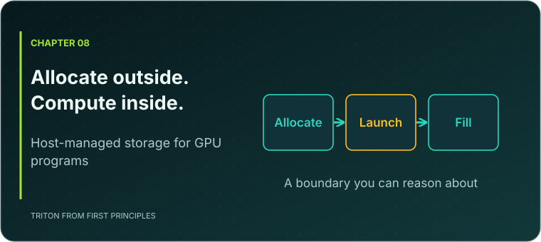
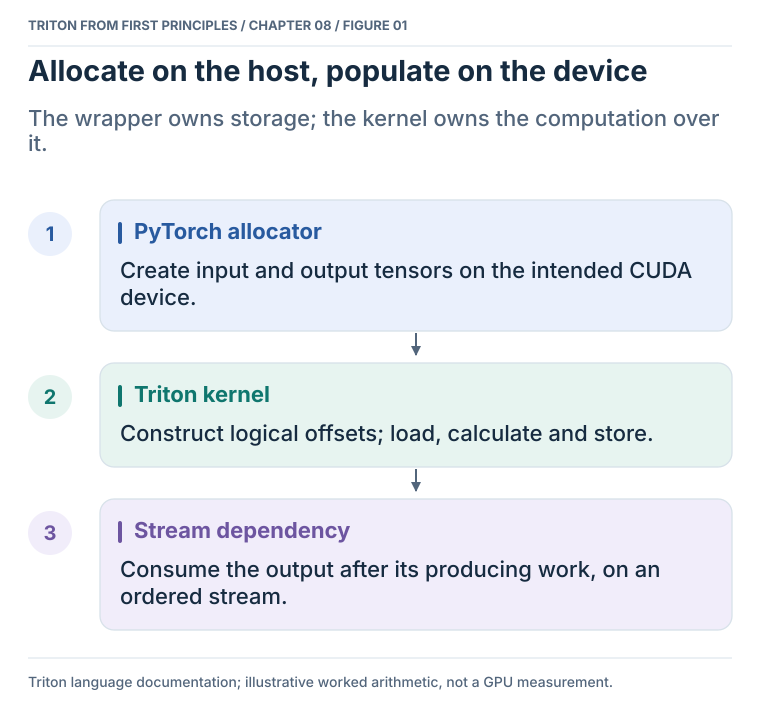

# Chapter 8: GPU-Side Construction

[](../images/chapter-openers/08.svg)

[](../images/ch08/01-concept.svg)

> "A `@triton.jit` kernel can compute anything you can express in its language, and allocate nothing at all. Every buffer it will ever write into has to already exist, built by ordinary Python code, before the kernel is ever indexed with a grid."

**What you will understand by the end of this chapter:**

- Why Triton kernels have no allocation primitive at all — every output buffer a kernel writes into has to be constructed on the host side, in Python, before `kernel[grid](...)` is ever called
- Why `tl.zeros(...)`, despite the name, does not allocate anything a caller can see — it produces a block of register-resident values that vanish the instant the kernel finishes unless something explicitly `tl.store`s them somewhere real
- How to write a Python wrapper function that mimics the *convention* of a factory function — `Tensor.zeros(shape)`, `Tensor.full(shape, value)` — while being honest that the actual allocation underneath is always PyTorch's, never Triton's own
- Why device placement — whether a tensor's memory lives on the CPU or a specific GPU — is a promise Triton's real compiled path enforces strictly, and exactly why this book's CPU-only interpreter cannot demonstrate that enforcement at all
- How this chapter's findings map onto Mojo's `Tensor[dtype]` factory functions and `DeviceTensor` (Chapter 6 of the Mojo edition), where both allocation and device tracking are built into the type itself — and why Triton has neither

**What you need to know first:**

- Chapter 6's pointer+stride contract — this chapter is about what has to happen *before* a pointer exists for that contract to apply to at all
- Chapter 5's `tl.zeros`-as-accumulator pattern — reused here to show precisely what it does and doesn't allocate
- If you've read the Mojo edition, this chapter directly answers the two remaining pieces of Mojo's Chapter 6 this book hasn't yet addressed: `Tensor[dtype]`'s factory functions (`.zeros()`, `.ones()`, `.full()`) and `DeviceTensor`, which tracks host-vs-GPU memory placement as part of the type

## 8.1 Kernels Don't Allocate: Every Buffer Exists Before the Kernel Runs `[FOUNDATIONAL]`

### Intuition

A print shop's press can stamp ink onto any sheet of paper you feed it, in any pattern its plates are cut for — but it cannot manufacture a new sheet of paper out of nothing mid-run. Every sheet that will ever come out of that press had to already exist, cut to size, sitting in the feed tray, before the press ever started.

A `@triton.jit` kernel is the press. `tl.store(out_ptr + offsets, value, mask=mask)` can write anywhere within an already-existing buffer that `out_ptr` points into, but there is no Triton language primitive — no `tl.malloc`, no `tl.new_tensor`, nothing — that creates a new buffer from inside a kernel body. Every tensor a kernel will ever write into has to be constructed by ordinary host-side Python code, almost always `torch.empty`, `torch.empty_like`, or one of PyTorch's other allocating factory functions, *before* that tensor's pointer is ever passed into a kernel launch.

### Background

| | Mojo's `Tensor[dtype]` (Chapter 6, Mojo edition) | Triton |
|---|---|---|
| Where does allocation happen? | Inside the struct's own constructor / factory functions | Never inside a kernel — always in host-side Python, before the launch |
| Does the kernel-equivalent (a `fn` operating on `Tensor[dtype]`) ever allocate its own output? | Can, if written to | Cannot — no language-level allocation primitive exists inside `@triton.jit` |
| What if you don't pre-allocate an output buffer? | A missing/invalid `Tensor[dtype]` is a type-level problem, generally caught by the type checker | The kernel launch fails at the point it tries to use whatever you passed instead — Worked Example 8.1.2 |

### Worked Example 8.1.1 — an ordinary launch, with allocation happening entirely on the host

```python
x = torch.tensor([1.0, 2.0, 3.0, 4.0])
y = torch.tensor([10.0, 20.0, 30.0, 40.0])
out = torch.empty_like(x)   # allocated on the host, in Python, BEFORE the kernel runs
add_kernel[(1,)](x, y, out, 4, BLOCK=4)
```

Every kernel since Chapter 1 has quietly done exactly this — `out = torch.empty_like(x)` (or `torch.empty(...)`) has appeared, unremarked, before every single launch. Genuinely captured:

```
out (pre-allocated by torch.empty_like, then filled by the kernel): [11.0, 22.0, 33.0, 44.0]
```

Nothing about the kernel itself changed; this section is naming a pattern that was always there rather than introducing a new one.

### Worked Example 8.1.2 — what happens without a pre-allocated buffer

```python
bad_out = None
add_kernel[(1,)](x, y, bad_out, 4, BLOCK=4)
```

Genuinely captured:

```
passing None as the output buffer -> InterpreterError: AttributeError("'NoneType' object has no attribute 'type'")
```

The specific error text is this book's interpreter's own internal plumbing showing through — a genuinely compiled build reports a different, differently-worded failure at a different stage of compilation — but the underlying fact holds in both: there is no code path anywhere in Triton that responds to a missing output buffer by constructing one. Something has to already exist at that pointer, or the launch cannot proceed.

### Worked Example 8.1.3 — `tl.zeros`: a value, not an allocation

```python
@triton.jit
def local_zeros_kernel(out_ptr, BLOCK: tl.constexpr):
    local = tl.zeros((BLOCK,), dtype=tl.float32)   # exists only inside this kernel's execution
    local = local + 1.0
    tl.store(out_ptr + tl.arange(0, BLOCK), local)  # must be explicitly stored to survive
```

`tl.zeros((BLOCK,), dtype=tl.float32)` — used already in Chapter 5 as a wide reduction accumulator — creates a `BLOCK`-shaped tensor of registers, initialized to zero, that exists only for the duration of this kernel instance's execution. It is not a pointer, it does not correspond to any address in GPU global memory, and nothing outside this one kernel launch can ever see it unless it is explicitly written out through `tl.store`. Genuinely captured:

```
value only survives because it was explicitly tl.store'd: [1.0, 1.0, 1.0, 1.0]
(tl.zeros() itself allocated nothing outside the kernel -- it's a block of registers,
 gone the instant the kernel finishes, unless something stores it to a real pointer)
```

### ASCII Diagram — the press and the paper

```
  HOST (Python, before launch)              KERNEL (during launch)
  +---------------------------+             +---------------------------+
  | out = torch.empty_like(x) |   pointer   | tl.store(out_ptr + ...)   |
  | (allocation happens here, | ----------> | (writes into memory that  |
  |  once, in ordinary Python)|             |  already existed before   |
  +---------------------------+             |  this kernel started)     |
                                             |                           |
                                             | local = tl.zeros(...)     |
                                             | (register-resident,       |
                                             |  vanishes at kernel exit  |
                                             |  unless tl.store'd out)   |
                                             +---------------------------+
```

> `[COMMON TRAP]` `tl.zeros((BLOCK,), dtype=tl.float32)` reads like a constructor call — it even takes a shape and a dtype, the same two arguments `torch.zeros((BLOCK,), dtype=torch.float32)` would take on the host side. It is not doing the same job. `torch.zeros(...)` allocates new global memory the caller can hand anywhere else in the program; `tl.zeros(...)` produces registers scoped to the single kernel instance executing right now. Assuming the two are interchangeable is exactly the mistake that would lead someone to expect `tl.zeros(...)`'s result to "come back" to the host without an explicit `tl.store` — it never does.

## 8.2 Factory-Function Conventions: Construction Is Still Just PyTorch's Allocator `[FOUNDATIONAL]`

### Intuition

Mojo's `Tensor[dtype].zeros(shape)` and `Tensor[dtype].full(shape, value)` (Chapter 6 of the Mojo edition) are factory functions in the classic sense: named static constructors that hide an allocation and an initialization behind a friendly call. Nothing stops a Triton codebase from writing Python wrapper functions with the same shape and the same names — `triton_full(shape, value)`, say — but it's worth being honest about what such a wrapper actually buys you: the allocation itself is still, unavoidably, `torch.empty(...)`, exactly as in Section 8.1. A hand-written "factory function" in Triton is a Python convention layered on top of PyTorch's allocator, not a new capability Triton itself provides.

### Background

| | Mojo's `Tensor[dtype].full(shape, value)` | A hand-written Triton `triton_full(shape, value)` wrapper | `torch.full(shape, value)` directly |
|---|---|---|
| Where the memory comes from | The struct's own allocator, internal to the type | `torch.empty(shape, ...)`, called inside the wrapper | `torch.empty(shape, ...)`, called inside PyTorch's own C++ implementation |
| What fills it | The constructor's own initialization logic | A `@triton.jit` kernel launch | An optimized C++/CUDA fill routine |
| Extra overhead vs. calling PyTorch directly | Not applicable — this *is* the canonical way to construct one | A full kernel trace-and-launch, for work `torch.full` already does in one call | None — this is the baseline |
| When does writing the Triton version actually pay for itself? | Not applicable | When the fill is fused into a larger kernel doing other work at the same time (Chapter 20) — never in isolation | Always, for a standalone fill |

### Worked Example 8.2.1 — a factory-function-style wrapper, and what it costs

```python
def triton_full(shape, value, dtype=torch.float32, device="cpu"):
    """A hand-written 'factory function' mimicking Mojo's Tensor[dtype].full(shape, value)."""
    out = torch.empty(shape, dtype=dtype, device=device)   # allocation still happens via torch
    n = out.numel()
    BLOCK = triton.next_power_of_2(n)
    fill_kernel[(1,)](out, value, n, BLOCK=BLOCK)
    return out
```

Genuinely captured, compared directly against calling PyTorch's own `torch.full` with the same arguments:

```
triton_full((6,), 7.0) -> [7.0, 7.0, 7.0, 7.0, 7.0, 7.0]

compare against just using torch's own factory function directly:
torch.full((6,), 7.0)  -> [7.0, 7.0, 7.0, 7.0, 7.0, 7.0]
(identical result -- the Triton kernel added a compiled launch for something
 torch's own allocator+fill already does in one call; no Triton-side benefit
 unless this fill is fused into a larger kernel that does other work too)
```

Both produce identical output. `triton_full` is not wrong to write — later chapters fuse an initialization step directly into a larger kernel precisely to avoid a second, separate memory pass — but writing it purely as a standalone "constructor," the way Section 8.1's framing might tempt you to, adds a full trace-and-compile-and-launch cycle around work `torch.full` was already doing, in one line, with a routine PyTorch has already optimized.

> `[COMMON TRAP]` It's easy to read Chapter 6 through 8's emphasis on "the wrapper function is where everything gets assembled" and conclude that every tensor operation in a Triton codebase should be its own custom kernel wrapped in its own custom factory function. Most of the time, plain PyTorch — `torch.zeros`, `torch.full`, `torch.empty_like` — is exactly the right tool for pure allocation-and-initialization, with no kernel involved at all. Triton earns its keep when a kernel is doing real, otherwise-expensive *compute* — the fill-as-a-kernel pattern above exists in this chapter purely to make the allocation/computation boundary explicit, not as a recommendation to replace `torch.full`.

## 8.3 Device Placement: The One Promise Real Triton Enforces That This Book's Interpreter Can't `[FOUNDATIONAL]`

### Intuition

Mojo's `DeviceTensor` (Chapter 6 of the Mojo edition) tracks, as part of the type itself, whether a tensor's memory lives on the host or on a specific GPU — a `DeviceTensor` and a host `Tensor[dtype]` are different types, and moving data between them is an explicit, visible operation. Triton has nothing resembling this at the language level: a kernel argument is a bare pointer (Chapter 6), and pointer arithmetic doesn't know or care whether the address it's computing points into host RAM or GPU memory. On a real, compiled Triton build, launching a kernel against a CPU tensor is still an error — but the error comes from the surrounding CUDA machinery Triton compiles against, not from anything in the Triton language itself checking device placement the way Mojo's type system does.

### Background

| | Mojo's `DeviceTensor` | Real, compiled Triton | This book's `TRITON_INTERPRET=1` interpreter |
|---|---|---|
| Tracks device placement | Yes — part of the type | No — a pointer is a pointer; enforcement comes from the CUDA runtime underneath, not the Triton language | No — the interpreter runs everything as a CPU-side simulation regardless of the tensor's claimed device |
| Passing a CPU tensor to a GPU kernel | Would be a type mismatch, caught before running | Genuinely fails — the launch cannot proceed against memory the GPU can't address | Runs without complaint — Worked Example 8.3.2 |
| Can this book demonstrate the real-build failure directly? | Not applicable | — | **No — this environment has no NVIDIA driver at all, as the next worked example shows directly** |

### Worked Example 8.3.1 — this environment cannot even construct a CUDA tensor

```python
torch.cuda.is_available()   # False
t = torch.tensor([1.0, 2.0], device="cuda")
```

Genuinely captured:

```
torch.cuda.is_available(): False
attempting to create a real CUDA tensor in this environment -> RuntimeError: Found no NVIDIA driver on your system. Please check that you have an NVIDIA GPU and installed a driver from http://www.nvidia.com/Download/index.aspx
```

This is not a Triton error at all — it's PyTorch itself refusing to construct a CUDA-resident tensor, because there is no GPU anywhere in this book's environment for it to live on (Chapter 1's opening disclosure). Without a real CUDA tensor to launch against, there is no way for this book to genuinely reproduce the specific device-mismatch error a real Triton build raises when a kernel expecting GPU memory receives a CPU pointer instead — reproducing a plausible-looking version of that error would mean fabricating output this book has committed not to do.

### Worked Example 8.3.2 — what this book's interpreter does instead: nothing

```python
x_cpu = torch.tensor([1.0, 2.0, 3.0])
out = torch.empty_like(x_cpu)
add_one_kernel[(1,)](x_cpu, out, 3, BLOCK=4)
```

Genuinely captured:

```
x_cpu.device: cpu
interpreter ran a plain CPU tensor with no complaint: [2.0, 3.0, 4.0]
```

Every kernel in this book, in every chapter so far, has been launched exactly this way — against ordinary CPU tensors, because `TRITON_INTERPRET=1` runs kernel logic as a Python-level simulation on the CPU regardless of what device a tensor claims. This is consistent with Chapter 1's opening disclosure and worth restating precisely here: the interpreter validates kernel *logic*, and device placement is not part of that logic in any sense the interpreter checks — it's enforced entirely by the real CUDA compilation and launch path this book cannot exercise.

> `[COMMON TRAP]` It would be easy to read this section and conclude "Triton doesn't care about devices." The precise statement is narrower and more important: the Triton *language* has no device-tracking construct comparable to Mojo's `DeviceTensor`, but the *system* a real compiled kernel launches into absolutely does enforce device placement, strictly, at the CUDA level — a real GPU build launched against a CPU tensor fails before any kernel logic runs at all. This book's interpreter's silence on device placement is a limitation of the interpreter, disclosed here exactly as Chapter 1 disclosed it for performance and Chapter 7 disclosed it for alignment hints — not evidence that device placement is actually optional.

## 8.4 Complete Runnable Code

Sections 8.1–8.3 built up this chapter's findings as isolated probes. The files below are the actual, complete, run-in-order source. `04_standalone_complete.py` combines everything from Sections 8.1 through 8.3 into a single script; its output is reproduced in full afterward. All were run exactly as shown, with `TRITON_INTERPRET=1` set, per Chapter 1's opening disclosure.

### File: `01_no_allocation.py` — Section 8.1

[Download the complete current reference](../examples/references/part1/03-gpu-side-construction/01_no_allocation.py) (interpreter mode; GPU portability is not established).

**Execution:** `TRITON_INTERPRET=1 python3 01_no_allocation.py`

```python
import torch
import triton
import triton.language as tl


@triton.jit
def add_kernel(x_ptr, y_ptr, out_ptr, n, BLOCK: tl.constexpr):
    offsets = tl.arange(0, BLOCK)
    mask = offsets < n
    x = tl.load(x_ptr + offsets, mask=mask)
    y = tl.load(y_ptr + offsets, mask=mask)
    tl.store(out_ptr + offsets, x + y, mask=mask)


@triton.jit
def local_zeros_kernel(out_ptr, BLOCK: tl.constexpr):
    local = tl.zeros((BLOCK,), dtype=tl.float32)
    local = local + 1.0
    tl.store(out_ptr + tl.arange(0, BLOCK), local)


def demo_preallocated_output():
    print("=== Section 8.1: the kernel needs somewhere to write BEFORE it launches ===")
    x = torch.tensor([1.0, 2.0, 3.0, 4.0])
    y = torch.tensor([10.0, 20.0, 30.0, 40.0])
    out = torch.empty_like(x)
    add_kernel[(1,)](x, y, out, 4, BLOCK=4)
    print("out (pre-allocated by torch.empty_like, then filled by the kernel):", out.tolist())

    try:
        bad_out = None
        add_kernel[(1,)](x, y, bad_out, 4, BLOCK=4)
        print("unexpectedly succeeded")
    except Exception as e:
        print(f"passing None as the output buffer -> {type(e).__name__}: {e}")


def demo_tl_zeros_is_not_allocation():
    print("\n=== Section 8.1: tl.zeros() is a register-resident value, not a new allocation ===")
    out2 = torch.empty(4)
    local_zeros_kernel[(1,)](out2, BLOCK=4)
    print("value only survives because it was explicitly tl.store'd:", out2.tolist())


if __name__ == "__main__":
    demo_preallocated_output()
    demo_tl_zeros_is_not_allocation()
```

### File: `02_factory_wrapper.py` — Section 8.2

[Download the complete current reference](../examples/references/part1/03-gpu-side-construction/02_factory_wrapper.py) (interpreter mode; GPU portability is not established).

**Execution:** `TRITON_INTERPRET=1 python3 02_factory_wrapper.py`

```python
import torch
import triton
import triton.language as tl


@triton.jit
def fill_kernel(out_ptr, value, n, BLOCK: tl.constexpr):
    offsets = tl.arange(0, BLOCK)
    mask = offsets < n
    tl.store(out_ptr + offsets, value, mask=mask)


def triton_full(shape, value, dtype=torch.float32, device="cpu"):
    out = torch.empty(shape, dtype=dtype, device=device)
    n = out.numel()
    BLOCK = triton.next_power_of_2(n)
    fill_kernel[(1,)](out, value, n, BLOCK=BLOCK)
    return out


def demo_factory_wrapper():
    print("=== Section 8.2: a hand-written 'factory function' wrapper ===")
    t = triton_full((6,), 7.0)
    print("triton_full((6,), 7.0) ->", t.tolist())

    print("\ncompare against just using torch's own factory function directly:")
    t2 = torch.full((6,), 7.0)
    print("torch.full((6,), 7.0)  ->", t2.tolist())


if __name__ == "__main__":
    demo_factory_wrapper()
```

### File: `03_device_placement.py` — Section 8.3

[Download the complete current reference](../examples/references/part1/03-gpu-side-construction/03_device_placement.py) (interpreter mode; GPU portability is not established).

**Execution:** `TRITON_INTERPRET=1 python3 03_device_placement.py`

```python
import torch
import triton
import triton.language as tl


@triton.jit
def add_one_kernel(x_ptr, out_ptr, n, BLOCK: tl.constexpr):
    offsets = tl.arange(0, BLOCK)
    mask = offsets < n
    x = tl.load(x_ptr + offsets, mask=mask)
    tl.store(out_ptr + offsets, x + 1.0, mask=mask)


def demo_no_cuda_here():
    print("=== Section 8.3: this environment cannot even construct a CUDA tensor ===")
    print("torch.cuda.is_available():", torch.cuda.is_available())
    try:
        t = torch.tensor([1.0, 2.0], device="cuda")
        print("created cuda tensor:", t)
    except Exception as e:
        print(f"attempting to create a real CUDA tensor in this environment -> {type(e).__name__}: {e}")


def demo_interpreter_ignores_device():
    print("\n=== Section 8.3: the interpreter runs a CPU tensor with no complaint ===")
    x_cpu = torch.tensor([1.0, 2.0, 3.0])
    print("x_cpu.device:", x_cpu.device)
    out = torch.empty_like(x_cpu)
    add_one_kernel[(1,)](x_cpu, out, 3, BLOCK=4)
    print("interpreter ran a plain CPU tensor with no complaint:", out.tolist())


if __name__ == "__main__":
    demo_no_cuda_here()
    demo_interpreter_ignores_device()
```

### File: `04_standalone_complete.py` — the full chapter, one program

[Download the complete current reference](../examples/references/part1/03-gpu-side-construction/04_standalone_complete.py) (interpreter mode; GPU portability is not established).

**Execution:** `TRITON_INTERPRET=1 python3 04_standalone_complete.py`

```python
import torch
import triton
import triton.language as tl


@triton.jit
def add_kernel(x_ptr, y_ptr, out_ptr, n, BLOCK: tl.constexpr):
    offsets = tl.arange(0, BLOCK)
    mask = offsets < n
    x = tl.load(x_ptr + offsets, mask=mask)
    y = tl.load(y_ptr + offsets, mask=mask)
    tl.store(out_ptr + offsets, x + y, mask=mask)


@triton.jit
def local_zeros_kernel(out_ptr, BLOCK: tl.constexpr):
    local = tl.zeros((BLOCK,), dtype=tl.float32)
    local = local + 1.0
    tl.store(out_ptr + tl.arange(0, BLOCK), local)


@triton.jit
def fill_kernel(out_ptr, value, n, BLOCK: tl.constexpr):
    offsets = tl.arange(0, BLOCK)
    mask = offsets < n
    tl.store(out_ptr + offsets, value, mask=mask)


def triton_full(shape, value, dtype=torch.float32, device="cpu"):
    out = torch.empty(shape, dtype=dtype, device=device)
    n = out.numel()
    BLOCK = triton.next_power_of_2(n)
    fill_kernel[(1,)](out, value, n, BLOCK=BLOCK)
    return out


@triton.jit
def add_one_kernel(x_ptr, out_ptr, n, BLOCK: tl.constexpr):
    offsets = tl.arange(0, BLOCK)
    mask = offsets < n
    x = tl.load(x_ptr + offsets, mask=mask)
    tl.store(out_ptr + offsets, x + 1.0, mask=mask)


def main():
    print("=== Section 8.1: no allocation inside a kernel ===")
    x = torch.tensor([1.0, 2.0, 3.0, 4.0])
    y = torch.tensor([10.0, 20.0, 30.0, 40.0])
    out = torch.empty_like(x)
    add_kernel[(1,)](x, y, out, 4, BLOCK=4)
    print("out:", out.tolist())

    try:
        add_kernel[(1,)](x, y, None, 4, BLOCK=4)
        print("unexpectedly succeeded")
    except Exception as e:
        print(f"None as output -> {type(e).__name__}: {e}")

    out2 = torch.empty(4)
    local_zeros_kernel[(1,)](out2, BLOCK=4)
    print("tl.zeros, explicitly stored:", out2.tolist())

    print("\n=== Section 8.2: factory-function-style wrapper ===")
    t = triton_full((6,), 7.0)
    print("triton_full((6,), 7.0) ->", t.tolist())
    t2 = torch.full((6,), 7.0)
    print("torch.full((6,), 7.0)  ->", t2.tolist())

    print("\n=== Section 8.3: device placement ===")
    print("torch.cuda.is_available():", torch.cuda.is_available())
    try:
        torch.tensor([1.0, 2.0], device="cuda")
    except Exception as e:
        print(f"CUDA tensor construction -> {type(e).__name__}: {e}")

    x_cpu = torch.tensor([1.0, 2.0, 3.0])
    out3 = torch.empty_like(x_cpu)
    add_one_kernel[(1,)](x_cpu, out3, 3, BLOCK=4)
    print("interpreter ran a CPU tensor with no complaint:", out3.tolist())


if __name__ == "__main__":
    main()
```

### Expected Output for `04_standalone_complete.py`

```
=== Section 8.1: no allocation inside a kernel ===
out: [11.0, 22.0, 33.0, 44.0]
None as output -> InterpreterError: AttributeError("'NoneType' object has no attribute 'type'")
tl.zeros, explicitly stored: [1.0, 1.0, 1.0, 1.0]

=== Section 8.2: factory-function-style wrapper ===
triton_full((6,), 7.0) -> [7.0, 7.0, 7.0, 7.0, 7.0, 7.0]
torch.full((6,), 7.0)  -> [7.0, 7.0, 7.0, 7.0, 7.0, 7.0]

=== Section 8.3: device placement ===
torch.cuda.is_available(): False
CUDA tensor construction -> RuntimeError: Found no NVIDIA driver on your system. Please check that you have an NVIDIA GPU and installed a driver from http://www.nvidia.com/Download/index.aspx
interpreter ran a CPU tensor with no complaint: [2.0, 3.0, 4.0]
```

The exact wording of the `RuntimeError` in Section 8.3 depends on the machine this book is built on and may vary slightly across environments (a different message on a machine with an AMD GPU but no NVIDIA driver, for instance) — the underlying fact it demonstrates, that this book's environment has no functioning CUDA device at all, holds regardless of the exact phrasing.

## Chapter Summary

Triton kernels have no allocation primitive: every buffer a kernel writes into, without exception, has to be constructed on the host side — almost always via `torch.empty` or `torch.empty_like` — before the kernel is ever launched, and Section 8.1 showed both the ordinary pattern every prior chapter has quietly relied on and what happens when it's skipped. `tl.zeros(...)` looks like a constructor but isn't one: it produces register-resident values scoped to a single kernel instance, gone the moment that instance finishes unless explicitly `tl.store`d somewhere real. A Python wrapper function can be written in the style of a factory function — `triton_full(shape, value)` — but Section 8.2 was honest that the allocation underneath is always PyTorch's own, and that writing such a wrapper purely for allocation, rather than as part of a larger fused kernel, adds overhead without adding capability. And device placement — whether memory lives on the host or a GPU — is enforced strictly by the real CUDA path a compiled Triton kernel launches into, but not by anything in the Triton language itself, which is exactly why this book's environment, with no CUDA driver present at all, can show the interpreter running a plain CPU tensor with no complaint (Section 8.3) but cannot honestly reproduce the specific error a real GPU build would raise in the same situation.

## Self-Check Questions

1. A kernel needs to write its result somewhere. What, precisely, has to happen before `kernel[grid](...)` is called, and what language-level Triton primitive could accomplish this from inside the kernel body instead?
2. `tl.zeros((BLOCK,), dtype=tl.float32)` and `torch.zeros((BLOCK,), dtype=torch.float32)` share a name and a similar signature. What is the essential difference in what each one produces?
3. A team member proposes writing a Triton kernel to replace every `torch.zeros(...)` call in a codebase, arguing "Triton is faster." Under what specific circumstance would this actually be true, and under what circumstance would it just add overhead?
4. Why does launching a Triton kernel against a CPU tensor fail on a real, compiled GPU build, but succeed without any error under this book's `TRITON_INTERPRET=1` interpreter?
5. This book's environment cannot construct even a single real CUDA tensor. What specific consequence does this have for what Section 8.3 could and couldn't demonstrate?

## Where We Go Next

Chapter 8 established that a kernel is handed pointers to memory that already exists — but said nothing yet about what shape that memory is allowed to have, or what happens when a kernel's masking logic has to handle a tensor whose structure isn't a simple flat or rectangular block. Chapter 9 turns to exactly that: masks that encode more than "is this index in bounds" — triangular structure, block-sparse patterns, ragged batches — and the specific ways Triton's masking primitives do and don't scale to structure more complex than the rectangles every kernel so far has assumed.

## Worked Solutions

**1.** The output buffer has to already be allocated by ordinary host-side Python code — almost always `torch.empty(...)` or `torch.empty_like(...)` — before the kernel launch. There is no Triton language primitive that could do this from inside the kernel body: Triton has no `tl.malloc` or equivalent allocation function, and `tl.zeros(...)`, the closest-looking candidate, produces register-resident values rather than addressable memory (Worked Example 8.1.3), so it cannot substitute for a real pre-allocated buffer either.

**2.** `torch.zeros(...)` allocates new memory in PyTorch's allocator that persists and can be handed to any other part of the program — it is a real, addressable tensor. `tl.zeros(...)` produces a block of registers that exists only for the duration of the single kernel instance currently executing; it has no address outside that kernel, and it does not persist past the kernel's completion unless its contents are explicitly written out to a real pointer via `tl.store`, as Worked Example 8.1.3 demonstrated directly.

**3.** It would be true specifically when the fill/zero-initialization is fused into a larger kernel that is also doing other, genuinely expensive computation at the same time — avoiding a second, separate memory pass over the data (a pattern later chapters build directly, particularly Chapter 20's fused kernels). It would just add overhead in the standalone case Worked Example 8.2.1 tested: a Triton kernel that does nothing but fill a buffer with a constant is strictly more work than `torch.full(...)` doing the identical allocation-and-fill in one already-optimized call, with a full trace-and-compile-and-launch cycle added on top for no additional benefit.

**4.** A real, compiled Triton build launches its kernel through the CUDA runtime, which genuinely cannot execute GPU code against memory that lives on the host CPU — the failure is enforced by the surrounding CUDA machinery, not by anything in the Triton language itself checking device placement (Triton has no `DeviceTensor`-style type-level tracking, unlike Mojo). This book's `TRITON_INTERPRET=1` interpreter runs all kernel logic as a Python-level CPU simulation regardless of what device a tensor claims to be on, so there is no CUDA runtime present at all to enforce the mismatch — Worked Example 8.3.2 showed it running a plain CPU tensor without any complaint.

**5.** It means Section 8.3 could not construct a genuine `device="cuda"` tensor at all — attempting to do so raises `RuntimeError: Found no NVIDIA driver on your system` before Triton is even involved — so this book has no way to genuinely run a kernel against a real GPU tensor and observe what device-mismatch enforcement actually looks like on a compiled build. Rather than fabricate a plausible-sounding error message for that scenario, Section 8.3 disclosed the limitation directly: it showed what this environment *can* demonstrate (the interpreter's silence on device placement) and was explicit that the real compiled-path failure is one this book's setup cannot honestly reproduce.
