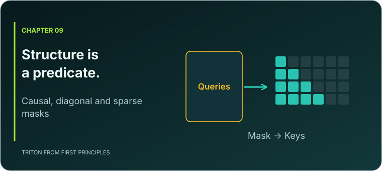
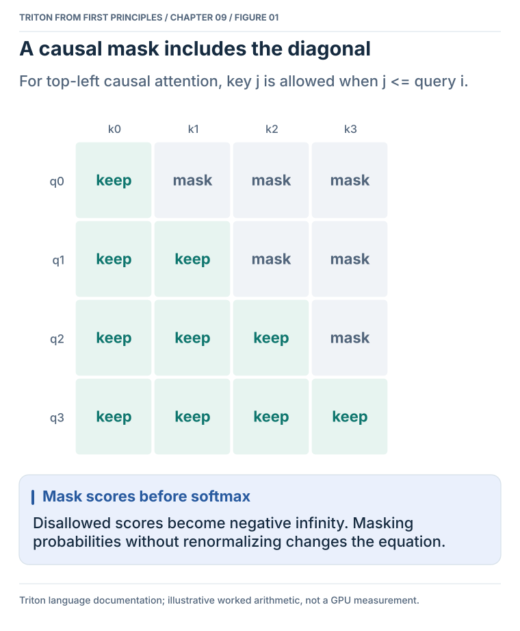

# Chapter 9: Mask and Structure Kernels

[](../images/chapter-openers/09.svg)

[](../images/ch09/01-concept.svg)

> "Every mask since Chapter 5 has answered one question: is this index in bounds? A mask can answer a much richer question than that — is this position on or below the diagonal, is this whole tile worth computing at all, does this particular row even have this many real elements — and the moment it does, the mask stops being bookkeeping and starts being the actual structure of the computation."

**What you will understand by the end of this chapter:**

- How to build a triangular (causal) mask as a direct comparison between two block-shaped index tensors, and the specific off-by-one mistake that silently zeroes out the diagonal in causal-attention-style code
- How to skip an entire tile's worth of computation, not just individual out-of-bounds elements, by loading a per-program flag as a genuine scalar and branching on it the way Chapter 1, Section 1.4 established is legal
- How to write a kernel whose masking bound is different for every row of a batch — the ragged-batch case, where a shared `n` (every kernel since Chapter 5) isn't the right shape for the problem, and a per-row length array is
- Why all three patterns are the same masking machinery from Chapters 5–7, aimed at successively more specific questions, rather than three unrelated new primitives

**What you need to know first:**

- Chapter 5's masking discipline (`mask=`, `other=`, and the `tl.where` fix from Chapter 1, Section 1.4) — every mask in this chapter builds directly on that foundation
- Chapter 1, Section 1.4's distinction between a genuine scalar (legal to branch on with Python's `if`) and a block-shaped value (not) — Section 9.2 depends on this directly
- Chapter 7's broadcasting via `[:, None]` / `[None, :]` — used throughout to build 2D index grids

## 9.1 Triangular Structure: Masks as a Function of Two Indices `[FOUNDATIONAL]`

### Intuition

A round-robin tournament schedule where every team plays every other team exactly once is naturally drawn as a triangle, not a full grid: once you know team 3 plays team 7, you already know team 7 plays team 3 — writing both cells wastes ink on redundant information. A scheduler filling in only the lower-triangular half of the grid isn't applying an arbitrary restriction; the shape of the problem itself is triangular.

Causal attention is the same shape for a different reason: position `i` in a sequence is allowed to attend to position `j` only if `j <= i` — the future hasn't been generated yet when position `i` is being computed, so nothing past it should be visible. Chapters 5 through 7 already built every ingredient this needs: `cols[None, :] <= rows[:, None]` is a broadcasted comparison producing exactly the same kind of `(BLOCK_M, BLOCK_N)`-shaped boolean tensor a bounds mask like `rows[:, None] < M` already is. It happens to encode "on or below the diagonal" instead of "within the tensor's real extent," but it is not a new kind of object — it's the same mask machinery pointed at a different question.

### Background

| | Bounds mask (Chapters 5–7) | Causal mask (this section) |
|---|---|---|
| What it answers | Is this index within the tensor's real shape? | Is this column position on or before this row position? |
| Built from | `rows[:, None] < M`, `cols[None, :] < N` | `cols[None, :] <= rows[:, None]` |
| Combines with other masks how | `&` with other bounds masks | `&` with a bounds mask, exactly the same way — both are just boolean tensors |
| Applied via | `mask=` on `tl.load`/`tl.store`, or `tl.where` | Same primitives, same rules |

### Worked Example 9.1.1 — masking everything above the diagonal

```python
rows = tl.arange(0, BLOCK_M)
cols = tl.arange(0, BLOCK_N)
bounds_mask = (rows[:, None] < M) & (cols[None, :] < N)
causal_mask = cols[None, :] <= rows[:, None]     # keep only col <= row (lower triangular)
ptrs = x_ptr + rows[:, None] * stride_m + cols[None, :] * stride_n
x = tl.load(ptrs, mask=bounds_mask, other=0.0)
result = tl.where(causal_mask, x, 0.0)
```

Against a `4×4` tensor of `1..16`, hand-trace row 1 (`rows[1] = 1`): `causal_mask[1, :] = [1<=1, 0<=1... ]` — precisely, `cols = [0,1,2,3]`, so `causal_mask[1, j] = (j <= 1)`, true for `j=0,1` and false for `j=2,3`. Row 1's real values are `[5, 6, 7, 8]`, so the masked row should be `[5, 6, 0, 0]`. Genuinely captured:

```
input:
 tensor([[ 1.,  2.,  3.,  4.],
        [ 5.,  6.,  7.,  8.],
        [ 9., 10., 11., 12.],
        [13., 14., 15., 16.]])
causal-masked (lower triangular, incl. diagonal):
 tensor([[ 1.,  0.,  0.,  0.],
        [ 5.,  6.,  0.,  0.],
        [ 9., 10., 11.,  0.],
        [13., 14., 15., 16.]])
matches torch.tril(x)? True
```

Every row matches the hand trace, and the whole result matches PyTorch's own `torch.tril` exactly — confirmation that a broadcasted `<=` comparison genuinely is a correct, general way to build this structure, not a coincidence of this particular example.

### Worked Example 9.1.2 — the off-by-one that zeroes the diagonal

```python
wrong_mask = cols[None, :] < rows[:, None]     # BUG: should be <=
```

A single changed character — `<` instead of `<=` — changes "keep the diagonal and everything below it" to "keep only strictly below it." Genuinely captured, on the identical input:

```
with < instead of <=:
 tensor([[ 0.,  0.,  0.,  0.],
        [ 5.,  0.,  0.,  0.],
        [ 9., 10.,  0.,  0.],
        [13., 14., 15.,  0.]])
diagonal zeroed out (1, 6, 11, 16 all missing) -- a common off-by-one in causal attention code
```

Every diagonal entry — a position attending to itself, which causal attention explicitly requires — silently disappears. Nothing about this failure looks obviously wrong from the output alone: it's a perfectly well-formed lower-triangular-looking matrix, just the wrong one, and this exact mistake (`<` where `<=` was needed, or the reverse) is one of the most common real bugs in hand-written causal attention kernels.

### ASCII Diagram — two masks, two different questions, same machinery

```
   bounds_mask: rows[:,None] < M  &  cols[None,:] < N        causal_mask: cols[None,:] <= rows[:,None]

   row\col  0    1    2    3                                  row\col  0    1    2    3
      0    [T]  [T]  [T]  [T]   (all in-bounds,                  0    [T]  [F]  [F]  [F]
      1    [T]  [T]  [T]  [T]    M=N=4, BLOCK=4)                 1    [T]  [T]  [F]  [F]
      2    [T]  [T]  [T]  [T]                                    2    [T]  [T]  [T]  [F]
      3    [T]  [T]  [T]  [T]                                    3    [T]  [T]  [T]  [T]

   Both are ordinary (BLOCK_M, BLOCK_N) boolean tensors, built from the exact same
   rows[:,None] / cols[None,:] broadcasting pattern -- they combine with `&` exactly
   the way two bounds masks would.
```

> `[COMMON TRAP]` A causal mask alone is not a substitute for a bounds mask, and forgetting the bounds half is easy to miss precisely because the two masks look so similar. If `BLOCK_M` or `BLOCK_N` exceeds the tensor's real `M`/`N` (the ordinary case whenever a shape isn't an exact multiple of the block size — Chapter 5), applying only `causal_mask` to a `tl.load` reads past the tensor's real extent for any row/col pair that happens to satisfy `col <= row` but lies outside `[0, M) × [0, N)`. The fix is the same as every masked load since Chapter 5: `&` the causal mask together with a genuine bounds mask, exactly as Worked Example 9.1.1 did, rather than assuming triangular structure alone bounds anything.

## 9.2 Block-Sparse Patterns: Skipping Whole Tiles by Branching on a Real Scalar `[FOUNDATIONAL]`

### Intuition

A warehouse worker checking a manifest before opening a shipping container saves real time by not opening containers the manifest already says are empty — the saving isn't in how fast they can search an empty container, it's in never touching it at all. Masking an individual element after loading it (Chapters 5–9.1) is the equivalent of opening every container and then ignoring the empty ones; skipping a whole tile before ever issuing a load for it is the equivalent of reading the manifest first.

Block-sparse patterns — common in sparse attention, mixture-of-experts routing, and pruned models — exploit exactly this: a coarse per-tile flag decides whether an entire block of work is worth computing at all. Chapter 1, Section 1.4 already established the rule this depends on: `tl.program_id(0)` is a genuine scalar, and so is any single value loaded through it (like one flag out of a per-block array) — branching on a scalar with Python's `if` is legal, unlike branching on a block-shaped mask.

### Background

| | Element-level masking (Chapters 5–9.1) | Block-level skipping (this section) |
|---|---|---|
| What decides the outcome | A `BLOCK`-shaped boolean tensor | A single scalar, loaded once per program instance |
| How it's applied | `mask=` on `tl.load`/`tl.store`, or `tl.where` | An ordinary Python `if`, legal per Chapter 1, Section 1.4 |
| What happens to skipped work | Loads/stores still issue, masked lanes are ignored | The `tl.load`/`tl.store` calls for that tile never execute at all |
| Where the saving comes from | Correctness — an invalid lane never corrupts memory | Actual avoided memory traffic and compute, not just correctness |

### Worked Example 9.2.1 — skipping entire blocks based on a per-block flag

```python
@triton.jit
def block_sparse_double_kernel(x_ptr, out_ptr, block_mask_ptr, N,
                                BLOCK: tl.constexpr, NUM_BLOCKS: tl.constexpr):
    pid = tl.program_id(0)
    is_active = tl.load(block_mask_ptr + pid)     # a genuine scalar: one flag per program instance
    offsets = pid * BLOCK + tl.arange(0, BLOCK)
    mask = offsets < N
    if is_active:                                  # legal: is_active is a real scalar (Ch1, Sec 1.4)
        x = tl.load(x_ptr + offsets, mask=mask, other=0.0)
        tl.store(out_ptr + offsets, x * 2.0, mask=mask)
```

With `N=16`, `BLOCK=4` (4 program instances, one per block), and `block_mask = [1, 0, 1, 0]` — blocks 0 and 2 active, blocks 1 and 3 not — the output buffer is pre-zeroed so a skipped block's untouched state is directly visible. Genuinely captured:

```
x:             [0.0, 1.0, 2.0, 3.0, 4.0, 5.0, 6.0, 7.0, 8.0, 9.0, 10.0, 11.0, 12.0, 13.0, 14.0, 15.0]
block_mask:    [1, 0, 1, 0]  (one flag per BLOCK=4 chunk)
result:        [0.0, 2.0, 4.0, 6.0, 0.0, 0.0, 0.0, 0.0, 16.0, 18.0, 20.0, 22.0, 0.0, 0.0, 0.0, 0.0]
(blocks 0 and 2 doubled; blocks 1 and 3 left as the pre-zeroed 0.0 -- their tl.load/tl.store never ran)
```

Positions `0..3` (block 0) and `8..11` (block 2) show the doubled values; positions `4..7` and `12..15` show the pre-zeroed `0.0` untouched — not because a mask suppressed a store, but because `tl.load` and `tl.store` for those blocks were never reached at all. This is the entire point of the pattern: for a genuinely sparse block-mask (most real block-sparse attention patterns skip the large majority of tiles), the memory traffic and compute for every skipped block is avoided outright, not merely discarded after the fact.

### ASCII Diagram — one flag, one branch, one program instance

```
  block_mask:  [ 1 ,  0 ,  1 ,  0 ]
                 |     |     |     |
  program 0 -----'     |     |     |    is_active = 1 -> tl.load/tl.store DO run
  program 1 -----------'     |     |    is_active = 0 -> tl.load/tl.store NEVER run
  program 2 -----------------'     |    is_active = 1 -> tl.load/tl.store DO run
  program 3 -----------------------'    is_active = 0 -> tl.load/tl.store NEVER run

  Each program instance loads exactly ONE scalar flag for itself --
  never the whole block_mask array -- and that scalar is what Ch1 Sec 1.4
  calls a genuine, unambiguous single value: legal to branch on directly.
```

> `[COMMON TRAP]` `is_active` is only a legal `if` condition because it was loaded as a single scalar — `tl.load(block_mask_ptr + pid)` with a scalar `pid` and no `tl.arange` anywhere in the address computation. Writing the same idea slightly differently, say by accidentally loading a `BLOCK`-shaped slice of `block_mask_ptr` instead of one flag per program, reintroduces exactly Chapter 1, Section 1.4's trap: `if` on a block-shaped tensor either raises an error on a real compiled build or behaves like Worked Example 1.4.2's silently-wrong collapse under this book's interpreter. The scalar-ness of `is_active` here isn't incidental — it's the entire reason this pattern is legal at all.

## 9.3 Ragged Batches: When the Bound Isn't Shared Across the Grid `[FOUNDATIONAL]`

### Intuition

A ferry terminal loading several different-sized ferries doesn't use one boarding cutoff number for every ferry — the 40-car ferry closes boarding after 40 cars, the 60-car ferry after 60, each independently, from the same queue-management process applied with a different number each time. Every masked kernel since Chapter 5 has used a single shared `n` (or `M`/`N`) — the same bound, for every program instance, for the whole launch. A ragged batch — variable-length sequences padded into a common tensor shape, extremely common in NLP and any batch of naturally different-length sequences — breaks that assumption directly: row 0 might have 4 real elements, row 1 only 2, row 2 exactly 3, all padded out to the same width for storage.

The fix doesn't require a new primitive — it requires each program instance to load *its own* bound, from a per-row `lengths` array, instead of receiving one shared `n` as an ordinary kernel argument. `tl.load(lengths_ptr + row)` returns a genuine scalar (exactly Section 9.2's pattern, applied to a bound instead of a flag), and that scalar becomes the comparison value in an otherwise completely ordinary mask.

### Background

| | Every kernel through Chapter 8 | Ragged-batch kernel (this section) |
|---|---|---|
| Where the bound (`n`) comes from | A single scalar kernel argument, shared by every program instance | A per-row entry in a `lengths` array, loaded individually by each program instance |
| Mask expression | `offsets < n` | `offsets < row_len`, where `row_len = tl.load(lengths_ptr + row)` |
| Same bound for every program in the grid? | Yes | No — genuinely different per program instance |
| New Triton primitive required | — | None — this is Section 9.2's "load your own scalar" pattern, reused for a bound instead of a flag |

### Worked Example 9.3.1 — summing each row up to its own real length

```python
@triton.jit
def ragged_row_sum_kernel(x_ptr, lengths_ptr, out_ptr, stride_row, MAX_WIDTH: tl.constexpr):
    row = tl.program_id(0)
    row_len = tl.load(lengths_ptr + row)          # a genuine scalar: this row's real length
    cols = tl.arange(0, MAX_WIDTH)
    mask = cols < row_len                          # per-row bound, NOT a shared n
    ptrs = x_ptr + row * stride_row + cols
    x = tl.load(ptrs, mask=mask, other=0.0)
    total = tl.sum(x, axis=0)
    tl.store(out_ptr + row, total)
```

Against a padded `(3, 4)` tensor where rows have real lengths `4, 2, 3` (the remaining positions padded with `999.0` — a deliberately obvious sentinel, so any leakage would be unmistakable), launched with one program instance per row:

```
padded tensor (rows padded with 999.0 past their real length):
 tensor([[  1.,   2.,   3.,   4.],
        [ 10.,  20., 999., 999.],
        [  5.,   5.,   5., 999.]])
lengths: [4, 2, 3]
ragged row sums (ignoring padding): [10.0, 30.0, 15.0]
expected (manually summing only the real, unpadded portion): [10.0, 30.0, 15.0]
matches? True
```

Row 0's mask (`row_len=4`) keeps all four positions: `1+2+3+4=10`. Row 1's mask (`row_len=2`) keeps only the first two, excluding both `999.0` sentinels: `10+20=30` — if the padding had leaked in, this would have been `1029.0`, not `30.0`, an error impossible to miss. Row 2's mask (`row_len=3`) excludes the trailing `999.0`: `5+5+5=15`. Every row used the exact same kernel code, with the only difference between rows being the single scalar `row_len` each program instance loaded for itself.

### ASCII Diagram — three programs, three different bounds, one kernel

```
  lengths:  [ 4 ,  2 ,  3 ]

  program 0 (row 0): row_len=4   cols=[0,1,2,3]   mask=[T,T,T,T]   sums all 4 real values
  program 1 (row 1): row_len=2   cols=[0,1,2,3]   mask=[T,T,F,F]   sums only the first 2
  program 2 (row 2): row_len=3   cols=[0,1,2,3]   mask=[T,T,T,F]   sums only the first 3

  Same `cols = tl.arange(0, MAX_WIDTH)` in every program instance --
  the mask differs only because `row_len` (one scalar, loaded per-row)
  differs. No per-row branching, no per-row recompilation: one compiled
  kernel, applied identically, computing something genuinely different
  for each program instance because its input scalar was different.
```

> `[COMMON TRAP]` It's tempting to reach for a Python-level loop over rows with a different `n` passed as an ordinary launch argument each time — `kernel[(1,)](row_i, n=lengths[i])` in a loop — rather than loading the length inside the kernel. This works, but it launches one kernel per row instead of one kernel launch covering the whole batch, giving up exactly the parallelism a `(num_rows,)`-shaped grid provides for free. Loading each row's own bound from inside the kernel, as Worked Example 9.3.1 does, keeps the entire ragged batch as a single launch — the same principle Chapter 5 established for the "remainder" problem (one masked launch instead of a separate cleanup kernel), applied here to per-row rather than per-launch variation.

## 9.4 Complete Runnable Code

Sections 9.1–9.3 built up this chapter's findings as isolated probes. The files below are the actual, complete, run-in-order source. `04_standalone_complete.py` combines everything from Sections 9.1 through 9.3 into a single script; its output is reproduced in full afterward. All were run exactly as shown, with `TRITON_INTERPRET=1` set, per Chapter 1's opening disclosure.

### File: `01_triangular_masks.py` — Section 9.1

[Download the complete current reference](../examples/references/part1/04-mask-and-structure-kernels/01_triangular_masks.py) (interpreter mode; GPU portability is not established).

**Execution:** `TRITON_INTERPRET=1 python3 01_triangular_masks.py`

```python
import torch
import triton
import triton.language as tl


@triton.jit
def causal_mask_kernel(x_ptr, out_ptr, M, N, stride_m, stride_n,
                        BLOCK_M: tl.constexpr, BLOCK_N: tl.constexpr):
    rows = tl.arange(0, BLOCK_M)
    cols = tl.arange(0, BLOCK_N)
    bounds_mask = (rows[:, None] < M) & (cols[None, :] < N)
    causal_mask = cols[None, :] <= rows[:, None]
    ptrs = x_ptr + rows[:, None] * stride_m + cols[None, :] * stride_n
    x = tl.load(ptrs, mask=bounds_mask, other=0.0)
    result = tl.where(causal_mask, x, 0.0)
    out_ptrs = out_ptr + rows[:, None] * N + cols[None, :]
    tl.store(out_ptrs, result, mask=bounds_mask)


@triton.jit
def wrong_causal_mask_kernel(x_ptr, out_ptr, M, N, stride_m, stride_n,
                              BLOCK_M: tl.constexpr, BLOCK_N: tl.constexpr):
    rows = tl.arange(0, BLOCK_M)
    cols = tl.arange(0, BLOCK_N)
    bounds_mask = (rows[:, None] < M) & (cols[None, :] < N)
    wrong_mask = cols[None, :] < rows[:, None]     # BUG: should be <=
    ptrs = x_ptr + rows[:, None] * stride_m + cols[None, :] * stride_n
    x = tl.load(ptrs, mask=bounds_mask, other=0.0)
    result = tl.where(wrong_mask, x, 0.0)
    out_ptrs = out_ptr + rows[:, None] * N + cols[None, :]
    tl.store(out_ptrs, result, mask=bounds_mask)


def demo_causal_mask():
    print("=== Section 9.1: a correct causal (lower-triangular) mask ===")
    x = torch.arange(1, 17, dtype=torch.float32).reshape(4, 4)
    print("input:\n", x)
    out = torch.empty(4, 4)
    causal_mask_kernel[(1,)](x, out, 4, 4, x.stride(0), x.stride(1), BLOCK_M=4, BLOCK_N=4)
    print("causal-masked (lower triangular, incl. diagonal):\n", out)
    print("matches torch.tril(x)?", torch.equal(out, torch.tril(x)))

    print("\n=== the off-by-one trap: < instead of <= excludes the diagonal ===")
    out_wrong = torch.empty(4, 4)
    wrong_causal_mask_kernel[(1,)](x, out_wrong, 4, 4, x.stride(0), x.stride(1), BLOCK_M=4, BLOCK_N=4)
    print("with < instead of <=:\n", out_wrong)


if __name__ == "__main__":
    demo_causal_mask()
```

### File: `02_block_sparse.py` — Section 9.2

[Download the complete current reference](../examples/references/part1/04-mask-and-structure-kernels/02_block_sparse.py) (interpreter mode; GPU portability is not established).

**Execution:** `TRITON_INTERPRET=1 python3 02_block_sparse.py`

```python
import torch
import triton
import triton.language as tl


@triton.jit
def block_sparse_double_kernel(x_ptr, out_ptr, block_mask_ptr, N,
                                BLOCK: tl.constexpr, NUM_BLOCKS: tl.constexpr):
    pid = tl.program_id(0)
    is_active = tl.load(block_mask_ptr + pid)
    offsets = pid * BLOCK + tl.arange(0, BLOCK)
    mask = offsets < N
    if is_active:
        x = tl.load(x_ptr + offsets, mask=mask, other=0.0)
        tl.store(out_ptr + offsets, x * 2.0, mask=mask)


def demo_block_sparse():
    print("=== Section 9.2: skipping whole blocks based on a per-block scalar flag ===")
    N = 16
    BLOCK = 4
    NUM_BLOCKS = triton.cdiv(N, BLOCK)
    x = torch.arange(N, dtype=torch.float32)
    out = torch.zeros(N)
    block_mask = torch.tensor([1, 0, 1, 0], dtype=torch.int32)

    block_sparse_double_kernel[(NUM_BLOCKS,)](x, out, block_mask, N, BLOCK=BLOCK, NUM_BLOCKS=NUM_BLOCKS)
    print("x:            ", x.tolist())
    print("block_mask:   ", block_mask.tolist())
    print("result:       ", out.tolist())


if __name__ == "__main__":
    demo_block_sparse()
```

### File: `03_ragged_batches.py` — Section 9.3

[Download the complete current reference](../examples/references/part1/04-mask-and-structure-kernels/03_ragged_batches.py) (interpreter mode; GPU portability is not established).

**Execution:** `TRITON_INTERPRET=1 python3 03_ragged_batches.py`

```python
import torch
import triton
import triton.language as tl


@triton.jit
def ragged_row_sum_kernel(x_ptr, lengths_ptr, out_ptr, stride_row, MAX_WIDTH: tl.constexpr):
    row = tl.program_id(0)
    row_len = tl.load(lengths_ptr + row)
    cols = tl.arange(0, MAX_WIDTH)
    mask = cols < row_len
    ptrs = x_ptr + row * stride_row + cols
    x = tl.load(ptrs, mask=mask, other=0.0)
    total = tl.sum(x, axis=0)
    tl.store(out_ptr + row, total)


def demo_ragged_batches():
    print("=== Section 9.3: a per-row bound instead of a shared n ===")
    padded = torch.tensor([
        [1.0, 2.0, 3.0, 4.0],
        [10.0, 20.0, 999.0, 999.0],
        [5.0, 5.0, 5.0, 999.0],
    ])
    lengths = torch.tensor([4, 2, 3], dtype=torch.int32)

    out = torch.empty(3, dtype=torch.float32)
    ragged_row_sum_kernel[(3,)](padded, lengths, out, padded.stride(0), MAX_WIDTH=4)

    print("padded tensor:\n", padded)
    print("lengths:", lengths.tolist())
    print("ragged row sums (ignoring padding):", out.tolist())


if __name__ == "__main__":
    demo_ragged_batches()
```

### File: `04_standalone_complete.py` — the full chapter, one program

[Download the complete current reference](../examples/references/part1/04-mask-and-structure-kernels/04_standalone_complete.py) (interpreter mode; GPU portability is not established).

**Execution:** `TRITON_INTERPRET=1 python3 04_standalone_complete.py`

```python
import torch
import triton
import triton.language as tl


@triton.jit
def causal_mask_kernel(x_ptr, out_ptr, M, N, stride_m, stride_n,
                        BLOCK_M: tl.constexpr, BLOCK_N: tl.constexpr):
    rows = tl.arange(0, BLOCK_M)
    cols = tl.arange(0, BLOCK_N)
    bounds_mask = (rows[:, None] < M) & (cols[None, :] < N)
    causal_mask = cols[None, :] <= rows[:, None]
    ptrs = x_ptr + rows[:, None] * stride_m + cols[None, :] * stride_n
    x = tl.load(ptrs, mask=bounds_mask, other=0.0)
    result = tl.where(causal_mask, x, 0.0)
    out_ptrs = out_ptr + rows[:, None] * N + cols[None, :]
    tl.store(out_ptrs, result, mask=bounds_mask)


@triton.jit
def block_sparse_double_kernel(x_ptr, out_ptr, block_mask_ptr, N,
                                BLOCK: tl.constexpr, NUM_BLOCKS: tl.constexpr):
    pid = tl.program_id(0)
    is_active = tl.load(block_mask_ptr + pid)
    offsets = pid * BLOCK + tl.arange(0, BLOCK)
    mask = offsets < N
    if is_active:
        x = tl.load(x_ptr + offsets, mask=mask, other=0.0)
        tl.store(out_ptr + offsets, x * 2.0, mask=mask)


@triton.jit
def ragged_row_sum_kernel(x_ptr, lengths_ptr, out_ptr, stride_row, MAX_WIDTH: tl.constexpr):
    row = tl.program_id(0)
    row_len = tl.load(lengths_ptr + row)
    cols = tl.arange(0, MAX_WIDTH)
    mask = cols < row_len
    ptrs = x_ptr + row * stride_row + cols
    x = tl.load(ptrs, mask=mask, other=0.0)
    total = tl.sum(x, axis=0)
    tl.store(out_ptr + row, total)


def main():
    print("=== Section 9.1: triangular masks ===")
    x = torch.arange(1, 17, dtype=torch.float32).reshape(4, 4)
    out = torch.empty(4, 4)
    causal_mask_kernel[(1,)](x, out, 4, 4, x.stride(0), x.stride(1), BLOCK_M=4, BLOCK_N=4)
    print("causal-masked:\n", out)
    print("matches torch.tril(x)?", torch.equal(out, torch.tril(x)))

    print("\n=== Section 9.2: block-sparse skipping ===")
    N, BLOCK = 16, 4
    NUM_BLOCKS = triton.cdiv(N, BLOCK)
    xb = torch.arange(N, dtype=torch.float32)
    outb = torch.zeros(N)
    block_mask = torch.tensor([1, 0, 1, 0], dtype=torch.int32)
    block_sparse_double_kernel[(NUM_BLOCKS,)](xb, outb, block_mask, N, BLOCK=BLOCK, NUM_BLOCKS=NUM_BLOCKS)
    print("block-sparse result:", outb.tolist())

    print("\n=== Section 9.3: ragged batches ===")
    padded = torch.tensor([
        [1.0, 2.0, 3.0, 4.0],
        [10.0, 20.0, 999.0, 999.0],
        [5.0, 5.0, 5.0, 999.0],
    ])
    lengths = torch.tensor([4, 2, 3], dtype=torch.int32)
    outr = torch.empty(3, dtype=torch.float32)
    ragged_row_sum_kernel[(3,)](padded, lengths, outr, padded.stride(0), MAX_WIDTH=4)
    print("ragged row sums:", outr.tolist())


if __name__ == "__main__":
    main()
```

### Expected Output for `04_standalone_complete.py`

```
=== Section 9.1: triangular masks ===
causal-masked:
 tensor([[ 1.,  0.,  0.,  0.],
        [ 5.,  6.,  0.,  0.],
        [ 9., 10., 11.,  0.],
        [13., 14., 15., 16.]])
matches torch.tril(x)? True

=== Section 9.2: block-sparse skipping ===
block-sparse result: [0.0, 2.0, 4.0, 6.0, 0.0, 0.0, 0.0, 0.0, 16.0, 18.0, 20.0, 22.0, 0.0, 0.0, 0.0, 0.0]

=== Section 9.3: ragged batches ===
ragged row sums: [10.0, 30.0, 15.0]
```

Every number in that output was independently hand-traced earlier in this chapter: the triangular structure and its `torch.tril` cross-check in Section 9.1, the active/skipped block pattern in Section 9.2, and each row's real-length-only sum in Section 9.3.

## Chapter Summary

A triangular mask is built from exactly the same broadcasting machinery as a bounds mask — `cols[None, :] <= rows[:, None]` instead of `cols[None, :] < N` — and Section 9.1 showed both that this reproduces `torch.tril` exactly and that a single flipped comparison operator silently and specifically zeroes the diagonal, a common real mistake in causal attention code. Skipping a whole tile's computation, rather than masking individual elements within it, requires only that the flag deciding whether to skip be a genuine scalar — Section 9.2 showed a per-block flag loaded through a scalar `program_id`-indexed address, legal to branch on by Chapter 1, Section 1.4's rule, actually avoiding the `tl.load`/`tl.store` calls for inactive blocks rather than merely discarding their results. And a ragged batch, where different rows have genuinely different real lengths, needs no new primitive at all — Section 9.3 showed the same "load one scalar per program instance" pattern from Section 9.2, applied to a per-row bound instead of a per-block flag, letting one kernel launch handle a whole batch of differently-sized rows without a Python-level loop over them.

## Self-Check Questions

1. A causal mask is built as `cols[None, :] <= rows[:, None]`. What does this comparison mean in terms of "which position can see which," and why is `<=` rather than `<` the correct operator for standard causal attention?
2. Section 9.1's off-by-one trap and Section 9.2's block-sparse pattern both involve masks or flags, but they behave very differently when "wrong." Contrast what goes wrong when a causal mask has the wrong comparison operator versus when a block's `is_active` flag is loaded incorrectly as a block-shaped value instead of a scalar.
3. In the block-sparse kernel, what specifically is skipped for an inactive block — is it the same as loading the data and then discarding it via a mask? Why does the distinction matter in practice?
4. A ragged batch kernel loads `row_len = tl.load(lengths_ptr + row)` inside the kernel, rather than the caller looping over rows and passing a different `n` to a separate launch each time. What does keeping it inside one kernel launch preserve that a Python-level loop would give up?
5. Could Section 9.3's `ragged_row_sum_kernel` be rewritten to use `is_active`-style block-skipping (Section 9.2) instead of a per-row masked sum? What would that change, and would it still need `tl.load(lengths_ptr + row)`?

## Where We Go Next

Every mask in this chapter — triangular, block-sparse, ragged — has still been shaping computation that happens on a single GPU, running a single kernel written for a single hardware target. Chapter 10 turns to what changes when that assumption breaks: what a kernel actually needs to know about the GPU it's compiling for, how Triton's autotuning and `tl.constexpr`-driven configuration interact with genuinely different hardware generations, and what part of everything Chapters 1 through 9 have built stays true across hardware and what doesn't.

## Worked Solutions

**1.** `cols[None, :] <= rows[:, None]` is true at position `(row, col)` exactly when `col <= row` — that is, when the column position is at or before the row position. In standard causal attention, position `row` is allowed to attend to position `col` if `col` is not in `row`'s future, which includes `row` attending to itself (`col == row`). `<=` keeps the diagonal (self-attention) in addition to everything strictly before it; `<` would incorrectly exclude a position from attending to itself, which Worked Example 9.1.2 showed zeroes out every diagonal entry.

**2.** A wrong comparison operator in a causal mask (Section 9.1) produces a well-formed, plausible-looking output that is simply the wrong set of positions — no error, no crash, just silently incorrect structure, exactly like Chapter 6's stride-lying failures. A block-shaped value loaded where `is_active` should be a scalar (Section 9.2) reintroduces Chapter 1, Section 1.4's `if mask:` trap directly: on a real compiled build this is rejected outright as illegal, since Python's `if` cannot resolve a block-shaped condition to one truth value, and under this book's interpreter it behaves the way Worked Example 1.4.2 already showed — a plausible-looking but wrong collapse of the whole block's truthiness into one decision.

**3.** False lanes in a masked `tl.load` do not perform their loads; false lanes in a masked `tl.store` do not write. Active lanes can still fetch whole sectors. Skipping a whole inactive block additionally omits its instruction and address-generation work. This distinction is about predication versus skipping work, not a guarantee that masked-out lanes generate memory traffic.

**4.** Keeping the per-row length lookup inside one kernel launch preserves the parallelism of launching all rows as a single `(num_rows,)`-shaped grid, letting every row's program instance run independently and concurrently. A Python-level loop that calls a separate kernel launch per row, passing a different `n` each time, gives up that parallelism — it turns one launch covering the whole batch into as many separate launches as there are rows, each with its own trace/compile-cache lookup and launch overhead, purely to avoid loading one scalar from inside the kernel.

**5.** Not directly in the same form — `is_active` in Section 9.2 is a boolean flag deciding whether to do any work for a block at all, while a ragged batch's `row_len` is a bound that still requires real per-lane masking within a row, since a row's real length is rarely an exact multiple of a block boundary. What could be combined is block-skipping *across* rows or row-groups — if an entire block of rows in a larger ragged structure were entirely padding, a genuine `is_active`-style flag could skip it outright — but processing a single ragged row still needs `tl.load(lengths_ptr + row)` to know how many of that row's positions are real, exactly as Worked Example 9.3.1 does; skipping-by-flag and per-lane masking answer different questions and are typically used together rather than as substitutes for each other.
