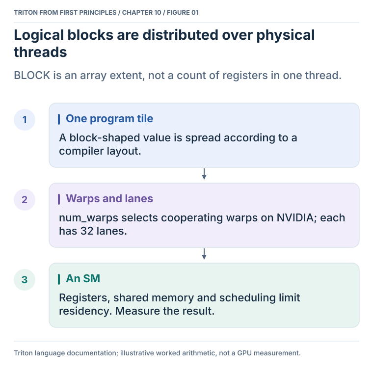

# Chapter 10: Targeting Hardware

[](../images/ch10/01-concept.svg)

> "A compiled kernel is compiled for something — a specific GPU generation, a specific number of warps scheduled per program instance, a specific number of pipeline stages. This book's interpreter has never had to answer any of those questions honestly, because it has never had a GPU to answer them about. This chapter is the one place that gap can no longer be worked around quietly."

**What you will understand by the end of this chapter:**

- What happens when Triton or PyTorch is asked, in this book's environment, the most basic hardware question there is — which GPU, if any, is present — and why every such query fails with the same shape of error Chapter 2's autotuning experiment already surfaced
- `num_warps` and `num_stages`: real, load-bearing hardware-tuning arguments that this book's interpreter accepts without complaint and without acting on at all, and exactly why that silence is a limitation of the interpreter rather than evidence the arguments don't matter
- The two genuinely different strategies real Triton code uses to adapt to whatever hardware it ends up running on — empirical autotuning, which benchmarks candidates on the actual device present, and explicit `tl.constexpr`-driven branching, which selects a code path from information supplied ahead of time — and which of the two this book's driver-less environment can and cannot demonstrate
- Why "runs correctly under the interpreter regardless of `num_warps`" is not the same claim as "runs correctly on real hardware regardless of `num_warps`," and where that gap actually matters

**What you need to know first:**

- Chapter 1, Section 1.2's `tl.constexpr` mechanics and Section 1.1's compilation-cache-per-signature model — this chapter's hardware-branching pattern is a direct application of both
- Chapter 2's autotuning finding (`RuntimeError: 0 active drivers ([]). There should only be one.`) — this chapter extends that same finding to hardware querying in general, rather than re-deriving it
- Chapter 8's device-placement disclosure (`torch.cuda.is_available() == False`, no NVIDIA driver present anywhere in this book's environment) — the running constraint this entire chapter is written around

## 10.1 Querying the Hardware You're Compiling For (and What Happens With None) `[FOUNDATIONAL]`

### Intuition

A recipe that says "adjust roasting time for your oven's actual temperature" is only useful to a cook who can put a thermometer in the oven and read a number back. A cook standing in front of an oven with no thermometer, no dial, and no manual has no way to answer the question at all — not because the question is malformed, but because nothing in front of them can supply an answer.

Every piece of Triton or PyTorch machinery that exists to answer "what GPU is this kernel actually compiling for" needs a real device to ask. This book's environment doesn't have one — Chapter 8 already established `torch.cuda.is_available() == False` and no NVIDIA driver present at all — so every such query fails, not with a wrong answer, but with an honest refusal to answer at all.

### Background

| | What it asks | What it needs to answer | Result in this book's environment |
|---|---|---|---|
| `triton.runtime.driver.active` | Which backend (CUDA, ROCm, ...) is currently active | A real, initialized GPU driver | `RuntimeError: 0 active drivers ([])` |
| `triton.runtime.driver.active.get_current_target()` | Which specific architecture (e.g. `sm_90`) to compile for | The same active driver | Same error — it never gets far enough to ask the second question |
| `torch.cuda.get_device_properties(0)` | Device name, compute capability, SM count, memory | A CUDA-visible GPU | `RuntimeError: Found no NVIDIA driver on your system` |
| Chapter 2's `@triton.autotune` launch | Which config runs fastest on this specific device | The same active driver, to actually benchmark candidates | The identical `0 active drivers` error, already documented in Chapter 2 |

### Worked Example 10.1.1 — three different questions, one honest answer

```python
triton.runtime.driver.active                          # which backend is active?
triton.runtime.driver.active.get_current_target()      # which architecture?
torch.cuda.get_device_properties(0)                    # device name, SM count, memory?
```

Genuinely captured, attempting all three in this book's environment:

```
RuntimeError: 0 active drivers ([]). There should only be one.
RuntimeError: 0 active drivers ([]). There should only be one.

torch.cuda.is_available(): False
RuntimeError: Found no NVIDIA driver on your system. Please check that you have an NVIDIA GPU and installed a driver from http://www.nvidia.com/Download/index.aspx
```

The first two errors are byte-for-byte identical, because both questions route through the same underlying driver-discovery step, and that step fails before either question is specifically asked. This is exactly the same error Chapter 2 encountered launching an autotuned kernel — worth recognizing now as a general symptom of "no GPU driver anywhere," not something specific to autotuning.

### ASCII Diagram — where every hardware query dead-ends

```
  "What GPU am I compiling for?"
              |
              v
     triton.runtime.driver.active
              |
              v
     Is there a real, initialized
     GPU driver on this machine?
        /                    \
      yes                     no  <-- this book's environment, every time
       |                       |
       v                       v
   Proceed to answer      RuntimeError: 0 active
   the specific question   drivers ([]). There
   (architecture, SM       should only be one.
   count, ...)             (Chapter 2's autotune
                            error, generalized)
```

> `[COMMON TRAP]` It's tempting to read Chapter 2's autotuning error as a fact specifically about autotuning, and this chapter's identical error on plain hardware queries as a coincidence. They are the same fact, encountered twice: `@triton.autotune`'s job is to benchmark candidate configurations on real hardware, which means it has to ask exactly the same "is there a driver" question this section asks directly — there was never a separate autotuning-specific failure mode, only this one, showing up wherever real hardware is required.

## 10.2 `num_warps` and `num_stages`: Hardware Knobs the Interpreter Accepts but Cannot Model `[FOUNDATIONAL]`

### Intuition

A shipping label that says "handle with 4 workers" is a real instruction about how a physical warehouse should staff the job — it changes how fast the job gets done and how it's coordinated, without changing what's inside the box. A simulation of the warehouse that only checks "did the right boxes end up in the right place" can accept that label, print it back, and never actually staff anything differently, because its notion of correctness was never about staffing in the first place.

`num_warps` (how many groups of 32 threads are scheduled per program instance) and `num_stages` (the requested software-pipeline staging, subject to compiler lowering) are exactly this kind of label: real scheduling and pipelining instructions to the GPU's real hardware, with real performance consequences, that this book's interpreter accepts as keyword arguments and does essentially nothing with — because the interpreter simulates a kernel's *logic* on the CPU, one program instance at a time, and has no warp scheduler or instruction pipeline to actually configure.

### Background

| | On a real compiled GPU build | Under this book's `TRITON_INTERPRET=1` |
|---|---|---|
| What `num_warps` controls | How many warps (groups of 32 threads) execute one program instance concurrently | Nothing — accepted as an argument, has no observable effect |
| What `num_stages` controls | Requested pipeline staging; actual overlap depends on the lowered kernel | Nothing — same as above |
| Effect on the kernel's numeric output | None, for a correctly written kernel — these are performance knobs, not correctness knobs | None — genuinely unchanged across values, as Worked Example 10.2.1 shows |
| Effect on wall-clock performance | Often dramatic — Chapter 19 explains how to measure this on a GPU | Not measurable at all — this book's interpreter has no meaningful timing signal (Chapter 1's opening disclosure) |

### Worked Example 10.2.1 — the same kernel, three different `num_warps`, one identical result

```python
add_kernel[(1,)](x, y, out, 4, BLOCK=4, num_warps=1)
add_kernel[(1,)](x, y, out, 4, BLOCK=4, num_warps=4)
add_kernel[(1,)](x, y, out, 4, BLOCK=4, num_warps=8)
```

Genuinely captured:

```
num_warps=1 -> [11.0, 22.0, 33.0, 44.0]
num_warps=4 -> [11.0, 22.0, 33.0, 44.0]
num_warps=8 -> [11.0, 22.0, 33.0, 44.0]
num_stages=3 accepted -> [11.0, 22.0, 33.0, 44.0]
```

Every value is identical across every configuration. On real hardware, `num_warps=1` versus `num_warps=8` for this kernel would very plausibly change measured throughput; under this book's interpreter, there is no mechanism by which it could, because the interpreter never actually schedules multiple warps in the first place — it evaluates the kernel body once, in Python, regardless of what `num_warps` claims.

> `[COMMON TRAP]` This result should not be read as "`num_warps` doesn't matter" — it should be read as "this book's tool for testing kernel logic cannot see anything `num_warps` actually changes." A kernel whose *correctness* genuinely depends on warp-level scheduling — for instance, one that relies on a specific ordering between lanes without explicit synchronization, an easy but serious bug — could pass every test in this book flawlessly under every `num_warps` value tried, and still be wrong on real hardware in a way that depends on warp count. This book's interpreter validates logic that doesn't depend on real concurrency; it cannot validate logic that secretly does.

## 10.3 Two Strategies for Adapting to Hardware: Autotuning vs. `constexpr` Branching `[FOUNDATIONAL]`

### Intuition

One traveler adapts to an unfamiliar country by trying several local phrasebooks in conversation and sticking with whichever gets understood fastest — an empirical process that requires actually being there, talking to actual people. A second traveler adapts by looking up, before the trip, exactly which language the destination country speaks, and packing only that phrasebook — a decision made from known facts, requiring no live experimentation once the facts are in hand.

Real Triton code adapts to different GPU generations using both of these strategies, and Section 10.1 already showed why only one of them can be genuinely demonstrated in this book's environment. `@triton.autotune` (Chapter 2) is the first traveler: it benchmarks each candidate configuration on the real device present at runtime and keeps whichever measured fastest — which is precisely why it needs the driver Section 10.1 showed doesn't exist here. A `tl.constexpr` flag like `USE_FAST_PATH` is the second traveler: it selects between code paths based on information decided before compilation — information that, in real code, usually comes from a hardware query, but which needs no live benchmarking once it's known, and can therefore be demonstrated honestly even without a GPU, simply by supplying that information by hand.

### Background

| | `@triton.autotune` (empirical) | `tl.constexpr` hardware branching (explicit) |
|---|---|---|
| How it decides | Benchmarks each candidate config on the real device, keeps the fastest | A flag, computed however the caller likes, selects a `tl.constexpr`-gated branch at trace time |
| Needs a real GPU to decide? | Yes — Section 10.1's driver-less error is exactly this requirement failing | No — the flag can come from anywhere, including a hand-supplied value |
| Can this book demonstrate the mechanism honestly? | No — Chapter 2 already showed this fails outright here | **Yes — Worked Example 10.3.1** |
| What decides the flag's value in real code | Not applicable | Usually the same hardware query Section 10.1 showed requires a real GPU — this book substitutes a hand-supplied value instead |

### Worked Example 10.3.1 — a `tl.constexpr` flag selecting between hardware-specific code paths

```python
@triton.jit
def hw_aware_kernel(x_ptr, out_ptr, n, USE_FAST_PATH: tl.constexpr, BLOCK: tl.constexpr):
    offsets = tl.arange(0, BLOCK)
    mask = offsets < n
    x = tl.load(x_ptr + offsets, mask=mask)
    if USE_FAST_PATH:
        result = x * 2.0     # stands in for a hardware-specific fast instruction sequence
    else:
        result = x + x       # a portable fallback path
    tl.store(out_ptr + offsets, result, mask=mask)

def launch_for_hardware(x, out, n, BLOCK, compute_capability):
    use_fast_path = compute_capability >= 90   # e.g. Hopper (sm_90) and newer
    hw_aware_kernel[(1,)](x, out, n, USE_FAST_PATH=use_fast_path, BLOCK=BLOCK)
```

Genuinely captured, calling `launch_for_hardware` with two different hand-supplied `compute_capability` values, standing in for hardware this book's environment cannot actually detect:

```
compute_capability=90 (fast path, tensor-core-style op) -> [2.0, 4.0, 6.0, 8.0]
compute_capability=80 (portable fallback path)          -> [2.0, 4.0, 6.0, 8.0]
(both paths compute the same mathematical result here for illustration --
 in real kernels the fast path invokes hardware-specific instructions the
 fallback path cannot, e.g. tensor-core MMA ops vs. plain multiply-adds)
```

`USE_FAST_PATH` is resolved during tracing exactly the way Chapter 1, Section 1.1's `USE_RELU` was — two distinct compiled kernels, one per branch, with the choice baked in before either one exists as compiled code. Both branches happen to compute the same numeric result here so the example can be verified without a real fast-path instruction to invoke; in genuine hardware-specific code, the two branches would call entirely different, non-interchangeable instruction sequences, and only one of them would even be legal to compile for a given architecture.

### ASCII Diagram — where each strategy gets its answer from

```
  Autotuning (empirical)                    constexpr branching (explicit)

  candidate configs                          compute_capability
  [BLOCK=64,  num_warps=4]                          |
  [BLOCK=128, num_warps=8]                          v
  [BLOCK=256, num_warps=4]              use_fast_path = (cc >= 90)
         |                                          |
         v                                          v
  benchmark EACH on the              trace ONE branch, chosen before
  real device present --             compilation, no benchmarking,
  needs Section 10.1's driver        no device required at all
  (fails here: 0 active drivers)     (Worked Example 10.3.1: works here)
         |                                          |
         v                                          v
  keep whichever measured            compile exactly the chosen
  fastest                            branch, permanently
```

> `[COMMON TRAP]` It's tempting to treat `tl.constexpr` branching as a strictly inferior substitute for autotuning, since it requires someone to already know the right answer instead of discovering it empirically. The two solve different problems: autotuning searches a space of *otherwise-equivalent* configurations (block sizes, warp counts) for whichever happens to run fastest, while `constexpr` branching selects between code paths that may not even be *valid* on every target (a tensor-core instruction that simply doesn't exist on older hardware) — a search autotuning is not equipped to perform, because there is no "try it and see" available when the wrong branch wouldn't compile at all on the wrong hardware. Real production kernels (flash-attention implementations are a common example) typically use both: `constexpr` flags to select a legal code path for the detected architecture, and autotuning within that path to pick the fastest configuration among the choices that remain legal.

## 10.4 Complete Runnable Code

Sections 10.1–10.3 built up this chapter's findings as isolated probes. The files below are the actual, complete, run-in-order source. `04_standalone_complete.py` combines everything from Sections 10.1 through 10.3 into a single script; its output is reproduced in full afterward. All were run exactly as shown, with `TRITON_INTERPRET=1` set, per Chapter 1's opening disclosure.

### File: `01_hardware_queries.py` — Section 10.1

[Download the complete current reference](../examples/references/part1/05-targeting-hardware/01_hardware_queries.py) (interpreter mode; GPU portability is not established).

**Execution:** `TRITON_INTERPRET=1 python3 01_hardware_queries.py`

```python
import torch
import triton
import triton.language as tl


def demo_hardware_queries():
    print("=== Section 10.1: querying hardware info without a GPU ===")
    try:
        print("triton.runtime.driver.active:", triton.runtime.driver.active)
    except Exception as e:
        print(f"{type(e).__name__}: {e}")

    try:
        target = triton.runtime.driver.active.get_current_target()
        print("current target:", target)
    except Exception as e:
        print(f"{type(e).__name__}: {e}")

    print("\ntorch.cuda.is_available():", torch.cuda.is_available())
    try:
        props = torch.cuda.get_device_properties(0)
        print(props)
    except Exception as e:
        print(f"{type(e).__name__}: {e}")


if __name__ == "__main__":
    demo_hardware_queries()
```

### File: `02_warps_and_stages.py` — Section 10.2

[Download the complete current reference](../examples/references/part1/05-targeting-hardware/02_warps_and_stages.py) (interpreter mode; GPU portability is not established).

**Execution:** `TRITON_INTERPRET=1 python3 02_warps_and_stages.py`

```python
import torch
import triton
import triton.language as tl


@triton.jit
def add_kernel(x_ptr, y_ptr, out_ptr, n, BLOCK: tl.constexpr):
    offsets = tl.arange(0, BLOCK)
    mask = offsets < n
    x = tl.load(x_ptr + offsets, mask=mask)
    y = tl.load(y_ptr + offsets, mask=mask)
    tl.store(out_ptr + offsets, x + y, mask=mask)


def demo_warps_and_stages():
    print("=== Section 10.2: num_warps / num_stages under the interpreter ===")
    x = torch.tensor([1.0, 2.0, 3.0, 4.0])
    y = torch.tensor([10.0, 20.0, 30.0, 40.0])

    for nw in [1, 4, 8]:
        out = torch.empty_like(x)
        add_kernel[(1,)](x, y, out, 4, BLOCK=4, num_warps=nw)
        print(f"num_warps={nw} -> {out.tolist()}")

    try:
        out = torch.empty_like(x)
        add_kernel[(1,)](x, y, out, 4, BLOCK=4, num_stages=3)
        print("num_stages=3 accepted ->", out.tolist())
    except Exception as e:
        print(f"num_stages=3 -> {type(e).__name__}: {e}")


if __name__ == "__main__":
    demo_warps_and_stages()
```

### File: `03_constexpr_hw_branch.py` — Section 10.3

[Download the complete current reference](../examples/references/part1/05-targeting-hardware/03_constexpr_hw_branch.py) (interpreter mode; GPU portability is not established).

**Execution:** `TRITON_INTERPRET=1 python3 03_constexpr_hw_branch.py`

```python
import torch
import triton
import triton.language as tl


@triton.jit
def hw_aware_kernel(x_ptr, out_ptr, n, USE_FAST_PATH: tl.constexpr, BLOCK: tl.constexpr):
    offsets = tl.arange(0, BLOCK)
    mask = offsets < n
    x = tl.load(x_ptr + offsets, mask=mask)
    if USE_FAST_PATH:
        result = x * 2.0
    else:
        result = x + x
    tl.store(out_ptr + offsets, result, mask=mask)


def launch_for_hardware(x, out, n, BLOCK, compute_capability):
    use_fast_path = compute_capability >= 90
    hw_aware_kernel[(1,)](x, out, n, USE_FAST_PATH=use_fast_path, BLOCK=BLOCK)


def demo_constexpr_hw_branch():
    print("=== Section 10.3: a tl.constexpr flag selecting between hardware-specific code paths ===")
    x = torch.tensor([1.0, 2.0, 3.0, 4.0])

    out_new = torch.empty_like(x)
    launch_for_hardware(x, out_new, 4, 4, compute_capability=90)
    print("compute_capability=90 (fast path)   ->", out_new.tolist())

    out_old = torch.empty_like(x)
    launch_for_hardware(x, out_old, 4, 4, compute_capability=80)
    print("compute_capability=80 (fallback path) ->", out_old.tolist())


if __name__ == "__main__":
    demo_constexpr_hw_branch()
```

### File: `04_standalone_complete.py` — the full chapter, one program

[Download the complete current reference](../examples/references/part1/05-targeting-hardware/04_standalone_complete.py) (interpreter mode; GPU portability is not established).

**Execution:** `TRITON_INTERPRET=1 python3 04_standalone_complete.py`

```python
import torch
import triton
import triton.language as tl


@triton.jit
def add_kernel(x_ptr, y_ptr, out_ptr, n, BLOCK: tl.constexpr):
    offsets = tl.arange(0, BLOCK)
    mask = offsets < n
    x = tl.load(x_ptr + offsets, mask=mask)
    y = tl.load(y_ptr + offsets, mask=mask)
    tl.store(out_ptr + offsets, x + y, mask=mask)


@triton.jit
def hw_aware_kernel(x_ptr, out_ptr, n, USE_FAST_PATH: tl.constexpr, BLOCK: tl.constexpr):
    offsets = tl.arange(0, BLOCK)
    mask = offsets < n
    x = tl.load(x_ptr + offsets, mask=mask)
    if USE_FAST_PATH:
        result = x * 2.0
    else:
        result = x + x
    tl.store(out_ptr + offsets, result, mask=mask)


def launch_for_hardware(x, out, n, BLOCK, compute_capability):
    use_fast_path = compute_capability >= 90
    hw_aware_kernel[(1,)](x, out, n, USE_FAST_PATH=use_fast_path, BLOCK=BLOCK)


def main():
    print("=== Section 10.1: hardware queries without a GPU ===")
    try:
        triton.runtime.driver.active.get_current_target()
    except Exception as e:
        print(f"hardware query -> {type(e).__name__}: {e}")

    print("\n=== Section 10.2: num_warps / num_stages ===")
    x = torch.tensor([1.0, 2.0, 3.0, 4.0])
    y = torch.tensor([10.0, 20.0, 30.0, 40.0])
    for nw in [1, 4, 8]:
        out = torch.empty_like(x)
        add_kernel[(1,)](x, y, out, 4, BLOCK=4, num_warps=nw)
        print(f"num_warps={nw} -> {out.tolist()}")

    print("\n=== Section 10.3: constexpr hardware branching ===")
    out_new = torch.empty_like(x)
    launch_for_hardware(x, out_new, 4, 4, compute_capability=90)
    print("compute_capability=90 ->", out_new.tolist())
    out_old = torch.empty_like(x)
    launch_for_hardware(x, out_old, 4, 4, compute_capability=80)
    print("compute_capability=80 ->", out_old.tolist())


if __name__ == "__main__":
    main()
```

### Expected Output for `04_standalone_complete.py`

```
=== Section 10.1: hardware queries without a GPU ===
hardware query -> RuntimeError: 0 active drivers ([]). There should only be one.

=== Section 10.2: num_warps / num_stages ===
num_warps=1 -> [11.0, 22.0, 33.0, 44.0]
num_warps=4 -> [11.0, 22.0, 33.0, 44.0]
num_warps=8 -> [11.0, 22.0, 33.0, 44.0]

=== Section 10.3: constexpr hardware branching ===
compute_capability=90 -> [2.0, 4.0, 6.0, 8.0]
compute_capability=80 -> [2.0, 4.0, 6.0, 8.0]
```

Every result here is exactly as reproducible as any other chapter's: the `RuntimeError` text is stable across runs of this book's environment (it depends only on the absence of a driver, not on anything random), and every numeric result matches its corresponding worked example precisely.

## Chapter Summary

Every attempt to ask this book's environment a hardware question — which driver is active, which architecture to compile for, what a device's properties are — fails with the same underlying cause Chapter 2 already surfaced once: no GPU driver exists here at all, so the question can't be answered, not answered wrongly (Section 10.1). `num_warps` and `num_stages` are genuine, load-bearing hardware-scheduling arguments that this book's interpreter accepts and silently ignores, which means a kernel "passing" under every value of either in this book's tests is evidence the kernel's *logic* doesn't depend on them — not evidence that its real-hardware *behavior* doesn't (Section 10.2). And real Triton code adapts to different hardware two ways: autotuning, which benchmarks real candidates on a real device and therefore cannot be demonstrated honestly here, and `tl.constexpr`-driven branching, which needs only a known flag value and can be demonstrated genuinely by supplying that value by hand instead of querying for it (Section 10.3) — the two are complementary, not competing, strategies, used together in real production kernels.

## Self-Check Questions

1. `triton.runtime.driver.active` and `torch.cuda.get_device_properties(0)` both fail in this book's environment. What is the shared underlying cause, and how does it connect to a specific error this book already encountered in an earlier chapter?
2. A kernel produces identical output whether launched with `num_warps=1` or `num_warps=8` under this book's interpreter. Does this prove the kernel would behave identically on real hardware under both settings? Why or why not?
3. Why can `@triton.autotune` not be genuinely demonstrated in this book's environment, while `tl.constexpr`-driven hardware branching can?
4. In Worked Example 10.3.1, where does `compute_capability` come from, and what would supply that value in a real production kernel running on real hardware?
5. A team is optimizing a kernel that needs to run well on three different GPU generations, one of which lacks a fast instruction the newest generation has. Would autotuning alone be sufficient to handle this, or is something else required? Explain why.

## Where We Go Next

This chapter's `constexpr` hardware-branching pattern assumed each program instance already had everything it needed once the right code path was selected — it never asked what happens when multiple program instances, or multiple iterations within one, need to *share* work or intermediate results rather than compute everything independently. Chapter 11 turns to exactly that: the kernel cache Chapter 1 introduced as a compilation-level concept, and shared memory as the mechanism real GPU hardware uses to let threads within a single program instance cooperate — the last major piece of Part 1 before Part 2 starts building real, complete kernels.

## Worked Solutions

**1.** The shared underlying cause is that this book's environment has no GPU driver present at all — no NVIDIA driver, and consequently no active CUDA (or other) backend for Triton to report on. `triton.runtime.driver.active` and `torch.cuda.get_device_properties(0)` both need a real, initialized driver to answer anything, and both fail at that same first step. This is the identical root cause behind Chapter 2's `@triton.autotune` launch failing with `RuntimeError: 0 active drivers ([]). There should only be one.` — autotuning needs to benchmark on a real device, which requires exactly the driver these direct queries also can't find.

**2.** No. It proves only that this specific kernel's *logic*, as executed by the interpreter, doesn't depend on `num_warps` — the interpreter never actually schedules multiple warps regardless of the value passed, so it has no way to expose a real dependency even if one existed. A kernel whose correctness quietly relies on warp-level execution order or timing (without proper synchronization) could pass identically under every `num_warps` value in this book's tests and still behave incorrectly on real hardware, where `num_warps` controls genuine concurrent execution the interpreter never models.

**3.** `@triton.autotune` decides its answer by benchmarking each candidate configuration on the real device present at runtime — an empirical process that requires an actual, working GPU driver to launch and time each candidate, which Section 10.1 showed does not exist anywhere in this book's environment. `tl.constexpr`-driven branching, by contrast, only needs a flag value decided ahead of time — Worked Example 10.3.1 supplied that value by hand (`compute_capability=90` or `80`) rather than querying real hardware for it, so the compilation and branch-selection mechanism itself can be demonstrated genuinely, with no device required at all.

**4.** In Worked Example 10.3.1, `compute_capability` is passed in directly as a Python argument to `launch_for_hardware`, standing in for a value this book's environment cannot actually determine. In a real production kernel running on real hardware, that same value would ordinarily come from exactly the kind of hardware query Section 10.1 demonstrated failing here — `torch.cuda.get_device_properties(device).major` and `.minor`, or `triton.runtime.driver.active.get_current_target()` — read once at the start of a program and then used to decide which `tl.constexpr` flags to pass into each kernel launch.

**5.** Autotuning alone is not sufficient, because autotuning searches among configurations that are all individually valid on the hardware being benchmarked — it has no mechanism for choosing between two code paths where one of them wouldn't even compile or execute correctly on certain hardware (a fast instruction the older generation lacks entirely). What's required is `tl.constexpr`-driven branching to first select a code path that is legal for the detected architecture — exactly Worked Example 10.3.1's pattern — and then, within that already-legal path, autotuning can be layered on top to search among the configuration choices (block size, warp count) that remain valid once the hardware-appropriate branch has been selected. This combination, not either technique alone, is what real multi-generation kernels use.
