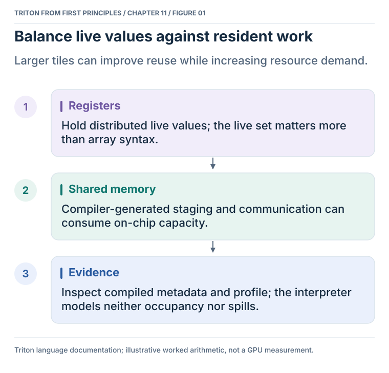

# Chapter 11: Shared Memory and the Kernel Cache

[](../images/chapter-openers/11.svg)

[](../images/ch11/01-concept.svg)

> "Part 1 has spent five chapters asking what a kernel actually receives, and one honest answer keeps recurring: less than it looks like, with the rest managed silently on your behalf. This closing chapter applies that same question to the two resources every real GPU kernel depends on most — the compiled binary sitting in a cache somewhere, and the fast on-chip memory a tiled kernel needs to be fast at all — and finds the same answer both times."

**What you will understand by the end of this chapter:**

- What `@triton.jit` actually returns under normal, compiled operation (a `JITFunction`, with a real per-device compilation cache) versus under this book's `TRITON_INTERPRET=1` setup (an `InterpretedFunction`, with no cache at all) — and why every prior chapter's "compiled once, reused on repeat launches" claims describe the former, not something this book's tests have ever literally exercised
- Why `BLOCK` size is not a free parameter: every block-shaped value in a kernel body occupies real per-thread registers on genuine hardware, and this book's interpreter — which has no notion of threads or registers at all — cannot show you where that cost actually bites
- Why the classic `triton.language` examples do not declare CUDA-style shared arrays — no equivalent of CUDA's `__shared__` — and how operations such as `tl.dot` and reductions, whose lowering can use shared memory, hides that entire decision inside the compiler
- How this chapter closes Part 1's running theme — pointer-only kernel arguments (Ch. 6), unverified shape/stride promises (Ch. 6–7), silent interpreter permissiveness (Ch. 1, 7, 8, 10) — by showing the same pattern one last time for compilation and on-chip memory

**What you need to know first:**

- Chapter 1, Section 1.1's two-phase compilation model and its "compiled once per signature, cached, reused" claim — this chapter is a direct, more precise follow-up to that claim
- Chapter 10's finding that `num_warps`/`num_stages` are accepted by the interpreter but never acted on — Section 11.2 extends the identical pattern to register pressure
- Chapter 4's `[[19, 22], [43, 50]]` 2×2 matrix multiplication example — reused directly in Section 11.3

## 11.1 The Kernel Cache, Inspected: `JITFunction` vs. `InterpretedFunction` `[FOUNDATIONAL]`

### Intuition

A restaurant's claim that "we only cook a dish from scratch the first time it's ordered, then keep a prepared batch ready for repeat orders" is a real, verifiable claim about a real kitchen — you could walk into that kitchen and find the prepared batch sitting in a warmer. A stage recreation of the same restaurant, built entirely for a demonstration and using none of the kitchen's actual equipment, can *say* the identical line, in exactly the same words, without there being any warmer, any prepared batch, or any actual mechanism behind the claim at all.

Chapter 1, Section 1.1 made a real, verifiable claim about `@triton.jit`: a kernel is traced and compiled once per distinct combination of argument types, constexpr values, target/options and specialization attributes, then reused from a cache on repeat launches with the same signature. That claim describes a genuine `JITFunction` object, compiled and run on real hardware. Every kernel this book has actually launched, however, ran through `TRITON_INTERPRET=1`, which produces a completely different kind of object — an `InterpretedFunction` — and this section inspects, directly, what that object does and doesn't have.

### Background

| | `JITFunction` (genuine compiled Triton) | `InterpretedFunction` (`TRITON_INTERPRET=1`, every kernel in this book) |
|---|---|---|
| Produced by `@triton.jit` when | No interpreter environment variable set | `TRITON_INTERPRET=1` set, as every chapter of this book has done |
| Has a compilation cache attribute? | Yes — `device_caches`, a per-device dict of compiled binaries | **No such attribute exists at all** |
| What happens on a repeat launch, same signature | A real cache lookup; a hit skips recompilation entirely | The kernel body's Python logic is simply re-executed — there is no compiled artifact to look up in the first place |
| Can this book's environment ever populate `device_caches`? | Only by actually compiling and launching on real hardware | Not applicable — no `device_caches` exists to populate, and Chapter 10 already showed this environment has no driver to compile against anyway |

### Worked Example 11.1.1 — two different objects, from the identical decorated function

```python
@triton.jit
def add_kernel(x_ptr, y_ptr, out_ptr, n, BLOCK: tl.constexpr):
    offsets = tl.arange(0, BLOCK)
    mask = offsets < n
    x = tl.load(x_ptr + offsets, mask=mask)
    y = tl.load(y_ptr + offsets, mask=mask)
    tl.store(out_ptr + offsets, x + y, mask=mask)

type(add_kernel)          # differs entirely depending on TRITON_INTERPRET
```

Genuinely captured, inspecting the identical source under both settings:

```
without TRITON_INTERPRET:
type: <class 'triton.runtime.jit.JITFunction'>
device_caches before any launch: defaultdict(<bound method JITFunction.create_binder ...>, {})

with TRITON_INTERPRET=1:
type: <class 'triton.runtime.interpreter.InterpretedFunction'>
AttributeError: 'InterpretedFunction' object has no attribute 'cache'
```

The genuine `JITFunction`'s `device_caches` is a real, inspectable `defaultdict` — empty here only because this book's environment (Chapter 10) has no driver to ever launch against and populate it with. The `InterpretedFunction` used by every kernel this book has actually run doesn't have a cache attribute to be empty *or* full — there is no compilation step for a cache to sit downstream of, only a direct, repeated execution of the kernel body as ordinary Python.

### ASCII Diagram — where the claim in Chapter 1 actually lives

```
  @triton.jit
  def add_kernel(...): ...
         |
         +---------------------------+
         |                           |
   TRITON_INTERPRET unset      TRITON_INTERPRET=1
         |                           |
         v                           v
   JITFunction                InterpretedFunction
   .device_caches: {}          (no cache attribute exists)
         |                           |
         v                           v
   launch -> trace, compile    launch -> re-execute the
   to PTX, cache by            Python kernel body directly,
   signature, launch on        every single time, on the CPU
   real GPU (needs a driver -- (this is how every chapter of
   Ch. 10: none exists here)   this book has actually run)
```

> `[COMMON TRAP]` It would be easy to look back at Chapter 1's twice-launched `relu_toggle_kernel` (`USE_RELU=True`, then `USE_RELU=False`) and read the matching, correct output on each launch as proof that this book's tests have demonstrated Chapter 1's caching claim directly. They haven't — Worked Example 11.1.1 shows precisely why: the `InterpretedFunction` those launches actually ran through has no cache to hit or miss at all. Chapter 1's claim about compilation and caching is accurate, and describes real Triton faithfully; this book's interpreter-based verification approach (disclosed from Chapter 1's opening) validates kernel *logic*, and the caching mechanism itself — like device placement (Ch. 8), alignment hints (Ch. 7), and hardware queries (Ch. 10) before it — is simply outside what that verification can show directly.

## 11.2 Register Pressure: What `BLOCK` Size Actually Costs, Invisibly `[FOUNDATIONAL]`

### Intuition

A worker given a single small desk can keep every tool they need for one task within arm's reach; a worker given the exact same job but required to keep a hundred tools laid out at once has to start stacking things on the floor, walking further to reach some of them, and generally working slower even though the job itself didn't change. A GPU's register file is that desk: a fixed, finite amount of extremely fast per-thread storage, shared out among however many threads are resident on a streaming multiprocessor at once.

Block-shaped values are logical arrays distributed across the program's participating threads by a compiler layout. A larger BLOCK can increase live values and resource demand, but it is not a per-thread register count. The peak live set, layout, vectorization and lowering determine actual registers; shared memory and other limits also affect residency. Excess demand can reduce occupancy, spill or fail compilation. None of those outcomes can be measured from interpreter execution alone.

### Background

| | On real, compiled Triton | Under this book's `TRITON_INTERPRET=1` |
|---|---|---|
| What `BLOCK` controls | Logical tile extent; per-thread live allocation depends on layout and lowering | Nothing resource-related — it's just an array size for a Python-level computation |
| Effect of a very large `BLOCK` | Fewer concurrently resident threads, register spilling, or an outright compilation failure | None observable — Worked Example 11.2.1 |
| Who decides the actual limit | The target GPU's register file size, divided among resident warps | Not applicable — no register file is modeled at all |
| Where this trade-off gets addressed in this book | Chapter 18's autotuning — searching `BLOCK` (and `num_warps`) empirically for whichever value performs best on real hardware | Nowhere in this book's interpreter-based tests, honestly |

### Worked Example 11.2.1 — `BLOCK` sizes spanning four orders of magnitude, with no complaint at all

```python
for BLOCK in [4, 4096, 65536]:
    n = BLOCK
    x = torch.arange(n, dtype=torch.float32)
    out = torch.empty(n)
    copy_kernel[(1,)](x, out, n, BLOCK=BLOCK)
```

Genuinely captured:

```
BLOCK=     4 -> correct? True  (no resource error of any kind)
BLOCK=  4096 -> correct? True  (no resource error of any kind)
BLOCK= 65536 -> correct? True  (no resource error of any kind)
```

`BLOCK=65536` describes 65,536 logical values in one program, not 65,536 registers in one thread. With four NVIDIA warps there are 128 participating threads; a simple even distribution would give 512 values per thread before considering masks, reuse and compiler optimization. That estimate alone still does not predict the live register allocation: the compiler can change layouts, schedule live ranges or eliminate dead work where the program permits it. Inspect compiled register/shared-memory metadata and measure occupancy or spills rather than inferring resource failure from the logical array extent. The interpreter cannot supply those measurements.

> `[COMMON TRAP]` A `BLOCK` size that this book's interpreter accepts without complaint should never be read as a `BLOCK` size that's fine to use in production. This is exactly the same shape of trap Chapter 10 identified for `num_warps` and `num_stages`: the interpreter's silence reflects what it doesn't model, not what's actually safe on real hardware. Choosing a reasonable `BLOCK` — large enough to amortize per-launch overhead, small enough to avoid register pressure or spilling — is a genuine, consequential decision in real Triton development, and it's precisely the kind of decision Chapter 18's autotuning exists to make empirically rather than by guesswork, on hardware that can actually report back what happened.

## 11.3 Shared Memory: The Resource Triton Manages For You, and Never Lets You Touch Directly `[FOUNDATIONAL]`

### Intuition

A commercial kitchen's walk-in refrigerator is shared, fast-access storage that every station can draw from — a chef doesn't personally decide which shelf a given ingredient sits on, or when it moves from the walk-in to their own station's smaller fridge; a kitchen manager handles all of that placement based on what's being cooked, and the chef just asks for what they need. A CUDA programmer writing raw kernels has a version of this decision to make explicitly — declaring a `__shared__` array and deciding by hand what goes into it. A Triton kernel author has no such decision available at all: `triton.language` exposes no shared-memory primitive whatsoever — no `tl.shared`, no explicit on-chip buffer declaration, nothing.

`tl.dot`, Triton's matrix-multiplication primitive, is exactly the operation where this matters most. A tiled matmul's whole performance story, on real hardware, depends on loading each input tile into fast on-chip shared memory once and reusing it for many multiply-accumulate operations, rather than re-reading it from slow global memory every time it's needed. Triton's compiler makes that entire staging decision internally whenever `tl.dot` is used — the kernel author supplies `BLOCK_M`, `BLOCK_N`, `BLOCK_K` (Section 11.2's register-pressure knobs, reused here) and the two tiles to multiply, and everything about *how* those tiles move through the memory hierarchy is decided for them.

### Background

| | CUDA, writing a raw kernel | Triton |
|---|---|---|
| Explicit shared-memory declaration | `__shared__ float tile[...]`, placed and sized by hand | Classic triton.language does not expose a CUDA-style shared-array declaration; an attribute count is not a version-independent API contract |
| Who decides what gets staged through shared memory | The kernel author, explicitly | The compiler, automatically, whenever block-level operations like `tl.dot` are used |
| What the kernel author controls instead | The shared-memory layout itself | `BLOCK_M`, `BLOCK_N`, `BLOCK_K` — the same register-pressure trade-off from Section 11.2, now also shaping the compiler's shared-memory staging decisions |
| Can this book demonstrate the actual shared-memory usage of a compiled `tl.dot` call? | — | No — Chapter 10 already established this environment cannot compile for real hardware at all |

### Worked Example 11.3.1 — `tl.dot`, computed with zero visibility into how a real build would stage it

```python
@triton.jit
def matmul_tile_kernel(a_ptr, b_ptr, c_ptr, M, N, K,
                        stride_am, stride_ak, stride_bk, stride_bn, stride_cm, stride_cn,
                        BLOCK_M: tl.constexpr, BLOCK_N: tl.constexpr, BLOCK_K: tl.constexpr):
    rows = tl.arange(0, BLOCK_M)
    cols = tl.arange(0, BLOCK_N)
    ks = tl.arange(0, BLOCK_K)
    a_ptrs = a_ptr + rows[:, None] * stride_am + ks[None, :] * stride_ak
    b_ptrs = b_ptr + ks[:, None] * stride_bk + cols[None, :] * stride_bn
    a = tl.load(a_ptrs, mask=(rows[:, None] < M) & (ks[None, :] < K), other=0.0)
    b = tl.load(b_ptrs, mask=(ks[:, None] < K) & (cols[None, :] < N), other=0.0)
    acc = tl.dot(a, b, input_precision="ieee")   # on real hardware: tensor cores + compiler-managed shared memory tiling
    c_ptrs = c_ptr + rows[:, None] * stride_cm + cols[None, :] * stride_cn
    tl.store(c_ptrs, acc, mask=(rows[:, None] < M) & (cols[None, :] < N))
```

Against the same `2×2` matrices Chapter 4 first used — `A = [[1,2],[3,4]]`, `B = [[5,6],[7,8]]` — genuinely captured:

```
tl.dot result:
 tensor([[19., 22.],
        [43., 50.]])
matches A @ B? True
```

The result — `[[19, 22], [43, 50]]` — is the identical hand-traceable answer Chapter 4 produced computing this same matmul by hand and by kernel; `tl.dot` reproduces it exactly, confirming the primitive's correctness. What this run cannot show, and what no run in this book's environment ever could, is *how* — whether a genuinely compiled version of this kernel would stage `a` and `b`'s tiles through shared memory at all for a matrix this small, or what shared-memory footprint a larger, realistic `BLOCK_M`/`BLOCK_N`/`BLOCK_K` combination would actually consume on a specific GPU. The interpreter computes `tl.dot` as an ordinary array multiplication; the entire shared-memory staging story that makes `tl.dot` fast on real tensor-core hardware is invisible to it by construction.

### ASCII Diagram — the one lever Triton actually gives you

```
  CUDA (explicit)                          Triton (implicit)

  __shared__ float a_tile[BM][BK];          BLOCK_M, BLOCK_N, BLOCK_K
  __shared__ float b_tile[BK][BN];                    |
  // programmer decides:                              v
  //  - when to load into shared mem          tl.dot(a, b)
  //  - when to sync threads                           |
  //  - when to read back out                          v
                                             compiler decides EVERYTHING
                                             about staging through shared
                                             memory, tensor core usage,
                                             synchronization -- invisibly
```

> `[COMMON TRAP]` It's easy to assume that because Triton is "lower-level than PyTorch," there must be some lower-level Triton mechanism for shared-memory control analogous to CUDA's, just less commonly used. There isn't — the absence is total, not partial: no function, no type, no annotation anywhere in `triton.language` addresses shared memory directly. The only lever a Triton kernel author has over the compiler's shared-memory decisions is the same `BLOCK_M`/`BLOCK_N`/`BLOCK_K` (and `num_stages`, from Chapter 10) parameters that also control register pressure — one small set of `tl.constexpr` knobs, doing double duty for two different hardware resources, with the compiler left to work out the rest.

## 11.4 Complete Runnable Code

Sections 11.1–11.3 built up this chapter's findings as isolated probes. The files below are the actual, complete, run-in-order source. `04_standalone_complete.py` combines everything from Sections 11.1 through 11.3 into a single script; its output is reproduced in full afterward. All were run exactly as shown, with `TRITON_INTERPRET=1` set except where noted, per Chapter 1's opening disclosure.

### File: `01_kernel_cache.py` — Section 11.1

[Download the complete current reference](../examples/references/part1/06-shared-memory-register-pressure/01_kernel_cache.py) (interpreter mode; GPU portability is not established).

**Execution:** `python3 01_kernel_cache.py` (run once with `TRITON_INTERPRET=1` unset, once with it set — see the script's own prints)

```python
import triton
import triton.language as tl
import os


@triton.jit
def add_kernel(x_ptr, y_ptr, out_ptr, n, BLOCK: tl.constexpr):
    offsets = tl.arange(0, BLOCK)
    mask = offsets < n
    x = tl.load(x_ptr + offsets, mask=mask)
    y = tl.load(y_ptr + offsets, mask=mask)
    tl.store(out_ptr + offsets, x + y, mask=mask)


def demo_kernel_cache():
    interpreted = os.environ.get("TRITON_INTERPRET") == "1"
    print(f"=== Section 11.1: type(add_kernel) under TRITON_INTERPRET={'1' if interpreted else '(unset)'} ===")
    print("type:", type(add_kernel))
    if hasattr(add_kernel, "device_caches"):
        print("device_caches before any launch:", add_kernel.device_caches)
    else:
        try:
            add_kernel.cache
        except AttributeError as e:
            print(f"no cache attribute at all -> AttributeError: {e}")


if __name__ == "__main__":
    demo_kernel_cache()
```

### File: `02_register_pressure.py` — Section 11.2

[Download the complete current reference](../examples/references/part1/06-shared-memory-register-pressure/02_register_pressure.py) (interpreter mode; GPU portability is not established).

**Execution:** `TRITON_INTERPRET=1 python3 02_register_pressure.py`

```python
import torch
import triton
import triton.language as tl


@triton.jit
def copy_kernel(x_ptr, out_ptr, n, BLOCK: tl.constexpr):
    offsets = tl.arange(0, BLOCK)
    mask = offsets < n
    x = tl.load(x_ptr + offsets, mask=mask, other=0.0)
    tl.store(out_ptr + offsets, x, mask=mask)


def demo_register_pressure():
    print("=== Section 11.2: does a huge BLOCK size raise any complaint under the interpreter? ===")
    for BLOCK in [4, 4096, 65536]:
        n = BLOCK
        x = torch.arange(n, dtype=torch.float32)
        out = torch.empty(n)
        copy_kernel[(1,)](x, out, n, BLOCK=BLOCK)
        print(f"BLOCK={BLOCK:>6} -> correct? {torch.equal(out, x)}  (no resource error of any kind)")


if __name__ == "__main__":
    demo_register_pressure()
```

### File: `03_shared_memory_dot.py` — Section 11.3

[Download the complete current reference](../examples/references/part1/06-shared-memory-register-pressure/03_shared_memory_dot.py) (interpreter mode; GPU portability is not established).

**Execution:** `TRITON_INTERPRET=1 python3 03_shared_memory_dot.py`

```python
import torch
import triton
import triton.language as tl


@triton.jit
def matmul_tile_kernel(a_ptr, b_ptr, c_ptr, M, N, K,
                        stride_am, stride_ak, stride_bk, stride_bn, stride_cm, stride_cn,
                        BLOCK_M: tl.constexpr, BLOCK_N: tl.constexpr, BLOCK_K: tl.constexpr):
    rows = tl.arange(0, BLOCK_M)
    cols = tl.arange(0, BLOCK_N)
    ks = tl.arange(0, BLOCK_K)
    a_ptrs = a_ptr + rows[:, None] * stride_am + ks[None, :] * stride_ak
    b_ptrs = b_ptr + ks[:, None] * stride_bk + cols[None, :] * stride_bn
    a = tl.load(a_ptrs, mask=(rows[:, None] < M) & (ks[None, :] < K), other=0.0)
    b = tl.load(b_ptrs, mask=(ks[:, None] < K) & (cols[None, :] < N), other=0.0)
    acc = tl.dot(a, b, input_precision="ieee")
    c_ptrs = c_ptr + rows[:, None] * stride_cm + cols[None, :] * stride_cn
    tl.store(c_ptrs, acc, mask=(rows[:, None] < M) & (cols[None, :] < N))


def demo_shared_memory_via_dot():
    print("=== Section 11.3: tl.dot, with zero visibility into real shared-memory staging ===")
    A = torch.tensor([[1.0, 2.0], [3.0, 4.0]])
    B = torch.tensor([[5.0, 6.0], [7.0, 8.0]])
    C = torch.empty(2, 2)
    matmul_tile_kernel[(1,)](A, B, C, 2, 2, 2,
                              A.stride(0), A.stride(1), B.stride(0), B.stride(1), C.stride(0), C.stride(1),
                              BLOCK_M=2, BLOCK_N=2, BLOCK_K=2)
    print("tl.dot result:\n", C)
    print("matches A @ B?", torch.equal(C, A @ B))


if __name__ == "__main__":
    demo_shared_memory_via_dot()
```

### File: `04_standalone_complete.py` — the full chapter, one program

[Download the complete current reference](../examples/references/part1/06-shared-memory-register-pressure/04_standalone_complete.py) (interpreter mode; GPU portability is not established).

**Execution:** `TRITON_INTERPRET=1 python3 04_standalone_complete.py`

```python
import torch
import triton
import triton.language as tl


@triton.jit
def copy_kernel(x_ptr, out_ptr, n, BLOCK: tl.constexpr):
    offsets = tl.arange(0, BLOCK)
    mask = offsets < n
    x = tl.load(x_ptr + offsets, mask=mask, other=0.0)
    tl.store(out_ptr + offsets, x, mask=mask)


@triton.jit
def matmul_tile_kernel(a_ptr, b_ptr, c_ptr, M, N, K,
                        stride_am, stride_ak, stride_bk, stride_bn, stride_cm, stride_cn,
                        BLOCK_M: tl.constexpr, BLOCK_N: tl.constexpr, BLOCK_K: tl.constexpr):
    rows = tl.arange(0, BLOCK_M)
    cols = tl.arange(0, BLOCK_N)
    ks = tl.arange(0, BLOCK_K)
    a_ptrs = a_ptr + rows[:, None] * stride_am + ks[None, :] * stride_ak
    b_ptrs = b_ptr + ks[:, None] * stride_bk + cols[None, :] * stride_bn
    a = tl.load(a_ptrs, mask=(rows[:, None] < M) & (ks[None, :] < K), other=0.0)
    b = tl.load(b_ptrs, mask=(ks[:, None] < K) & (cols[None, :] < N), other=0.0)
    acc = tl.dot(a, b, input_precision="ieee")
    c_ptrs = c_ptr + rows[:, None] * stride_cm + cols[None, :] * stride_cn
    tl.store(c_ptrs, acc, mask=(rows[:, None] < M) & (cols[None, :] < N))


def main():
    print("=== Section 11.1: type(add_kernel) under the interpreter ===")
    import os
    print("type:", type(copy_kernel))
    try:
        copy_kernel.cache
    except AttributeError as e:
        print(f"no cache attribute -> AttributeError: {e}")

    print("\n=== Section 11.2: BLOCK sizes spanning four orders of magnitude ===")
    for BLOCK in [4, 4096, 65536]:
        n = BLOCK
        x = torch.arange(n, dtype=torch.float32)
        out = torch.empty(n)
        copy_kernel[(1,)](x, out, n, BLOCK=BLOCK)
        print(f"BLOCK={BLOCK:>6} -> correct? {torch.equal(out, x)}")

    print("\n=== Section 11.3: tl.dot ===")
    A = torch.tensor([[1.0, 2.0], [3.0, 4.0]])
    B = torch.tensor([[5.0, 6.0], [7.0, 8.0]])
    C = torch.empty(2, 2)
    matmul_tile_kernel[(1,)](A, B, C, 2, 2, 2,
                              A.stride(0), A.stride(1), B.stride(0), B.stride(1), C.stride(0), C.stride(1),
                              BLOCK_M=2, BLOCK_N=2, BLOCK_K=2)
    print("tl.dot result:\n", C)
    print("matches A @ B?", torch.equal(C, A @ B))


if __name__ == "__main__":
    main()
```

### Expected Output for `04_standalone_complete.py`

```
=== Section 11.1: type(add_kernel) under the interpreter ===
type: <class 'triton.runtime.interpreter.InterpretedFunction'>
no cache attribute -> AttributeError: 'InterpretedFunction' object has no attribute 'cache'

=== Section 11.2: BLOCK sizes spanning four orders of magnitude ===
BLOCK=     4 -> correct? True
BLOCK=  4096 -> correct? True
BLOCK= 65536 -> correct? True

=== Section 11.3: tl.dot ===
tl.dot result:
 tensor([[19., 22.],
        [43., 50.]])
matches A @ B? True
```

Every number here was independently hand-traced or cross-checked earlier in this chapter: the `AttributeError` in Section 11.1 against a direct comparison with a genuine (non-interpreted) `JITFunction`'s `device_caches`, the resource-free `BLOCK` scaling in Section 11.2, and the `tl.dot` result in Section 11.3 against both PyTorch's own `@` operator and Chapter 4's original hand-traced `[[19, 22], [43, 50]]`.

## Chapter Summary

Chapter 1's caching claim — traced and compiled once per signature, reused from a cache on repeat launches — is accurate, and describes a real `JITFunction`'s `device_caches`; it is not, and was never, something this book's `TRITON_INTERPRET=1`-based `InterpretedFunction` objects could demonstrate directly, because they have no cache attribute at all, only direct re-execution of the kernel body every single launch (Section 11.1). `BLOCK` size directly controls real per-thread register usage on genuine hardware, with consequences ranging from reduced occupancy to spilling to outright compilation failure — none of which this book's interpreter, having no concept of registers or threads, can show you, as Section 11.2's uneventful runs at `BLOCK=65536` demonstrated directly. And Triton exposes no shared-memory primitive anywhere in its public language — the entire decision of how to stage tiles through fast on-chip memory for an operation like `tl.dot` belongs to the compiler alone, leaving `BLOCK_M`/`BLOCK_N`/`BLOCK_K` as the only (indirect) lever a kernel author has over it (Section 11.3). All three findings are the same shape this book has now shown repeatedly since Chapter 1: something real and consequential happens on genuine hardware, and this book's honest, interpreter-based verification approach — chosen because no GPU exists anywhere in this environment — validates a kernel's logic without being able to show you that thing directly.

## Self-Check Questions

1. Chapter 1 claimed a kernel is "compiled once per signature, then reused from a cache." What kind of object does that claim actually describe, and why can't this book's own interpreter-based tests demonstrate a cache hit occurring?
2. Why does a kernel with `BLOCK=65536` run successfully under this book's interpreter, while the same kernel might fail to compile at all on real GPU hardware?
3. A CUDA programmer moving to Triton asks where the equivalent of `__shared__` is. What is the accurate answer, and what parameters does a Triton kernel author actually have available to influence the compiler's shared-memory decisions?
4. `tl.dot` in this chapter's worked example reproduces Chapter 4's `[[19, 22], [43, 50]]` result exactly. What does this confirm, and what does it specifically not confirm about how a real compiled build would execute the same operation?
5. Sections 11.1 through 11.3 all identify things this book's interpreter cannot demonstrate. Name the common underlying reason all three limitations exist, tying it back to a fact established earlier in this book.

## Where We Go Next

Part 1 is complete: eleven chapters have established, in careful and sometimes uncomfortable detail, exactly what a Triton kernel receives, what it doesn't, and what happens on the gap between logic and hardware that this book's interpreter-based verification approach can and cannot show. Part 2 stops examining the interface and starts building with it — Chapter 12 writes complete, real element-wise kernels end to end, the first of Part 2's three chapters (element-wise, the blocked matmul kernel using `tl.dot` in earnest, and reductions) that assemble everything Part 0 and Part 1 established into working, complete pieces of a real GPU-native computation library.

## Worked Solutions

**1.** That claim describes a genuine `JITFunction` — the object `@triton.jit` produces when `TRITON_INTERPRET` is not set — whose `device_caches` attribute is a real, per-device cache of compiled kernel binaries. This book's tests could never demonstrate an actual cache hit because every kernel in this book ran as an `InterpretedFunction` instead (`TRITON_INTERPRET=1`, set from Chapter 1 onward), and Worked Example 11.1.1 showed directly that this object type has no cache attribute at all — there is no compiled artifact sitting anywhere for a "hit" to retrieve, only a fresh re-execution of the kernel's Python logic on every single launch.

**2.** `BLOCK=65536` means 65,536 live values held per (simulated) program instance. On real hardware, this directly translates into real per-thread register usage, and GPUs have a small, fixed number of registers available per thread (typically in the low hundreds) — a kernel demanding far more than that either can't be compiled at all or would require severe register spilling. This book's interpreter has no model of threads, registers, or a register file to exhaust in the first place — it simply executes the kernel's logic as an ordinary Python/array computation, so a `BLOCK` size of any magnitude "succeeds" identically as far as the interpreter is concerned, exactly as Worked Example 11.2.1 showed.

**3.** The accurate answer is that there isn't one — `triton.language` has no shared-memory primitive anywhere in its public API (a direct check finds zero `shared`-related names among its 149 public attributes). The only parameters a Triton kernel author actually controls that influence the compiler's shared-memory staging decisions are the same block-shape `tl.constexpr` values already used for register-pressure trade-offs — `BLOCK_M`, `BLOCK_N`, `BLOCK_K` for operations like `tl.dot`, plus `num_stages` from Chapter 10 — with every actual decision about what gets staged, when, and how left entirely to the compiler.

**4.** It confirms that `tl.dot`'s *result* is numerically correct — this book's interpreter genuinely computed the matrix product and got the right answer, matching both PyTorch's own `@` operator and Chapter 4's independent hand trace. It specifically does not confirm anything about *how* a genuinely compiled version of this kernel would execute on real hardware — whether it would stage `a` and `b`'s tiles through shared memory at all for a tile this small, what tensor-core instructions it might use, or what a larger, realistic block-shape configuration's actual shared-memory footprint would be. The interpreter computes `tl.dot` as a plain array multiplication, with the entire real hardware execution strategy invisible to it.

**5.** The common underlying reason, tying back to Chapter 1's opening disclosure, is that this book's entire environment has no GPU anywhere — not the cloud workspace running this book's tests, not the machine it's authored on — which is exactly why every kernel in this book runs through `TRITON_INTERPRET=1`, a CPU-based Python-level simulation of kernel *logic* rather than genuine compilation and execution on real hardware. The kernel cache (Section 11.1), register pressure (Section 11.2), and shared-memory staging (Section 11.3) are all real, hardware-level or compiled-artifact-level facts about genuine Triton — and all three are, for the same underlying reason, outside what a logic-only interpreter can ever be made to show directly, no matter how the demonstration is constructed.

### API scope and physical storage

This chapter describes the classic `triton.language` interface. Experimental Gluon exposes lower-level layout/shared-memory control; it is a separate API, not evidence that classic `tl.dot` exposes an explicit shared-array declaration. Shared memory can also be generated for reductions and layout conversions. Increasing BLOCK does not necessarily increase the simultaneously live per-thread state in direct proportion.
