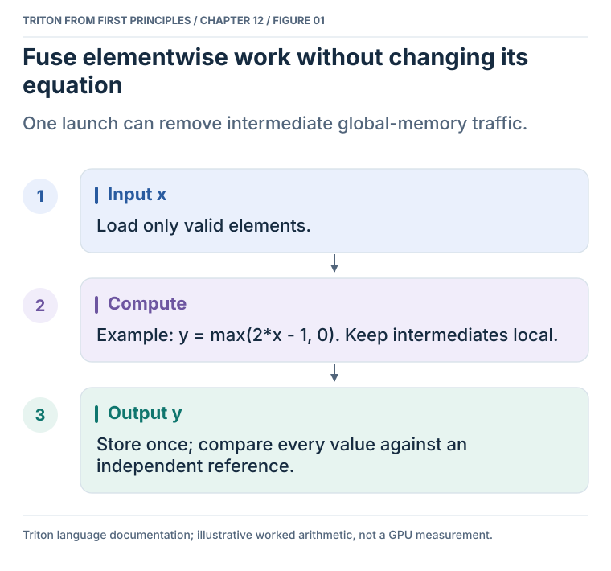

# Chapter 12: Element-wise Kernels

[](../images/ch12/01-concept.svg)

> "Every ingredient for a complete kernel has already been introduced — a wrapper function that assembles a pointer's shape and dtype (Ch. 6, 8), a mask that keeps a launch honest at its edges (Ch. 5), a grid that covers the whole tensor (Ch. 5). This chapter's only genuinely new idea is what happens when you stop treating each of those ingredients as a separate lesson and start asking: what's actually worth building this way, and how do you know it's right when the answer isn't a small hand-traceable integer anymore?"

**What you will understand by the end of this chapter:**

- How to assemble a complete, real element-wise kernel — wrapper function, allocation, masked launch — as one coherent unit, rather than as separate lessons about separate pieces
- Why hand-written element-wise kernels exist at all: fusing several arithmetic steps into a single kernel launch avoids the repeated global-memory round trips that chaining separate PyTorch operations implies, and exactly what this book's environment can and cannot show you about that benefit
- How to implement and verify a genuinely non-trivial elementwise function — exact GELU, using `tl.math.erf` — against an independent, trusted oracle (`torch.nn.functional.gelu`) rather than a hand-traced number, and why that's a different, necessary verification method for this kind of kernel
- Why an approximate variant of a function (GELU's `tanh`-based approximation) can match its *own* oracle closely while still differing meaningfully from the exact version — and why comparing against the wrong oracle is a real way to hide a genuine bug

**What you need to know first:**

- Chapter 6's wrapper-function convention and Chapter 8's pre-allocation requirement — Section 12.1 assembles both into one real, complete example
- Chapter 5's masking discipline — reused without further explanation
- Chapter 1's opening disclosure about this book's interpreter-only, no-GPU environment — directly relevant to what Section 12.2 can and cannot demonstrate about performance

## 12.1 Anatomy of a Complete Element-wise Kernel: From Wrapper to Launch `[FOUNDATIONAL]`

### Intuition

A recipe card that separately explains what an oven is, what a mixing bowl is, and what "fold gently" means is teaching ingredients, not a dish. Actually baking something means picking up all three at once, in order, for a specific result. Chapters 1 through 11 have been the ingredient cards — pointers, masks, wrapper functions, allocation, hardware targeting — each demonstrated in isolation, on the smallest kernel that could show the point. This section bakes the actual dish: one complete, real element-wise operation, assembled from pieces this book has already earned separately, with nothing new introduced except the assembly itself.

### Background

| | Where it came from | Role in this section's kernel |
|---|---|---|
| A pointer-only kernel signature | Chapter 6 | `x_ptr`, `out_ptr` — bare addresses, exactly as established |
| Pre-allocating the output | Chapter 8 | `out = torch.empty_like(x)`, before the launch |
| A wrapper function assembling shape/dtype into launch arguments | Chapter 6, Section 6.4 | `fused_fma_relu(x, a, b)` — the actual callable a user calls |
| A masked launch covering the whole tensor | Chapter 5 | `mask = offsets < n` |
| `tl.maximum` for the ReLU clamp | Chapter 1 | Reused exactly as introduced there |

### Worked Example 12.1.1 — a complete kernel, wrapper, and correctness check

```python
@triton.jit
def fma_relu_kernel(x_ptr, a, b, out_ptr, n, BLOCK: tl.constexpr):
    offsets = tl.arange(0, BLOCK)
    mask = offsets < n
    x = tl.load(x_ptr + offsets, mask=mask)
    y = a * x + b
    y = tl.maximum(y, 0.0)
    tl.store(out_ptr + offsets, y, mask=mask)

def fused_fma_relu(x: torch.Tensor, a: float, b: float) -> torch.Tensor:
    assert x.ndim == 1
    out = torch.empty_like(x)
    n = x.numel()
    BLOCK = triton.next_power_of_2(n)
    fma_relu_kernel[(1,)](x, a, b, out, n, BLOCK=BLOCK)
    return out
```

This computes `relu(a*x + b)` — a fused multiply-add followed by a clamp, the same shape of computation that appears, chained many times, inside real neural network layers. Hand-trace `a=2.0, b=-1.0` against `x = [-2, -1, 0, 1, 2]`: `2x - 1 = [-5, -3, -1, 1, 3]`, then `relu(...) = [0, 0, 0, 1, 3]`. Genuinely captured, both from the kernel and from an independent, unfused PyTorch reference computing the identical formula with three separate operators:

```python
out = fused_fma_relu(x, a, b)
ref = torch.relu(a * x + b)
```

```
fused kernel result: [0.0, 0.0, 0.0, 1.0, 3.0]
unfused torch reference: [0.0, 0.0, 0.0, 1.0, 3.0]
match? True
```

Both match the hand trace and each other exactly — the fused kernel and the unfused reference compute the identical mathematical function, just through different numbers of memory passes, which is precisely Section 12.2's subject.

### ASCII Diagram — the complete assembly, labeled by originating chapter

```
  def fused_fma_relu(x, a, b):                    <- Ch. 6 wrapper convention
      out = torch.empty_like(x)                    <- Ch. 8: pre-allocate, kernels can't
      n = x.numel()
      BLOCK = triton.next_power_of_2(n)
      fma_relu_kernel[(1,)](x, a, b, out, n, BLOCK=BLOCK)
      return out

  @triton.jit
  def fma_relu_kernel(x_ptr, a, b, out_ptr, n, BLOCK: tl.constexpr):
      offsets = tl.arange(0, BLOCK)
      mask = offsets < n                            <- Ch. 5: bounds mask
      x = tl.load(x_ptr + offsets, mask=mask)        <- Ch. 6: x_ptr is a bare pointer
      y = a * x + b
      y = tl.maximum(y, 0.0)                        <- Ch. 1: tl.maximum for ReLU
      tl.store(out_ptr + offsets, y, mask=mask)
```

> `[COMMON TRAP]` It's easy, after eleven chapters of small, isolated demonstrations, to keep writing kernels that only prove one point at a time. Real Triton kernels are never that narrow — `fma_relu_kernel` above already does three genuinely different things (an affine transform, a nonlinearity, a masked memory access) in one pass, and that combination, not any one piece alone, is what makes it worth writing as a kernel instead of three separate PyTorch calls. Section 12.2 makes that "worth writing" claim precise.

## 12.2 Fusion: Why a Hand-Written Element-wise Kernel Exists At All `[FOUNDATIONAL]`

### Intuition

A single trip to the grocery store that fills one cart with everything on the list costs one trip's worth of gas, regardless of how many separate items are in the cart. Three separate trips — one for produce, one for dairy, one for everything else — cost three trips' worth of gas, even though the total groceries purchased are identical. The groceries are `a * x + b`, then `relu(...)`; the "trip" is a full read-and-write pass over a tensor's data in GPU global memory.

`torch.relu(a * x + b)`, written as ordinary PyTorch, is at least two separate operations under the hood — a multiply-add, then a clamp — each one, in the most naive execution model, reading its input from GPU memory and writing its result back before the next operation starts. `fma_relu_kernel` from Section 12.1 does the same arithmetic in one kernel launch: `x` is read from memory exactly once, held in registers through the affine transform and the clamp, and the final result is written exactly once. This is the entire reason hand-written element-wise kernels are worth writing at all when a chain of existing PyTorch operators would compute the identical function: not different arithmetic, but fewer trips to memory doing it.

### Background

| | Naive chained PyTorch ops | One fused Triton kernel |
|---|---|---|
| Number of times `x`'s data is read from global memory | Once per operation in the chain | Once, total |
| Number of times an intermediate result is written back to global memory | Once per intermediate step | Never — intermediates live in registers only |
| Does the final numeric result differ? | No — Worked Example 12.1.1 confirmed identical output | No |
| Can this book measure the actual time saved? | — | **No — this book has no GPU anywhere (Ch. 1) and no meaningful timing signal under the interpreter** |
| Important caveat | Modern PyTorch (`torch.compile`) can automatically fuse many pointwise chains itself | Hand-written fusion is increasingly competing with an capable auto-fuser, not literally unfused eager code alone |

### Worked Example 12.2.1 — counting memory passes, not measuring time

This book cannot honestly produce a wall-clock number for the difference fusion makes — Chapter 1's opening disclosure already established that `TRITON_INTERPRET=1` provides no meaningful timing signal, and Chapter 10 established that this environment has no GPU to time anything on at all. What can be stated precisely, and checked by reading the code rather than running a clock, is the *shape* of the difference:

```
naive chain:  y1 = a * x        (read x, write y1)
              y2 = y1 + b       (read y1, write y2)
              y3 = relu(y2)     (read y2, write y3)
              -> 3 reads, 3 writes, 2 intermediate tensors materialized in memory

fused kernel: y = fma_relu_kernel(x, a, b)
              -> 1 read (x), 1 write (y), zero intermediates ever leave registers
```

On real hardware, where a single elementwise pass over a large tensor is often memory-bandwidth-bound rather than compute-bound, cutting the number of memory passes from three (or more, for longer chains) to one is frequently the single largest lever available for pointwise-heavy code — this is the actual justification real-world fused kernels (GELU, LayerNorm, softmax, and everything Chapter 20 builds) give for existing at all, rather than deferring entirely to PyTorch's built-in operators. Chapter 19's benchmarking chapter is where this book finally has the tools to measure an effect like this directly, once the discussion turns to what can and can't be measured honestly.

> `[COMMON TRAP]` It's tempting to conclude that any chain of PyTorch elementwise operations is automatically worth rewriting as a fused Triton kernel. Two things complicate this in practice, and both are worth naming honestly: first, `torch.compile` and other modern JIT compilers can automatically detect and fuse many pointwise chains without any hand-written kernel at all, so a hand-fused kernel's real advantage over *compiled* PyTorch (rather than naive eager PyTorch) is often much smaller than the naive comparison above suggests. Second, fusion only pays off when the operation is genuinely memory-bandwidth-bound in the first place — a chain dominated by one expensive compute step gains little from eliminating cheap surrounding memory traffic. Fusion is a real and important technique, not a universal one.

## 12.3 GELU: An Exact Elementwise Kernel Verified Against an Independent Oracle `[FOUNDATIONAL]`

### Intuition

Checking a simple arithmetic answer by hand — does `2 * 3 - 1` equal `5`? — is something anyone can verify directly, the way every worked example through Chapter 11 has been checked. Checking whether a computed approximation to the Gaussian error function is correct to the eighth decimal place is not something a reader can verify by hand at all; the only practical way to gain confidence is to compute the same quantity through a second, independently-built, already-trusted implementation and confirm the two agree. GELU — `x * Φ(x)`, where `Φ` is the standard normal cumulative distribution function, built from `erf` — is this book's first function where hand-tracing stops being the right tool, and comparing against an oracle (PyTorch's own `torch.nn.functional.gelu`) becomes the honest way to verify correctness instead.

### Background

| | Every worked example through Chapter 11 | This section's GELU verification |
|---|---|---|
| How correctness was checked | Computing the exact expected value by hand and comparing for an exact match | Comparing against `torch.nn.functional.gelu`, an independently implemented, trusted reference |
| Exact match expected? | Yes | **No — small floating-point differences are expected and healthy**, since the two implementations compute `erf` through different code paths |
| What "verified" means here | Bit-for-bit identical to a hand computation | Numerically close (`torch.allclose`) to a trusted second implementation of the *same* mathematical function |
| What this method cannot tell you | — | Whether you implemented the *right* function, if you compare against an oracle for a different (but related) function — Worked Example 12.3.2 |

### Worked Example 12.3.1 — exact GELU, verified against PyTorch's own oracle

```python
@triton.jit
def gelu_exact_kernel(x_ptr, out_ptr, n, BLOCK: tl.constexpr):
    offsets = tl.arange(0, BLOCK)
    mask = offsets < n
    x = tl.load(x_ptr + offsets, mask=mask)
    SQRT_2_INV: tl.constexpr = 0.7071067811865476   # 1/sqrt(2)
    cdf = 0.5 * (1.0 + tl.math.erf(x * SQRT_2_INV))
    y = x * cdf
    tl.store(out_ptr + offsets, y, mask=mask)
```

This computes GELU's exact mathematical definition, `x * 0.5 * (1 + erf(x / sqrt(2)))`, using `tl.math.erf` directly. Genuinely captured, against `torch.nn.functional.gelu(x, approximate="none")` as the oracle:

```
x:                [-3.0, -1.0, -0.5, 0.0, 0.5, 1.0, 2.0, 3.0]
triton GELU:      [-0.0040496885776519775, -0.15865525603294373, -0.1542687714099884, 0.0, 0.3457312285900116, 0.8413447141647339, 1.9544997215270996, 2.995950222015381]
torch oracle:     [-0.004050225019454956, -0.15865525603294373, -0.1542687714099884, 0.0, 0.3457312285900116, 0.8413447141647339, 1.9544997215270996, 2.9959497451782227]
max abs diff: 5.364418029785156e-07
allclose? True
```

Notice `x = -3.0`: the Triton result (`-0.0040496886...`) and the torch oracle (`-0.0040502250...`) are not bit-for-bit identical — they differ in the sixth decimal place, well within `torch.allclose`'s default tolerance, and entirely expected: `tl.math.erf` and PyTorch's own `erf` are two different numerical implementations of the same special function, and floating-point arithmetic doesn't generally produce bit-identical results across different code paths even when both are correct. This is the healthy version of a small discrepancy — genuinely different from Chapter 6's silent, structural wrongness, which produced answers differing by far more than floating-point noise.

### Worked Example 12.3.2 — the `tanh` approximation: matching its own oracle, while intentionally differing from the exact function

```python
@triton.jit
def gelu_tanh_approx_kernel(x_ptr, out_ptr, n, BLOCK: tl.constexpr):
    offsets = tl.arange(0, BLOCK)
    mask = offsets < n
    x = tl.load(x_ptr + offsets, mask=mask)
    SQRT_2_OVER_PI: tl.constexpr = 0.7978845608028654
    COEFF: tl.constexpr = 0.044715
    inner = SQRT_2_OVER_PI * (x + COEFF * x * x * x)
    tanh_inner = 2.0 * tl.sigmoid(2.0 * inner) - 1.0   # tanh(z) = 2*sigmoid(2z) - 1
    cdf = 0.5 * (1.0 + tanh_inner)
    y = x * cdf
    tl.store(out_ptr + offsets, y, mask=mask)
```

This is a genuinely different, faster-to-evaluate approximation to the same underlying GELU idea, used heavily in practice (it's the version many transformer implementations actually run). Verified against its *own* matching oracle, `torch.nn.functional.gelu(x, approximate="tanh")`:

```
triton tanh-approx GELU: [-0.0036374330520629883, -0.15880799293518066, -0.1542859822511673, ...]
torch tanh-approx oracle: [-0.0036374330520629883, -0.15880799293518066, -0.1542859971523285, ...]
max abs diff vs tanh oracle: 1.1920928955078125e-07
```

That agreement is as tight as Worked Example 12.3.1's — both implementations of the tanh approximation agree to within ordinary floating-point noise. But compared against the *exact* GELU oracle from Worked Example 12.3.1 instead of its own matching oracle:

```
max abs diff vs EXACT gelu (how much the approximation itself costs): 0.00041294097900390625
```

`0.0004` is roughly a thousand times larger than the `~0.0000001` of floating-point noise separating two correct implementations of the *same* formula. This is not a bug in either implementation — it's the real, intentional cost of choosing the faster `tanh` approximation over the exact `erf`-based formula, and it is a completely different kind of number from Worked Example 12.3.1's discrepancy, even though both are "differences from the exact oracle."

### ASCII Diagram — two kinds of "difference from the oracle"

```
  exact GELU (Triton) vs exact GELU (torch oracle):
     max diff ~ 5e-7   <- floating-point noise: same formula, different erf implementation
     |-|
     0                                                                exact value

  tanh-approx GELU (Triton) vs tanh-approx GELU (torch oracle):
     max diff ~ 1e-7   <- floating-point noise: same formula, both correct
     |-|
     0                                                          tanh-approx value

  tanh-approx GELU vs EXACT GELU oracle:
     max diff ~ 4e-4   <- NOT noise: a different formula, on purpose
     |-----------------------------|
     0                                                                exact value
```

> `[COMMON TRAP]` `torch.allclose(your_result, oracle)` returning `True` only tells you your kernel agrees with *that specific oracle* — it says nothing about whether that oracle computes the function you actually meant to implement. If a kernel author intended to implement exact GELU but accidentally wrote the `tanh` approximation instead, comparing against `torch.nn.functional.gelu(x, approximate="tanh")` would report a perfect match and hide the mistake completely; only comparing against the *intended* oracle (`approximate="none"`) would reveal the ~`0.0004` gap. Choosing the right oracle to verify against is not a minor detail — it's the entire content of what "verified" means for this kind of kernel.

## 12.4 Complete Runnable Code

Sections 12.1–12.3 built up this chapter's findings as isolated probes. The files below are the actual, complete, run-in-order source. `04_standalone_complete.py` combines everything from Sections 12.1 through 12.3 into a single script; its output is reproduced in full afterward. All were run exactly as shown, with `TRITON_INTERPRET=1` set, per Chapter 1's opening disclosure.

### File: `01_fused_fma_relu.py` — Section 12.1

[Download the complete current reference](../examples/references/part2/01-elementwise-kernels/01_fused_fma_relu.py) (interpreter mode; GPU portability is not established).

**Execution:** `TRITON_INTERPRET=1 python3 01_fused_fma_relu.py`

```python
import torch
import triton
import triton.language as tl


@triton.jit
def fma_relu_kernel(x_ptr, a, b, out_ptr, n, BLOCK: tl.constexpr):
    offsets = tl.arange(0, BLOCK)
    mask = offsets < n
    x = tl.load(x_ptr + offsets, mask=mask)
    y = a * x + b
    y = tl.maximum(y, 0.0)
    tl.store(out_ptr + offsets, y, mask=mask)


def fused_fma_relu(x: torch.Tensor, a: float, b: float) -> torch.Tensor:
    assert x.ndim == 1
    out = torch.empty_like(x)
    n = x.numel()
    BLOCK = triton.next_power_of_2(n)
    fma_relu_kernel[(1,)](x, a, b, out, n, BLOCK=BLOCK)
    return out


def demo_fused_kernel():
    print("=== Section 12.1: a complete, assembled element-wise kernel ===")
    x = torch.tensor([-2.0, -1.0, 0.0, 1.0, 2.0])
    a, b = 2.0, -1.0
    out = fused_fma_relu(x, a, b)
    print("fused kernel result:", out.tolist())

    ref = torch.relu(a * x + b)
    print("unfused torch reference:", ref.tolist())
    print("match?", torch.equal(out, ref))


if __name__ == "__main__":
    demo_fused_kernel()
```

### File: `02_memory_pass_counting.py` — Section 12.2

[Download the complete current reference](../examples/references/part2/01-elementwise-kernels/02_memory_pass_counting.py) (interpreter mode; GPU portability is not established).

**Execution:** `TRITON_INTERPRET=1 python3 02_memory_pass_counting.py`

```python
import torch
import triton
import triton.language as tl


@triton.jit
def fma_relu_kernel(x_ptr, a, b, out_ptr, n, BLOCK: tl.constexpr):
    offsets = tl.arange(0, BLOCK)
    mask = offsets < n
    x = tl.load(x_ptr + offsets, mask=mask)
    y = a * x + b
    y = tl.maximum(y, 0.0)
    tl.store(out_ptr + offsets, y, mask=mask)


def fused_fma_relu(x: torch.Tensor, a: float, b: float) -> torch.Tensor:
    out = torch.empty_like(x)
    n = x.numel()
    BLOCK = triton.next_power_of_2(n)
    fma_relu_kernel[(1,)](x, a, b, out, n, BLOCK=BLOCK)
    return out


def demo_memory_passes():
    print("=== Section 12.2: identical results, different numbers of memory passes ===")
    x = torch.tensor([-2.0, -1.0, 0.0, 1.0, 2.0])
    a, b = 2.0, -1.0

    # naive chain: 3 separate operations, each conceptually a full read+write pass
    y1 = a * x
    y2 = y1 + b
    y3 = torch.relu(y2)
    print("naive chain result (3 separate ops):", y3.tolist())

    # fused: one kernel launch, one read of x, one write of the result
    fused = fused_fma_relu(x, a, b)
    print("fused kernel result   (1 kernel launch):", fused.tolist())
    print("identical?", torch.equal(y3, fused))


if __name__ == "__main__":
    demo_memory_passes()
```

### File: `03_gelu_oracle_verified.py` — Section 12.3

[Download the complete current reference](../examples/references/part2/01-elementwise-kernels/03_gelu_oracle_verified.py) (interpreter mode; GPU portability is not established).

**Execution:** `TRITON_INTERPRET=1 python3 03_gelu_oracle_verified.py`

```python
import torch
import triton
import triton.language as tl


@triton.jit
def gelu_exact_kernel(x_ptr, out_ptr, n, BLOCK: tl.constexpr):
    offsets = tl.arange(0, BLOCK)
    mask = offsets < n
    x = tl.load(x_ptr + offsets, mask=mask)
    SQRT_2_INV: tl.constexpr = 0.7071067811865476
    cdf = 0.5 * (1.0 + tl.math.erf(x * SQRT_2_INV))
    y = x * cdf
    tl.store(out_ptr + offsets, y, mask=mask)


@triton.jit
def gelu_tanh_approx_kernel(x_ptr, out_ptr, n, BLOCK: tl.constexpr):
    offsets = tl.arange(0, BLOCK)
    mask = offsets < n
    x = tl.load(x_ptr + offsets, mask=mask)
    SQRT_2_OVER_PI: tl.constexpr = 0.7978845608028654
    COEFF: tl.constexpr = 0.044715
    inner = SQRT_2_OVER_PI * (x + COEFF * x * x * x)
    tanh_inner = 2.0 * tl.sigmoid(2.0 * inner) - 1.0
    cdf = 0.5 * (1.0 + tanh_inner)
    y = x * cdf
    tl.store(out_ptr + offsets, y, mask=mask)


def triton_gelu(x: torch.Tensor) -> torch.Tensor:
    out = torch.empty_like(x)
    n = x.numel()
    BLOCK = triton.next_power_of_2(n)
    gelu_exact_kernel[(1,)](x, out, n, BLOCK=BLOCK)
    return out


def triton_gelu_tanh(x: torch.Tensor) -> torch.Tensor:
    out = torch.empty_like(x)
    n = x.numel()
    BLOCK = triton.next_power_of_2(n)
    gelu_tanh_approx_kernel[(1,)](x, out, n, BLOCK=BLOCK)
    return out


def demo_gelu_oracle():
    print("=== Section 12.3: exact GELU vs. its independent oracle ===")
    x = torch.tensor([-3.0, -1.0, -0.5, 0.0, 0.5, 1.0, 2.0, 3.0])
    out = triton_gelu(x)
    oracle = torch.nn.functional.gelu(x, approximate="none")
    print("triton GELU:  ", out.tolist())
    print("torch oracle: ", oracle.tolist())
    print("max abs diff:", (out - oracle).abs().max().item())
    print("allclose?", torch.allclose(out, oracle, atol=1e-6))

    print("\n=== tanh-approximation GELU: matches its own oracle, differs from the exact one ===")
    out_tanh = triton_gelu_tanh(x)
    oracle_tanh = torch.nn.functional.gelu(x, approximate="tanh")
    print("triton tanh-approx GELU: ", out_tanh.tolist())
    print("torch tanh-approx oracle:", oracle_tanh.tolist())
    print("max abs diff vs tanh oracle:", (out_tanh - oracle_tanh).abs().max().item())
    print("max abs diff vs EXACT gelu oracle:", (out_tanh - oracle).abs().max().item())


if __name__ == "__main__":
    demo_gelu_oracle()
```

### File: `04_standalone_complete.py` — the full chapter, one program

[Download the complete current reference](../examples/references/part2/01-elementwise-kernels/04_standalone_complete.py) (interpreter mode; GPU portability is not established).

**Execution:** `TRITON_INTERPRET=1 python3 04_standalone_complete.py`

```python
import torch
import triton
import triton.language as tl


@triton.jit
def fma_relu_kernel(x_ptr, a, b, out_ptr, n, BLOCK: tl.constexpr):
    offsets = tl.arange(0, BLOCK)
    mask = offsets < n
    x = tl.load(x_ptr + offsets, mask=mask)
    y = a * x + b
    y = tl.maximum(y, 0.0)
    tl.store(out_ptr + offsets, y, mask=mask)


@triton.jit
def gelu_exact_kernel(x_ptr, out_ptr, n, BLOCK: tl.constexpr):
    offsets = tl.arange(0, BLOCK)
    mask = offsets < n
    x = tl.load(x_ptr + offsets, mask=mask)
    SQRT_2_INV: tl.constexpr = 0.7071067811865476
    cdf = 0.5 * (1.0 + tl.math.erf(x * SQRT_2_INV))
    y = x * cdf
    tl.store(out_ptr + offsets, y, mask=mask)


@triton.jit
def gelu_tanh_approx_kernel(x_ptr, out_ptr, n, BLOCK: tl.constexpr):
    offsets = tl.arange(0, BLOCK)
    mask = offsets < n
    x = tl.load(x_ptr + offsets, mask=mask)
    SQRT_2_OVER_PI: tl.constexpr = 0.7978845608028654
    COEFF: tl.constexpr = 0.044715
    inner = SQRT_2_OVER_PI * (x + COEFF * x * x * x)
    tanh_inner = 2.0 * tl.sigmoid(2.0 * inner) - 1.0
    cdf = 0.5 * (1.0 + tanh_inner)
    y = x * cdf
    tl.store(out_ptr + offsets, y, mask=mask)


def fused_fma_relu(x, a, b):
    out = torch.empty_like(x)
    n = x.numel()
    BLOCK = triton.next_power_of_2(n)
    fma_relu_kernel[(1,)](x, a, b, out, n, BLOCK=BLOCK)
    return out


def triton_gelu(x):
    out = torch.empty_like(x)
    n = x.numel()
    BLOCK = triton.next_power_of_2(n)
    gelu_exact_kernel[(1,)](x, out, n, BLOCK=BLOCK)
    return out


def triton_gelu_tanh(x):
    out = torch.empty_like(x)
    n = x.numel()
    BLOCK = triton.next_power_of_2(n)
    gelu_tanh_approx_kernel[(1,)](x, out, n, BLOCK=BLOCK)
    return out


def main():
    print("=== Section 12.1: complete fused kernel ===")
    xf = torch.tensor([-2.0, -1.0, 0.0, 1.0, 2.0])
    a, b = 2.0, -1.0
    out = fused_fma_relu(xf, a, b)
    ref = torch.relu(a * xf + b)
    print("fused result:", out.tolist(), " match?", torch.equal(out, ref))

    print("\n=== Section 12.2: fused vs. naive chain, identical result ===")
    y3 = torch.relu((a * xf) + b)
    print("naive chain:", y3.tolist(), " identical to fused?", torch.equal(y3, out))

    print("\n=== Section 12.3: GELU vs. oracle ===")
    x = torch.tensor([-3.0, -1.0, -0.5, 0.0, 0.5, 1.0, 2.0, 3.0])
    gelu_out = triton_gelu(x)
    oracle = torch.nn.functional.gelu(x, approximate="none")
    print("exact GELU allclose to oracle?", torch.allclose(gelu_out, oracle, atol=1e-6))

    tanh_out = triton_gelu_tanh(x)
    oracle_tanh = torch.nn.functional.gelu(x, approximate="tanh")
    print("tanh-approx allclose to its own oracle?", torch.allclose(tanh_out, oracle_tanh, atol=1e-6))
    print("tanh-approx max diff vs EXACT oracle:", (tanh_out - oracle).abs().max().item())


if __name__ == "__main__":
    main()
```

### Expected Output for `04_standalone_complete.py`

```
=== Section 12.1: complete fused kernel ===
fused result: [0.0, 0.0, 0.0, 1.0, 3.0]  match? True

=== Section 12.2: fused vs. naive chain, identical result ===
naive chain: [0.0, 0.0, 0.0, 1.0, 3.0]  identical to fused? True

=== Section 12.3: GELU vs. oracle ===
exact GELU allclose to oracle? True
tanh-approx allclose to its own oracle? True
tanh-approx max diff vs EXACT oracle: 0.00041294097900390625
```

Every claim in this output was individually verified with full numeric detail earlier in this chapter — Section 12.1's `[0.0, 0.0, 0.0, 1.0, 3.0]` hand trace, Section 12.2's memory-pass accounting, and Section 12.3's oracle comparisons at both the floating-point-noise scale (`~1e-7`) and the genuine-approximation scale (`~4e-4`).

## Chapter Summary

A complete element-wise kernel is nothing more than the pieces Chapters 1 through 11 already established, assembled into one working unit: a pointer-only signature (Ch. 6), a pre-allocated output (Ch. 8), a masked launch (Ch. 5), and a wrapper function tying them together (Ch. 6, Section 6.4) — Section 12.1 built exactly this for a fused multiply-add-then-ReLU. The reason to write such a kernel by hand, rather than chaining existing PyTorch operators, is fusion: one kernel launch reads its input once and writes its output once, regardless of how many arithmetic steps happen in between, while a naive chain of separate operators pays a full memory round trip per step — a real and often decisive advantage on real, memory-bandwidth-bound hardware that this book's environment cannot measure directly, and one increasingly contested by automatic fusion in tools like `torch.compile` (Section 12.2). And GELU introduced this book's first genuinely new verification method: comparing against an independent, trusted oracle rather than a hand-traced number, which surfaces two very different kinds of "difference from the oracle" — ordinary floating-point noise between two correct implementations of the same formula, and a much larger, entirely intentional gap between an exact formula and a deliberately cheaper approximation of it (Section 12.3), with the specific danger that comparing against the wrong oracle can make a genuinely wrong kernel look perfectly verified.

## Self-Check Questions

1. `fma_relu_kernel` from Section 12.1 combines an affine transform, a nonlinearity, and a masked memory access in one kernel. Name which earlier chapter established each of those three pieces.
2. Why does fusing three chained PyTorch operations into one Triton kernel reduce the number of memory passes, and why can this book not report a measured speedup from doing so?
3. `torch.allclose(triton_result, oracle)` returns `True` for both the exact GELU kernel and the tanh-approximation GELU kernel in this chapter, each compared against its own matching oracle. What would happen if the tanh-approximation kernel were instead compared against the *exact* GELU oracle, and why is that comparison meaningfully different from Worked Example 12.3.1's `~5e-7` discrepancy?
4. A newcomer argues that any chain of two or more PyTorch elementwise operations should always be rewritten as a fused Triton kernel for better performance. What two considerations complicate this claim?
5. Why is "hand-trace the exact expected value" not a practical verification method for `gelu_exact_kernel`, and what method did this chapter use instead?

## Where We Go Next

Element-wise kernels operate on one value at a time (or one masked block of them), with no interaction between different output positions — computing `out[i]` never requires looking at `x[j]` for `j != i`. Chapter 13 breaks that assumption for the first time in this book: the blocked matmul kernel, where computing a single output tile genuinely requires reading and accumulating across many input tiles, `tl.dot` (introduced but not built up from scratch in Chapter 11) becomes the centerpiece rather than a side reference, and the tiling strategy — not just the arithmetic — becomes the main design decision.

## Worked Solutions

**1.** The affine transform (`a * x + b`) and the masked memory access (`mask = offsets < n`, `tl.load`/`tl.store` with `mask=`) both trace to Chapter 5, which established masking as the mechanism for safely handling a tensor size that isn't a multiple of `BLOCK`. The nonlinearity (`tl.maximum(y, 0.0)` for ReLU) traces to Chapter 1, Section 1.1's `USE_RELU` worked example, which used the identical `tl.maximum` clamp. The bare-pointer kernel signature itself (`x_ptr`, `out_ptr` receiving nothing but addresses) traces to Chapter 6's pointer+stride contract.

**2.** A naive chain of three separate PyTorch operations reads its input and writes an intermediate result at each step — `y1 = a*x` reads `x`, writes `y1`; `y2 = y1+b` reads `y1`, writes `y2`; `y3 = relu(y2)` reads `y2`, writes `y3` — three full read-and-write passes over the data. A single fused kernel reads `x` once, keeps every intermediate value in registers without ever writing it back to memory, and writes the final result once. This book cannot report a measured speedup because Chapter 1's opening disclosure already established that this environment has no GPU anywhere and no meaningful timing signal under `TRITON_INTERPRET=1` — the memory-pass counting in Section 12.2 is a structural argument based on reading the code, not a measurement.

**3.** Comparing the tanh-approximation kernel against the exact GELU oracle instead of its own matching oracle would show a much larger discrepancy — roughly `0.0004`, as Worked Example 12.3.2 measured directly — rather than the `~1e-7` floating-point noise it shows against its own oracle. This is meaningfully different from Worked Example 12.3.1's `~5e-7` gap because that gap reflects two different numerical implementations computing the *identical* mathematical formula, while the `~0.0004` gap reflects two genuinely *different* formulas (exact `erf`-based GELU versus the `tanh`-based approximation) that are expected to disagree by more than floating-point precision alone — one is not "more wrong" than the other, they are answering intentionally different questions.

**4.** First, modern tools like `torch.compile` can automatically detect and fuse many pointwise chains without requiring a hand-written kernel at all, so the real advantage of hand-fusing over *compiled* PyTorch is often much smaller than the naive comparison against unfused eager-mode PyTorch suggests. Second, fusion's benefit specifically comes from reducing memory traffic, which only matters when the operation chain is memory-bandwidth-bound in the first place — a chain dominated by one genuinely expensive compute step gains little from eliminating cheap surrounding memory passes, so fusion is a situational optimization, not a universal one.

**5.** `gelu_exact_kernel` computes a value through `erf`, a special function with no simple closed-form decimal value a reader could compute by hand the way `2*3-1=5` can be checked directly — unlike every worked example through Chapter 11, there is no practical way to hand-verify GELU's output to sufficient precision. This chapter used oracle-based verification instead: comparing the kernel's output against `torch.nn.functional.gelu`, an independently implemented, already-trusted reference computing the same mathematical function, and checking that the two agree within ordinary floating-point tolerance (`torch.allclose`) rather than requiring a bit-for-bit hand-traced match.
