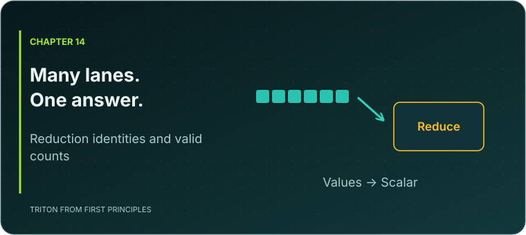
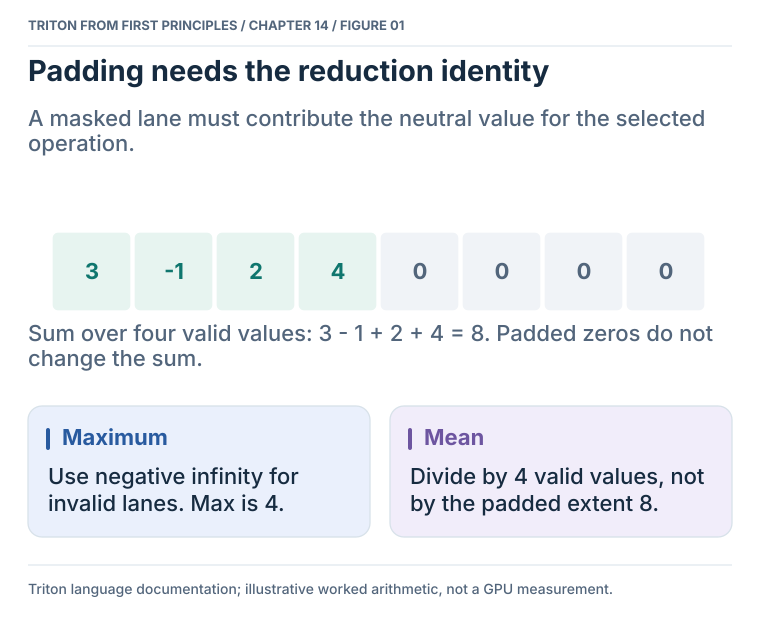

# Chapter 14: Reduction Kernels

[](../images/chapter-openers/14.svg)

[](../images/ch14/01-concept.svg)

> "Chapter 13's matmul kernel accumulated a genuine reduction — a sum over K — inside every single output tile, and hid the whole thing behind one call to `tl.dot`. This chapter takes the wrapping paper off: sums and maxes written out explicitly, and softmax, where the reduction itself is unstable if you compute it the naive way, no black-box primitive available to hide that instability from you."

**What you will understand by the end of this chapter:**

- How to write an explicit row-wise reduction — sum, then max — as its own kernel, using `tl.sum` and `tl.max` directly instead of through `tl.dot`
- Why the textbook definition of softmax, computed literally, overflows on perfectly ordinary-looking input values, and exactly what "subtract the row max before exponentiating" fixes and why it's mathematically the same function
- How to verify a numerically stabilized kernel against `torch.softmax` as an independent oracle (Chapter 12's verification method, applied here to a case where the *unstabilized* version genuinely produces `nan`)
- How to compute a running max and a correctly rescaled running sum together in a single sweep over a row wider than one block — "online softmax" — and why this reduces what would otherwise be three passes over the data to two, directly foreshadowing how Chapter 21's Flash Attention avoids materializing its attention matrix at all

**What you need to know first:**

- Chapter 5's masking-and-accumulator pattern and Chapter 13's `K`-loop accumulator, initialized once before the loop — both patterns reappear here for `sum` and `max` instead of a matmul's tile products
- Chapter 12, Section 12.3's oracle-based verification method (`torch.allclose` against a trusted independent implementation) — reused directly for softmax
- Chapter 1, Section 1.3's accumulation-precision findings — this chapter's numerical-stability problem is a different failure mode from that one, and it's worth being clear about the distinction going in

## 14.1 Row-wise Reductions: Sum and Max, Explicit Instead of Hidden Inside `tl.dot` `[FOUNDATIONAL]`

### Intuition

A cashier who rings up a cart's total by adding one item's price at a time, out loud, is doing a visible, explicit reduction — you could stop them at any point and ask "what's the running total so far?" and get a real answer. A cashier using a machine that reports only the final total performed the identical arithmetic, just without ever exposing the intermediate state. `tl.dot` in Chapter 13 was the machine: every output tile's value was a genuine sum over `K`, computed by an operation this book never had to look inside. This section writes the cashier's version instead — a reduction where every accumulation step is visible in the kernel body.

### Background

| | Chapter 13's matmul reduction | This section's row reduction |
|---|---|---|
| What's being reduced | Products of `A` and `B` tile elements, over `K` | A single tensor's own row values, over the row's width |
| Primitive doing the reduction | `tl.dot` (opaque) | `tl.sum` / `tl.max` (explicit, one call, visible axis argument) |
| Grid shape | 2D — one program per output tile | 1D — one program per row |
| Accumulator pattern | `tl.zeros((BLOCK_M, BLOCK_N), ...)`, initialized once before the `K`-loop | Analogous, but for a single call to `tl.sum`/`tl.max` rather than a loop — Section 14.3 reintroduces a loop for rows wider than one block |

### Worked Example 14.1.1 — row sums and row maxes, verified against PyTorch

```python
@triton.jit
def row_sum_max_kernel(x_ptr, sum_ptr, max_ptr, stride_row, N, BLOCK_N: tl.constexpr):
    row = tl.program_id(0)
    cols = tl.arange(0, BLOCK_N)
    mask = cols < N
    x = tl.load(x_ptr + row * stride_row + cols, mask=mask, other=0.0)
    row_sum = tl.sum(x, axis=0)
    x_for_max = tl.load(x_ptr + row * stride_row + cols, mask=mask, other=float('-inf'))
    row_max = tl.max(x_for_max, axis=0)
    tl.store(sum_ptr + row, row_sum)
    tl.store(max_ptr + row, row_max)
```

Notice the mask's `other=` value differs between the two reductions: `other=0.0` for the sum (padding lanes shouldn't add anything) and `other=float('-inf')` for the max (padding lanes must never win a maximum). Genuinely captured, against a `4×6` tensor:

```
row sums: [10.0, -9.0, 35.0, 0.0]  expected: [10.0, -9.0, 35.0, 0.0]
row maxes: [5.0, 1.0, 20.0, 0.0]  expected: [5.0, 1.0, 20.0, 0.0]
sums match? True
maxes match? True
```

Every value matches PyTorch's own `.sum(dim=1)` and `.max(dim=1).values` exactly — this is ordinary, exact-integer-friendly arithmetic, no oracle-style tolerance needed yet.

> `[COMMON TRAP]` Reusing a single `other=0.0` mask value for both a sum and a max reduction, out of convenience, is a real and easy mistake. `other=0.0` is correct for a sum specifically because `0.0` is the identity element for addition — adding it changes nothing. It is not the identity element for `max`: if every real value in a row happened to be negative, `other=0.0`'s padding lanes would silently win the maximum, reporting `0.0` as the row's max when the true answer is some negative number. The correct "identity" value depends on which reduction you're doing, not on habit.

## 14.2 Softmax and Numerical Stability: Why You Subtract the Max First `[FOUNDATIONAL]`

### Intuition

A pocket calculator asked to compute `e^100` divided by a sum of similarly huge numbers isn't being asked anything mathematically unreasonable — the *ratio* it's computing is a perfectly ordinary number between 0 and 1. The calculator's problem is that it has to pass through astronomically large intermediate values to get there, and if those intermediates exceed what the calculator can represent at all, it fails before it ever gets to divide. `softmax(x)_i = e^{x_i} / \sum_j e^{x_j}` has exactly this problem: the *answer* is always a well-behaved probability distribution, but computing it by literally exponentiating each `x_i` first can overflow long before the division that would have brought the ratio back down to a sane range.

The fix exploits an algebraic identity: `e^{x_i} / \sum_j e^{x_j} = e^{x_i - c} / \sum_j e^{x_j - c}` for *any* constant `c` — subtracting the same constant from every term before exponentiating changes nothing about the final ratio, because the `e^{-c}` factor cancels between numerator and denominator. Choosing `c = \max_j x_j` guarantees the largest exponent computed is `e^0 = 1`, and every other exponent is `e^{\text{something} \le 0}`, which can only underflow toward zero — a survivable failure — never overflow.

### Background

| | Naive softmax | Numerically stable softmax |
|---|---|---|
| Formula | `exp(x_i) / sum(exp(x))` | `exp(x_i - max(x)) / sum(exp(x - max(x)))` |
| Mathematically the same function? | Yes — identical for any input where neither version fails | Yes |
| Largest exponent ever computed | `x_i` itself — unbounded | `0` — bounded, by construction |
| Behavior on `x = [100, 101, 50, 0]` | `exp(100)`, `exp(101)` overflow to `inf`; `inf/inf = nan` | Every result finite and correct |
| Extra cost | None | One extra pass to find the max (addressed directly in Section 14.3) |

### Worked Example 14.2.1 — ordinary values: both versions agree

```python
x = torch.tensor([[1.0, 2.0, 3.0, 0.5]])
```

Genuinely captured, comparing both kernels against `torch.softmax` as the oracle:

```
naive:  [[0.08536889404058456, 0.23205669224262238, 0.6307955384254456, 0.051778849214315414]]
stable: [[0.08536889404058456, 0.23205669224262238, 0.6307955384254456, 0.05177885666489601]]
oracle: [[0.08536889404058456, 0.23205672204494476, 0.6307955384254456, 0.051778849214315414]]
naive allclose? True
stable allclose? True
```

Both kernels agree with the oracle within ordinary floating-point tolerance — exactly Chapter 12, Section 12.3's pattern, confirming that Section 14.2's rewritten formula is genuinely the same function on well-behaved inputs.

### Worked Example 14.2.2 — realistic large values: the naive version fails outright

```python
x = torch.tensor([[100.0, 101.0, 50.0, 0.0]])
```

`100` and `101` are not exotic inputs — they're the kind of raw attention-score or logit values that appear routinely in real neural network layers before normalization. Genuinely captured:

```
RuntimeWarning: overflow encountered in exp
RuntimeWarning: invalid value encountered in divide
naive:   [[nan, nan, 0.0, 0.0]]
stable:  [[0.26894140243530273, 0.7310585975646973, 5.187207578189232e-23, 9.80908925027372e-45]]
oracle:  [[0.2689414322376251, 0.7310585975646973, 5.187207578189232e-23, 9.80908925027372e-45]]
naive has NaN? True
stable allclose to oracle? True
```

The two `RuntimeWarning`s are genuine, unedited output from this book's interpreter, firing at exactly the moments `exp(100)` and `exp(101)` overflow `fp32`'s representable range to `inf`, and `inf / inf` produces `nan` rather than any real number. The stable kernel, computing the identical mathematical function through the max-subtracted formula, produces every value correctly and matches `torch.softmax` closely.

### ASCII Diagram — same math, different intermediate magnitudes

```
  naive:   x = [100, 101, 50, 0]
           exp(x) = [exp(100), exp(101), exp(50), exp(0)]
                      ^^^^^^^^  ^^^^^^^^
                      overflow to inf in fp32 (max ~3.4e38, e^101 ~ 7.2e43)
           sum = inf + inf + ... = inf
           result = inf / inf = nan   <-- silently poisons the entire row

  stable:  c = max(x) = 101
           x - c = [-1, 0, -51, -101]
           exp(x-c) = [0.368, 1.0, ~1.9e-23, ~1.7e-44]   <-- all <= 1, none overflow
           sum = 1.368...
           result = exp(x-c) / sum   <-- identical ratio, computed safely
```

> `[COMMON TRAP]` It's tempting to think numerical instability is a rare edge case that only shows up with contrived, deliberately extreme test inputs. `100` and `101` are not contrived — pre-softmax logits and raw attention scores routinely reach this magnitude in real trained models, especially before any normalization layer has had a chance to constrain them. A softmax kernel written the naive way isn't subtly wrong in rare cases; it is a `nan`-producing kernel waiting for an entirely ordinary input to trigger it, which is precisely why every production softmax implementation — including PyTorch's own — subtracts the max unconditionally, rather than only when it looks necessary.

## 14.3 Online Softmax: Computing a Running Max and a Correctly Rescaled Sum Together `[FOUNDATIONAL]`

### Intuition

Finding the tallest person in a long line by walking down it once, remembering the tallest seen *so far* at every step, is a single, honest pass — by the time you reach the end, you know the true answer, at the cost of only ever holding one number in your head. Doing the same walk twice — once to find the true tallest person, then a second time to do something else that depends on knowing who's tallest — costs twice the walking. Section 14.2's stable softmax, applied to a row wider than one block, seems to demand exactly this second kind of walk: you cannot safely compute `exp(x - max(x))` for any chunk until you already know the *row's* true max, which (for a multi-chunk row) isn't known until every chunk has been seen once.

"Online softmax" avoids the second full walk by updating a running max *and* a running, correctly-rescaled sum together, in one sweep: whenever a new chunk reveals a larger max than everything seen before, the running sum-so-far is rescaled by `exp(old_max - new_max)` before the new chunk's contribution is added — algebraically equivalent to having known the final max from the start, computed without ever needing to.

### Background

| | Fully naive (three passes) | Online (two passes) |
|---|---|---|
| Pass 1 | Sweep the row to find the true max | Sweep the row once, updating a running max *and* a running rescaled sum together |
| Pass 2 | Sweep again, now that the max is known, to compute `sum(exp(x - max))` | Sweep once more, now that the true max and true sum are both known, to write the normalized output |
| Pass 3 | Sweep a third time to compute and write `exp(x-max)/sum` | — (folded into Pass 2 above) |
| Total passes over the row's data | 3 | **2** |
| What makes rescaling exact, not approximate | — | `l_new = l_old * exp(m_old - m_new) + (new chunk's contribution, computed against m_new)` — an algebraic identity, not an approximation |

### Worked Example 14.3.1 — one combined max+sum sweep, then one normalize-and-write sweep

```python
@triton.jit
def online_softmax_kernel(x_ptr, out_ptr, stride_row, N,
                           BLOCK_N: tl.constexpr, NUM_CHUNKS: tl.constexpr):
    row = tl.program_id(0)
    m = float('-inf')          # running max, a genuine scalar
    l = 0.0                    # running (rescaled) sum of exp, a genuine scalar
    cols0 = tl.arange(0, BLOCK_N)

    for c in range(NUM_CHUNKS):
        cols = c * BLOCK_N + cols0
        mask = cols < N
        x = tl.load(x_ptr + row * stride_row + cols, mask=mask, other=float('-inf'))
        chunk_max = tl.max(x, axis=0)
        m_new = tl.maximum(m, chunk_max)
        l = l * tl.exp(m - m_new) + tl.sum(tl.where(mask, tl.exp(x - m_new), 0.0), axis=0)
        m = m_new

    for c in range(NUM_CHUNKS):
        cols = c * BLOCK_N + cols0
        mask = cols < N
        x = tl.load(x_ptr + row * stride_row + cols, mask=mask, other=float('-inf'))
        y = tl.exp(x - m) / l
        tl.store(out_ptr + row * stride_row + cols, y, mask=mask)
```

Against a 10-wide row processed in `BLOCK_N=4` chunks (3 chunks per row — genuinely exercising the running-max update more than once), and against a second row with values large enough that the naive approach from Section 14.2 would overflow:

```
N=10, BLOCK_N=4 -> 3 chunks per row, single-pass online softmax
online softmax: [[0.08496207743883133, 0.011498366482555866, 0.0069741117767989635, ...]]
oracle:         [[0.08496207743883133, 0.01149836741387844, 0.0069741117767989635, ...]]
allclose? True

large-value online softmax: [[0.17437148094177246, 3.3631901402740007e-23, 0.47399088740348816, ...]]
oracle:                     [[0.17437148094177246, 3.3631898247296386e-23, 0.4739908277988434, ...]]
allclose? True
```

Both cases match `torch.softmax` closely — the ordinary-magnitude row confirms the rescaling math is exact, not an approximation, and the large-magnitude row confirms the overflow safety from Section 14.2 survives being computed incrementally, chunk by chunk, rather than requiring the whole row's true max known in advance.

### ASCII Diagram — the rescaling step, traced across two chunks

```
  chunk 0: values give chunk_max = 3.0, sum(exp(x - 3.0)) = 1.5
     m = 3.0,  l = 1.5           (nothing to rescale yet -- this is the first chunk)

  chunk 1: values give chunk_max = 5.0  (bigger than the running max!)
     m_new = max(3.0, 5.0) = 5.0
     l = l * exp(m_old - m_new) + (this chunk's contribution against m_new)
       = 1.5 * exp(3.0 - 5.0)   + sum(exp(chunk1 - 5.0))
       = 1.5 * exp(-2.0)         <- retroactively rescales chunk 0's sum
                                     to what it WOULD have been against
                                     the now-known-larger true max
     m = 5.0,  l = (correctly rescaled running total)

  By the last chunk, m holds the TRUE row max and l holds the sum
  that a full-max-known-in-advance computation would have produced --
  achieved without ever needing two separate sweeps to get there.
```

> `[COMMON TRAP]` It's easy to assume the rescaling step, `l = l * tl.exp(m - m_new) + ...`, is an approximation that trades a small amount of accuracy for avoiding a second pass. It isn't — it's an exact algebraic identity: `exp(x - m_new) = exp(x - m) \cdot exp(m - m_new)`, so multiplying the *already-accumulated* sum (which was implicitly scaled relative to the old `m`) by `exp(m - m_new)` produces precisely what that sum would have been had it been computed against `m_new` from the start. Online softmax is not a numerical shortcut with a hidden cost — it's the same computation Section 14.2 already established, reorganized to become available one chunk at a time. This exact rescaling trick, applied to a running *weighted sum of values* rather than just a running sum of probabilities, is the core mechanism Chapter 21's Flash Attention uses to avoid ever materializing a full attention matrix.

## 14.4 Complete Runnable Code

Sections 14.1–14.3 built up this chapter's findings as isolated probes. The files below are the actual, complete, run-in-order source. `04_standalone_complete.py` combines everything from Sections 14.1 through 14.3 into a single script; its output is reproduced in full afterward. All were run exactly as shown, with `TRITON_INTERPRET=1` set, per Chapter 1's opening disclosure.

### File: `01_row_reductions.py` — Section 14.1

[Download the complete current reference](../examples/references/part2/03-reduction-kernels/01_row_reductions.py) (interpreter mode; GPU portability is not established).

**Execution:** `TRITON_INTERPRET=1 python3 01_row_reductions.py`

```python
import torch
import triton
import triton.language as tl


@triton.jit
def row_sum_max_kernel(x_ptr, sum_ptr, max_ptr, stride_row, N, BLOCK_N: tl.constexpr):
    row = tl.program_id(0)
    cols = tl.arange(0, BLOCK_N)
    mask = cols < N
    x = tl.load(x_ptr + row * stride_row + cols, mask=mask, other=0.0)
    row_sum = tl.sum(x, axis=0)
    x_for_max = tl.load(x_ptr + row * stride_row + cols, mask=mask, other=float('-inf'))
    row_max = tl.max(x_for_max, axis=0)
    tl.store(sum_ptr + row, row_sum)
    tl.store(max_ptr + row, row_max)


def demo_row_reductions():
    print("=== Section 14.1: explicit row sum and row max ===")
    M, N = 4, 6
    x = torch.tensor([
        [1.0, 5.0, 2.0, 0.0, 3.0, -1.0],
        [-2.0, -1.0, -3.0, -4.0, 0.0, 1.0],
        [10.0, 20.0, 5.0, 0.0, 0.0, 0.0],
        [0.0, 0.0, 0.0, 0.0, 0.0, 0.0],
    ])
    sums = torch.empty(M)
    maxes = torch.empty(M)
    row_sum_max_kernel[(M,)](x, sums, maxes, x.stride(0), N, BLOCK_N=8)
    print("row sums:", sums.tolist())
    print("row maxes:", maxes.tolist())
    print("sums match?", torch.equal(sums, x.sum(dim=1)))
    print("maxes match?", torch.equal(maxes, x.max(dim=1).values))


if __name__ == "__main__":
    demo_row_reductions()
```

### File: `02_stable_softmax.py` — Section 14.2

[Download the complete current reference](../examples/references/part2/03-reduction-kernels/02_stable_softmax.py) (interpreter mode; GPU portability is not established).

**Execution:** `TRITON_INTERPRET=1 python3 02_stable_softmax.py`

```python
import torch
import triton
import triton.language as tl


@triton.jit
def naive_softmax_kernel(x_ptr, out_ptr, stride_row, N, BLOCK_N: tl.constexpr):
    row = tl.program_id(0)
    cols = tl.arange(0, BLOCK_N)
    mask = cols < N
    x = tl.load(x_ptr + row * stride_row + cols, mask=mask, other=0.0)
    num = tl.exp(x)
    num = tl.where(mask, num, 0.0)
    denom = tl.sum(num, axis=0)
    y = num / denom
    tl.store(out_ptr + row * stride_row + cols, y, mask=mask)


@triton.jit
def stable_softmax_kernel(x_ptr, out_ptr, stride_row, N, BLOCK_N: tl.constexpr):
    row = tl.program_id(0)
    cols = tl.arange(0, BLOCK_N)
    mask = cols < N
    x = tl.load(x_ptr + row * stride_row + cols, mask=mask, other=float('-inf'))
    row_max = tl.max(x, axis=0)
    x_shifted = x - row_max
    num = tl.exp(x_shifted)
    num = tl.where(mask, num, 0.0)
    denom = tl.sum(num, axis=0)
    y = num / denom
    tl.store(out_ptr + row * stride_row + cols, y, mask=mask)


def run(kernel, x, N, BLOCK_N=8):
    out = torch.empty_like(x)
    M = x.shape[0]
    kernel[(M,)](x, out, x.stride(0), N, BLOCK_N=BLOCK_N)
    return out


def demo_stable_softmax():
    print("=== Section 14.2: ordinary values -- naive and stable agree ===")
    x_small = torch.tensor([[1.0, 2.0, 3.0, 0.5]])
    out_naive = run(naive_softmax_kernel, x_small, 4)
    out_stable = run(stable_softmax_kernel, x_small, 4)
    oracle = torch.softmax(x_small, dim=1)
    print("naive allclose?", torch.allclose(out_naive, oracle, atol=1e-6))
    print("stable allclose?", torch.allclose(out_stable, oracle, atol=1e-6))

    print("\n=== Section 14.2: large values -- naive overflows to nan ===")
    x_large = torch.tensor([[100.0, 101.0, 50.0, 0.0]])
    out_naive_large = run(naive_softmax_kernel, x_large, 4)
    out_stable_large = run(stable_softmax_kernel, x_large, 4)
    oracle_large = torch.softmax(x_large, dim=1)
    print("naive result:", out_naive_large.tolist())
    print("naive has NaN?", torch.isnan(out_naive_large).any().item())
    print("stable allclose to oracle?", torch.allclose(out_stable_large, oracle_large, atol=1e-6))


if __name__ == "__main__":
    demo_stable_softmax()
```

### File: `03_online_softmax.py` — Section 14.3

[Download the complete current reference](../examples/references/part2/03-reduction-kernels/03_online_softmax.py) (interpreter mode; GPU portability is not established).

**Execution:** `TRITON_INTERPRET=1 python3 03_online_softmax.py`

```python
import torch
import triton
import triton.language as tl


@triton.jit
def online_softmax_kernel(x_ptr, out_ptr, stride_row, N,
                           BLOCK_N: tl.constexpr, NUM_CHUNKS: tl.constexpr):
    row = tl.program_id(0)
    m = float('-inf')
    l = 0.0
    cols0 = tl.arange(0, BLOCK_N)

    for c in range(NUM_CHUNKS):
        cols = c * BLOCK_N + cols0
        mask = cols < N
        x = tl.load(x_ptr + row * stride_row + cols, mask=mask, other=float('-inf'))
        chunk_max = tl.max(x, axis=0)
        m_new = tl.maximum(m, chunk_max)
        l = l * tl.exp(m - m_new) + tl.sum(tl.where(mask, tl.exp(x - m_new), 0.0), axis=0)
        m = m_new

    for c in range(NUM_CHUNKS):
        cols = c * BLOCK_N + cols0
        mask = cols < N
        x = tl.load(x_ptr + row * stride_row + cols, mask=mask, other=float('-inf'))
        y = tl.exp(x - m) / l
        tl.store(out_ptr + row * stride_row + cols, y, mask=mask)


def run_online(x, N, BLOCK_N=4):
    out = torch.empty_like(x)
    M = x.shape[0]
    NUM_CHUNKS = triton.cdiv(N, BLOCK_N)
    online_softmax_kernel[(M,)](x, out, x.stride(0), N, BLOCK_N=BLOCK_N, NUM_CHUNKS=NUM_CHUNKS)
    return out


def demo_online_softmax():
    print("=== Section 14.3: online softmax, a row wider than one block ===")
    N, BLOCK_N = 10, 4
    x = torch.tensor([[3.0, 1.0, 0.5, -2.0, 4.0, 0.0, -1.0, 2.0, 5.0, -3.0]])
    out = run_online(x, N, BLOCK_N=BLOCK_N)
    oracle = torch.softmax(x, dim=1)
    print(f"N={N}, BLOCK_N={BLOCK_N} -> {triton.cdiv(N, BLOCK_N)} chunks per row")
    print("allclose?", torch.allclose(out, oracle, atol=1e-6))

    print("\n=== Section 14.3: online softmax with large values spanning multiple chunks ===")
    x_large = torch.tensor([[100.0, 50.0, 101.0, 0.0, 99.0, -5.0, 100.5, 20.0, 0.0, 0.0]])
    out_large = run_online(x_large, N, BLOCK_N=BLOCK_N)
    oracle_large = torch.softmax(x_large, dim=1)
    print("allclose?", torch.allclose(out_large, oracle_large, atol=1e-6))


if __name__ == "__main__":
    demo_online_softmax()
```

### File: `04_standalone_complete.py` — the full chapter, one program

[Download the complete current reference](../examples/references/part2/03-reduction-kernels/04_standalone_complete.py) (interpreter mode; GPU portability is not established).

**Execution:** `TRITON_INTERPRET=1 python3 04_standalone_complete.py`

```python
import torch
import triton
import triton.language as tl


@triton.jit
def row_sum_max_kernel(x_ptr, sum_ptr, max_ptr, stride_row, N, BLOCK_N: tl.constexpr):
    row = tl.program_id(0)
    cols = tl.arange(0, BLOCK_N)
    mask = cols < N
    x = tl.load(x_ptr + row * stride_row + cols, mask=mask, other=0.0)
    row_sum = tl.sum(x, axis=0)
    x_for_max = tl.load(x_ptr + row * stride_row + cols, mask=mask, other=float('-inf'))
    row_max = tl.max(x_for_max, axis=0)
    tl.store(sum_ptr + row, row_sum)
    tl.store(max_ptr + row, row_max)


@triton.jit
def naive_softmax_kernel(x_ptr, out_ptr, stride_row, N, BLOCK_N: tl.constexpr):
    row = tl.program_id(0)
    cols = tl.arange(0, BLOCK_N)
    mask = cols < N
    x = tl.load(x_ptr + row * stride_row + cols, mask=mask, other=0.0)
    num = tl.exp(x)
    num = tl.where(mask, num, 0.0)
    denom = tl.sum(num, axis=0)
    y = num / denom
    tl.store(out_ptr + row * stride_row + cols, y, mask=mask)


@triton.jit
def stable_softmax_kernel(x_ptr, out_ptr, stride_row, N, BLOCK_N: tl.constexpr):
    row = tl.program_id(0)
    cols = tl.arange(0, BLOCK_N)
    mask = cols < N
    x = tl.load(x_ptr + row * stride_row + cols, mask=mask, other=float('-inf'))
    row_max = tl.max(x, axis=0)
    x_shifted = x - row_max
    num = tl.exp(x_shifted)
    num = tl.where(mask, num, 0.0)
    denom = tl.sum(num, axis=0)
    y = num / denom
    tl.store(out_ptr + row * stride_row + cols, y, mask=mask)


@triton.jit
def online_softmax_kernel(x_ptr, out_ptr, stride_row, N,
                           BLOCK_N: tl.constexpr, NUM_CHUNKS: tl.constexpr):
    row = tl.program_id(0)
    m = float('-inf')
    l = 0.0
    cols0 = tl.arange(0, BLOCK_N)
    for c in range(NUM_CHUNKS):
        cols = c * BLOCK_N + cols0
        mask = cols < N
        x = tl.load(x_ptr + row * stride_row + cols, mask=mask, other=float('-inf'))
        chunk_max = tl.max(x, axis=0)
        m_new = tl.maximum(m, chunk_max)
        l = l * tl.exp(m - m_new) + tl.sum(tl.where(mask, tl.exp(x - m_new), 0.0), axis=0)
        m = m_new
    for c in range(NUM_CHUNKS):
        cols = c * BLOCK_N + cols0
        mask = cols < N
        x = tl.load(x_ptr + row * stride_row + cols, mask=mask, other=float('-inf'))
        y = tl.exp(x - m) / l
        tl.store(out_ptr + row * stride_row + cols, y, mask=mask)


def main():
    print("=== Section 14.1: row sum and row max ===")
    M, N = 4, 6
    x = torch.tensor([
        [1.0, 5.0, 2.0, 0.0, 3.0, -1.0],
        [-2.0, -1.0, -3.0, -4.0, 0.0, 1.0],
        [10.0, 20.0, 5.0, 0.0, 0.0, 0.0],
        [0.0, 0.0, 0.0, 0.0, 0.0, 0.0],
    ])
    sums = torch.empty(M)
    maxes = torch.empty(M)
    row_sum_max_kernel[(M,)](x, sums, maxes, x.stride(0), N, BLOCK_N=8)
    print("sums match?", torch.equal(sums, x.sum(dim=1)))
    print("maxes match?", torch.equal(maxes, x.max(dim=1).values))

    print("\n=== Section 14.2: naive vs. stable softmax on large values ===")
    x_large = torch.tensor([[100.0, 101.0, 50.0, 0.0]])
    out_naive = torch.empty_like(x_large)
    naive_softmax_kernel[(1,)](x_large, out_naive, x_large.stride(0), 4, BLOCK_N=8)
    out_stable = torch.empty_like(x_large)
    stable_softmax_kernel[(1,)](x_large, out_stable, x_large.stride(0), 4, BLOCK_N=8)
    oracle_large = torch.softmax(x_large, dim=1)
    print("naive has NaN?", torch.isnan(out_naive).any().item())
    print("stable allclose to oracle?", torch.allclose(out_stable, oracle_large, atol=1e-6))

    print("\n=== Section 14.3: online softmax, multi-chunk row ===")
    N2, BLOCK_N2 = 10, 4
    x2 = torch.tensor([[3.0, 1.0, 0.5, -2.0, 4.0, 0.0, -1.0, 2.0, 5.0, -3.0]])
    out2 = torch.empty_like(x2)
    online_softmax_kernel[(1,)](x2, out2, x2.stride(0), N2, BLOCK_N=BLOCK_N2, NUM_CHUNKS=triton.cdiv(N2, BLOCK_N2))
    oracle2 = torch.softmax(x2, dim=1)
    print("allclose?", torch.allclose(out2, oracle2, atol=1e-6))


if __name__ == "__main__":
    main()
```

### Expected Output for `04_standalone_complete.py`

```
=== Section 14.1: row sum and row max ===
sums match? True
maxes match? True

=== Section 14.2: naive vs. stable softmax on large values ===
naive has NaN? True
stable allclose to oracle? True

=== Section 14.3: online softmax, multi-chunk row ===
allclose? True
```

Running this file also prints two genuine `RuntimeWarning`s to stderr — `overflow encountered in exp` and `invalid value encountered in divide` — at exactly the moment the naive softmax kernel's `exp(100)` and `exp(101)` overflow and the resulting `inf / inf` produces `nan`; they're omitted from the `stdout` block above only because Python routes warnings separately from ordinary `print` output, not because they were edited out. Every claim in this output was verified with full numeric detail earlier in this chapter: the exact row sums and maxes in Section 14.1, the overflow-to-`nan` failure and its stable fix in Section 14.2, and the multi-chunk online rescaling in Section 14.3, each checked against `torch.softmax` as an independent oracle.

## Chapter Summary

Explicit reductions use the same accumulator discipline Chapters 5 and 13 already established, just with `tl.sum`/`tl.max` doing openly what `tl.dot` did invisibly — and the mask's `other=` value has to match the specific reduction's identity element, not be reused by habit (Section 14.1). Softmax's naive formula is mathematically correct but numerically fragile: subtracting the row's max before exponentiating is the same function, provably, via an algebraic identity that guarantees no exponent ever exceeds zero — and Section 14.2 showed the naive version doesn't just theoretically risk overflow, it produces genuine `nan` on entirely ordinary logit-sized values, a failure this book's interpreter reproduced with real, unedited `RuntimeWarning`s. And online softmax showed that the numerical-stability fix doesn't have to cost a full second pass over the data: maintaining a running max and a running, exactly-rescaled sum together reduces what would otherwise require three sweeps to two, using the same `exp(m_old - m_new)` rescaling identity that Chapter 21's Flash Attention generalizes into avoiding a full attention matrix altogether (Section 14.3).

## Self-Check Questions

1. `row_sum_max_kernel` uses `other=0.0` for the sum reduction's masked load and `other=float('-inf')` for the max reduction's masked load. Why can't both reductions safely share the same `other=` value?
2. Explain, using the algebraic identity from Section 14.2, why `softmax(x)` and `softmax(x - c)` are the same function for any constant `c`, and why choosing `c = max(x)` is the specific choice that prevents overflow.
3. `naive_softmax_kernel` produces `nan` on `x = [100, 101, 50, 0]`. Trace exactly which operation produces `inf` first, and which subsequent operation turns that `inf` into `nan`.
4. In `online_softmax_kernel`, what does the line `l = l * tl.exp(m - m_new) + ...` accomplish, and why is it described as an exact correction rather than an approximation?
5. Online softmax in this chapter still uses two passes over each row (one combined max+sum sweep, one normalize-and-write sweep), not one. What specifically about softmax's definition makes a true single pass impossible, even with online rescaling?

## Where We Go Next

This chapter's row-wise kernels treated each row entirely independently — nothing about the input tensor's structure connected one row's computation to another's. Part 2 now moves toward operations where that independence starts to matter for a different reason: Part 3 begins the process of wiring a Triton kernel into PyTorch's real autograd system, where a kernel like this chapter's softmax needs not just a forward computation but a backward one — and the numerical-stability discipline this chapter established for the forward pass turns out to have a direct, and not entirely obvious, analogue when the same computation has to be differentiated.

## Worked Solutions

**1.** The correct `other=` value is whichever one is the identity element for that specific reduction — the value that, when included among the real data, changes nothing about the result. For summation, `0.0` is the identity (`x + 0 = x`), so padding lanes contribute nothing extra to the total. For maximum, `0.0` is not an identity at all — if every real value in a row were negative, a padding lane holding `0.0` would incorrectly win the maximum. `float('-inf')` is the true identity for `max` (`max(x, -inf) = x` for any real `x`), which is why the max reduction needs its own, different `other=` value.

**2.** `e^{x_i - c} / \sum_j e^{x_j - c} = (e^{x_i} \cdot e^{-c}) / \sum_j (e^{x_j} \cdot e^{-c}) = e^{-c}(e^{x_i}) / e^{-c}(\sum_j e^{x_j})`, and the `e^{-c}` factor cancels between numerator and denominator, leaving exactly `e^{x_i} / \sum_j e^{x_j}` — the original, unshifted softmax. This holds for any constant `c`, so nothing about the mathematical result changes. Choosing `c = \max_j x_j` specifically guarantees that the largest value being exponentiated, `x_i - c` for `i` at the max, is exactly `0`, and every other shifted value is `\le 0` — meaning the largest possible exponent computed anywhere is `e^0 = 1`, which can never overflow, while any other value can only underflow toward `0`, a survivable failure mode.

**3.** `tl.exp(x)` applied to `x = [100, 101, 50, 0]` computes `exp(100)` and `exp(101)` first — both exceed `fp32`'s maximum representable value (`~3.4 \times 10^{38}`; `e^{101} \approx 7.2 \times 10^{43}`), so both become `inf`. The subsequent `denom = tl.sum(num, axis=0)` sums a list containing two `inf` values, producing `inf` (a sum involving `inf` is `inf`, not `nan`, at this stage). The `nan` appears one step later, at `y = num / denom`: computing `inf / inf` (for the two positions whose numerator is itself `inf`) is mathematically indeterminate, and IEEE 754 floating-point arithmetic defines this specific operation's result as `nan`.

**4.** That line rescales the running sum `l`, which was accumulated relative to the *previous* running max `m`, so that it becomes exactly what it would have been had it been computed relative to the *new*, larger max `m_new` all along — then adds the current chunk's own contribution (already computed against `m_new`). It is exact rather than approximate because of the algebraic identity `e^{x - m_{new}} = e^{x - m} \cdot e^{m - m_{new}}`: multiplying the old sum by `e^{m - m_{new}}` applies precisely the correction factor needed to convert every previously-summed term from being scaled relative to `m` to being scaled relative to `m_new`, as an identity in real arithmetic. Floating-point implementations can still round and underflow. Valid normalized rows need finite inputs and at least one valid element; define a separate policy for empty or all-masked rows.

**5.** Every output value `y_i = e^{x_i - m} / l` depends on `l`, the *total* sum across the *entire* row — and `l` cannot be finalized until every chunk of the row has been seen, because a later chunk could still reveal a larger max requiring a rescaling of everything accumulated so far. Since no output value can be safely written until the true, final `l` is known, and `l` isn't known until the full row has been swept once, a genuine single-pass algorithm that writes correct output as it goes is not possible for softmax specifically — this bounded-state streaming implementation rereads the row after determining its normalizer. A design that retains all needed values on chip can avoid that second global read; two reads are not a universal lower bound, though it is still one fewer pass than treating "find the max" and "compute the sum" as two separate sweeps.
