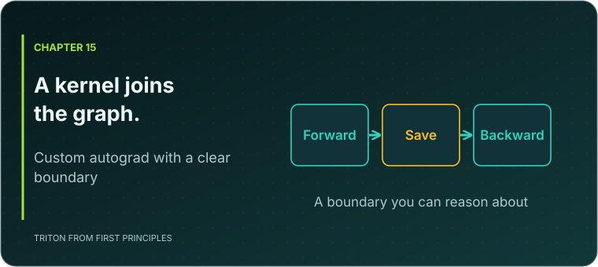
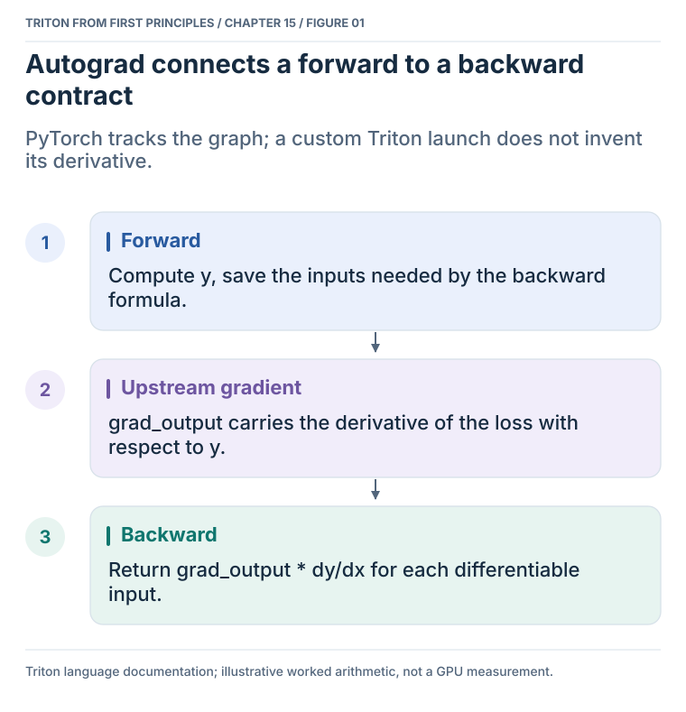

# Chapter 15: `torch.autograd.Function` as the Graph Node

[](../images/chapter-openers/15.svg)

[](../images/ch15/01-concept.svg)

> "Every kernel through Chapter 14 was a function you called: you passed it tensors, it gave you back a tensor, and that was the entire transaction. PyTorch's autograd was never in the room. The moment you want `.backward()` to reach through a Triton kernel the way it reaches through `torch.nn.functional.gelu`, you need a genuinely different kind of object — one PyTorch's graph recognizes as a node, not just a Python function that happens to return a tensor."

!!! warning "Input contract for these first wrappers"
    Pass small contiguous FP32 tensors whose element count fits the single BLOCK. These flat-address examples do not support arbitrary strided views: `arange(8)[::2]` contains `[0,2,4,6]`, whereas an unchecked flat read sees `[0,1,2,3]`. Chapter 16 normalizes its multi-program wrappers before launch. Differentiation support is limited to the derivatives explicitly implemented.

**What you will understand by the end of this chapter:**

- Why calling a Triton kernel from an ordinary Python function is completely invisible to PyTorch's autograd, even when the input tensor has `requires_grad=True` — and exactly what error you get for trying to differentiate through it anyway
- How `torch.autograd.Function`, with its paired `forward` and `backward` static methods, is a standard mechanism for inserting a computation autograd cannot see through — like a raw kernel launch — into a graph autograd can actually traverse
- How to wire up a correct `forward`/`backward` pair for a real kernel (this chapter's GELU from Chapter 12), verify the resulting gradient against PyTorch's own autograd-enabled `torch.nn.functional.gelu`, while being explicit that this chapter's `backward` is still ordinary PyTorch arithmetic, not yet a hand-written kernel — that's Chapter 16's job
- Why `ctx.save_for_backward(x)` exists as a distinct mechanism from just storing `ctx.x = x`, and what specific, silent failure mode the distinct mechanism prevents

**What you need to know first:**

- Chapter 12's exact GELU kernel and its `tl.math.erf`-based formula — reused directly as this chapter's forward pass
- Chapter 6's wrapper-function convention — a `torch.autograd.Function`'s `forward` staticmethod is, mechanically, an elaborated version of exactly that wrapper pattern
- No prior autograd or backpropagation knowledge is assumed; this chapter builds the mechanism from its most basic observable behavior

## 15.1 Autograd Can't See Through a Raw Kernel Launch `[FOUNDATIONAL]`

### Intuition

A courier who hands a sealed envelope to a recipient and walks away has performed a real delivery, but left no paper trail — if someone later asks "who delivered this, and by what route," there's nothing to point to. PyTorch's autograd builds its computational graph by watching every *recognized* operation as it happens, attaching a small record of "how to undo this, given the output's gradient" to each result. A raw call to a `@triton.jit` kernel, wrapped in an ordinary Python function, is exactly the sealed-envelope courier: real work happens, a real tensor comes back, but nothing about that work was performed through an operation autograd recognizes, so no record gets attached at all.

### Background

| | An ordinary PyTorch operation (e.g. `torch.nn.functional.gelu`) | A Triton kernel launch wrapped in a plain Python function |
|---|---|---|
| Does autograd observe it? | Yes — every built-in op is instrumented to record itself | No — a `@triton.jit` launch is opaque to autograd; it's just a side effect as far as the graph is concerned |
| Output's `.grad_fn` | Points to a real backward node | `None` |
| Calling `.backward()` on a loss derived from this output | Works, computing real gradients | Fails outright — there is no path back through the untracked operation |

### Worked Example 15.1.1 — a real kernel, invisible to autograd

```python
def plain_triton_gelu(x: torch.Tensor) -> torch.Tensor:
    """An ordinary Python function wrapping a kernel launch -- NOT an autograd.Function."""
    out = torch.empty_like(x)
    n = x.numel()
    BLOCK = triton.next_power_of_2(n)
    gelu_exact_kernel[(1,)](x, out, n, BLOCK=BLOCK)
    return out

x = torch.tensor([-1.0, 0.5, 2.0], requires_grad=True)
y = plain_triton_gelu(x)
```

Genuinely captured:

```
x.requires_grad: True
y.requires_grad: False
y.grad_fn: None
y.sum().backward() -> RuntimeError: element 0 of tensors does not require grad and does not have a grad_fn
```

`x` genuinely requires gradients — but `y`, the kernel's output, does not, because nothing in `plain_triton_gelu` did anything autograd could observe. This isn't a bug in Triton or an oversight in this wrapper; it's the expected, correct behavior of a framework that can only build a graph out of operations it was told how to differentiate. A raw kernel launch was never one of those operations.

### ASCII Diagram — where the graph simply doesn't extend

```
  x (requires_grad=True)
        |
        v
  plain_triton_gelu(x)          <- a Triton kernel launch happens here,
        |                          but autograd has no way to observe it
        v
  y  (requires_grad=False, grad_fn=None)
        |
        X   <- .backward() has nowhere to go: no recorded operation
              connects y back to x at all, as far as autograd knows
```

> `[COMMON TRAP]` It's tempting to assume that because `x.requires_grad` is `True`, any tensor computed *from* `x` will automatically also require grad, regardless of how it was computed. This is only true for operations autograd is instrumented to observe — ordinary tensor arithmetic, PyTorch's built-in functions, and (as Section 15.2 will show) a properly defined `torch.autograd.Function`. A raw Triton kernel launch is none of these; it produces a tensor with the same *values* an autograd-visible computation would, but with none of the bookkeeping that makes `.backward()` possible.

## 15.2 `torch.autograd.Function`: Making a Kernel Launch a Node PyTorch's Graph Recognizes `[FOUNDATIONAL]`

### Intuition

A courier service that issues a tracking number for every delivery, logging pickup and drop-off in a system a customer can later query, has turned an otherwise invisible transaction into something the whole shipping network can reason about — the delivery still physically happens the same way, but now there's a record connecting the parcel's origin to its destination. `torch.autograd.Function` is that tracking system for a computation autograd can't see through on its own: subclassing it and defining a `forward` staticmethod (what actually computes the output — Chapter 15.1's kernel launch, unchanged) alongside a `backward` staticmethod (how to turn a gradient with respect to the output into a gradient with respect to the input) gives PyTorch exactly the record it needs to extend the graph through your kernel.

### Background

| | Plain Python function (Section 15.1) | `torch.autograd.Function` subclass |
|---|---|---|
| Structure | One function, does the computation and returns | Two static methods: `forward(ctx, ...)` computes the output; `backward(ctx, grad_output)` computes input gradients |
| What `ctx` is | Not applicable | A context object `forward` can stash data on, for `backward` to retrieve later |
| Invocation | Called directly | `MyFunction.apply(x)` — `apply`, not calling the class or `forward` directly |
| Output's `.grad_fn` after calling | `None` | Points to a real backward node (e.g. `TritonGELUBackward`) |
| Is `backward` required to use a Triton kernel? | Not applicable | **No — this section's `backward` is ordinary PyTorch arithmetic; Chapter 16 replaces it with a real kernel** |

### Worked Example 15.2.1 — wiring the same GELU kernel into a real graph node

```python
class TritonGELU(torch.autograd.Function):
    @staticmethod
    def forward(ctx, x):
        out = torch.empty_like(x)
        n = x.numel()
        BLOCK = triton.next_power_of_2(n)
        gelu_exact_kernel[(1,)](x, out, n, BLOCK=BLOCK)
        ctx.save_for_backward(x)
        return out

    @staticmethod
    def backward(ctx, grad_output):
        # placeholder: a correct analytical formula in plain PyTorch --
        # NOT yet a hand-written Triton kernel. That's Chapter 16's job.
        x, = ctx.saved_tensors
        sqrt_2_inv = 0.7071067811865476
        sqrt_2pi_inv = 0.3989422804014327
        cdf = 0.5 * (1.0 + torch.erf(x * sqrt_2_inv))
        pdf = sqrt_2pi_inv * torch.exp(-0.5 * x * x)
        d_gelu = cdf + x * pdf
        return grad_output * d_gelu
```

`forward` is Section 15.1's identical kernel launch, with one addition: `ctx.save_for_backward(x)`, keeping `x` available for later. `backward` implements GELU's actual derivative — `d/dx[x \cdot \Phi(x)] = \Phi(x) + x \cdot \phi(x)`, where `\Phi` is the CDF and `\phi` the PDF of the standard normal distribution — using ordinary PyTorch tensor operations, explicitly *not* a Triton kernel yet. Genuinely captured:

```
y.requires_grad: True
y.grad_fn: <torch.autograd.function.TritonGELUBackward object at 0x7f0a4f232f10>
x.grad: tensor([-0.0833,  0.8675,  1.0852])
torch GELU x2.grad: tensor([-0.0833,  0.8675,  1.0852])
gradients match? True
```

`y.grad_fn` now points to a real node — `TritonGELUBackward`, automatically named from the class — and calling `y.sum().backward()` genuinely walks the graph back through it, producing `x.grad` that matches PyTorch's own autograd-enabled `torch.nn.functional.gelu` exactly. Nothing about the forward computation changed from Section 15.1; the entire difference is that `torch.autograd.Function` gave autograd a place to attach a backward record.

### ASCII Diagram — the same kernel, now with a tracking number

```
  x (requires_grad=True)
        |
        v
  TritonGELU.apply(x)
   forward(ctx, x):
     - launches gelu_exact_kernel      <- identical kernel call to Section 15.1
     - ctx.save_for_backward(x)        <- NEW: stash x for later
     - returns out
        |
        v
  y  (requires_grad=True, grad_fn=TritonGELUBackward)
        |
        v
  y.sum().backward()
        |
        v
  TritonGELU.backward(ctx, grad_output):
     - retrieves x from ctx.saved_tensors
     - computes d_gelu analytically (plain PyTorch, for now)
     - returns grad_output * d_gelu
        |
        v
  x.grad populated correctly
```

> `[COMMON TRAP]` `TritonGELU.forward(x)` — calling `forward` directly instead of `TritonGELU.apply(x)` — will often appear to work, since `forward` really does compute the correct output. It bypasses the machinery that actually builds the graph node, though: `apply` is what registers the operation with autograd, attaches the resulting `grad_fn`, and manages `ctx`'s lifecycle correctly. Calling `forward` directly produces a tensor with the right *values* and no `grad_fn` at all — silently reproducing exactly Section 15.1's invisible-to-autograd problem, from inside a class that was specifically built to solve it.

## 15.3 `ctx.save_for_backward`: Not Just a Convenient Place to Stash a Tensor `[FOUNDATIONAL]`

### Intuition

A courier logging a package's exact condition-at-pickup, in a security-sealed record neither party can quietly edit afterward, protects against a very specific dispute: someone claiming the package was in a different state than it actually was when it changed hands. A courier who just scribbles a note on a sticky pad — informal, easily overwritten, no seal — has recorded the same information with none of the same protection. `ctx.save_for_backward(x)` is the sealed record; storing `ctx.x = x` directly is the sticky note — both make `x` available inside `backward`, but only one of them protects against `x` having been silently changed in between.

### Background

| | `ctx.save_for_backward(x)` | `ctx.x = x` (storing directly) |
|---|---|---|
| Makes `x` available in `backward`? | Yes, via `ctx.saved_tensors` | Yes, via `ctx.x` |
| Tracks whether `x` was modified in-place after `forward` returned | Yes — PyTorch records a version counter | No tracking at all |
| What happens if `x` is mutated in-place before `backward` runs | Raises a clear `RuntimeError` at `backward()` time | **Silently uses the mutated value — wrong gradient, no error** |
| Recommended for tensors needed in `backward` | Yes — this is specifically what it's for | No — works, but removes a real safety check |

### Worked Example 15.3.1 — the version check, catching a genuine mistake

```python
class SafeSquare(torch.autograd.Function):
    @staticmethod
    def forward(ctx, x):
        ctx.save_for_backward(x)
        return x * x

    @staticmethod
    def backward(ctx, grad_output):
        x, = ctx.saved_tensors
        return grad_output * 2 * x

x = torch.tensor([3.0], requires_grad=True)
y = SafeSquare.apply(x)
with torch.no_grad():
    x.mul_(10.0)   # mutate x in place AFTER forward, BEFORE backward
y.sum().backward()
```

Genuinely captured:

```
RuntimeError: one of the variables needed for gradient computation has been modified by an inplace operation: [torch.FloatTensor [1]] is at version 1; expected version 0 instead. Hint: enable anomaly detection to find the operation that failed to compute its gradient, with torch.autograd.set_detect_anomaly(True, check_nan=False).
```

`ctx.save_for_backward(x)` recorded `x`'s version at the moment of saving; `x.mul_(10.0)` incremented that version by performing an in-place operation; when `backward()` tried to retrieve `x` via `ctx.saved_tensors`, PyTorch checked the version and refused to proceed with what it correctly identified as stale, no-longer-trustworthy data.

### Worked Example 15.3.2 — the identical mistake, with no safety net at all

```python
class UnsafeSquare(torch.autograd.Function):
    @staticmethod
    def forward(ctx, x):
        ctx.x = x   # anti-pattern: stash directly on ctx instead of save_for_backward
        return x * x

    @staticmethod
    def backward(ctx, grad_output):
        x = ctx.x
        return grad_output * 2 * x

x2 = torch.tensor([3.0], requires_grad=True)
y2 = UnsafeSquare.apply(x2)
with torch.no_grad():
    x2.mul_(10.0)   # identical mutation
y2.sum().backward()
```

Genuinely captured:

```
backward succeeded silently, x2.grad: tensor([60.])
(correct gradient at x=3 would be 2*3=6.0 -- this used the MUTATED x=30 instead, giving 2*30=60.0)
```

No error, no warning — `backward` retrieves `ctx.x`, which is simply whatever `x2` currently holds, `30.0`, and computes `2 \times 30 = 60.0`. The true gradient at the point `forward` actually ran, `x=3`, was `2 \times 3 = 6.0`. `ctx.x = x` doesn't store a snapshot of `x` as it was during `forward` — it stores a reference to the same tensor object, and that tensor kept changing after `forward` returned. `ctx.save_for_backward` exists specifically to catch exactly this class of mistake, and Worked Example 15.3.1 showed it doing so.

> `[COMMON TRAP]` It's easy to read `ctx.save_for_backward(x)` as a minor style preference — "the officially blessed way to do what `ctx.x = x` already does." Worked Examples 15.3.1 and 15.3.2 show it is not: the two approaches behave identically right up until something goes wrong, and only one of them turns "something went wrong" into a loud, immediate error instead of a silently incorrect gradient computed from stale data. Any tensor a custom `backward` needs — not just this chapter's GELU input — should go through `save_for_backward`, precisely because the failure mode it prevents is invisible until you specifically go looking for it.

## 15.4 Complete Runnable Code

Sections 15.1–15.3 built up this chapter's findings as isolated probes. The files below are the actual, complete, run-in-order source. `04_standalone_complete.py` combines everything from Sections 15.1 through 15.3 into a single script; its output is reproduced in full afterward. Sections 15.1 and 15.2 require `TRITON_INTERPRET=1` (they launch a real kernel); Section 15.3 uses no Triton at all and runs under ordinary Python.

### File: `01_invisible_to_autograd.py` — Section 15.1

[Download the complete current reference](../examples/references/part3/01-autograd-function-graph-node/01_invisible_to_autograd.py) (interpreter mode; GPU portability is not established).

**Execution:** `TRITON_INTERPRET=1 python3 01_invisible_to_autograd.py`

```python
import torch
import triton
import triton.language as tl


@triton.jit
def gelu_exact_kernel(x_ptr, out_ptr, n, BLOCK: tl.constexpr):
    offsets = tl.arange(0, BLOCK)
    mask = offsets < n
    x = tl.load(x_ptr + offsets, mask=mask)
    SQRT_2_INV: tl.constexpr = 0.7071067811865476
    cdf = 0.5 * (1.0 + tl.math.erf(x * SQRT_2_INV))
    y = x * cdf
    tl.store(out_ptr + offsets, y, mask=mask)


def plain_triton_gelu(x: torch.Tensor) -> torch.Tensor:
    out = torch.empty_like(x)
    n = x.numel()
    BLOCK = triton.next_power_of_2(n)
    gelu_exact_kernel[(1,)](x, out, n, BLOCK=BLOCK)
    return out


def demo_invisible_to_autograd():
    print("=== Section 15.1: a raw kernel launch is invisible to autograd ===")
    x = torch.tensor([-1.0, 0.5, 2.0], requires_grad=True)
    y = plain_triton_gelu(x)
    print("x.requires_grad:", x.requires_grad)
    print("y.requires_grad:", y.requires_grad)
    print("y.grad_fn:", y.grad_fn)
    try:
        y.sum().backward()
        print("backward succeeded (unexpected!):", x.grad)
    except Exception as e:
        print(f"y.sum().backward() -> {type(e).__name__}: {e}")


if __name__ == "__main__":
    demo_invisible_to_autograd()
```

### File: `02_autograd_function.py` — Section 15.2

[Download the complete current reference](../examples/references/part3/01-autograd-function-graph-node/02_autograd_function.py) (interpreter mode; GPU portability is not established).

**Execution:** `TRITON_INTERPRET=1 python3 02_autograd_function.py`

```python
import torch
import triton
import triton.language as tl


@triton.jit
def gelu_exact_kernel(x_ptr, out_ptr, n, BLOCK: tl.constexpr):
    offsets = tl.arange(0, BLOCK)
    mask = offsets < n
    x = tl.load(x_ptr + offsets, mask=mask)
    SQRT_2_INV: tl.constexpr = 0.7071067811865476
    cdf = 0.5 * (1.0 + tl.math.erf(x * SQRT_2_INV))
    y = x * cdf
    tl.store(out_ptr + offsets, y, mask=mask)


class TritonGELU(torch.autograd.Function):
    @staticmethod
    def forward(ctx, x):
        out = torch.empty_like(x)
        n = x.numel()
        BLOCK = triton.next_power_of_2(n)
        gelu_exact_kernel[(1,)](x, out, n, BLOCK=BLOCK)
        ctx.save_for_backward(x)
        return out

    @staticmethod
    def backward(ctx, grad_output):
        # placeholder: correct analytical formula in plain PyTorch,
        # not yet a hand-written Triton kernel (Chapter 16).
        x, = ctx.saved_tensors
        sqrt_2_inv = 0.7071067811865476
        sqrt_2pi_inv = 0.3989422804014327
        cdf = 0.5 * (1.0 + torch.erf(x * sqrt_2_inv))
        pdf = sqrt_2pi_inv * torch.exp(-0.5 * x * x)
        d_gelu = cdf + x * pdf
        return grad_output * d_gelu


def demo_autograd_function():
    print("=== Section 15.2: wiring the kernel into a real graph node ===")
    x = torch.tensor([-1.0, 0.5, 2.0], requires_grad=True)
    y = TritonGELU.apply(x)
    print("y.requires_grad:", y.requires_grad)
    print("y.grad_fn:", y.grad_fn)

    y.sum().backward()
    print("x.grad:", x.grad)

    x2 = torch.tensor([-1.0, 0.5, 2.0], requires_grad=True)
    y2 = torch.nn.functional.gelu(x2, approximate="none")
    y2.sum().backward()
    print("torch GELU x2.grad:", x2.grad)
    print("gradients match?", torch.allclose(x.grad, x2.grad, atol=1e-5))


if __name__ == "__main__":
    demo_autograd_function()
```

### File: `03_save_for_backward.py` — Section 15.3

[Download the complete current reference](../examples/references/part3/01-autograd-function-graph-node/03_save_for_backward.py) (interpreter mode; GPU portability is not established).

**Execution:** `python3 03_save_for_backward.py` (no Triton involved — ordinary Python)

```python
import torch


class SafeSquare(torch.autograd.Function):
    @staticmethod
    def forward(ctx, x):
        ctx.save_for_backward(x)
        return x * x

    @staticmethod
    def backward(ctx, grad_output):
        x, = ctx.saved_tensors
        return grad_output * 2 * x


class UnsafeSquare(torch.autograd.Function):
    @staticmethod
    def forward(ctx, x):
        ctx.x = x
        return x * x

    @staticmethod
    def backward(ctx, grad_output):
        x = ctx.x
        return grad_output * 2 * x


def demo_safe_save_for_backward():
    print("=== Section 15.3: save_for_backward detects the in-place mutation ===")
    x = torch.tensor([3.0], requires_grad=True)
    y = SafeSquare.apply(x)
    with torch.no_grad():
        x.mul_(10.0)
    try:
        y.sum().backward()
        print("backward succeeded (unexpected!):", x.grad)
    except Exception as e:
        print(f"{type(e).__name__}: {e}")


def demo_unsafe_ctx_attribute():
    print("\n=== Section 15.3: ctx.x bypasses the safety check entirely ===")
    x2 = torch.tensor([3.0], requires_grad=True)
    y2 = UnsafeSquare.apply(x2)
    with torch.no_grad():
        x2.mul_(10.0)
    y2.sum().backward()
    print("backward succeeded silently, x2.grad:", x2.grad)
    print("(correct gradient at x=3 would be 6.0 -- this used the mutated x=30 instead)")


if __name__ == "__main__":
    demo_safe_save_for_backward()
    demo_unsafe_ctx_attribute()
```

### File: `04_standalone_complete.py` — the full chapter, one program

[Download the complete current reference](../examples/references/part3/01-autograd-function-graph-node/04_standalone_complete.py) (interpreter mode; GPU portability is not established).

**Execution:** `TRITON_INTERPRET=1 python3 04_standalone_complete.py`

```python
import torch
import triton
import triton.language as tl


@triton.jit
def gelu_exact_kernel(x_ptr, out_ptr, n, BLOCK: tl.constexpr):
    offsets = tl.arange(0, BLOCK)
    mask = offsets < n
    x = tl.load(x_ptr + offsets, mask=mask)
    SQRT_2_INV: tl.constexpr = 0.7071067811865476
    cdf = 0.5 * (1.0 + tl.math.erf(x * SQRT_2_INV))
    y = x * cdf
    tl.store(out_ptr + offsets, y, mask=mask)


def plain_triton_gelu(x):
    out = torch.empty_like(x)
    n = x.numel()
    BLOCK = triton.next_power_of_2(n)
    gelu_exact_kernel[(1,)](x, out, n, BLOCK=BLOCK)
    return out


class TritonGELU(torch.autograd.Function):
    @staticmethod
    def forward(ctx, x):
        out = torch.empty_like(x)
        n = x.numel()
        BLOCK = triton.next_power_of_2(n)
        gelu_exact_kernel[(1,)](x, out, n, BLOCK=BLOCK)
        ctx.save_for_backward(x)
        return out

    @staticmethod
    def backward(ctx, grad_output):
        x, = ctx.saved_tensors
        sqrt_2_inv = 0.7071067811865476
        sqrt_2pi_inv = 0.3989422804014327
        cdf = 0.5 * (1.0 + torch.erf(x * sqrt_2_inv))
        pdf = sqrt_2pi_inv * torch.exp(-0.5 * x * x)
        d_gelu = cdf + x * pdf
        return grad_output * d_gelu


class SafeSquare(torch.autograd.Function):
    @staticmethod
    def forward(ctx, x):
        ctx.save_for_backward(x)
        return x * x

    @staticmethod
    def backward(ctx, grad_output):
        x, = ctx.saved_tensors
        return grad_output * 2 * x


class UnsafeSquare(torch.autograd.Function):
    @staticmethod
    def forward(ctx, x):
        ctx.x = x
        return x * x

    @staticmethod
    def backward(ctx, grad_output):
        x = ctx.x
        return grad_output * 2 * x


def main():
    print("=== Section 15.1: invisible to autograd ===")
    x1 = torch.tensor([-1.0, 0.5, 2.0], requires_grad=True)
    y1 = plain_triton_gelu(x1)
    print("y.grad_fn:", y1.grad_fn)
    try:
        y1.sum().backward()
    except Exception as e:
        print(f"backward -> {type(e).__name__}: {e}")

    print("\n=== Section 15.2: wired into a real graph node ===")
    x2 = torch.tensor([-1.0, 0.5, 2.0], requires_grad=True)
    y2 = TritonGELU.apply(x2)
    print("y.grad_fn:", y2.grad_fn)
    y2.sum().backward()
    x2_ref = torch.tensor([-1.0, 0.5, 2.0], requires_grad=True)
    torch.nn.functional.gelu(x2_ref, approximate="none").sum().backward()
    print("gradients match torch's own GELU?", torch.allclose(x2.grad, x2_ref.grad, atol=1e-5))

    print("\n=== Section 15.3: save_for_backward vs. ctx.x ===")
    xs = torch.tensor([3.0], requires_grad=True)
    ys = SafeSquare.apply(xs)
    with torch.no_grad():
        xs.mul_(10.0)
    try:
        ys.sum().backward()
    except Exception as e:
        print(f"safe version -> {type(e).__name__} (mutation caught)")

    xu = torch.tensor([3.0], requires_grad=True)
    yu = UnsafeSquare.apply(xu)
    with torch.no_grad():
        xu.mul_(10.0)
    yu.sum().backward()
    print("unsafe version -> silently wrong grad:", xu.grad.item(), "(correct would be 6.0)")


if __name__ == "__main__":
    main()
```

### Expected Output for `04_standalone_complete.py`

```
=== Section 15.1: invisible to autograd ===
y.grad_fn: None
backward -> RuntimeError: element 0 of tensors does not require grad and does not have a grad_fn

=== Section 15.2: wired into a real graph node ===
y.grad_fn: <torch.autograd.function.TritonGELUBackward object at ...>
gradients match torch's own GELU? True

=== Section 15.3: save_for_backward vs. ctx.x ===
safe version -> RuntimeError (mutation caught)
unsafe version -> silently wrong grad: 60.0 (correct would be 6.0)
```

The exact memory address in `TritonGELUBackward object at ...` will differ on every run — everything else in this output is deterministic and should reproduce exactly.

## Chapter Summary

A raw Triton kernel launch, however correct its output, is invisible to PyTorch's autograd — `.grad_fn` is `None`, and `.backward()` fails outright, because autograd can only build a graph out of operations it was specifically told how to observe (Section 15.1). `torch.autograd.Function` is that specific mechanism: subclassing it and defining `forward` (the kernel launch, unchanged) and `backward` (how to turn an output gradient into an input gradient) gives autograd a real node to attach, and this chapter's `TritonGELU.apply(x)` produced gradients that matched PyTorch's own autograd-enabled GELU exactly — using a `backward` written in ordinary PyTorch arithmetic, deliberately not yet a Triton kernel, since that replacement is Chapter 16's entire subject (Section 15.2). And `ctx.save_for_backward(x)` is not a stylistic preference over `ctx.x = x` — it's the difference between an in-place mutation between `forward` and `backward` raising an immediate, clear `RuntimeError`, and the identical mutation silently producing a wrong gradient (`60.0` instead of `6.0`) with no error at all (Section 15.3).

## Self-Check Questions

1. `x = torch.tensor([1.0], requires_grad=True)` and `y = some_function(x)` where `some_function` launches a Triton kernel internally. What specifically determines whether `y.grad_fn` is `None` or points to a real node?
2. What are the two static methods a `torch.autograd.Function` subclass must define, and what is each one responsible for?
3. Why does calling `TritonGELU.forward(x)` directly, instead of `TritonGELU.apply(x)`, produce a tensor with the correct numeric values but no working gradient?
4. `ctx.save_for_backward(x)` and `ctx.x = x` both make `x` available inside `backward`. What specific scenario distinguishes their behavior, and which one fails loudly versus silently?
5. In Worked Example 15.2.1, `backward` is implemented using ordinary PyTorch tensor operations (`torch.erf`, `torch.exp`), not a Triton kernel. Is this a mistake this chapter should have caught? Why or why not?

## Where We Go Next

This chapter's `backward` staticmethod computed GELU's derivative correctly, but using exactly the kind of ordinary PyTorch arithmetic this book has spent fourteen chapters building kernels to replace. Chapter 16 finishes the job: rewriting that `backward` as a genuine Triton kernel, applying everything Chapters 1 through 14 established — masking, wrapper-function conventions, accumulation precision — to a computation whose entire purpose is to compute a gradient rather than a forward value, and confronting a specific new question forward passes never had to answer: what does a kernel need to receive, and return, when its job is to propagate a gradient backward through exactly the operation it also computed forward?

## Worked Solutions

**1.** Whether `y.grad_fn` is `None` or a real node is determined entirely by *how* `y` was produced — specifically, whether it came from an operation autograd is instrumented to observe. If `some_function` is an ordinary Python function that calls a `@triton.jit` kernel directly, autograd never sees the kernel launch at all, and `y.grad_fn` is `None`, exactly as Worked Example 15.1.1 showed. If `some_function` instead calls `SomeFunction.apply(x)` for a properly defined `torch.autograd.Function` subclass, `apply` registers the operation with autograd and `y.grad_fn` points to a real backward node, as Worked Example 15.2.1 showed for `TritonGELU`.

**2.** `forward(ctx, ...)`, which performs the actual computation (in this chapter's case, launching the Triton kernel) and returns the output tensor, and `backward(ctx, grad_output)`, which receives the gradient of the loss with respect to this operation's output and must return the gradient of the loss with respect to each of `forward`'s inputs. `ctx` is shared between the two, typically used via `ctx.save_for_backward(...)` in `forward` to make data available to `backward` later.

**3.** `forward` alone only performs the numeric computation — it never runs `apply`'s surrounding machinery, which is what actually registers the operation with autograd, attaches the correct `grad_fn` to the output, and sets up the plumbing that lets `backward` be found and invoked later. Calling `forward` directly produces a tensor with the right values (the arithmetic inside `forward` still runs correctly) but with no `grad_fn` attached at all — mechanically identical to Section 15.1's problem, since from autograd's perspective nothing distinguishable from an ordinary, unobserved function call took place.

**4.** The distinguishing scenario is a tensor saved during `forward` being modified in-place before `backward` runs. `ctx.save_for_backward(x)` records `x`'s version counter at save time and checks it again when `backward` retrieves `x` via `ctx.saved_tensors` — if the version has changed (an in-place mutation occurred), it raises a clear `RuntimeError` rather than proceeding with stale data, as Worked Example 15.3.1 showed. `ctx.x = x` stores a plain reference with no version tracking at all — `backward` simply reads whatever `x` currently holds, silently using the mutated value and producing a wrong gradient with no indication anything went wrong, as Worked Example 15.3.2 demonstrated with a gradient of `60.0` instead of the correct `6.0`.

**5.** No — this chapter is explicit that `backward`'s implementation, plain PyTorch arithmetic rather than a Triton kernel, is a deliberate, disclosed choice, not an oversight. Chapter 15's subject is the *mechanism* connecting a kernel to PyTorch's autograd graph — getting `forward`, `backward`, `ctx`, and `apply` wired together correctly and verified against a trusted oracle (PyTorch's own GELU gradient). Whether `backward`'s internal computation happens to be a Triton kernel or ordinary PyTorch code doesn't affect whether the *wiring* is correct; Chapter 16 addresses the separate, real question of writing that computation as a kernel, once this chapter has established that the surrounding graph machinery works.
