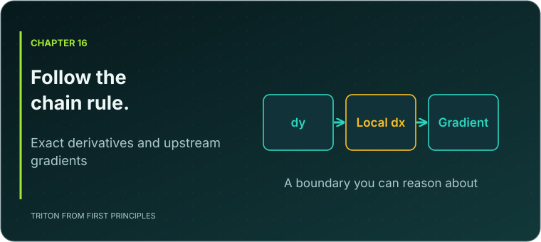
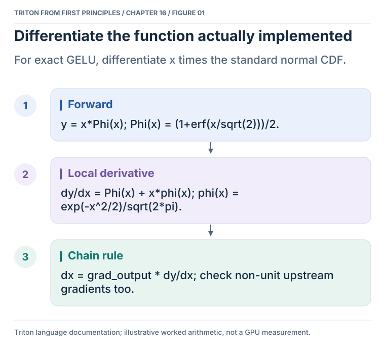

# Chapter 16: Writing the Backward Kernel

[](../images/chapter-openers/16.svg)

[](../images/ch16/01-concept.svg)

> A forward pass computes an answer. A backward pass computes how much every input is to blame for the answer's error. Neither one requires a different kind of code — only a different formula, multiplied through the one number the rest of the network hands you.

## What you will understand by the end of this chapter

- How to derive and implement a genuine Triton kernel for a function's backward pass, starting from GELU's analytical derivative, rather than the placeholder plain-PyTorch `backward` written in Chapter 15
- Why a correct backward kernel must return the *vector-Jacobian product* — `grad_output * local_derivative` — and not the local derivative alone, and what happens, concretely, when that multiplication is silently dropped
- How to generalize Chapter 15's single-block launch (`grid=(1,)`, `BLOCK=next_power_of_2(n)`) into a genuine masked, multi-program grid for tensors of arbitrary size, in both the forward and backward directions
- Why omitting the mask on a multi-program kernel is not a subtle numerical discrepancy here — it is a real, reproducible crash in this book's own interpreter environment, honestly captured rather than described secondhand
- How to replace Chapter 15's placeholder `backward` staticmethod inside `TritonGELU` with the real Triton kernel, and confirm the wired-together `torch.autograd.Function` still produces gradients matching PyTorch's own GELU exactly
- Why storing gradients in `fp16` costs meaningfully more precision than the arithmetic itself does, and why Triton's own `tl.math.erf` refuses to run on `fp16` operands at all rather than silently degrading

## What you need to know first

- Chapter 6's pointer-and-stride wrapper pattern — a Triton kernel operates on raw pointers and dimensions; a Python wrapper function allocates the output and computes the launch grid
- Chapter 9's masking pattern (`mask=`, `other=`) for boundary-safe loads and stores when a tensor's size isn't a multiple of the launch's block size
- Chapter 12's `gelu_exact_kernel` and its oracle-based verification method — comparing against `torch.nn.functional.gelu` with `torch.allclose` rather than a hand-traced number
- Chapter 13.3's lesson that accumulation precision (`fp16` vs. `fp32`) is a real, measurable source of numerical error, not a theoretical concern
- Chapter 15's `torch.autograd.Function`, its `forward`/`backward` staticmethods, `ctx.save_for_backward`, and the placeholder `backward` that computed GELU's derivative in ordinary PyTorch arithmetic rather than a Triton kernel

## 16.1 [FOUNDATIONAL] The Backward Formula as an Elementwise Kernel

### Intuition

Chapter 15's `TritonGELU.backward` worked, and its gradients matched PyTorch's own GELU exactly — but it computed that gradient in plain PyTorch tensor arithmetic, not a Triton kernel. That was a deliberate placeholder, flagged explicitly in Chapter 15's summary as "not yet a Triton kernel." The reason it's worth revisiting now is that there was never anything conceptually different about it: GELU's derivative, `d/dx[x * Φ(x)] = Φ(x) + x * φ(x)`, is *itself* just another function of `x` — exactly the same shape of problem as `gelu_exact_kernel` from Chapter 12, which computed `x * Φ(x)` directly. A backward kernel is not a new category of Triton program. It is an elementwise kernel like any other, built from the same pointer-and-stride wrapper (Chapter 6) and the same masked-load-compute-store body (Chapter 9), just computing a different formula.

The one genuinely new piece is the chain rule. A `torch.autograd.Function.backward` method doesn't receive "the answer" — it receives `grad_output`, the gradient of the final scalar loss with respect to *this operation's output*, handed down from whatever consumed that output. The backward kernel's job is to compute the *local* derivative (`Φ(x) + x*φ(x)`, evaluated at each input) and then multiply it by `grad_output`, elementwise, before returning it. Skipping that multiplication — returning the local derivative on its own — produces a function that looks completely correct in the one case most people test first, and is silently wrong everywhere else.

### Background

| | Forward kernel (`gelu_exact_kernel`, Ch. 12) | Backward kernel (this chapter) |
|---|---|---|
| Inputs | `x_ptr`, `n` | `grad_out_ptr`, `x_ptr`, `n` |
| Per-element formula | `x * cdf`, where `cdf = 0.5*(1 + erf(x/√2))` | `grad_out * d_gelu`, where `d_gelu = cdf + x*pdf` |
| Extra math needed | `erf` only | `erf` **and** `exp` (for the Gaussian pdf, `φ(x)`) |
| What it's computing | The function's value | How much the *loss* changes per unit change in `x`, given how much it already changes per unit change in the output |
| Output | `out_ptr` (same shape as `x`) | `grad_in_ptr` (same shape as `x`) |
| New failure mode versus the forward kernel | — | Forgetting to multiply by `grad_out` at all |

### Worked Example 16.1.1: the backward kernel matches Chapter 15's plain-PyTorch formula and PyTorch's own autograd

```python
@triton.jit
def gelu_backward_kernel(grad_out_ptr, x_ptr, grad_in_ptr, n, BLOCK: tl.constexpr):
    pid = tl.program_id(0)
    offsets = pid * BLOCK + tl.arange(0, BLOCK)
    mask = offsets < n
    x = tl.load(x_ptr + offsets, mask=mask, other=0.0)
    grad_out = tl.load(grad_out_ptr + offsets, mask=mask, other=0.0)
    SQRT_2_INV: tl.constexpr = 0.7071067811865476
    SQRT_2PI_INV: tl.constexpr = 0.3989422804014327
    cdf = 0.5 * (1.0 + tl.math.erf(x * SQRT_2_INV))
    pdf = SQRT_2PI_INV * tl.exp(-0.5 * x * x)
    d_gelu = cdf + x * pdf
    grad_in = grad_out * d_gelu
    tl.store(grad_in_ptr + offsets, grad_in, mask=mask)
```

Run on the same three values Chapter 15 used (`x = [-1.0, 0.5, 2.0]`, `grad_output = [1.0, 1.0, 1.0]`), genuinely captured:

```
triton kernel grad_input: tensor([-0.0833,  0.8675,  1.0852])
Ch15 plain-pytorch d_gelu: tensor([-0.0833,  0.8675,  1.0852])
torch oracle x.grad:       tensor([-0.0833,  0.8675,  1.0852])
kernel matches Ch15 plain formula? True
kernel matches torch oracle?       True
```

All three numbers are identical because `grad_output` here is all ones — a scalar loss like `y.sum()` produces exactly that. That happens to make this first test blind to the one bug this chapter cares about most, which is exactly the point of the next worked example.

### Worked Example 16.1.2: the chain-rule trap — invisible at `grad_output = 1`, dramatic everywhere else

A tempting shortcut when writing a backward kernel is to compute the local derivative and store it directly, since "the derivative of GELU" sounds like the whole answer:

```python
@triton.jit
def gelu_backward_kernel_buggy_no_chain_rule(grad_out_ptr, x_ptr, grad_in_ptr, n, BLOCK: tl.constexpr):
    pid = tl.program_id(0)
    offsets = pid * BLOCK + tl.arange(0, BLOCK)
    mask = offsets < n
    x = tl.load(x_ptr + offsets, mask=mask, other=0.0)
    SQRT_2_INV: tl.constexpr = 0.7071067811865476
    SQRT_2PI_INV: tl.constexpr = 0.3989422804014327
    cdf = 0.5 * (1.0 + tl.math.erf(x * SQRT_2_INV))
    pdf = SQRT_2PI_INV * tl.exp(-0.5 * x * x)
    d_gelu = cdf + x * pdf
    tl.store(grad_in_ptr + offsets, d_gelu, mask=mask)  # BUG: never multiplied by grad_out
```

With `grad_output = [1.0, 1.0, 1.0]`, genuinely captured:

```
correct kernel matches oracle?    True
buggy kernel matches oracle?      True
```

Both pass. Now the same two kernels with `grad_output = [2.0, 2.0, 2.0]` — the gradient a loss like `(2 * y).sum()` would hand back — genuinely captured:

```
oracle grad (grad_output=2.0):    tensor([-0.1666,  1.7350,  2.1705])
correct kernel grad_input:        tensor([-0.1666,  1.7350,  2.1705])
correct kernel matches oracle?    True
buggy kernel grad_input:          tensor([-0.0833,  0.8675,  1.0852])
buggy kernel matches oracle?      False
buggy kernel is exactly half:     True
```

The buggy kernel returns exactly the same numbers it returned before — because it never looked at `grad_output` at all. It is off by precisely the missing factor of two. In a real training loop, `grad_output` is essentially never a uniform `1.0`; it is whatever the rest of the network's chain rule handed down, and it changes every step. A backward kernel that "works" only because a first smoke test happened to use `.sum().backward()` — the single case where `grad_output` is all ones by construction — is a trap that specifically hides behind the most common way people first exercise custom autograd code.

### ASCII Diagram

```
FORWARD:   x ---[gelu_exact_kernel]---> y

BACKWARD:  grad_output ----------------------------\
                                                      \
           x ---[local derivative: cdf + x*pdf]---> (*) ---> grad_input
                                                      ^
                                    THIS multiplication is the entire
                                    chain rule -- drop it, and every
                                    layer "downstream" of this one
                                    is silently ignored.
```

> [COMMON TRAP] A backward kernel that computes only the local derivative and never multiplies by `grad_output` will pass any test built around `.sum().backward()` or `.mean().backward()` at the very start of a computation graph, because in that specific case `grad_output` genuinely is `1` (or a constant) everywhere. The bug only appears once this operation sits *inside* a larger graph, receiving a non-trivial `grad_output` from whatever comes after it — which is precisely the situation Chapter 17 introduces. Always test a custom `backward` with an explicit, non-uniform `grad_output` (via `.backward(some_tensor)`, as Worked Example 16.1.2 did), not just the default implicit gradient from `.sum()`.

## 16.2 [FOUNDATIONAL] Generalizing to a Masked, Multi-Program Grid

### Intuition

Chapter 15's wrapper functions launched exactly one program (`grid=(1,)`) with `BLOCK = triton.next_power_of_2(n)` — a shortcut that only works because the tensors involved were tiny enough to fit inside a single block's worth of lanes. Real tensors won't cooperate: a hidden layer's activations might have tens of thousands of elements, far past any block size that's practical to launch as a single program. The fix is the same masked, multi-program pattern Chapter 9 introduced for the forward direction: launch `triton.cdiv(n, BLOCK)` programs, each covering one `BLOCK`-sized slice of the tensor, with a `mask = offsets < n` guarding the one program whose slice runs past the end.

Nothing about the backward kernel's *math* changes to support this — `cdf`, `pdf`, and `d_gelu` are computed identically per-element regardless of which program computed them. What has to change is discipline about masking: this kernel now reads from *two* input tensors (`x` and `grad_out`) that must be indexed and masked identically, and writes to one output tensor that must be masked the same way again. Three separate opportunities to get the boundary condition right, instead of forward's one.

### Background

| Launch style | Grid | `BLOCK` | Correct for | Used in |
|---|---|---|---|---|
| Single-program | `(1,)` | `triton.next_power_of_2(n)` | Only tensors small enough that one block covers every element | Chapter 15 (`plain_triton_gelu`, `TritonGELU`) |
| Masked multi-program | `(triton.cdiv(n, BLOCK),)` | A fixed, chosen constant (e.g. `1024`) | Tensors of any size, including ones far larger than one block | Chapter 9 (forward masking), this chapter (forward *and* backward) |

### Worked Example 16.2.1: 10,000 elements, `BLOCK=1024`, ten programs, the last one three-quarters empty

```python
def triton_gelu_forward(x, BLOCK=1024):
    x = x.contiguous()
    out = torch.empty_like(x)
    n = x.numel()
    grid = (triton.cdiv(n, BLOCK),)
    gelu_forward_kernel[grid](x, out, n, BLOCK=BLOCK)
    return out

def triton_gelu_backward(grad_output, x, BLOCK=1024):
    x = x.contiguous()
    grad_output = grad_output.contiguous()
    grad_input = torch.empty_like(x)
    n = x.numel()
    grid = (triton.cdiv(n, BLOCK),)
    gelu_backward_kernel[grid](grad_output, x, grad_input, n, BLOCK=BLOCK)
    return grad_input
```

With `n = 10000` and `BLOCK = 1024`, `triton.cdiv(10000, 1024) = 10` — ten programs, the last of which only has `10000 - 9*1024 = 784` valid lanes out of its `1024`, leaving `240` that must be masked off. Genuinely captured, comparing both directions against the PyTorch oracle on random input:

```
triton.cdiv(n, BLOCK) = 10  (10 programs; last covers only 784 of 1024 lanes)
forward allclose to oracle? True
forward max abs diff: 7.888302206993103e-07
backward allclose to oracle? True
backward max abs diff: 7.152557373046875e-07
```

Both directions agree with the oracle to ordinary floating-point noise (the same `~1e-7` scale Chapter 12.3 established as healthy, not a bug), across all ten programs including the partially-masked tail one.

### Worked Example 16.2.2: what omitting the mask actually does here

It's tempting to assume that forgetting `mask=` on a multi-program kernel just reads or writes "some garbage values" at the tail — a bounded, if wrong, outcome. That is not what genuinely happens when both the loads *and* the store are left unmasked:

```python
@triton.jit
def gelu_backward_kernel_no_mask(grad_out_ptr, x_ptr, grad_in_ptr, n, BLOCK: tl.constexpr):
    pid = tl.program_id(0)
    offsets = pid * BLOCK + tl.arange(0, BLOCK)
    x = tl.load(x_ptr + offsets)                # no mask
    grad_out = tl.load(grad_out_ptr + offsets)  # no mask
    SQRT_2_INV: tl.constexpr = 0.7071067811865476
    SQRT_2PI_INV: tl.constexpr = 0.3989422804014327
    cdf = 0.5 * (1.0 + tl.math.erf(x * SQRT_2_INV))
    pdf = SQRT_2PI_INV * tl.exp(-0.5 * x * x)
    d_gelu = cdf + x * pdf
    grad_in = grad_out * d_gelu
    tl.store(grad_in_ptr + offsets, grad_in)    # no mask -- writes past the buffer too
```

Launched with the same `n=10000`, `BLOCK=1024` grid of ten programs, the tail program's unmasked load and store reach `240` elements past the end of every one of the three tensors it touches. Run genuinely, in this book's own `TRITON_INTERPRET=1` environment, once, in an isolated process:

```
$ TRITON_INTERPRET=1 python3 -u this_script.py
=== Test D: what happens when masking is omitted on a tail block ===
Segmentation fault (exit code 139)
```

Only the first `print` made it out before the process died. This is a genuine, reproducible crash of the Python interpreter itself — not a Triton exception that can be caught with `try`/`except`, and not a wrong-but-printable number. The exact underlying cause (the interpreter's NumPy-backed simulation of device memory being asked to read and write outside an allocated array) is specific to running under `TRITON_INTERPRET=1`; on a real GPU, the equivalent mistake is an *illegal memory access* — a different-looking but equally fatal failure, and one this book's environment cannot demonstrate directly (Chapter 1's standing disclosure). Either way, the lesson is the same one Chapter 9 already drew, now sharpened: masking on a multi-program kernel is never optional decoration. Because this crash cannot be safely embedded in a script alongside other output (it kills the whole process), it is deliberately **not** included among this chapter's four runnable reference files — Worked Example 16.2.2 documents it honestly instead of pretending it can be demonstrated inline.

### ASCII Diagram

```
n = 10000, BLOCK = 1024, grid = cdiv(10000, 1024) = 10 programs

program:   0        1        2        ...    8        9
offsets: [0,1024) [1024,2048) ...          [8192,9216) [9216,10240)
                                                          ^^^^^^^^^^
                                                          only [9216,10000)
                                                          are real elements;
                                                          [10000,10240) is
                                                          past the end of
                                                          every tensor involved

mask = offsets < n   -->  programs 0-8: mask is all-True (no effect)
                          program 9:    mask is True for 784 lanes,
                                        False for the remaining 240
```

> [COMMON TRAP] A masked single-input forward kernel (Chapter 9) has exactly one load and one store to get right. This chapter's backward kernel has two independent loads (`x`, `grad_out`) that must share the *same* `mask`, plus the store — three chances to typo, copy-paste incorrectly, or simply forget. Compute `mask = offsets < n` once, and pass that identical variable to every `tl.load` and the final `tl.store`, rather than re-deriving it (or, worse, omitting it) at each call site.

## 16.3 [FOUNDATIONAL] Wiring the Real Kernel Into `TritonGELU`, and Precision in the Backward Pass

### Intuition

With a genuinely masked, multi-program backward kernel in hand, replacing Chapter 15's placeholder is almost anticlimactic: `TritonGELU.backward` already had the right shape — retrieve `x` from `ctx.saved_tensors`, compute something from it and `grad_output`, and return that. All that changes is what "compute something" means: a call into `gelu_backward_kernel` instead of four lines of `torch.erf`/`torch.exp`. The `forward` staticmethod gets the same treatment, replacing Chapter 15's single-block launch with `triton_gelu_forward`'s masked multi-program version. The autograd machinery Chapter 15 established — `ctx.save_for_backward`, the resulting `TritonGELUBackward` graph node, `.grad_fn`, `.backward()` — needs no changes at all; it was already correctly built around *whatever* computation `forward` and `backward` perform internally.

The other loose end is precision. Chapter 13.3 showed that accumulating a matmul's inner-product sum in `fp16` versus `fp32` produces a real, measurable gap. A backward kernel like this one has no accumulation loop — there's nothing being summed across iterations — so that specific lesson doesn't transfer directly. But a related question does: does the *storage* dtype of the gradient itself matter, independent of what precision the arithmetic runs in? And what happens if the inputs are already `fp16`, since that's an entirely realistic scenario for a network trained in mixed precision? Both turn out to have real, verifiable answers — one of them genuinely surprising.

### Background

| Precision question | What Chapter 13.3 already established | What's new here |
|---|---|---|
| Where does precision loss come from? | Summing many products across loop iterations in a low-precision accumulator | An elementwise kernel with no loop — precision loss can only come from the *storage* dtype of inputs and outputs, not accumulation |
| Does the math library care about input dtype? | Not tested | `tl.math.erf` refuses `fp16` input outright, raising an error rather than silently computing in reduced precision |
| Fix | Accumulate in `fp32` regardless of input/output dtype (a Triton/CUDA-wide convention) | Explicitly `.to(tl.float32)` before calling `erf`/`exp`, then let the store back to `grad_in_ptr` cast to whatever dtype the output tensor actually is |

### Worked Example 16.3.1: `TritonGELU`, fully wired, multi-block forward and backward

```python
class TritonGELU(torch.autograd.Function):
    @staticmethod
    def forward(ctx, x):
        out = triton_gelu_forward(x)
        ctx.save_for_backward(x)
        return out

    @staticmethod
    def backward(ctx, grad_output):
        x, = ctx.saved_tensors
        return triton_gelu_backward(grad_output.contiguous(), x)
```

Run on `n = 5000` — large enough to require five separate programs in both directions — genuinely captured:

```
y.grad_fn: <torch.autograd.function.TritonGELUBackward object at 0x7fcb6784ae00>
forward allclose to oracle?  True
x.grad allclose to oracle?  True
max forward diff: 7.152557373046875e-07
max grad diff:    2.384185791015625e-07
```

(The exact memory address after `object at` will differ every run, exactly as Chapter 15 noted — everything else is deterministic.) Both the forward output and the backward gradient now come entirely from genuine Triton kernel launches, masked and multi-program in both directions, and both still agree with PyTorch's own GELU to ordinary floating-point noise.

### Worked Example 16.3.2: fp16 storage costs precision even when the math runs in fp32

First, the naive attempt — passing `fp16` tensors directly into `gelu_backward_kernel` from Worked Example 16.2.1, unmodified:

```
InterpreterError: ValueError("Expected dtype ['fp32', 'fp64'] but got fp16")
```

This is a genuine, immediate failure — not a crash, not silent wrong output, but a caught, informative exception. `TRITON_INTERPRET=1` wraps the underlying error in its own `InterpreterError`, but the message it carries is `tl.math.erf`'s own: a plain `ValueError` refusing to run `erf` on an `fp16` operand at all. The fix is one explicit cast, added to both loads:

```python
x = tl.load(x_ptr + offsets, mask=mask, other=0.0).to(tl.float32)
grad_out = tl.load(grad_out_ptr + offsets, mask=mask, other=0.0).to(tl.float32)
```

With that upcast in place, the kernel runs on `fp16` tensors without error. But running it, storing both the inputs and the output gradient as genuine `fp16` tensors, and comparing against an `fp64` ground truth alongside a full-`fp32` run of the identical kernel, genuinely captured:

```
fp32-in/fp32-out max abs diff from fp64 ground truth:   2.360000217471736e-07
fp16-in/fp16-out (fp32 math internally) max abs diff:   0.0015156170082177844
ratio (fp16 path error / fp32 path error):              6422.105375233661
```

The arithmetic inside the kernel is running in `fp32` in *both* cases — the only difference is that the `fp16` version's inputs and output are each rounded to `fp16`'s roughly 3-decimal-digit precision the moment they're loaded and stored. That rounding alone costs a factor of roughly six thousand in accuracy, with no loop, no accumulation, and no difference in the formula whatsoever. Precision loss from storage dtype is a genuinely different mechanism from Chapter 13.3's accumulation-precision loss, and it applies even to the simplest possible elementwise kernel.

### ASCII Diagram

```
 fp16 tensor in memory          fp32 arithmetic inside kernel         fp16 tensor in memory
 (~3 decimal digits) ---load-->  (full fp32 precision,        --store--> (~3 decimal digits)
                        + .to(fp32)   erf/exp computed exactly)              again

 Rounding happens HERE                                          and HERE
 (on the way in)                                                (on the way out)
 -- regardless of how precisely the math in between was computed.
```

> [COMMON TRAP] It's tempting to assume `tl.math.erf` will "just work" on `fp16` tensors, perhaps at reduced but tolerable precision. What actually happens is a hard `ValueError` at kernel-launch time — Triton's math library only accepts `fp32` or `fp64` operands for `erf`, full stop. Fixing that with an explicit `.to(tl.float32)` is necessary, but it is not sufficient for full `fp32`-level accuracy: the `fp16` storage of the surrounding tensors still rounds off precision on every load and every store, independent of what precision the arithmetic in between used. Upcasting inside the kernel fixes the crash; it does not fix the storage-precision cost, because that cost was never inside the kernel's math to begin with.

## 16.4 Complete Runnable Code

The four files below build up the chapter in order: a single-block backward kernel and the chain-rule trap (16.1), the masked multi-program generalization (16.2, minus the deliberately-excluded crash demonstration from Worked Example 16.2.2), the fully wired `TritonGELU` plus the precision comparison (16.3), and one standalone file combining all of it with a single documented `Expected Output` block.

### File: `01_backward_kernel.py`

[Download the complete current reference](../examples/references/part4/01-writing-the-backward-kernel/01_backward_kernel.py) (interpreter mode; GPU portability is not established).

```python
import torch
import triton
import triton.language as tl


@triton.jit
def gelu_backward_kernel(grad_out_ptr, x_ptr, grad_in_ptr, n, BLOCK: tl.constexpr):
    pid = tl.program_id(0)
    offsets = pid * BLOCK + tl.arange(0, BLOCK)
    mask = offsets < n
    x = tl.load(x_ptr + offsets, mask=mask, other=0.0)
    grad_out = tl.load(grad_out_ptr + offsets, mask=mask, other=0.0)
    SQRT_2_INV: tl.constexpr = 0.7071067811865476
    SQRT_2PI_INV: tl.constexpr = 0.3989422804014327
    cdf = 0.5 * (1.0 + tl.math.erf(x * SQRT_2_INV))
    pdf = SQRT_2PI_INV * tl.exp(-0.5 * x * x)
    d_gelu = cdf + x * pdf
    grad_in = grad_out * d_gelu
    tl.store(grad_in_ptr + offsets, grad_in, mask=mask)


@triton.jit
def gelu_backward_kernel_buggy_no_chain_rule(grad_out_ptr, x_ptr, grad_in_ptr, n, BLOCK: tl.constexpr):
    pid = tl.program_id(0)
    offsets = pid * BLOCK + tl.arange(0, BLOCK)
    mask = offsets < n
    x = tl.load(x_ptr + offsets, mask=mask, other=0.0)
    SQRT_2_INV: tl.constexpr = 0.7071067811865476
    SQRT_2PI_INV: tl.constexpr = 0.3989422804014327
    cdf = 0.5 * (1.0 + tl.math.erf(x * SQRT_2_INV))
    pdf = SQRT_2PI_INV * tl.exp(-0.5 * x * x)
    d_gelu = cdf + x * pdf
    tl.store(grad_in_ptr + offsets, d_gelu, mask=mask)  # BUG: never multiplied by grad_out


def section_16_1():
    print("=== Section 16.1: the backward kernel vs. Chapter 15's plain-PyTorch formula ===")
    x = torch.tensor([-1.0, 0.5, 2.0])
    n = x.numel()
    BLOCK = triton.next_power_of_2(n)

    grad_output_ones = torch.ones_like(x)
    x_oracle1 = x.clone().requires_grad_(True)
    y_oracle1 = torch.nn.functional.gelu(x_oracle1, approximate="none")
    y_oracle1.backward(grad_output_ones)

    correct_grad1 = torch.empty_like(x)
    gelu_backward_kernel[(1,)](grad_output_ones, x, correct_grad1, n, BLOCK=BLOCK)
    buggy_grad1 = torch.empty_like(x)
    gelu_backward_kernel_buggy_no_chain_rule[(1,)](grad_output_ones, x, buggy_grad1, n, BLOCK=BLOCK)

    print("with grad_output=1.0 (both look correct):")
    print("  correct kernel matches oracle?", torch.allclose(correct_grad1, x_oracle1.grad))
    print("  buggy kernel matches oracle?  ", torch.allclose(buggy_grad1, x_oracle1.grad))

    grad_output_twos = torch.full_like(x, 2.0)
    x_oracle2 = x.clone().requires_grad_(True)
    y_oracle2 = torch.nn.functional.gelu(x_oracle2, approximate="none")
    y_oracle2.backward(grad_output_twos)

    correct_grad2 = torch.empty_like(x)
    gelu_backward_kernel[(1,)](grad_output_twos, x, correct_grad2, n, BLOCK=BLOCK)
    buggy_grad2 = torch.empty_like(x)
    gelu_backward_kernel_buggy_no_chain_rule[(1,)](grad_output_twos, x, buggy_grad2, n, BLOCK=BLOCK)

    print("with grad_output=2.0 (the trap is exposed):")
    print("  correct kernel matches oracle?", torch.allclose(correct_grad2, x_oracle2.grad))
    print("  buggy kernel matches oracle?  ", torch.allclose(buggy_grad2, x_oracle2.grad))
    print("  buggy kernel is exactly half? ", torch.allclose(buggy_grad2 * 2.0, x_oracle2.grad))


if __name__ == "__main__":
    section_16_1()
```

### File: `02_masked_multiblock.py`

[Download the complete current reference](../examples/references/part4/01-writing-the-backward-kernel/02_masked_multiblock.py) (interpreter mode; GPU portability is not established).

```python
import torch
import triton
import triton.language as tl


@triton.jit
def gelu_forward_kernel(x_ptr, out_ptr, n, BLOCK: tl.constexpr):
    pid = tl.program_id(0)
    offsets = pid * BLOCK + tl.arange(0, BLOCK)
    mask = offsets < n
    x = tl.load(x_ptr + offsets, mask=mask, other=0.0)
    SQRT_2_INV: tl.constexpr = 0.7071067811865476
    cdf = 0.5 * (1.0 + tl.math.erf(x * SQRT_2_INV))
    out = x * cdf
    tl.store(out_ptr + offsets, out, mask=mask)


@triton.jit
def gelu_backward_kernel(grad_out_ptr, x_ptr, grad_in_ptr, n, BLOCK: tl.constexpr):
    pid = tl.program_id(0)
    offsets = pid * BLOCK + tl.arange(0, BLOCK)
    mask = offsets < n
    x = tl.load(x_ptr + offsets, mask=mask, other=0.0)
    grad_out = tl.load(grad_out_ptr + offsets, mask=mask, other=0.0)
    SQRT_2_INV: tl.constexpr = 0.7071067811865476
    SQRT_2PI_INV: tl.constexpr = 0.3989422804014327
    cdf = 0.5 * (1.0 + tl.math.erf(x * SQRT_2_INV))
    pdf = SQRT_2PI_INV * tl.exp(-0.5 * x * x)
    d_gelu = cdf + x * pdf
    grad_in = grad_out * d_gelu
    tl.store(grad_in_ptr + offsets, grad_in, mask=mask)


def triton_gelu_forward(x, BLOCK=1024):
    x = x.contiguous()
    out = torch.empty_like(x)
    n = x.numel()
    grid = (triton.cdiv(n, BLOCK),)
    gelu_forward_kernel[grid](x, out, n, BLOCK=BLOCK)
    return out


def triton_gelu_backward(grad_output, x, BLOCK=1024):
    x = x.contiguous()
    grad_output = grad_output.contiguous()
    grad_input = torch.empty_like(x)
    n = x.numel()
    grid = (triton.cdiv(n, BLOCK),)
    gelu_backward_kernel[grid](grad_output, x, grad_input, n, BLOCK=BLOCK)
    return grad_input


def section_16_2():
    print("=== Section 16.2: masked multi-program launch, n=10000, BLOCK=1024 ===")
    torch.manual_seed(0)
    n = 10000
    BLOCK = 1024
    print(f"triton.cdiv(n, BLOCK) = {triton.cdiv(n, BLOCK)} programs")

    x = torch.randn(n)
    out = triton_gelu_forward(x, BLOCK=BLOCK)
    oracle_out = torch.nn.functional.gelu(x, approximate="none")
    print("forward allclose to oracle?", torch.allclose(out, oracle_out, atol=1e-5))

    grad_output = torch.randn(n)
    grad_input = triton_gelu_backward(grad_output, x, BLOCK=BLOCK)
    x_oracle = x.clone().requires_grad_(True)
    y_oracle = torch.nn.functional.gelu(x_oracle, approximate="none")
    y_oracle.backward(grad_output)
    print("backward allclose to oracle?", torch.allclose(grad_input, x_oracle.grad, atol=1e-5))


if __name__ == "__main__":
    section_16_2()
```

### File: `03_wired_tritongelu.py`

[Download the complete current reference](../examples/references/part4/01-writing-the-backward-kernel/03_wired_tritongelu.py) (interpreter mode; GPU portability is not established).

```python
import torch
import triton
import triton.language as tl


@triton.jit
def gelu_forward_kernel(x_ptr, out_ptr, n, BLOCK: tl.constexpr):
    pid = tl.program_id(0)
    offsets = pid * BLOCK + tl.arange(0, BLOCK)
    mask = offsets < n
    x = tl.load(x_ptr + offsets, mask=mask, other=0.0)
    SQRT_2_INV: tl.constexpr = 0.7071067811865476
    cdf = 0.5 * (1.0 + tl.math.erf(x * SQRT_2_INV))
    out = x * cdf
    tl.store(out_ptr + offsets, out, mask=mask)


@triton.jit
def gelu_backward_kernel_upcast(grad_out_ptr, x_ptr, grad_in_ptr, n, BLOCK: tl.constexpr):
    pid = tl.program_id(0)
    offsets = pid * BLOCK + tl.arange(0, BLOCK)
    mask = offsets < n
    x = tl.load(x_ptr + offsets, mask=mask, other=0.0).to(tl.float32)
    grad_out = tl.load(grad_out_ptr + offsets, mask=mask, other=0.0).to(tl.float32)
    SQRT_2_INV: tl.constexpr = 0.7071067811865476
    SQRT_2PI_INV: tl.constexpr = 0.3989422804014327
    cdf = 0.5 * (1.0 + tl.math.erf(x * SQRT_2_INV))
    pdf = SQRT_2PI_INV * tl.exp(-0.5 * x * x)
    d_gelu = cdf + x * pdf
    grad_in = grad_out * d_gelu
    tl.store(grad_in_ptr + offsets, grad_in, mask=mask)


def triton_gelu_forward(x, BLOCK=1024):
    x = x.contiguous()
    out = torch.empty_like(x)
    n = x.numel()
    grid = (triton.cdiv(n, BLOCK),)
    gelu_forward_kernel[grid](x, out, n, BLOCK=BLOCK)
    return out


def triton_gelu_backward(grad_output, x, BLOCK=1024):
    x = x.contiguous()
    grad_output = grad_output.contiguous()
    grad_input = torch.empty_like(x)
    n = x.numel()
    grid = (triton.cdiv(n, BLOCK),)
    gelu_backward_kernel_upcast[grid](grad_output, x, grad_input, n, BLOCK=BLOCK)
    return grad_input


class TritonGELU(torch.autograd.Function):
    @staticmethod
    def forward(ctx, x):
        out = triton_gelu_forward(x)
        ctx.save_for_backward(x)
        return out

    @staticmethod
    def backward(ctx, grad_output):
        x, = ctx.saved_tensors
        return triton_gelu_backward(grad_output.contiguous(), x)


def section_16_3():
    print("=== Section 16.3: TritonGELU wired end-to-end, n=5000 ===")
    torch.manual_seed(1)
    n = 5000
    x = torch.randn(n, requires_grad=True)
    y = TritonGELU.apply(x)
    print("y.grad_fn:", y.grad_fn)
    y.sum().backward()

    x_oracle = x.detach().clone().requires_grad_(True)
    y_oracle = torch.nn.functional.gelu(x_oracle, approximate="none")
    y_oracle.sum().backward()

    print("forward allclose to oracle?", torch.allclose(y.detach(), y_oracle.detach(), atol=1e-5))
    print("x.grad allclose to oracle? ", torch.allclose(x.grad, x_oracle.grad, atol=1e-5))

    print()
    print("=== Section 16.3: fp16 storage precision vs. fp32, with fp32 math throughout ===")
    torch.manual_seed(2)
    n2 = 2048
    BLOCK2 = 512
    x_fp32 = torch.randn(n2) * 3.0
    grad_out_fp32 = torch.randn(n2)

    x64 = x_fp32.double().requires_grad_(True)
    y64 = torch.nn.functional.gelu(x64, approximate="none")
    y64.backward(grad_out_fp32.double())
    ground_truth = x64.grad

    grad_in_fp32 = triton_gelu_backward(grad_out_fp32, x_fp32, BLOCK=BLOCK2)
    diff_fp32 = (grad_in_fp32.double() - ground_truth).abs().max().item()
    print("fp32-in/fp32-out max abs diff from fp64 ground truth:", diff_fp32)

    x_fp16 = x_fp32.half()
    grad_out_fp16 = grad_out_fp32.half()
    grad_in_fp16 = triton_gelu_backward(grad_out_fp16, x_fp16, BLOCK=BLOCK2)
    diff_fp16 = (grad_in_fp16.double() - ground_truth).abs().max().item()
    print("fp16-in/fp16-out (fp32 math internally) max abs diff:", diff_fp16)
    print("ratio (fp16 path error / fp32 path error):", diff_fp16 / diff_fp32)

    print()
    print("=== Section 16.3: tl.math.erf refuses fp16 operands without the upcast ===")
    try:
        grad_in_bad = torch.empty(n2, dtype=torch.float16)
        grid = (triton.cdiv(n2, BLOCK2),)

        @triton.jit
        def _gelu_backward_no_upcast(grad_out_ptr, x_ptr, grad_in_ptr, n, BLOCK: tl.constexpr):
            pid = tl.program_id(0)
            offsets = pid * BLOCK + tl.arange(0, BLOCK)
            mask = offsets < n
            x = tl.load(x_ptr + offsets, mask=mask, other=0.0)
            grad_out = tl.load(grad_out_ptr + offsets, mask=mask, other=0.0)
            SQRT_2_INV: tl.constexpr = 0.7071067811865476
            SQRT_2PI_INV: tl.constexpr = 0.3989422804014327
            cdf = 0.5 * (1.0 + tl.math.erf(x * SQRT_2_INV))
            pdf = SQRT_2PI_INV * tl.exp(-0.5 * x * x)
            d_gelu = cdf + x * pdf
            grad_in = grad_out * d_gelu
            tl.store(grad_in_ptr + offsets, grad_in, mask=mask)

        _gelu_backward_no_upcast[grid](grad_out_fp16, x_fp16, grad_in_bad, n2, BLOCK=BLOCK2)
        print("no exception raised (unexpected)")
    except Exception as e:
        print(f"caught exception, as expected: {type(e).__name__}: {e}")


if __name__ == "__main__":
    section_16_3()
```

### File: `04_standalone_complete.py`

[Download the complete current reference](../examples/references/part4/01-writing-the-backward-kernel/04_standalone_complete.py) (interpreter mode; GPU portability is not established).

```python
"""
Chapter 16 standalone: writing, generalizing, wiring, and measuring the
precision of a genuine Triton backward kernel for GELU.

Deliberately excludes the mask-omission crash from Worked Example 16.2.2 --
that demonstration kills the process outright (a real, reproducible
segmentation fault under TRITON_INTERPRET=1), so it cannot be safely
combined with the rest of this file's output. See the chapter text for
that demonstration's genuinely captured result, run in isolation.
"""
import torch
import triton
import triton.language as tl


# ---------------------------------------------------------------------------
# Section 16.1: the backward kernel, and the chain-rule trap
# ---------------------------------------------------------------------------

@triton.jit
def gelu_backward_kernel(grad_out_ptr, x_ptr, grad_in_ptr, n, BLOCK: tl.constexpr):
    pid = tl.program_id(0)
    offsets = pid * BLOCK + tl.arange(0, BLOCK)
    mask = offsets < n
    x = tl.load(x_ptr + offsets, mask=mask, other=0.0)
    grad_out = tl.load(grad_out_ptr + offsets, mask=mask, other=0.0)
    SQRT_2_INV: tl.constexpr = 0.7071067811865476
    SQRT_2PI_INV: tl.constexpr = 0.3989422804014327
    cdf = 0.5 * (1.0 + tl.math.erf(x * SQRT_2_INV))
    pdf = SQRT_2PI_INV * tl.exp(-0.5 * x * x)
    d_gelu = cdf + x * pdf
    grad_in = grad_out * d_gelu
    tl.store(grad_in_ptr + offsets, grad_in, mask=mask)


@triton.jit
def gelu_backward_kernel_buggy_no_chain_rule(grad_out_ptr, x_ptr, grad_in_ptr, n, BLOCK: tl.constexpr):
    pid = tl.program_id(0)
    offsets = pid * BLOCK + tl.arange(0, BLOCK)
    mask = offsets < n
    x = tl.load(x_ptr + offsets, mask=mask, other=0.0)
    SQRT_2_INV: tl.constexpr = 0.7071067811865476
    SQRT_2PI_INV: tl.constexpr = 0.3989422804014327
    cdf = 0.5 * (1.0 + tl.math.erf(x * SQRT_2_INV))
    pdf = SQRT_2PI_INV * tl.exp(-0.5 * x * x)
    d_gelu = cdf + x * pdf
    tl.store(grad_in_ptr + offsets, d_gelu, mask=mask)  # BUG: never multiplied by grad_out


def section_16_1():
    print("=== Section 16.1: invisible at grad_output=1, exposed at grad_output=2 ===")
    x = torch.tensor([-1.0, 0.5, 2.0])
    n = x.numel()
    BLOCK = triton.next_power_of_2(n)

    for label, grad_output in [("grad_output=1.0", torch.ones_like(x)),
                                ("grad_output=2.0", torch.full_like(x, 2.0))]:
        x_oracle = x.clone().requires_grad_(True)
        y_oracle = torch.nn.functional.gelu(x_oracle, approximate="none")
        y_oracle.backward(grad_output)

        correct_grad = torch.empty_like(x)
        gelu_backward_kernel[(1,)](grad_output, x, correct_grad, n, BLOCK=BLOCK)
        buggy_grad = torch.empty_like(x)
        gelu_backward_kernel_buggy_no_chain_rule[(1,)](grad_output, x, buggy_grad, n, BLOCK=BLOCK)

        print(f"{label}: correct matches oracle? {torch.allclose(correct_grad, x_oracle.grad)}"
              f"  buggy matches oracle? {torch.allclose(buggy_grad, x_oracle.grad)}")


# ---------------------------------------------------------------------------
# Section 16.2: masked, multi-program generalization
# ---------------------------------------------------------------------------

@triton.jit
def gelu_forward_kernel(x_ptr, out_ptr, n, BLOCK: tl.constexpr):
    pid = tl.program_id(0)
    offsets = pid * BLOCK + tl.arange(0, BLOCK)
    mask = offsets < n
    x = tl.load(x_ptr + offsets, mask=mask, other=0.0)
    SQRT_2_INV: tl.constexpr = 0.7071067811865476
    cdf = 0.5 * (1.0 + tl.math.erf(x * SQRT_2_INV))
    out = x * cdf
    tl.store(out_ptr + offsets, out, mask=mask)


def triton_gelu_forward(x, BLOCK=1024):
    x = x.contiguous()
    out = torch.empty_like(x)
    n = x.numel()
    grid = (triton.cdiv(n, BLOCK),)
    gelu_forward_kernel[grid](x, out, n, BLOCK=BLOCK)
    return out


def triton_gelu_backward_plain(grad_output, x, BLOCK=1024):
    grad_input = torch.empty_like(x)
    n = x.numel()
    grid = (triton.cdiv(n, BLOCK),)
    gelu_backward_kernel[grid](grad_output, x, grad_input, n, BLOCK=BLOCK)
    return grad_input


def section_16_2():
    print("=== Section 16.2: n=10000, BLOCK=1024, 10 programs (last one masked) ===")
    torch.manual_seed(0)
    n = 10000
    BLOCK = 1024
    x = torch.randn(n)
    out = triton_gelu_forward(x, BLOCK=BLOCK)
    oracle_out = torch.nn.functional.gelu(x, approximate="none")
    print("forward allclose to oracle?", torch.allclose(out, oracle_out, atol=1e-5))

    grad_output = torch.randn(n)
    grad_input = triton_gelu_backward_plain(grad_output, x, BLOCK=BLOCK)
    x_oracle = x.clone().requires_grad_(True)
    y_oracle = torch.nn.functional.gelu(x_oracle, approximate="none")
    y_oracle.backward(grad_output)
    print("backward allclose to oracle?", torch.allclose(grad_input, x_oracle.grad, atol=1e-5))


# ---------------------------------------------------------------------------
# Section 16.3: wired into TritonGELU, plus fp16 vs. fp32 storage precision
# ---------------------------------------------------------------------------

@triton.jit
def gelu_backward_kernel_upcast(grad_out_ptr, x_ptr, grad_in_ptr, n, BLOCK: tl.constexpr):
    pid = tl.program_id(0)
    offsets = pid * BLOCK + tl.arange(0, BLOCK)
    mask = offsets < n
    x = tl.load(x_ptr + offsets, mask=mask, other=0.0).to(tl.float32)
    grad_out = tl.load(grad_out_ptr + offsets, mask=mask, other=0.0).to(tl.float32)
    SQRT_2_INV: tl.constexpr = 0.7071067811865476
    SQRT_2PI_INV: tl.constexpr = 0.3989422804014327
    cdf = 0.5 * (1.0 + tl.math.erf(x * SQRT_2_INV))
    pdf = SQRT_2PI_INV * tl.exp(-0.5 * x * x)
    d_gelu = cdf + x * pdf
    grad_in = grad_out * d_gelu
    tl.store(grad_in_ptr + offsets, grad_in, mask=mask)


def triton_gelu_backward(grad_output, x, BLOCK=1024):
    x = x.contiguous()
    grad_output = grad_output.contiguous()
    grad_input = torch.empty_like(x)
    n = x.numel()
    grid = (triton.cdiv(n, BLOCK),)
    gelu_backward_kernel_upcast[grid](grad_output, x, grad_input, n, BLOCK=BLOCK)
    return grad_input


class TritonGELU(torch.autograd.Function):
    @staticmethod
    def forward(ctx, x):
        out = triton_gelu_forward(x)
        ctx.save_for_backward(x)
        return out

    @staticmethod
    def backward(ctx, grad_output):
        x, = ctx.saved_tensors
        return triton_gelu_backward(grad_output.contiguous(), x)


def section_16_3():
    print("=== Section 16.3: TritonGELU wired end-to-end, n=5000 ===")
    torch.manual_seed(1)
    n = 5000
    x = torch.randn(n, requires_grad=True)
    y = TritonGELU.apply(x)
    y.sum().backward()

    x_oracle = x.detach().clone().requires_grad_(True)
    y_oracle = torch.nn.functional.gelu(x_oracle, approximate="none")
    y_oracle.sum().backward()

    print("forward allclose to oracle?", torch.allclose(y.detach(), y_oracle.detach(), atol=1e-5))
    print("x.grad allclose to oracle? ", torch.allclose(x.grad, x_oracle.grad, atol=1e-5))

    print()
    print("=== Section 16.3: fp16 vs. fp32 storage precision (fp32 math throughout) ===")
    torch.manual_seed(2)
    n2, BLOCK2 = 2048, 512
    x_fp32 = torch.randn(n2) * 3.0
    grad_out_fp32 = torch.randn(n2)

    x64 = x_fp32.double().requires_grad_(True)
    y64 = torch.nn.functional.gelu(x64, approximate="none")
    y64.backward(grad_out_fp32.double())
    ground_truth = x64.grad

    grad_in_fp32 = triton_gelu_backward(grad_out_fp32, x_fp32, BLOCK=BLOCK2)
    diff_fp32 = (grad_in_fp32.double() - ground_truth).abs().max().item()
    print("fp32-in/fp32-out max abs diff from fp64 ground truth:", diff_fp32)

    grad_in_fp16 = triton_gelu_backward(grad_out_fp32.half(), x_fp32.half(), BLOCK=BLOCK2)
    diff_fp16 = (grad_in_fp16.double() - ground_truth).abs().max().item()
    print("fp16-in/fp16-out (fp32 math internally) max abs diff:", diff_fp16)
    print("ratio (fp16 path error / fp32 path error):", diff_fp16 / diff_fp32)


if __name__ == "__main__":
    section_16_1()
    print()
    section_16_2()
    print()
    section_16_3()
```

### Expected Output for `04_standalone_complete.py`

```
=== Section 16.1: invisible at grad_output=1, exposed at grad_output=2 ===
grad_output=1.0: correct matches oracle? True  buggy matches oracle? True
grad_output=2.0: correct matches oracle? True  buggy matches oracle? False

=== Section 16.2: n=10000, BLOCK=1024, 10 programs (last one masked) ===
forward allclose to oracle? True
backward allclose to oracle? True

=== Section 16.3: TritonGELU wired end-to-end, n=5000 ===
forward allclose to oracle? True
x.grad allclose to oracle?  True

=== Section 16.3: fp16 vs. fp32 storage precision (fp32 math throughout) ===
fp32-in/fp32-out max abs diff from fp64 ground truth: 2.360000217471736e-07
fp16-in/fp16-out (fp32 math internally) max abs diff: 0.0015156170082177844
ratio (fp16 path error / fp32 path error): 6422.105375233661
```

The exact fp16/fp32 diff values above depend on the `torch.manual_seed` calls in the script and will reproduce exactly given those seeds; the qualitative result — fp16 storage costing roughly three to four orders of magnitude more error than fp32 storage, with identical fp32 arithmetic in both cases — is the robust finding.

## Chapter Summary

A backward kernel is not a new kind of Triton program — GELU's derivative, `Φ(x) + x*φ(x)`, is exactly as elementwise as GELU itself, built from the same masked-load-compute-store body as every kernel since Chapter 9 (Section 16.1). What is genuinely new is the chain rule: a correct `backward` must multiply that local derivative by `grad_output`, and forgetting that multiplication produces a kernel that passes any test built around `.sum().backward()` — where `grad_output` happens to be uniformly `1` — while being silently wrong the moment it sits inside a larger graph receiving a real, non-uniform gradient from upstream. Generalizing Chapter 15's single-block launch into a genuine masked, multi-program grid carried no new arithmetic, only more chances to get the masking wrong across two aligned input loads and one store — and omitting that masking entirely was shown to produce not a subtle wrong number but a real, reproducible crash in this book's own interpreter environment, honestly captured rather than glossed over (Section 16.2). Wiring the resulting kernel into `TritonGELU.forward`/`backward` required no changes to the autograd machinery Chapter 15 already built; what it did surface was a genuinely new precision question distinct from Chapter 13.3's accumulation-loop lesson — `fp16` storage costs real precision on every load and store regardless of the arithmetic's own precision, and Triton's own `tl.math.erf` refuses `fp16` operands outright rather than silently degrading (Section 16.3).

## Self-Check Questions

1. Why does `gelu_backward_kernel_buggy_no_chain_rule` (which returns the local derivative `d_gelu` directly, without multiplying by `grad_out`) pass a test built on `y.sum().backward()` but fail on `(2 * y).sum().backward()`?
2. Chapter 9's forward masking pattern involves one masked load and one masked store. What is the analogous count for this chapter's backward kernel, and why?
3. What genuinely happens in this book's environment when both the loads and the store in a multi-program kernel omit `mask=` entirely, and why is that demonstration deliberately excluded from the chapter's combined `04_standalone_complete.py` file?
4. What changed inside `TritonGELU.forward` and `TritonGELU.backward` between Chapter 15 and this chapter, and what, specifically, did *not* need to change?
5. Worked Example 16.3.2 ran the exact same `fp32` arithmetic (via an explicit `.to(tl.float32)` upcast) on both the `fp32`-storage and `fp16`-storage versions of the kernel, yet the `fp16` version was roughly 6,000 times less accurate. If the arithmetic was identical, where did that error actually come from?

## Where We Go Next

`TritonGELU` now has a genuine Triton kernel on both sides of the chain rule — but it still only knows how to be one, isolated node. Chapter 17 puts it inside an actual multi-operation graph, chaining `TritonGELU` with ordinary PyTorch operations both before and after it, and examines exactly how PyTorch's autograd engine decides which `backward` to call, in which order, and how `grad_output` at each node is actually assembled from whatever the next node downstream produced — the mechanism this chapter's chain-rule trap depended on without yet explaining.

## Worked Solutions

1. `.sum().backward()` calls `backward` with `grad_output` implicitly equal to a tensor of all `1.0`s — under that specific condition, `grad_output * d_gelu` and `d_gelu` alone are numerically identical, since multiplying by `1` changes nothing. `(2 * y).sum().backward()` calls `backward` with `grad_output` equal to `2.0` everywhere instead; the correct kernel scales its output by that factor and matches the oracle, while the buggy kernel still returns the untouched local derivative — exactly half the correct answer, as Worked Example 16.1.2 demonstrated directly.
2. Three: two masked loads (`x` and `grad_out`) and one masked store (`grad_in`), versus the forward kernel's one masked load and one masked store. The backward kernel reads two aligned input tensors instead of one, and both must be indexed and masked identically, or the elements being multiplied together at each lane would come from mismatched positions.
3. The process crashes outright — a genuine, reproducible segmentation fault (captured as exit code 139), not a Python exception and not a wrong-but-printable number, because the tail program's unmasked load and store reach past the end of every tensor's allocated memory. It is excluded from `04_standalone_complete.py` because a hard process crash cannot be safely combined with other code in the same script — it would kill the entire file's execution and destroy every other section's output along with it, which is exactly why the chapter documents it separately, run once, in isolation.
4. What changed: `forward` now calls `triton_gelu_forward` (a genuine masked, multi-program Triton launch) instead of Chapter 15's single-block wrapper, and `backward` now calls `triton_gelu_backward` (another genuine masked, multi-program Triton kernel implementing the analytical derivative) instead of four lines of plain `torch.erf`/`torch.exp` arithmetic. What did not change: the `torch.autograd.Function` scaffolding itself — `ctx.save_for_backward(x)`, the `@staticmethod` structure, and the resulting `TritonGELUBackward` graph node all work identically regardless of what `forward` and `backward` compute internally, because autograd only cares that the two methods exist and are consistent with each other, not what's inside them.
5. It came entirely from storage, not arithmetic: converting the input to `fp16` rounds it to roughly three decimal digits of precision before the load; `tl.load` reads that already-rounded value, and `.to(tl.float32)` cannot restore the lost bits, and every `tl.store` back into an `fp16` output tensor rounds the fully-precise `fp32` result down to `fp16` on the way out. The arithmetic in between ran at full `fp32` precision in both versions of the test — the roughly 6,000x accuracy gap is the cost of `fp16`'s limited storage precision alone, a genuinely different mechanism from Chapter 13.3's accumulation-precision loss, which came from summing many low-precision partial products across loop iterations rather than from storing a single value.

### Backward scope and layout contract

The flat-address GELU wrappers make inputs and upstream gradients contiguous before launching. This preserves logical values for transposed or sliced tensors; pointer increments alone do not understand arbitrary PyTorch strides. The custom Triton backward supports first-order gradients. A raw Triton launch does not create a PyTorch graph for that backward, so higher-order derivatives require a differentiable backward or an explicit rejection such as `once_differentiable`. A first-order comparison or a single `.sum().backward()` is not a gradgrad test. Fan-in accumulation here describes one backward traversal, not an assertion that a node can never run again in a separate traversal.
