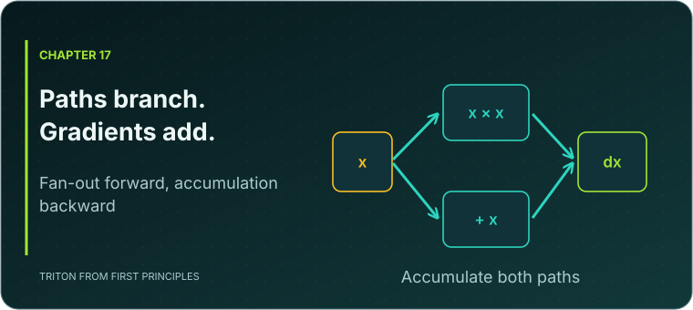
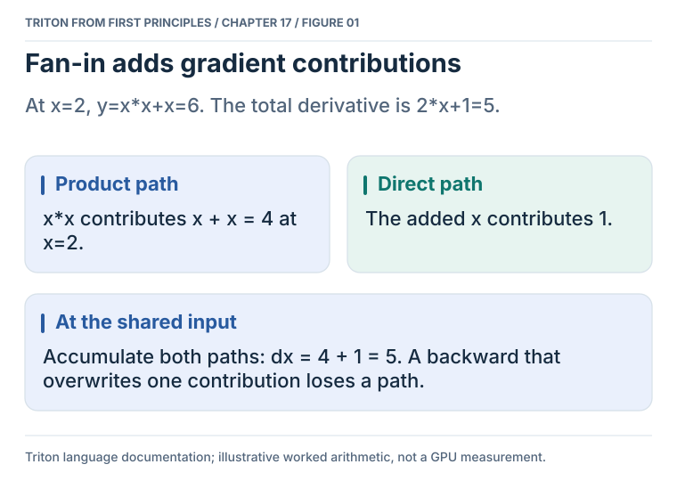

# Chapter 17: How PyTorch's Autograd Engine Chains Custom Ops

[](../images/chapter-openers/17.svg)

[](../images/ch17/01-concept.svg)

> A custom `backward` method that has only ever been tested alone has only been tested against the one input it can never actually receive in practice: a `grad_output` of uniform ones.

!!! info "Output provenance and rerun scope"
    Historical output blocks below may be abridged, reformatted or manually illustrated; they are not promised verbatim raw captures. The [execution record](../execution-2026-11-21.md) links untouched rerun logs and explains version/environment differences. Corrected sources marked pending are not validated by older logs.

## What you will understand by the end of this chapter

- What `grad_output` actually looks like when `TritonGELU` sits inside a real expression — `2 * TritonGELU(x) + 1`, not an isolated `.sum().backward()` — and why it is essentially never uniformly `1` in practice
- Why Chapter 16's chain-rule bug, which needed a hand-constructed `grad_output=2.0` to expose in isolation, shows up on its own the moment `TritonGELU` is used inside any ordinary multi-operation expression
- How to read a computation graph directly from PyTorch's own objects — `.grad_fn`, `.grad_fn.next_functions` — to see which node points to which, without guessing
- Why autograd calls `backward` methods in the reverse of the order their `forward`s ran, and what "reverse topological order" concretely means for a chain of two custom ops
- Why a value used by more than one downstream computation causes its producer's `backward` to be called exactly once, with an already-summed `grad_output` — not once per consumer — and why a custom `backward` must never assume `grad_output` reflects only a single use

## What you need to know first

- Chapter 15's `torch.autograd.Function`, `ctx.save_for_backward`, and how `.grad_fn` connects an output tensor back to the operation that produced it
- Chapter 16's real, masked Triton kernels for `TritonGELU.forward`/`backward`, and its chain-rule trap — a `backward` that returns the local derivative without multiplying by `grad_output`, invisible specifically when `grad_output` happens to be uniform `1`s
- Chapter 12's oracle-based verification method (`torch.nn.functional.gelu`, `torch.allclose`), used throughout this chapter to confirm a multi-operation chain's gradient against PyTorch's own autograd

## 17.1 [FOUNDATIONAL] Chaining `TritonGELU` Inside a Real Expression

### Intuition

Every worked example in Chapters 15 and 16 called `.sum().backward()` (or `.backward()` on an explicitly constructed tensor) directly on `TritonGELU`'s own output. That is a reasonable way to isolate and test one operation, but it is not how custom ops get used in practice — a real model calls `TritonGELU.apply(x)` and then keeps computing with the result: scaling it, adding a bias, feeding it into another layer. The moment that happens, `TritonGELU.backward` no longer receives `grad_output` from `.sum()`'s own gradient (a uniform `1`, since `d(sum)/d(each element) = 1`). It receives whatever the chain rule produces from *everything downstream of it* — and Chapter 16 already showed exactly what a chain rule multiplication looks like when a coefficient is involved.

This means Chapter 16's chain-rule trap wasn't a contrived edge case that needed an artificially scaled `grad_output` to expose — that scaling is just what an ordinary multiplication downstream looks like from `TritonGELU`'s perspective. Wrapping `TritonGELU.apply(x)` in something as simple as `2 * z + 1` reproduces the exact same `grad_output = 2` this chapter's predecessor had to construct by hand, except now it happens automatically, as a direct and unavoidable consequence of the surrounding code.

### Background

| | Chapter 16's test | This chapter's chain |
|---|---|---|
| Expression | `z = TritonGELU.apply(x)`; `z.backward(grad_output)` | `z = TritonGELU.apply(x)`; `w = 2*z + 1`; `loss = w.sum()`; `loss.backward()` |
| How `grad_output` at `TritonGELU`'s node is chosen | Constructed explicitly by the test, as a stand-in for "whatever comes next" | Computed automatically by autograd, as `d(loss)/d(w) * d(w)/d(z) = 1 * 2 = 2`, uniformly |
| Purpose | Isolate and directly control the one input a `backward` cares about | Show that ordinary, unremarkable surrounding code produces exactly this kind of `grad_output` on its own |

### Worked Example 17.1.1: reading the real `grad_output` off a chained expression

```python
z = TritonGELU.apply(x)
z.register_hook(lambda grad: captured_grad_output.setdefault("z", grad.clone()))
w = 2 * z + 1
loss = w.sum()
loss.backward()
```

`register_hook` runs a callback the moment autograd computes the gradient flowing into `z` — exactly the `grad_output` that `TritonGELU.backward` receives as its argument. On six random values, historical illustrated output:

```
grad_output that arrived at TritonGELU's node (dL/dz): tensor([2., 2., 2., 2., 2., 2.])
x.grad allclose to oracle? True
```

Uniformly `2.0`, matching `d(2z+1)/dz = 2` exactly — and `x.grad` still agrees with computing the entire chain (`gelu`, then `2*+1`, then `.sum()`) through PyTorch's own autograd from end to end.

### Worked Example 17.1.2: the chain-rule bug, now surfacing without any hand-constructed input

Reusing Chapter 16's buggy kernel (`gelu_backward_kernel_buggy_no_chain_rule`, which stores the local derivative directly and never multiplies by `grad_output`) inside this exact same chain, with no modification to the test beyond swapping which kernel `backward` calls:

```
buggy chain x.grad:   tensor([ 1.0212,  0.6381,  0.5708,  0.0669,  0.5368, -0.1285])
correct chain x.grad: tensor([ 2.0424,  1.2762,  1.1416,  0.1338,  1.0736, -0.2569])
buggy chain matches oracle? False
```

The correct chain's gradient is exactly double the buggy chain's — the missing factor of `2` from `2*z+1`'s own derivative, dropped silently because the buggy kernel never looked at `grad_output` at all. Nobody had to construct a special test to expose this; it is the default behavior of the single most ordinary way to use a custom autograd op — wrapping it in more arithmetic.

### ASCII Diagram

```
FORWARD:    x --[TritonGELU]--> z --[* 2, + 1]--> w --[.sum()]--> loss

BACKWARD (right to left):
  loss:            grad = 1                      (d(loss)/d(loss))
  w:               grad = 1                      (d(sum)/d(each element of w) = 1)
  z:               grad = 1 * 2 = 2               (d(w)/d(z) = 2, chained through)
  x:  TritonGELU.backward(grad_output=2) --> grad_output * (cdf + x*pdf)

  The "2" arriving at TritonGELU is not a special test value --
  it is exactly what "2*z+1" downstream produces, automatically.
```

> [COMMON TRAP] Testing a custom `backward` only via `.sum().backward()` tests exactly one input value for `grad_output`: uniform `1`s. That is the *one* case in which "forgot to multiply by `grad_output`" and "multiplied by `grad_output`" produce identical results. Any real use of the op — scaling it, combining it with another tensor, feeding it into a further layer — hands `backward` a `grad_output` that is not uniformly `1`, and a chain-rule bug invisible in isolation becomes visible the instant the op is actually used the way it's meant to be used.

## 17.2 [FOUNDATIONAL] Reading the Graph: Traversal Order and `next_functions`

### Intuition

`.grad_fn` isn't just a label confirming that autograd is tracking a tensor — it's a real, inspectable node in a real graph, and PyTorch exposes the graph's actual structure through it. Each `grad_fn` object has a `.next_functions` attribute: a tuple of `(function, input_index)` pairs pointing to whatever produced *its* inputs. Following those pointers backward from a loss tensor's `.grad_fn`, one hop at a time, reconstructs the entire computation graph exactly as autograd itself will walk it — because that walk, in reverse topological order starting from the loss, is precisely how `.backward()` decides what to call and when.

"Reverse topological order" has a very concrete meaning for a simple chain: if the forward pass ran operation A and then operation B (`B`'s input is `A`'s output), the backward pass calls `B`'s backward first, then `A`'s — the exact reverse of the order the forward operations executed in. This isn't a coincidence or an implementation detail; it's required by the chain rule itself, since `A`'s `backward` needs a `grad_output` value that can only be produced by first running `B`'s `backward`.

### Background

| Tool | What it shows |
|---|---|
| `tensor.grad_fn` | The `Function` node that produced this tensor, or `None` for a leaf or a tensor with `requires_grad=False` |
| `tensor.grad_fn.next_functions` | A tuple of `(function, input_index)` pointing to the node(s) that produced *this node's* inputs — `None` in place of a function marks a leaf with `requires_grad=False` |
| `AccumulateGrad` | The special node representing "write into `.grad` on a leaf tensor" — appears in `next_functions` wherever a graph edge terminates at an original input rather than another operation |
| `tensor.register_hook(fn)` | Runs `fn(grad)` the moment autograd computes the gradient arriving at this tensor — used in this chapter to observe values that Chapter 16 could only infer indirectly |

### Worked Example 17.2.1: two chained custom ops, `TritonGELU` then `TritonSquare`

```python
z = TritonGELU.apply(x)      # forward: GELU runs first
y = TritonSquare.apply(z)    # forward: square runs second
loss = y.sum()
loss.backward()
```

historical illustrated output, printing `.grad_fn` and `.grad_fn.next_functions` *before* calling `.backward()`, and the actual order `backward` methods were invoked (via a shared list each `backward` appends its own name to):

```
y.grad_fn: <torch.autograd.function.TritonSquareBackward object at 0x7ff966b4b020>
y.grad_fn.next_functions: ((<torch.autograd.function.TritonGELUBackward object at 0x7ff966b4acf0>, 0),)
z.grad_fn: <torch.autograd.function.TritonGELUBackward object at 0x7ff966b4acf0>
z.grad_fn.next_functions: ((<AccumulateGrad object at 0x7ff9669ef280>, 0),)
backward call order: ['TritonSquare.backward', 'TritonGELU.backward']
x.grad allclose to oracle? True
```

`y`'s node points directly at `z`'s node (the same `TritonGELUBackward` object, confirmed by the matching memory address) — exactly the edge the forward pass created by feeding `z` into `TritonSquare.apply`. `z`'s node, in turn, points at an `AccumulateGrad` node, because `z`'s input, `x`, is a leaf. And the actual call order is `TritonSquare` first, `TritonGELU` second — the reverse of `TritonGELU`, then `TritonSquare` in the forward pass — because `TritonGELU.backward` cannot run until it has a `grad_output`, and the only source of that value is `TritonSquare.backward` finishing first.

### ASCII Diagram

```
FORWARD:   x --[TritonGELU]--> z --[TritonSquare]--> y --[.sum()]--> loss

GRAPH (as .grad_fn.next_functions actually reports it):

  loss.grad_fn
       |
       v
  y.grad_fn = TritonSquareBackward
       | .next_functions[0][0]
       v
  z.grad_fn = TritonGELUBackward
       | .next_functions[0][0]
       v
  AccumulateGrad   (writes the final result into x.grad)

BACKWARD CALL ORDER:  TritonSquareBackward  -->  TritonGELUBackward  -->  AccumulateGrad
                       (called 1st)               (called 2nd)            (writes x.grad)
```

> [COMMON TRAP] It's easy to assume backward runs in the same order the code was written, left to right. It runs in the *reverse* of the order the forward operations actually executed, which is why `TritonSquare.backward` — the *second* line of forward code — is the *first* backward method called. For a straight-line chain this is simple to predict; Section 17.3 shows why it gets more subtle the moment a single value feeds two different downstream computations.

## 17.3 [FOUNDATIONAL] Fan-In: How `grad_output` Is Assembled When a Value Is Used More Than Once

### Intuition

Nothing so far has required a value to be used more than once. But it is completely ordinary for one tensor to feed into two different downstream computations — the same hidden layer's output might be used both for a prediction loss and for a regularization term, for instance. When that happens, `TritonGELU`'s output `z` has *two* consumers, each independently computing its own contribution to `d(loss)/dz`. Autograd's rule for this is simple to state and easy to verify directly: sum every consumer's contribution together, and call the producer's `backward` exactly *once*, with that single, already-summed `grad_output` — never once per consumer.

This is the mechanism Chapter 16's `grad_output` — treated, until now, as an opaque input handed down from "whatever's next" — is actually built from in general: not necessarily one clean derivative from one neighboring operation, but potentially a sum across every path through the graph that eventually reaches this node. A custom `backward` that assumed `grad_output` always reflects a single, clean use of its output would be making an assumption autograd never promised to keep.

### Background

| Usage pattern | `grad_output` arriving at the producer's `backward` | Number of times `backward` is called |
|---|---|---|
| `z` used once: `loss = z.sum()` | `d(loss)/dz`, from that one consumer | Once |
| `z` used twice, same op: `loss = z.sum() + z.sum()` | Sum of both `d(...)/dz` contributions (`1 + 1 = 2`, uniformly) | Once — not twice |
| `z` used twice, different ops: `loss = (2*z).sum() + (3*z).sum()` | Sum of both contributions (`2 + 3 = 5`, uniformly) | Once |

### Worked Example 17.3.1: the same value summed twice into the loss

```python
z = TritonGELU.apply(x)
loss = z.sum() + z.sum()
loss.backward()
```

historical illustrated output, comparing against the single-use case and counting how many times `TritonGELU.backward` actually ran:

```
used once  -> grad_output at TritonGELU.backward: tensor([1., 1., 1., 1.])
used twice -> grad_output at TritonGELU.backward: tensor([2., 2., 2., 2.])
(single call to backward, already summed -- not called twice)
number of times TritonGELU.backward was called: 1
x2.grad allclose to oracle? True
```

Using `z` twice doubles `grad_output` uniformly, exactly as `d(z.sum() + z.sum())/dz = 1 + 1 = 2` predicts — and, critically, `TritonGELU.backward` is called exactly *once*, with that pre-summed value, not twice with a `1` each time.

### Worked Example 17.3.2: two different consumers with different coefficients

```python
z = TritonGELU.apply(x)
loss = (2 * z).sum() + (3 * z).sum()
loss.backward()
```

historical illustrated output:

```
grad_output at TritonGELU.backward (expect uniformly 5.0): tensor([5., 5., 5., 5.])
x3.grad allclose to oracle? True
```

`5.0` is exactly `2 + 3` — the sum of each consumer's own local derivative with respect to `z`, assembled by autograd *before* `TritonGELU.backward` is ever invoked, and delivered as one ordinary-looking `grad_output` tensor indistinguishable, from `TritonGELU.backward`'s point of view, from a single consumer that happened to produce a coefficient of `5`.

### ASCII Diagram

```
FORWARD:        x --[TritonGELU]--> z --+--[* 2]--> --[.sum()]--\
                                          |                       +--> loss
                                          +--[* 3]--> --[.sum()]--/

BACKWARD (fan-in):        d(loss)/dz via the "*2" path  =  2
                           d(loss)/dz via the "*3" path  =  3
                           ---------------------------------
                           SUMMED before TritonGELU.backward runs = 5

                           TritonGELU.backward(grad_output=[5,5,5,5])
                           <-- called exactly ONCE, not once per path
```

> [COMMON TRAP] A custom `backward` must never assume the `grad_output` it receives reflects only one "clean" use of its output — by the time `backward` is called, autograd has already summed every consumer's contribution into that single tensor, and there is no way for `backward` to tell, from `grad_output` alone, whether it came from one consumer or ten. Writing a `backward` that tries to special-case "the first time I'm called" or assumes a specific consumer produced this value is building on a guarantee autograd does not make; the only safe assumption is that `grad_output` is *some* correctly-summed gradient, from however many paths actually exist.

## 17.4 Complete Runnable Code

The three files below build up the chapter in order: chaining `TritonGELU` inside ordinary arithmetic and exposing the chain-rule bug without a hand-constructed input (17.1), inspecting the graph structure and backward call order across two chained custom ops (17.2), and fan-in accumulation across single and multiple consumers (17.3) — plus one standalone file combining all three with a single documented `Expected Output` block.

### File: `01_chained_expression.py`

[Download the complete current reference](../examples/references/part4/02-chaining-custom-ops/01_chained_expression.py) (interpreter mode; GPU portability is not established).

```python
import torch
import triton
import triton.language as tl


@triton.jit
def gelu_forward_kernel(x_ptr, out_ptr, n, BLOCK: tl.constexpr):
    pid = tl.program_id(0)
    offsets = pid * BLOCK + tl.arange(0, BLOCK)
    mask = offsets < n
    x = tl.load(x_ptr + offsets, mask=mask, other=0.0)
    SQRT_2_INV: tl.constexpr = 0.7071067811865476
    cdf = 0.5 * (1.0 + tl.math.erf(x * SQRT_2_INV))
    out = x * cdf
    tl.store(out_ptr + offsets, out, mask=mask)


@triton.jit
def gelu_backward_kernel(grad_out_ptr, x_ptr, grad_in_ptr, n, BLOCK: tl.constexpr):
    pid = tl.program_id(0)
    offsets = pid * BLOCK + tl.arange(0, BLOCK)
    mask = offsets < n
    x = tl.load(x_ptr + offsets, mask=mask, other=0.0)
    grad_out = tl.load(grad_out_ptr + offsets, mask=mask, other=0.0)
    SQRT_2_INV: tl.constexpr = 0.7071067811865476
    SQRT_2PI_INV: tl.constexpr = 0.3989422804014327
    cdf = 0.5 * (1.0 + tl.math.erf(x * SQRT_2_INV))
    pdf = SQRT_2PI_INV * tl.exp(-0.5 * x * x)
    d_gelu = cdf + x * pdf
    grad_in = grad_out * d_gelu
    tl.store(grad_in_ptr + offsets, grad_in, mask=mask)


@triton.jit
def gelu_backward_kernel_buggy_no_chain_rule(grad_out_ptr, x_ptr, grad_in_ptr, n, BLOCK: tl.constexpr):
    pid = tl.program_id(0)
    offsets = pid * BLOCK + tl.arange(0, BLOCK)
    mask = offsets < n
    x = tl.load(x_ptr + offsets, mask=mask, other=0.0)
    SQRT_2_INV: tl.constexpr = 0.7071067811865476
    SQRT_2PI_INV: tl.constexpr = 0.3989422804014327
    cdf = 0.5 * (1.0 + tl.math.erf(x * SQRT_2_INV))
    pdf = SQRT_2PI_INV * tl.exp(-0.5 * x * x)
    d_gelu = cdf + x * pdf
    tl.store(grad_in_ptr + offsets, d_gelu, mask=mask)  # BUG: never multiplied by grad_out


def triton_gelu_forward(x, BLOCK=1024):
    x = x.contiguous()
    out = torch.empty_like(x)
    n = x.numel()
    grid = (triton.cdiv(n, BLOCK),)
    gelu_forward_kernel[grid](x, out, n, BLOCK=BLOCK)
    return out


def _launch_bwd(kernel, grad_output, x, BLOCK=1024):
    grad_input = torch.empty_like(x)
    n = x.numel()
    grid = (triton.cdiv(n, BLOCK),)
    kernel[grid](grad_output, x, grad_input, n, BLOCK=BLOCK)
    return grad_input


class TritonGELU(torch.autograd.Function):
    @staticmethod
    def forward(ctx, x):
        out = triton_gelu_forward(x)
        ctx.save_for_backward(x)
        return out

    @staticmethod
    def backward(ctx, grad_output):
        x, = ctx.saved_tensors
        return _launch_bwd(gelu_backward_kernel, grad_output.contiguous(), x)


class TritonGELUBuggy(torch.autograd.Function):
    @staticmethod
    def forward(ctx, x):
        out = triton_gelu_forward(x)
        ctx.save_for_backward(x)
        return out

    @staticmethod
    def backward(ctx, grad_output):
        x, = ctx.saved_tensors
        return _launch_bwd(gelu_backward_kernel_buggy_no_chain_rule, grad_output.contiguous(), x)


def section_17_1():
    print("=== Section 17.1: TritonGELU chained inside w = 2*z + 1, loss = w.sum() ===")
    torch.manual_seed(3)
    x = torch.randn(6, requires_grad=True)

    captured_grad_output = {}
    z = TritonGELU.apply(x)
    z.register_hook(lambda grad: captured_grad_output.setdefault("z", grad.clone()))
    w = 2 * z + 1
    loss = w.sum()
    loss.backward()

    print("grad_output that arrived at TritonGELU's node (dL/dz):", captured_grad_output["z"])

    x_oracle = x.detach().clone().requires_grad_(True)
    z_oracle = torch.nn.functional.gelu(x_oracle, approximate="none")
    (2 * z_oracle + 1).sum().backward()
    print("x.grad allclose to oracle?", torch.allclose(x.grad, x_oracle.grad, atol=1e-5))

    print()
    print("=== Section 17.1: the buggy kernel inside the SAME chain, no hand-injected grad_output ===")
    x2 = x.detach().clone().requires_grad_(True)
    z2 = TritonGELUBuggy.apply(x2)
    loss2 = (2 * z2 + 1).sum()
    loss2.backward()
    print("buggy chain matches oracle?", torch.allclose(x2.grad, x_oracle.grad, atol=1e-5))


if __name__ == "__main__":
    section_17_1()
```

### File: `02_graph_structure.py`

[Download the complete current reference](../examples/references/part4/02-chaining-custom-ops/02_graph_structure.py) (interpreter mode; GPU portability is not established).

```python
import torch
import triton
import triton.language as tl


@triton.jit
def gelu_forward_kernel(x_ptr, out_ptr, n, BLOCK: tl.constexpr):
    pid = tl.program_id(0)
    offsets = pid * BLOCK + tl.arange(0, BLOCK)
    mask = offsets < n
    x = tl.load(x_ptr + offsets, mask=mask, other=0.0)
    SQRT_2_INV: tl.constexpr = 0.7071067811865476
    cdf = 0.5 * (1.0 + tl.math.erf(x * SQRT_2_INV))
    out = x * cdf
    tl.store(out_ptr + offsets, out, mask=mask)


@triton.jit
def gelu_backward_kernel(grad_out_ptr, x_ptr, grad_in_ptr, n, BLOCK: tl.constexpr):
    pid = tl.program_id(0)
    offsets = pid * BLOCK + tl.arange(0, BLOCK)
    mask = offsets < n
    x = tl.load(x_ptr + offsets, mask=mask, other=0.0)
    grad_out = tl.load(grad_out_ptr + offsets, mask=mask, other=0.0)
    SQRT_2_INV: tl.constexpr = 0.7071067811865476
    SQRT_2PI_INV: tl.constexpr = 0.3989422804014327
    cdf = 0.5 * (1.0 + tl.math.erf(x * SQRT_2_INV))
    pdf = SQRT_2PI_INV * tl.exp(-0.5 * x * x)
    d_gelu = cdf + x * pdf
    grad_in = grad_out * d_gelu
    tl.store(grad_in_ptr + offsets, grad_in, mask=mask)


@triton.jit
def square_forward_kernel(x_ptr, out_ptr, n, BLOCK: tl.constexpr):
    pid = tl.program_id(0)
    offsets = pid * BLOCK + tl.arange(0, BLOCK)
    mask = offsets < n
    x = tl.load(x_ptr + offsets, mask=mask, other=0.0)
    tl.store(out_ptr + offsets, x * x, mask=mask)


@triton.jit
def square_backward_kernel(grad_out_ptr, x_ptr, grad_in_ptr, n, BLOCK: tl.constexpr):
    pid = tl.program_id(0)
    offsets = pid * BLOCK + tl.arange(0, BLOCK)
    mask = offsets < n
    x = tl.load(x_ptr + offsets, mask=mask, other=0.0)
    grad_out = tl.load(grad_out_ptr + offsets, mask=mask, other=0.0)
    tl.store(grad_in_ptr + offsets, grad_out * 2.0 * x, mask=mask)


def _launch(fwd_kernel, x, BLOCK=1024):
    out = torch.empty_like(x)
    n = x.numel()
    grid = (triton.cdiv(n, BLOCK),)
    fwd_kernel[grid](x, out, n, BLOCK=BLOCK)
    return out


def _launch_bwd(bwd_kernel, grad_output, x, BLOCK=1024):
    grad_input = torch.empty_like(x)
    n = x.numel()
    grid = (triton.cdiv(n, BLOCK),)
    bwd_kernel[grid](grad_output, x, grad_input, n, BLOCK=BLOCK)
    return grad_input


order = []


class TritonGELU(torch.autograd.Function):
    @staticmethod
    def forward(ctx, x):
        out = _launch(gelu_forward_kernel, x)
        ctx.save_for_backward(x)
        return out

    @staticmethod
    def backward(ctx, grad_output):
        order.append("TritonGELU.backward")
        x, = ctx.saved_tensors
        return _launch_bwd(gelu_backward_kernel, grad_output.contiguous(), x)


class TritonSquare(torch.autograd.Function):
    @staticmethod
    def forward(ctx, x):
        out = _launch(square_forward_kernel, x)
        ctx.save_for_backward(x)
        return out

    @staticmethod
    def backward(ctx, grad_output):
        order.append("TritonSquare.backward")
        x, = ctx.saved_tensors
        return _launch_bwd(square_backward_kernel, grad_output.contiguous(), x)


def section_17_2():
    print("=== Section 17.2: TritonGELU then TritonSquare -- graph structure and call order ===")
    torch.manual_seed(4)
    x = torch.randn(4, requires_grad=True)
    z = TritonGELU.apply(x)
    y = TritonSquare.apply(z)
    loss = y.sum()

    print("y.grad_fn:", y.grad_fn)
    print("y.grad_fn.next_functions:", y.grad_fn.next_functions)
    print("z.grad_fn:", z.grad_fn)
    print("z.grad_fn.next_functions:", z.grad_fn.next_functions)

    order.clear()
    loss.backward()
    print("backward call order:", order)

    x_oracle = x.detach().clone().requires_grad_(True)
    z_oracle = torch.nn.functional.gelu(x_oracle, approximate="none")
    (z_oracle * z_oracle).sum().backward()
    print("x.grad allclose to oracle?", torch.allclose(x.grad, x_oracle.grad, atol=1e-5))


if __name__ == "__main__":
    section_17_2()
```

### File: `03_fan_in.py`

[Download the complete current reference](../examples/references/part4/02-chaining-custom-ops/03_fan_in.py) (interpreter mode; GPU portability is not established).

```python
import torch
import triton
import triton.language as tl


@triton.jit
def gelu_forward_kernel(x_ptr, out_ptr, n, BLOCK: tl.constexpr):
    pid = tl.program_id(0)
    offsets = pid * BLOCK + tl.arange(0, BLOCK)
    mask = offsets < n
    x = tl.load(x_ptr + offsets, mask=mask, other=0.0)
    SQRT_2_INV: tl.constexpr = 0.7071067811865476
    cdf = 0.5 * (1.0 + tl.math.erf(x * SQRT_2_INV))
    out = x * cdf
    tl.store(out_ptr + offsets, out, mask=mask)


@triton.jit
def gelu_backward_kernel(grad_out_ptr, x_ptr, grad_in_ptr, n, BLOCK: tl.constexpr):
    pid = tl.program_id(0)
    offsets = pid * BLOCK + tl.arange(0, BLOCK)
    mask = offsets < n
    x = tl.load(x_ptr + offsets, mask=mask, other=0.0)
    grad_out = tl.load(grad_out_ptr + offsets, mask=mask, other=0.0)
    SQRT_2_INV: tl.constexpr = 0.7071067811865476
    SQRT_2PI_INV: tl.constexpr = 0.3989422804014327
    cdf = 0.5 * (1.0 + tl.math.erf(x * SQRT_2_INV))
    pdf = SQRT_2PI_INV * tl.exp(-0.5 * x * x)
    d_gelu = cdf + x * pdf
    grad_in = grad_out * d_gelu
    tl.store(grad_in_ptr + offsets, grad_in, mask=mask)


def triton_gelu_forward(x, BLOCK=1024):
    x = x.contiguous()
    out = torch.empty_like(x)
    n = x.numel()
    grid = (triton.cdiv(n, BLOCK),)
    gelu_forward_kernel[grid](x, out, n, BLOCK=BLOCK)
    return out


def triton_gelu_backward(grad_output, x, BLOCK=1024):
    x = x.contiguous()
    grad_output = grad_output.contiguous()
    grad_input = torch.empty_like(x)
    n = x.numel()
    grid = (triton.cdiv(n, BLOCK),)
    gelu_backward_kernel[grid](grad_output, x, grad_input, n, BLOCK=BLOCK)
    return grad_input


captured = []


class TritonGELU(torch.autograd.Function):
    @staticmethod
    def forward(ctx, x):
        out = triton_gelu_forward(x)
        ctx.save_for_backward(x)
        return out

    @staticmethod
    def backward(ctx, grad_output):
        captured.append(grad_output.clone())
        x, = ctx.saved_tensors
        return triton_gelu_backward(grad_output.contiguous(), x)


def section_17_3():
    print("=== Section 17.3: z used once vs. z used twice (same op) ===")
    torch.manual_seed(5)
    x1 = torch.randn(4, requires_grad=True)

    captured.clear()
    z1 = TritonGELU.apply(x1)
    z1.sum().backward()
    print("used once  -> grad_output:", captured[-1])

    captured.clear()
    x2 = x1.detach().clone().requires_grad_(True)
    z2 = TritonGELU.apply(x2)
    (z2.sum() + z2.sum()).backward()
    print("used twice -> grad_output:", captured[-1])
    print("number of times backward was called:", len(captured))

    x_oracle = x1.detach().clone().requires_grad_(True)
    z_oracle = torch.nn.functional.gelu(x_oracle, approximate="none")
    (z_oracle.sum() + z_oracle.sum()).backward()
    print("x2.grad allclose to oracle?", torch.allclose(x2.grad, x_oracle.grad, atol=1e-5))

    print()
    print("=== Section 17.3: z used in two DIFFERENT downstream expressions ===")
    captured.clear()
    x3 = x1.detach().clone().requires_grad_(True)
    z3 = TritonGELU.apply(x3)
    ((2 * z3).sum() + (3 * z3).sum()).backward()
    print("grad_output (expect uniformly 5.0):", captured[-1])

    x_oracle2 = x1.detach().clone().requires_grad_(True)
    z_oracle2 = torch.nn.functional.gelu(x_oracle2, approximate="none")
    ((2 * z_oracle2).sum() + (3 * z_oracle2).sum()).backward()
    print("x3.grad allclose to oracle?", torch.allclose(x3.grad, x_oracle2.grad, atol=1e-5))


if __name__ == "__main__":
    section_17_3()
```

### File: `04_standalone_complete.py`

[Download the complete current reference](../examples/references/part4/02-chaining-custom-ops/04_standalone_complete.py) (interpreter mode; GPU portability is not established).

```python
"""
Chapter 17 standalone: chaining a custom autograd.Function inside ordinary
PyTorch expressions, reading the resulting graph structure directly, and
confirming how grad_output is assembled when a value has more than one
consumer.
"""
import torch
import triton
import triton.language as tl


# ---------------------------------------------------------------------------
# Shared kernels: GELU forward/backward (correct and buggy), and square
# ---------------------------------------------------------------------------

@triton.jit
def gelu_forward_kernel(x_ptr, out_ptr, n, BLOCK: tl.constexpr):
    pid = tl.program_id(0)
    offsets = pid * BLOCK + tl.arange(0, BLOCK)
    mask = offsets < n
    x = tl.load(x_ptr + offsets, mask=mask, other=0.0)
    SQRT_2_INV: tl.constexpr = 0.7071067811865476
    cdf = 0.5 * (1.0 + tl.math.erf(x * SQRT_2_INV))
    out = x * cdf
    tl.store(out_ptr + offsets, out, mask=mask)


@triton.jit
def gelu_backward_kernel(grad_out_ptr, x_ptr, grad_in_ptr, n, BLOCK: tl.constexpr):
    pid = tl.program_id(0)
    offsets = pid * BLOCK + tl.arange(0, BLOCK)
    mask = offsets < n
    x = tl.load(x_ptr + offsets, mask=mask, other=0.0)
    grad_out = tl.load(grad_out_ptr + offsets, mask=mask, other=0.0)
    SQRT_2_INV: tl.constexpr = 0.7071067811865476
    SQRT_2PI_INV: tl.constexpr = 0.3989422804014327
    cdf = 0.5 * (1.0 + tl.math.erf(x * SQRT_2_INV))
    pdf = SQRT_2PI_INV * tl.exp(-0.5 * x * x)
    d_gelu = cdf + x * pdf
    grad_in = grad_out * d_gelu
    tl.store(grad_in_ptr + offsets, grad_in, mask=mask)


@triton.jit
def gelu_backward_kernel_buggy_no_chain_rule(grad_out_ptr, x_ptr, grad_in_ptr, n, BLOCK: tl.constexpr):
    pid = tl.program_id(0)
    offsets = pid * BLOCK + tl.arange(0, BLOCK)
    mask = offsets < n
    x = tl.load(x_ptr + offsets, mask=mask, other=0.0)
    SQRT_2_INV: tl.constexpr = 0.7071067811865476
    SQRT_2PI_INV: tl.constexpr = 0.3989422804014327
    cdf = 0.5 * (1.0 + tl.math.erf(x * SQRT_2_INV))
    pdf = SQRT_2PI_INV * tl.exp(-0.5 * x * x)
    d_gelu = cdf + x * pdf
    tl.store(grad_in_ptr + offsets, d_gelu, mask=mask)  # BUG: never multiplied by grad_out


@triton.jit
def square_forward_kernel(x_ptr, out_ptr, n, BLOCK: tl.constexpr):
    pid = tl.program_id(0)
    offsets = pid * BLOCK + tl.arange(0, BLOCK)
    mask = offsets < n
    x = tl.load(x_ptr + offsets, mask=mask, other=0.0)
    tl.store(out_ptr + offsets, x * x, mask=mask)


@triton.jit
def square_backward_kernel(grad_out_ptr, x_ptr, grad_in_ptr, n, BLOCK: tl.constexpr):
    pid = tl.program_id(0)
    offsets = pid * BLOCK + tl.arange(0, BLOCK)
    mask = offsets < n
    x = tl.load(x_ptr + offsets, mask=mask, other=0.0)
    grad_out = tl.load(grad_out_ptr + offsets, mask=mask, other=0.0)
    tl.store(grad_in_ptr + offsets, grad_out * 2.0 * x, mask=mask)


def _launch(fwd_kernel, x, BLOCK=1024):
    out = torch.empty_like(x)
    n = x.numel()
    grid = (triton.cdiv(n, BLOCK),)
    fwd_kernel[grid](x, out, n, BLOCK=BLOCK)
    return out


def _launch_bwd(bwd_kernel, grad_output, x, BLOCK=1024):
    grad_input = torch.empty_like(x)
    n = x.numel()
    grid = (triton.cdiv(n, BLOCK),)
    bwd_kernel[grid](grad_output, x, grad_input, n, BLOCK=BLOCK)
    return grad_input


call_order = []
captured_grads = []


class TritonGELU(torch.autograd.Function):
    @staticmethod
    def forward(ctx, x):
        out = _launch(gelu_forward_kernel, x)
        ctx.save_for_backward(x)
        return out

    @staticmethod
    def backward(ctx, grad_output):
        call_order.append("TritonGELU.backward")
        captured_grads.append(grad_output.clone())
        x, = ctx.saved_tensors
        return _launch_bwd(gelu_backward_kernel, grad_output.contiguous(), x)


class TritonGELUBuggy(torch.autograd.Function):
    @staticmethod
    def forward(ctx, x):
        out = _launch(gelu_forward_kernel, x)
        ctx.save_for_backward(x)
        return out

    @staticmethod
    def backward(ctx, grad_output):
        x, = ctx.saved_tensors
        return _launch_bwd(gelu_backward_kernel_buggy_no_chain_rule, grad_output.contiguous(), x)


class TritonSquare(torch.autograd.Function):
    @staticmethod
    def forward(ctx, x):
        out = _launch(square_forward_kernel, x)
        ctx.save_for_backward(x)
        return out

    @staticmethod
    def backward(ctx, grad_output):
        call_order.append("TritonSquare.backward")
        x, = ctx.saved_tensors
        return _launch_bwd(square_backward_kernel, grad_output.contiguous(), x)


def section_17_1():
    print("=== Section 17.1: chained expression, and the chain-rule bug surfacing on its own ===")
    torch.manual_seed(3)
    x = torch.randn(6, requires_grad=True)

    hook_captured = {}
    z = TritonGELU.apply(x)
    z.register_hook(lambda grad: hook_captured.setdefault("z", grad.clone()))
    loss = (2 * z + 1).sum()
    loss.backward()
    print("grad_output at TritonGELU's node:", hook_captured["z"])

    x_oracle = x.detach().clone().requires_grad_(True)
    z_oracle = torch.nn.functional.gelu(x_oracle, approximate="none")
    (2 * z_oracle + 1).sum().backward()
    print("correct chain x.grad allclose to oracle?", torch.allclose(x.grad, x_oracle.grad, atol=1e-5))

    x2 = x.detach().clone().requires_grad_(True)
    z2 = TritonGELUBuggy.apply(x2)
    (2 * z2 + 1).sum().backward()
    print("buggy chain x.grad allclose to oracle?  ", torch.allclose(x2.grad, x_oracle.grad, atol=1e-5))


def section_17_2():
    print()
    print("=== Section 17.2: graph structure and backward call order ===")
    torch.manual_seed(4)
    x = torch.randn(4, requires_grad=True)
    z = TritonGELU.apply(x)
    y = TritonSquare.apply(z)

    print("y.grad_fn is TritonSquareBackward?", "TritonSquareBackward" in str(y.grad_fn))
    print("z.grad_fn is TritonGELUBackward?  ", "TritonGELUBackward" in str(z.grad_fn))
    print("y.grad_fn.next_functions[0][0] is z.grad_fn?",
          y.grad_fn.next_functions[0][0] is z.grad_fn)

    call_order.clear()
    y.sum().backward()
    print("backward call order:", call_order)

    x_oracle = x.detach().clone().requires_grad_(True)
    z_oracle = torch.nn.functional.gelu(x_oracle, approximate="none")
    (z_oracle * z_oracle).sum().backward()
    print("x.grad allclose to oracle?", torch.allclose(x.grad, x_oracle.grad, atol=1e-5))


def section_17_3():
    print()
    print("=== Section 17.3: fan-in accumulation ===")
    torch.manual_seed(5)
    x1 = torch.randn(4, requires_grad=True)

    captured_grads.clear()
    z1 = TritonGELU.apply(x1)
    z1.sum().backward()
    print("used once  -> grad_output:", captured_grads[-1])

    captured_grads.clear()
    x2 = x1.detach().clone().requires_grad_(True)
    z2 = TritonGELU.apply(x2)
    (z2.sum() + z2.sum()).backward()
    print("used twice -> grad_output:", captured_grads[-1], " (backward called", len(captured_grads), "time(s))")

    captured_grads.clear()
    x3 = x1.detach().clone().requires_grad_(True)
    z3 = TritonGELU.apply(x3)
    ((2 * z3).sum() + (3 * z3).sum()).backward()
    print("two different consumers (2x + 3x) -> grad_output:", captured_grads[-1])

    x_oracle = x1.detach().clone().requires_grad_(True)
    z_oracle = torch.nn.functional.gelu(x_oracle, approximate="none")
    ((2 * z_oracle).sum() + (3 * z_oracle).sum()).backward()
    print("x3.grad allclose to oracle?", torch.allclose(x3.grad, x_oracle.grad, atol=1e-5))


if __name__ == "__main__":
    section_17_1()
    section_17_2()
    section_17_3()
```

### Expected Output for `04_standalone_complete.py`

```
=== Section 17.1: chained expression, and the chain-rule bug surfacing on its own ===
grad_output at TritonGELU's node: tensor([2., 2., 2., 2., 2., 2.])
correct chain x.grad allclose to oracle? True
buggy chain x.grad allclose to oracle?   False

=== Section 17.2: graph structure and backward call order ===
y.grad_fn is TritonSquareBackward? True
z.grad_fn is TritonGELUBackward?   True
y.grad_fn.next_functions[0][0] is z.grad_fn? True
backward call order: ['TritonSquare.backward', 'TritonGELU.backward']
x.grad allclose to oracle? True

=== Section 17.3: fan-in accumulation ===
used once  -> grad_output: tensor([1., 1., 1., 1.])
used twice -> grad_output: tensor([2., 2., 2., 2.])  (backward called 1 time(s))
two different consumers (2x + 3x) -> grad_output: tensor([5., 5., 5., 5.])
x3.grad allclose to oracle? True
```

## Chapter Summary

`TritonGELU.backward` was never actually receiving an arbitrary input in Chapters 15 and 16 — it was receiving a uniform `1`, the one specific value `.sum().backward()` produces, and Chapter 16's chain-rule bug needed a hand-constructed `grad_output=2.0` to become visible only because that isolation hid the truth: any ordinary use of a custom op inside real surrounding arithmetic produces a non-trivial `grad_output` automatically, and this chapter showed that wrapping `TritonGELU.apply(x)` in nothing more exotic than `2*z+1` reproduces exactly that scaled gradient, exposing the same bug with no special test construction at all (Section 17.1). That `grad_output` is not mysterious — `.grad_fn` and `.grad_fn.next_functions` expose the actual graph PyTorch built, and walking those pointers shows precisely why backward methods run in the reverse of their forward order: `TritonSquare.backward` must produce a value before `TritonGELU.backward` has anything to multiply its local derivative by (Section 17.2). And when a single tensor feeds more than one downstream computation, autograd sums every consumer's contribution into one `grad_output` and calls the producer's `backward` exactly once with that sum — never once per consumer — which means a correct `backward` can never assume anything about how many paths its `grad_output` was assembled from (Section 17.3).

## Self-Check Questions

1. Chapter 16's Worked Example 16.1.2 needed to construct `grad_output = [2.0, 2.0, 2.0]` by hand to expose the chain-rule bug. What specific line of ordinary-looking code in this chapter reproduces that exact same `grad_output` value automatically, and why?
2. If a forward pass runs `z = TritonGELU.apply(x)` followed by `y = TritonSquare.apply(z)`, in what order does the backward pass call `TritonGELU.backward` and `TritonSquare.backward`, and what has to be true first for that order to make sense?
3. What does `y.grad_fn.next_functions[0][0] is z.grad_fn` evaluating to `True` actually confirm about the computation graph?
4. If `z = TritonGELU.apply(x)` and `loss = z.sum() + z.sum()`, how many times is `TritonGELU.backward` called, and what value does its `grad_output` argument actually hold?
5. Why is it unsafe for a custom `backward` method to assume its `grad_output` argument reflects exactly one "clean" downstream use of its output?

## Where We Go Next

Every custom op examined so far has taken one tensor in and produced one tensor out. Chapter 18 leaves autograd mechanics behind and turns to performance: `@triton.autotune`, sweeping across `triton.Config` candidates for block size, `num_warps`, and `num_stages`, and this book's honest limits on what autotuning can actually demonstrate without real GPU hardware to measure against.

## Worked Solutions

1. `loss = (2 * z + 1).sum()` — the `2 *` coefficient, multiplied through by the chain rule at the `.sum()` and `+1` steps (both of which have a local derivative of `1` with respect to their relevant input), produces `d(loss)/dz = 2` uniformly, delivered to `TritonGELU.backward` as `grad_output`. This is the identical numeric value Chapter 16 had to construct by calling `.backward(torch.full_like(y, 2.0))` explicitly — except here it arises purely from ordinary arithmetic sitting downstream of the custom op, with no special test scaffolding at all.
2. `TritonSquare.backward` is called first, then `TritonGELU.backward` — the reverse of the forward order (`TritonGELU` ran first, `TritonSquare` second). This ordering is required because `TritonGELU.backward` needs a `grad_output` value representing `d(loss)/dz`, and the only way to compute that value is to first run `TritonSquare.backward`, which computes `d(loss)/dz` from `d(loss)/dy` and the local derivative of the squaring operation.
3. It confirms that `y`'s graph node's `next_functions` pointer — the edge representing "what produced this node's input" — points to the exact same `Function` object as `z`'s own `.grad_fn`, not merely an equivalent-looking one. Since `y = TritonSquare.apply(z)`, PyTorch recorded that `TritonSquare`'s input came directly from `TritonGELU`'s output, and `is` (object identity, not just equality) confirms that edge is real and precisely wired, not two separately-constructed objects that merely print the same way.
4. Exactly once — not twice. Autograd computes each of `z.sum()`'s two contributions to `d(loss)/dz` (each equal to `1`, since both terms are literally the same expression `z.sum()`), sums them together into a single tensor equal to `2` uniformly, and only then calls `TritonGELU.backward` a single time with that already-summed `grad_output=2`.
5. Because autograd's contract only guarantees that `grad_output` is the *correctly summed* gradient across every path that reaches this node from the loss — it makes no promise about how many paths contributed, what their individual coefficients were, or whether this is the first, only, or tenth time the node's output was used. A `backward` that tried to detect or special-case "a single clean use" (for example, assuming a specific expected magnitude, or trying to distinguish contributions from different callers) would be relying on information that has already been irreversibly summed away by the time `backward` receives it, and would silently misbehave the moment the real usage pattern didn't match that assumption — exactly the class of mistake Section 17.3's `[COMMON TRAP]` warns against.

### Backward scope and layout contract

The flat-address GELU wrappers make inputs and upstream gradients contiguous before launching. This preserves logical values for transposed or sliced tensors; pointer increments alone do not understand arbitrary PyTorch strides. The custom Triton backward supports first-order gradients. A raw Triton launch does not create a PyTorch graph for that backward, so higher-order derivatives require a differentiable backward or an explicit rejection such as `once_differentiable`. A first-order comparison or a single `.sum().backward()` is not a gradgrad test. Fan-in accumulation here describes one backward traversal, not an assertion that a node can never run again in a separate traversal.
