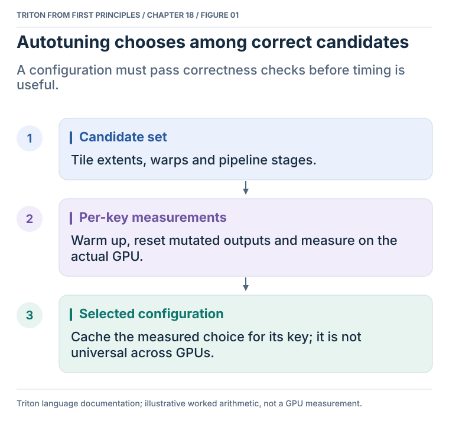

# Chapter 18: Autotuning

[](../images/ch18/01-concept.svg)

> Every kernel in this book so far has used one fixed block size, chosen once, by a human, and left alone. Autotuning replaces that guess with an experiment — but an experiment needs something to measure against, and that is exactly the one thing this book's environment has never had.

## What you will understand by the end of this chapter

- What `triton.Config` actually is — a plain, driver-independent Python object bundling a kernel's compile-time meta-parameters (`BLOCK`, and similar) together with `num_warps` and `num_stages` — and what each of those fields roughly controls
- Why not every combination of values is even a legal candidate, and what happens, genuinely, when one isn't
- What `@triton.autotune`'s `key=[...]` argument means, and the difference between its first-call behavior (a full timed sweep across every candidate) and every subsequent call with the same key values (an immediate, cached reuse of whichever candidate won)
- Why `@triton.autotune` cannot run at all in this book's own `TRITON_INTERPRET=1` environment — not degraded, not approximate, but a genuine, immediate failure — and exactly why that failure is fundamentally different from every earlier chapter's "no GPU" disclosures
- What this environment *can* still verify about a candidate search space without any hardware timing at all: that every legally-constructed candidate computes the identical, correct answer, regardless of its `BLOCK`, `num_warps`, or `num_stages`
- Why "every candidate is correct" is not the same claim as "here is the fastest candidate," and why confusing the two would undo the whole point of autotuning

## What you need to know first

- Chapter 6's pointer-and-stride wrapper pattern, and every chapter since that has launched a kernel with one hand-chosen `BLOCK` value
- Chapter 9's `tl.arange` and its requirement that its range argument be a compile-time power of 2 — revisited here as exactly the kind of constraint a config search space must respect
- Chapter 10's hardware-querying chapter and its honest disclosure that this book's environment has no GPU anywhere, confirmed repeatedly via `torch.cuda.is_available() == False`
- Chapter 12's oracle-based verification method (`torch.nn.functional.gelu`, `torch.allclose`), reused here to check every candidate config in a manual sweep

## 18.1 [FOUNDATIONAL] The Shape of an Autotuning Problem: `triton.Config` and the Search Space

### Intuition

Every kernel launch since Chapter 6 has picked one `BLOCK` value — usually `1024`, sometimes `triton.next_power_of_2(n)` — and moved on. That number is a guess, and it is not a free one: too small a block underuses the hardware's parallelism; too large a block can exceed register or shared-memory limits (Chapter 11) or simply waste work on masked-off lanes. The right choice depends on the input size, the specific GPU generation, and interactions between `BLOCK`, `num_warps` (how many groups of 32 threads cooperate on one program), and `num_stages` (how deeply the compiler pipelines loads ahead of the compute that consumes them) that are extremely difficult to predict from first principles. Autotuning replaces the guess with an experiment: define several plausible candidates, actually run each one, time it, and keep whichever was fastest.

`triton.Config` is simply the data structure that describes one candidate. It bundles a dictionary of the kernel's `tl.constexpr` meta-parameters (the same `BLOCK: tl.constexpr` this book has used since Chapter 6) together with `num_warps` and `num_stages` as separate fields, because those two are launch-configuration choices rather than values the kernel body reads directly. Building a `triton.Config` object requires nothing but ordinary Python — no GPU, no driver, no kernel launch — which makes it one of the few pieces of this chapter's subject this book's environment can inspect completely normally.

### Background

| `triton.Config` field | What it roughly controls | Where this book has already used the underlying concept |
|---|---|---|
| `kwargs` (a dict, e.g. `{"BLOCK": 1024}`) | The kernel's own `tl.constexpr` meta-parameters — the same values every chapter since Ch. 6 has passed as `BLOCK=...` | Every kernel launch so far |
| `num_warps` | How many groups of 32 threads cooperate on executing one program | Chapter 10's hardware-targeting discussion of warps and SMs |
| `num_stages` | How many iterations ahead the compiler tries to prefetch loads, pipelining memory latency against compute | Chapter 11's discussion of shared memory and the compiler's scheduling decisions |
| `key` (an `@triton.autotune` argument, not a `Config` field) | The list of a kernel's own argument names whose *values* determine when a cached tuning decision must be thrown out and re-searched | New in this chapter |

### Worked Example 18.1.1: constructing and inspecting `triton.Config` objects directly

```python
import triton

cfg = triton.Config({"BLOCK": 1024}, num_warps=8, num_stages=3)
print("kwargs:", cfg.kwargs)
print("num_warps:", cfg.num_warps)
print("num_stages:", cfg.num_stages)
```

Genuinely captured, with no driver, no GPU, and no kernel launch involved at all:

```
kwargs: {'BLOCK': 1024}
num_warps: 8
num_stages: 3
```

A `triton.Config` is nothing more than this — a plain container. Everything interesting about autotuning happens later, when a collection of these objects is actually used to launch and time real kernel executions.

### Worked Example 18.1.2: not every candidate is legal

A list of candidate configs is only useful if every candidate in it can actually run. Chapter 9 established that `tl.arange`'s range must be a compile-time power of 2; that constraint doesn't go away just because a value came from a `triton.Config` instead of a hand-typed literal. Launching the same `gelu_forward_kernel` from Chapter 12 with `BLOCK=300` — a plausible-looking but non-power-of-2 candidate — genuinely captured:

```
InterpreterError: ValueError("arange's range must be a power of 2")
```

This is the same error category Chapter 9 would have produced from a hand-written `tl.arange(0, 300)` — autotuning doesn't grant immunity from a kernel's own compile-time constraints, it just means that constraint now has to be respected across an entire *list* of candidates instead of one hand-chosen value. A search space containing even one illegal candidate isn't a minor inefficiency to prune away silently — it's a config that will fail the moment it's actually tried.

### ASCII Diagram

```
Candidate search space (kwargs, num_warps, num_stages):

  {BLOCK: 256},  warps=2, stages=1   -- legal  (256 = 2^8)
  {BLOCK: 512},  warps=4, stages=2   -- legal  (512 = 2^9)
  {BLOCK: 1024}, warps=8, stages=3   -- legal  (1024 = 2^10)
  {BLOCK: 300},  warps=4, stages=2   -- ILLEGAL -- tl.arange requires a power of 2
                                          ^
                                          fails immediately when actually launched,
                                          not silently skipped
```

> [COMMON TRAP] It's tempting to think of a config search space as "just try a range of reasonable-looking numbers." Every candidate still has to satisfy every constraint the kernel body itself imposes — `tl.arange`'s power-of-2 requirement being only one example already established back in Chapter 9. A real autotuning setup should only ever list candidates the kernel can legally accept; discovering an illegal one via a crash during the actual tuning sweep is a late and expensive way to find a typo in a config list.

## 18.2 [FOUNDATIONAL] What `@triton.autotune` Does, and Why It Cannot Run Here

### Intuition

`@triton.autotune(configs=[...], key=[...])` wraps a `@triton.jit` kernel so that its very first launch for a given combination of `key` argument values doesn't just run the kernel — it runs the kernel once per candidate `Config`, times every single run against real hardware, and keeps only the fastest. Every subsequent launch whose `key` arguments match a combination already tuned skips the entire sweep and reuses the cached winner immediately. The `key` list exists because the "best" config is generally not a universal constant — a `BLOCK` size that's fastest for a 1,000-element tensor is not necessarily fastest for a 10,000,000-element one, so the decorator re-runs its search whenever an argument named in `key` (typically the problem size) takes on a value it hasn't tuned for yet.

Every mechanism this book has examined up through Chapter 17 — masking, pointer arithmetic, shared memory, reductions, even the entire `torch.autograd.Function` machinery — is something the CPU-based interpreter can genuinely execute, because those mechanisms are about what a kernel *computes*. Autotuning is different in kind: its entire purpose is to measure how long each candidate actually takes to *run on real hardware*, and "time it against real hardware" is not something a CPU-based logic simulator can approximate, degrade gracefully into, or substitute a placeholder for. There is no CPU-timing fallback built into Triton's autotuner — its benchmarking step reaches directly for the active GPU driver, and if none exists, it fails immediately, before running a single candidate.

### Background

| | Every kernel-logic mechanism, Ch. 1–17 | `@triton.autotune`, this chapter |
|---|---|---|
| What it fundamentally does | Computes a mathematical result from inputs | Times how long computing that result actually takes on real hardware |
| Can `TRITON_INTERPRET=1` substitute for a real GPU? | Yes — the interpreter genuinely executes the kernel's logic in Python/NumPy, producing a real, verifiable answer | No — there is nothing to "compute" a wall-clock time on real hardware without real hardware |
| What happens without a GPU in this book's environment | A slower, CPU-simulated, but genuinely correct execution (every chapter so far) | An immediate `RuntimeError`, before any candidate is ever run |

### Worked Example 18.2.1: the genuine failure

```python
configs = [
    triton.Config({"BLOCK": 256}, num_warps=2),
    triton.Config({"BLOCK": 512}, num_warps=4),
    triton.Config({"BLOCK": 1024}, num_warps=8),
]

@triton.autotune(configs=configs, key=["n"])
@triton.jit
def gelu_forward_kernel(x_ptr, out_ptr, n, BLOCK: tl.constexpr):
    ...  # identical body to Chapter 12's gelu_exact_kernel

grid = lambda meta: (triton.cdiv(n, meta["BLOCK"]),)
gelu_forward_kernel[grid](x, out, n)
```

Genuinely captured, run under `TRITON_INTERPRET=1`, with the relevant portion of the real traceback:

```
File ".../triton/runtime/autotuner.py", line 229, in benchmark
  timings = {config: self._bench(*args, config=config, **kwargs) for config in pruned_configs}
File ".../triton/runtime/autotuner.py", line 125, in do_bench
  return driver.active.get_benchmarker()
File ".../triton/runtime/driver.py", line 20, in _create_driver
  raise RuntimeError(f"{len(active_drivers)} active drivers ({active_drivers}). There should only be one.")
RuntimeError: 0 active drivers ([]). There should only be one.
```

The failure happens inside `benchmark()`, before the kernel's own logic runs even once for any candidate — `driver.active.get_benchmarker()` is Triton's own internal request for a real GPU's timing infrastructure, and with zero GPU drivers active in this environment (confirmed repeatedly since Chapter 10), that request cannot be satisfied at all. This is not a matter of degraded precision or an approximation this book has to caveat, the way Chapter 12.2's fusion-performance discussion or Chapter 10's hardware query were — it is a hard stop, immediately, on the very first launch.

### ASCII Diagram

```
@triton.autotune(configs=[...], key=[...])
        |
        v
first launch for a new key --> Autotuner.benchmark()
        |
        v
   for each candidate config:
        Autotuner._bench()
              |
              v
        driver.active.get_benchmarker()  <-- requires a REAL, REGISTERED GPU DRIVER
              |
              v
        this environment: 0 active drivers
              |
              v
        RuntimeError -- raised BEFORE any candidate's kernel logic ever runs
```

> [COMMON TRAP] Every prior "no GPU" disclosure in this book (Chapter 10's hardware query, Chapter 12.2's fusion timing) meant "this specific number can't be measured realistically here," while the kernel's own logic still ran and produced a genuinely correct, verifiable answer. `@triton.autotune` is a different category of limitation entirely: its core mechanism *is* hardware timing, so there is no fallback path, degraded mode, or partial result available — it fails before doing any work at all, the moment it's asked to run. Do not assume every Triton feature that "needs a GPU" fails the same way; some fail gracefully into a slower-but-correct interpreted execution, and some, like this one, cannot start.

## 18.3 [FOUNDATIONAL] What Remains Verifiable Without a Driver: Manual Sweeps and Correctness Invariance

### Intuition

`@triton.autotune`'s decorator is unusable here, but nothing stops calling the underlying `@triton.jit` kernel directly, once per candidate, exactly the way every kernel in this book has been launched since Chapter 6 — the only difference is looping over several `BLOCK`/`num_warps`/`num_stages` combinations by hand instead of picking one. That can never answer the question autotuning exists to answer (which candidate is fastest), but it answers a different, genuinely useful question this environment actually can check: is every candidate in the search space even a *correct* kernel? Since `num_warps` and `num_stages` are execution-scheduling choices — how work is grouped and pipelined — and not part of the mathematical formula a kernel computes, a well-built config space should produce the *exact same answer* from every legal candidate, differing only (on real hardware) in how long each one takes.

### Background

| Question | Requires real GPU timing? | Verifiable in this environment? |
|---|---|---|
| Which candidate config is fastest? | Yes | No — this is precisely what Section 18.2 showed cannot run at all |
| Does every legal candidate compute the correct answer? | No — this is a property of the kernel's logic, not its execution speed | Yes — genuinely, directly, via the interpreter |
| Do different candidates ever disagree with each other numerically? | No | Yes — and a well-formed search space should show they never do |

### Worked Example 18.3.1: every legal candidate is correct

```python
candidate_configs = [
    {"BLOCK": 256,  "num_warps": 2, "num_stages": 1},
    {"BLOCK": 512,  "num_warps": 4, "num_stages": 2},
    {"BLOCK": 1024, "num_warps": 8, "num_stages": 3},
    {"BLOCK": 2048, "num_warps": 8, "num_stages": 4},
]

for cfg in candidate_configs:
    out = torch.empty_like(x)
    grid = (triton.cdiv(n, cfg["BLOCK"]),)
    gelu_forward_kernel[grid](x, out, n, BLOCK=cfg["BLOCK"],
                              num_warps=cfg["num_warps"], num_stages=cfg["num_stages"])
    print(cfg, "allclose to oracle?", torch.allclose(out, oracle, atol=1e-5))
```

Genuinely captured, on `n = 4096` random values:

```
BLOCK=  256 num_warps=2 num_stages=1  allclose to oracle? True
BLOCK=  512 num_warps=4 num_stages=2  allclose to oracle? True
BLOCK= 1024 num_warps=8 num_stages=3  allclose to oracle? True
BLOCK= 2048 num_warps=8 num_stages=4  allclose to oracle? True
```

Every candidate agrees with PyTorch's own oracle, despite using four completely different block sizes, warp counts, and pipelining depths.

### Worked Example 18.3.2: not just close — bit-for-bit identical to each other

Agreement with an oracle to floating-point tolerance is the standard this book has used since Chapter 12, but `BLOCK`, `num_warps`, and `num_stages` changing the *order* in which elements are grouped into programs raises a sharper question: do different candidates even agree with *each other*, exactly? Comparing the `BLOCK=256` and `BLOCK=1024` runs directly, genuinely captured:

```
BLOCK=256 output equals BLOCK=1024 output bit-for-bit? True
```

`torch.equal` — bit-for-bit equality, not `torch.allclose`'s tolerance-based check — confirms it. This makes sense once stated plainly: each output element is computed by exactly one program, from exactly one input element, through exactly the same formula, regardless of which program or how many total programs did the computing. `BLOCK`, `num_warps`, and `num_stages` change how work is partitioned and scheduled across programs; they change nothing about the formula any individual element is run through.

### ASCII Diagram

```
        candidate configs (BLOCK/num_warps/num_stages differ)
        256/2/1    512/4/2    1024/8/3   2048/8/4
           |          |           |          |
           v          v           v          v
        [ same kernel BODY, same formula, just different partitioning ]
           |          |           |          |
           +----------+-----+-----+----------+
                            |
                            v
              IDENTICAL output, bit-for-bit
              (this environment CAN verify this)

        ... but "which one finishes fastest on a real GPU"
        is a completely different question this environment
        CANNOT answer (Section 18.2).
```

> [COMMON TRAP] Confirming that every candidate in a search space produces the correct — even bit-identical — answer is a real and useful check (it's how you'd catch a config that's numerically wrong before ever worrying about which one is fastest), but it is not a substitute for the actual autotuning question. "All four candidates are correct" says nothing whatsoever about which one a real GPU would pick as fastest; those are two entirely independent properties of a config space, and this chapter can only speak to the first one. Chapter 19 turns to what real benchmarking requires and what it would take to answer the second question honestly.

## 18.4 Complete Runnable Code

The three files below build up the chapter in order: constructing and validating `triton.Config` objects (18.1), the genuine, captured failure of `@triton.autotune` itself in this environment (18.2), and a manual sweep confirming correctness invariance across the entire candidate space (18.3) — plus one standalone file combining all three with a single documented `Expected Output` block.

### File: `01_config_space.py`

[Download the complete current reference](../examples/references/part5/01-autotuning/01_config_space.py) (interpreter mode; GPU portability is not established).

```python
import torch
import triton
import triton.language as tl


@triton.jit
def gelu_forward_kernel(x_ptr, out_ptr, n, BLOCK: tl.constexpr):
    pid = tl.program_id(0)
    offsets = pid * BLOCK + tl.arange(0, BLOCK)
    mask = offsets < n
    x = tl.load(x_ptr + offsets, mask=mask, other=0.0)
    SQRT_2_INV: tl.constexpr = 0.7071067811865476
    cdf = 0.5 * (1.0 + tl.math.erf(x * SQRT_2_INV))
    out = x * cdf
    tl.store(out_ptr + offsets, out, mask=mask)


def section_18_1():
    print("=== Section 18.1: constructing and inspecting triton.Config objects ===")
    cfg = triton.Config({"BLOCK": 1024}, num_warps=8, num_stages=3)
    print("kwargs:", cfg.kwargs)
    print("num_warps:", cfg.num_warps)
    print("num_stages:", cfg.num_stages)

    print()
    print("=== Section 18.1: an illegal candidate -- BLOCK=300 is not a power of 2 ===")
    torch.manual_seed(0)
    n = 4096
    x = torch.randn(n)
    try:
        out_bad = torch.empty_like(x)
        gelu_forward_kernel[(triton.cdiv(n, 300),)](x, out_bad, n, BLOCK=300, num_warps=4, num_stages=2)
        print("ran without error (unexpected)")
    except Exception as e:
        print(f"caught, as expected: {type(e).__name__}: {e}")


if __name__ == "__main__":
    section_18_1()
```

### File: `02_autotune_attempt.py`

[Download the complete current reference](../examples/references/part5/01-autotuning/02_autotune_attempt.py) (interpreter mode; GPU portability is not established).

```python
import torch
import triton
import triton.language as tl


configs = [
    triton.Config({"BLOCK": 256}, num_warps=2),
    triton.Config({"BLOCK": 512}, num_warps=4),
    triton.Config({"BLOCK": 1024}, num_warps=8),
]


@triton.autotune(configs=configs, key=["n"])
@triton.jit
def gelu_forward_kernel_autotuned(x_ptr, out_ptr, n, BLOCK: tl.constexpr):
    pid = tl.program_id(0)
    offsets = pid * BLOCK + tl.arange(0, BLOCK)
    mask = offsets < n
    x = tl.load(x_ptr + offsets, mask=mask, other=0.0)
    SQRT_2_INV: tl.constexpr = 0.7071067811865476
    cdf = 0.5 * (1.0 + tl.math.erf(x * SQRT_2_INV))
    out = x * cdf
    tl.store(out_ptr + offsets, out, mask=mask)


def section_18_2():
    print("=== Section 18.2: attempting to actually run @triton.autotune ===")
    torch.manual_seed(0)
    n = 4096
    x = torch.randn(n)
    out = torch.empty_like(x)
    grid = lambda meta: (triton.cdiv(n, meta["BLOCK"]),)
    try:
        gelu_forward_kernel_autotuned[grid](x, out, n)
        print("ran without error (unexpected in this environment)")
    except RuntimeError as e:
        print(f"caught, as expected: {type(e).__name__}: {e}")
        print("(this is a hard requirement for a real GPU driver, not a degraded fallback)")


if __name__ == "__main__":
    section_18_2()
```

### File: `03_manual_sweep.py`

[Download the complete current reference](../examples/references/part5/01-autotuning/03_manual_sweep.py) (interpreter mode; GPU portability is not established).

```python
import torch
import triton
import triton.language as tl


@triton.jit
def gelu_forward_kernel(x_ptr, out_ptr, n, BLOCK: tl.constexpr):
    pid = tl.program_id(0)
    offsets = pid * BLOCK + tl.arange(0, BLOCK)
    mask = offsets < n
    x = tl.load(x_ptr + offsets, mask=mask, other=0.0)
    SQRT_2_INV: tl.constexpr = 0.7071067811865476
    cdf = 0.5 * (1.0 + tl.math.erf(x * SQRT_2_INV))
    out = x * cdf
    tl.store(out_ptr + offsets, out, mask=mask)


def section_18_3():
    print("=== Section 18.3: manual sweep across candidate configs ===")
    torch.manual_seed(0)
    n = 4096
    x = torch.randn(n)
    oracle = torch.nn.functional.gelu(x, approximate="none")

    candidate_configs = [
        {"BLOCK": 256, "num_warps": 2, "num_stages": 1},
        {"BLOCK": 512, "num_warps": 4, "num_stages": 2},
        {"BLOCK": 1024, "num_warps": 8, "num_stages": 3},
        {"BLOCK": 2048, "num_warps": 8, "num_stages": 4},
    ]

    outputs = []
    for cfg in candidate_configs:
        out = torch.empty_like(x)
        grid = (triton.cdiv(n, cfg["BLOCK"]),)
        gelu_forward_kernel[grid](x, out, n, BLOCK=cfg["BLOCK"],
                                  num_warps=cfg["num_warps"], num_stages=cfg["num_stages"])
        ok = torch.allclose(out, oracle, atol=1e-5)
        print(f"BLOCK={cfg['BLOCK']:5d} num_warps={cfg['num_warps']} num_stages={cfg['num_stages']}"
              f"  allclose to oracle? {ok}")
        outputs.append(out)

    print()
    print("BLOCK=256 output equals BLOCK=1024 output bit-for-bit?", torch.equal(outputs[0], outputs[2]))


if __name__ == "__main__":
    section_18_3()
```

### File: `04_standalone_complete.py`

[Download the complete current reference](../examples/references/part5/01-autotuning/04_standalone_complete.py) (interpreter mode; GPU portability is not established).

```python
"""
Chapter 18 standalone: the shape of an autotuning search space, the genuine
failure of @triton.autotune itself in a driver-less environment, and what a
manual config sweep can still verify without any hardware timing at all.
"""
import torch
import triton
import triton.language as tl


@triton.jit
def gelu_forward_kernel(x_ptr, out_ptr, n, BLOCK: tl.constexpr):
    pid = tl.program_id(0)
    offsets = pid * BLOCK + tl.arange(0, BLOCK)
    mask = offsets < n
    x = tl.load(x_ptr + offsets, mask=mask, other=0.0)
    SQRT_2_INV: tl.constexpr = 0.7071067811865476
    cdf = 0.5 * (1.0 + tl.math.erf(x * SQRT_2_INV))
    out = x * cdf
    tl.store(out_ptr + offsets, out, mask=mask)


configs = [
    triton.Config({"BLOCK": 256}, num_warps=2),
    triton.Config({"BLOCK": 512}, num_warps=4),
    triton.Config({"BLOCK": 1024}, num_warps=8),
]


@triton.autotune(configs=configs, key=["n"])
@triton.jit
def gelu_forward_kernel_autotuned(x_ptr, out_ptr, n, BLOCK: tl.constexpr):
    pid = tl.program_id(0)
    offsets = pid * BLOCK + tl.arange(0, BLOCK)
    mask = offsets < n
    x = tl.load(x_ptr + offsets, mask=mask, other=0.0)
    SQRT_2_INV: tl.constexpr = 0.7071067811865476
    cdf = 0.5 * (1.0 + tl.math.erf(x * SQRT_2_INV))
    out = x * cdf
    tl.store(out_ptr + offsets, out, mask=mask)


def section_18_1():
    print("=== Section 18.1: triton.Config objects and an illegal candidate ===")
    cfg = triton.Config({"BLOCK": 1024}, num_warps=8, num_stages=3)
    print("kwargs:", cfg.kwargs, " num_warps:", cfg.num_warps, " num_stages:", cfg.num_stages)

    torch.manual_seed(0)
    n = 4096
    x = torch.randn(n)
    try:
        out_bad = torch.empty_like(x)
        gelu_forward_kernel[(triton.cdiv(n, 300),)](x, out_bad, n, BLOCK=300, num_warps=4, num_stages=2)
        print("BLOCK=300 ran without error (unexpected)")
    except Exception as e:
        print(f"BLOCK=300 caught, as expected: {type(e).__name__}")


def section_18_2():
    print()
    print("=== Section 18.2: attempting @triton.autotune itself ===")
    torch.manual_seed(0)
    n = 4096
    x = torch.randn(n)
    out = torch.empty_like(x)
    grid = lambda meta: (triton.cdiv(n, meta["BLOCK"]),)
    try:
        gelu_forward_kernel_autotuned[grid](x, out, n)
        print("ran without error (unexpected in this environment)")
    except RuntimeError as e:
        print(f"caught, as expected: {type(e).__name__}: {e}")


def section_18_3():
    print()
    print("=== Section 18.3: manual sweep -- correctness invariance across configs ===")
    torch.manual_seed(0)
    n = 4096
    x = torch.randn(n)
    oracle = torch.nn.functional.gelu(x, approximate="none")

    candidate_configs = [
        {"BLOCK": 256, "num_warps": 2, "num_stages": 1},
        {"BLOCK": 512, "num_warps": 4, "num_stages": 2},
        {"BLOCK": 1024, "num_warps": 8, "num_stages": 3},
        {"BLOCK": 2048, "num_warps": 8, "num_stages": 4},
    ]

    outputs = []
    for cfg in candidate_configs:
        out = torch.empty_like(x)
        grid = (triton.cdiv(n, cfg["BLOCK"]),)
        gelu_forward_kernel[grid](x, out, n, BLOCK=cfg["BLOCK"],
                                  num_warps=cfg["num_warps"], num_stages=cfg["num_stages"])
        outputs.append(out)
        print(f"BLOCK={cfg['BLOCK']:5d} allclose to oracle? {torch.allclose(out, oracle, atol=1e-5)}")

    print("all four candidates bit-for-bit identical to each other?",
          all(torch.equal(outputs[0], o) for o in outputs[1:]))


if __name__ == "__main__":
    section_18_1()
    section_18_2()
    section_18_3()
```

### Expected Output for `04_standalone_complete.py`

```
=== Section 18.1: triton.Config objects and an illegal candidate ===
kwargs: {'BLOCK': 1024}  num_warps: 8  num_stages: 3
BLOCK=300 caught, as expected: InterpreterError

=== Section 18.2: attempting @triton.autotune itself ===
caught, as expected: RuntimeError: 0 active drivers ([]). There should only be one.

=== Section 18.3: manual sweep -- correctness invariance across configs ===
BLOCK=  256 allclose to oracle? True
BLOCK=  512 allclose to oracle? True
BLOCK= 1024 allclose to oracle? True
BLOCK= 2048 allclose to oracle? True
all four candidates bit-for-bit identical to each other? True
```

## Chapter Summary

A `triton.Config` is nothing more than a plain Python object bundling a kernel's `BLOCK`-style meta-parameters with `num_warps` and `num_stages`, and building one requires no GPU at all — but a config search space is only as good as its candidates' legality, and a candidate that violates a kernel's own compile-time constraints (Chapter 9's `tl.arange` power-of-2 requirement, revisited here) fails immediately, not silently (Section 18.1). `@triton.autotune`'s entire purpose is to time every candidate against real hardware on a search's first launch for a given `key`, caching whichever candidate wins for every subsequent call with matching key values — and because that purpose *is* hardware timing, with no CPU-simulated fallback available anywhere in Triton's own implementation, it fails immediately and completely in this book's driver-less environment, a categorically different kind of "no GPU" limitation than any earlier chapter's degraded-but-functional disclosures (Section 18.2). What remains genuinely checkable without any hardware timing is correctness invariance: launching the same kernel directly under several `BLOCK`/`num_warps`/`num_stages` combinations confirmed every legal candidate agrees with the oracle, and that different candidates agree with *each other* bit-for-bit, since those parameters govern how work is scheduled and partitioned, never what formula an individual output element is computed through (Section 18.3) — a necessary property of a well-formed search space, but not, and never a substitute for, the actual timing question autotuning exists to answer.

## Self-Check Questions

1. Why can `triton.Config({"BLOCK": 1024}, num_warps=8, num_stages=3)` be constructed and inspected successfully in this book's environment, while `@triton.autotune(configs=[...], key=[...])` fails the moment its wrapped kernel is actually launched?
2. What role does the `key` argument to `@triton.autotune` play, and what specifically changes about a launch's behavior when a `key` argument's value hasn't been seen before, versus when it has?
3. `BLOCK=300` raised `InterpreterError: ValueError("arange's range must be a power of 2")`. Which earlier chapter already established this exact constraint, and why does building an autotuning search space not grant any exemption from it?
4. Worked Example 18.3.2 checked `torch.equal`, not `torch.allclose`, between the `BLOCK=256` and `BLOCK=1024` outputs. Why is exact, bit-for-bit equality the right standard to expect here, rather than the floating-point tolerance this book has used for oracle comparisons since Chapter 12?
5. A colleague argues that since this chapter proved four different configs all compute the correct, identical answer, any of the four would be a reasonable choice to ship in production. What is wrong with that conclusion?

## Where We Go Next

Chapter 18 established that `@triton.autotune`'s core mechanism — timing candidates against real hardware — cannot function at all without a GPU driver, full stop. Chapter 19 looks directly at the benchmarking primitives underneath that mechanism, what genuine measurement of kernel performance actually requires, and what honest options remain for a book that must teach benchmarking methodology without ever being able to run a real benchmark.

## Worked Solutions

1. Constructing a `triton.Config` is pure Python object creation — no kernel is launched, no hardware is touched, nothing is timed. `@triton.autotune` only does something once its wrapped kernel is actually called: on that first call, it must time every candidate config against real hardware to decide a winner, and that timing step calls `driver.active.get_benchmarker()`, which requires a real, registered GPU driver. With zero active drivers in this environment, that specific step — and only that step — fails immediately.
2. `key` is a list of the wrapped kernel's own argument names whose value combination identifies "the same tuning problem." The first time `@triton.autotune` sees a particular combination of `key` argument values, it runs the full timed sweep across every candidate config and caches the winner against that specific combination. Any subsequent call whose `key` arguments match a combination already tuned skips the sweep entirely and reuses the cached winning config immediately, with no re-benchmarking.
3. Chapter 9 established that `tl.arange`'s range argument must be a compile-time power of 2, as part of introducing masking for boundary-safe kernels. An autotuning search space is still ultimately just a list of values fed into the same kernel body, and that kernel body's `tl.arange(0, BLOCK)` call enforces the exact same constraint regardless of whether `BLOCK` arrived as a hand-typed literal or as one field of a `triton.Config` in a candidate list — there is nothing about the autotuning mechanism itself that relaxes or checks this constraint in advance.
4. `BLOCK`, `num_warps`, and `num_stages` only change how work is partitioned and scheduled across programs — how many elements each program handles and how many programs run — not the mathematical formula each individual output element is computed through. Since every element is still produced by exactly one program executing exactly the same arithmetic regardless of the surrounding partitioning, there is no floating-point-order-of-operations difference between configs the way there was, for example, between Chapter 12's two structurally different GELU formulas (exact `erf` versus the `tanh` approximation) — so exact equality, not tolerance-based closeness, is the correct and achievable standard here.
5. Correctness invariance across the four configs says only that all four are *legal, correct* kernels — it says absolutely nothing about which one is fastest, which is the entire point of autotuning in the first place and precisely the question Section 18.2 showed this environment cannot answer at all. On real hardware, these four configs could easily differ by a large factor in actual runtime depending on the GPU generation and the input size, and shipping "any of the four, since they're all correct" throws away the entire benefit autotuning exists to provide — correctness is a necessary precondition for a config to be considered, never a stand-in for having actually measured its speed.
