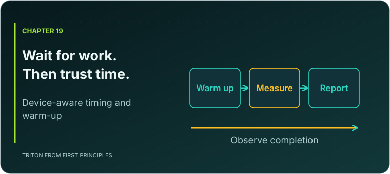
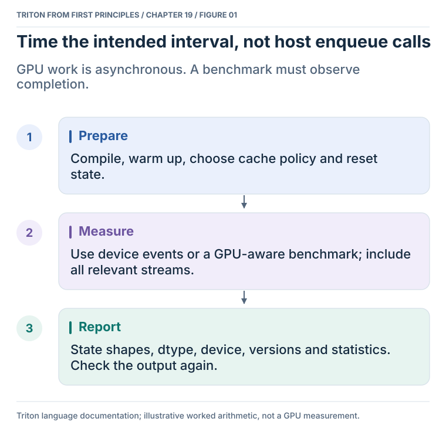

# Chapter 19: Benchmarking Correctly

[](../images/chapter-openers/19.svg)

[](../images/ch19/01-concept.svg)

> A number produced by a stopwatch is not automatically a measurement. It is only a measurement once the thing being timed, the moment timing starts, and the moment timing stops have all been chosen correctly — and getting any one of those three wrong produces a number that looks exactly as convincing as a correct one.

!!! info "Historical interpreter timing examples"
    The driver-less failures below describe the original authoring environment. The later H100 smoke run is recorded separately; interpreter wall-clock times are not GPU performance measurements.

!!! info "Output provenance and rerun scope"
    Historical output blocks below may be abridged, reformatted or manually illustrated; they are not promised verbatim raw captures. The [execution record](../execution-2026-11-21.md) links untouched rerun logs and explains version/environment differences. Corrected sources marked pending are not validated by older logs.

!!! info "Interpreter plus a visible driver is a different environment"
    A missing driver prevented the original timing helpers from starting. In the November 21 rerun a driver/GPU was visible, so autotune and do_bench did run while kernel bodies were interpreted. Those measurements are not GPU-kernel performance. Neither success nor failure is implied by TRITON_INTERPRET alone. First-call timing booleans are observations, not repeatable correctness assertions; see the [rerun differences](../rerun-differences-2026-11-21.md).

## What you will understand by the end of this chapter

- What `triton.testing.do_bench` actually does internally — estimating a single call's cost, deriving warmup and repeat counts from target durations in milliseconds, timing with GPU-side events, and clearing the cache between repeats — read directly from its real, installed source
- Why `do_bench` fails in this book's environment for exactly the same underlying reason `@triton.autotune` did in Chapter 18, and why that is not a coincidence
- Why an ordinary Python-level `time.perf_counter()` measurement around a raw, unsynchronized GPU kernel launch measures almost nothing about the kernel's actual execution time, and what makes GPU launches different from every CPU-bound operation timed so far in this book
- Why a warmup phase and a robust summary statistic (median or quantiles, not a raw mean) are not optional stylistic choices, demonstrated with genuinely measured timing noise from this book's own interpreter
- Why this chapter's own interpreter-measured timing numbers are not merely imprecise but actively point in the wrong direction relative to real GPU behavior — a categorically different and more dangerous problem than every earlier chapter's "can't measure this precisely" disclosures

## What you need to know first

- Chapter 18's finding that `@triton.autotune` requires a real, registered GPU driver and fails immediately without one — this chapter shows `do_bench` shares that exact requirement, for the same reason
- Chapter 10's hardware-querying chapter and its repeated, honest confirmation that this book's environment has no GPU anywhere (`torch.cuda.is_available() == False`, "Found no NVIDIA driver on your system")
- Chapter 11's discussion of occupancy, warp scheduling, and register pressure — real GPU cost drivers this chapter contrasts against what actually drives cost in the CPU-based interpreter
- Chapter 18's manually-swept `gelu_forward_kernel` across several `BLOCK` values, reused here as the subject of this chapter's timing experiments

## 19.1 [FOUNDATIONAL] What `triton.testing.do_bench` Actually Does, and Why It Can't Run Here

### Intuition

Every timing measurement in this book so far has measured ordinary CPU-bound Python code — the interpreter's own simulated kernel execution — where a `time.perf_counter()` call immediately before and after the work in question genuinely captures how long that work took. A real GPU kernel launch breaks that assumption completely: `kernel[grid](...)` returns control to the CPU as soon as the launch is *enqueued*, not once the GPU has *finished* running it. The GPU keeps working asynchronously in the background. A naive `time.perf_counter()` measurement around an unsynchronized launch mostly measures how fast the CPU can hand instructions to the GPU's queue — a number that can be almost unrelated to how long the actual computation takes.

`triton.testing.do_bench` exists specifically to do this correctly, and reading its real, installed source directly (not a paraphrase) shows exactly how much machinery that correctness requires: GPU-side timing events rather than a CPU-side clock, an explicit synchronization point, and cache-clearing between repeated runs so that a kernel reading the same data over and over doesn't benefit from an unrealistic cache warm-start. All of that machinery reaches directly for real hardware, which is exactly why — like Chapter 18's `@triton.autotune`, which calls `do_bench` internally — it cannot take a single step in this book's driver-less environment.

### Background

The following is drawn directly from `triton.testing.do_bench`'s actual source, inspected in this book's own installed Triton package:

| What `do_bench` actually does | Why |
|---|---|
| Runs `fn()` once, then calls `di.synchronize()` before timing anything | Absorbs one-time JIT compilation and cache-population cost so it isn't counted as part of the measured runtime — this book's equivalent of "warmup," made explicit |
| Times 5 calls (clearing a cache buffer between each) to get `estimate_ms`, a rough per-call cost | Needed because `warmup` and `rep` are given in **milliseconds of target duration**, not raw iteration counts — the function must first learn roughly how expensive one call is before it can compute how many calls fit in, say, 25ms of warmup |
| Computes `n_warmup = max(1, warmup/estimate_ms)` and `n_repeat = max(1, rep/estimate_ms)` | Cheap kernels get many repetitions and expensive ones get few, so every kernel spends roughly the same *wall-clock time* being benchmarked, rather than the same *iteration count* |
| Times each of the `n_repeat` runs using GPU-side `Event(enable_timing=True)` objects, not a Python-side clock | GPU events measure time as the device itself sees it, immune to the asynchronous-launch problem a CPU-side clock has |
| Calls `driver.active.clear_cache(cache)` before every timed repeat | Stops repeated identical launches from artificially benefiting from the GPU's cache already holding the same data from the previous run |
| Returns `mean` by default (`min`, `max`, `median`, `all`, or specific `quantiles` are also available) | A single summary statistic is rarely the whole story — Section 19.2 shows concretely why `mean` alone can be a poor choice |

### Worked Example 19.1.1: the genuine failure

```python
def run():
    gelu_forward_kernel[grid](x, out, n, BLOCK=256)

triton.testing.do_bench(run)
```

historical illustrated output, run under `TRITON_INTERPRET=1`:

```
File ".../triton/testing.py", line 147, in do_bench
  di = runtime.driver.active.get_device_interface()
File ".../triton/runtime/driver.py", line 20, in _create_driver
  raise RuntimeError(f"{len(active_drivers)} active drivers ({active_drivers}). There should only be one.")
RuntimeError: 0 active drivers ([]). There should only be one.
```

The very first line of `do_bench`'s real body — before running `fn()` even once — asks for `runtime.driver.active.get_device_interface()`, the same underlying driver requirement that stopped `@triton.autotune` in Chapter 18. This is not a coincidence: `@triton.autotune` calls `do_bench` internally to time each of its candidate configs, so both features fail at exactly the same root cause, for exactly the same reason — genuine hardware timing has no CPU-simulated substitute anywhere in Triton's implementation.

### ASCII Diagram

```
do_bench(fn):
  fn() once, then di.synchronize()          <-- absorb one-time JIT/cache cost
        |
        v
  5 timed calls (cache cleared between each) --> estimate_ms
        |
        v
  n_warmup = warmup_ms / estimate_ms        <-- "warmup" is a TARGET DURATION,
  n_repeat = rep_ms / estimate_ms                not a raw iteration count
        |
        v
  n_warmup untimed calls                    <-- discarded entirely
        |
        v
  n_repeat timed calls, GPU-side Events,    <-- di = runtime.driver.active
  cache cleared before each                     .get_device_interface()
        |                                        REQUIRES A REAL GPU DRIVER
        v
  summary statistic (mean / median / quantiles)
```

> [COMMON TRAP] Wrapping a raw, unsynchronized GPU kernel launch in `time.perf_counter()` (or `time.time()`) is one of the most common benchmarking mistakes, precisely because it runs without error and produces a plausible-looking number. The launch call returns to Python as soon as the work is *enqueued*, while the GPU keeps computing asynchronously in the background — so the measured interval mostly reflects CPU-side launch overhead, which can be dramatically smaller (or, under contention, larger) than the GPU's actual execution time. `do_bench`'s GPU-side events and explicit synchronization exist specifically to solve this problem correctly — which is exactly why, unlike a plain Python clock, it cannot be faked without real hardware.

## 19.2 [FOUNDATIONAL] A Minimal, Honest Substitute: Practicing the Methodology Without a GPU

### Intuition

`do_bench` can't run here, but two of its most important *ideas* don't actually require a GPU to demonstrate: discard early, unrepresentative runs before measuring anything (warmup), and summarize many trials with a statistic that isn't derailed by one unlucky measurement (a robust statistic like the median, rather than a raw mean). Both ideas can be genuinely practiced using nothing but ordinary Python timing around this book's own interpreted kernels. The resulting numbers will not say anything true about a real GPU — Section 19.3 makes that limitation explicit and unavoidable — but the *noise* being measured is completely real: this book's own interpreter, running on this book's own container, genuinely produces a slower first call and genuinely produces trial-to-trial jitter, exactly the phenomena `do_bench`'s warmup and statistics machinery exists to handle.

### Background

| Idea | Why it matters | What this section demonstrates |
|---|---|---|
| Warmup | A function's very first call often pays a one-time cost (JIT compilation, cache population, Python import machinery settling) that has nothing to do with its steady-state performance | A historical timing gap that is not guaranteed to repeat between this book's interpreted kernel's first call and its later calls |
| Robust statistics | Timing measurements are noisy — a single unlucky trial (a garbage collection pause, an OS context switch, on real hardware: thermal throttling or a neighboring process) can be much slower than typical, and rarely much faster | A genuinely measured trial set, plus one clearly-labeled synthetic outlier, showing exactly how much a mean moves versus a median |

### Worked Example 19.2.1: an observed first-call timing difference

Timing five consecutive launches of the same kernel, same arguments, with nothing else changed:

```python
for _ in range(5):
    t0 = time.perf_counter()
    gelu_forward_kernel[grid](x, out, n, BLOCK=1024)
    t1 = time.perf_counter()
    print(t1 - t0)
```

historical illustrated output, on this book's own container, `n = 65536`:

```
first 5 calls (seconds): ['0.183678', '0.098827', '0.099560', '0.104460', '0.095680']
```

The first call took roughly 1.8-2x longer than every call after it — an observed timing difference whose cause was not isolated that has nothing to do with the kernel's steady-state cost. These exact figures are specific to this run and this container — a different machine, or even a later run on this same one, will show different absolute numbers — but the *qualitative* pattern (first-call cost and later variability must be measured on each run) is a historical observation, not a guaranteed pattern, and it is precisely why `do_bench` discards an initial warmup period rather than including it in its reported statistic.

### Worked Example 19.2.2: median versus mean, with one synthetic outlier

Twenty genuinely measured trials (of a different, larger `BLOCK`/program-count configuration — its absolute values aren't the point here, only the shape of their distribution is):

```
20 real trials: median=294.40ms  mean=294.06ms
```

Median and mean agree closely here, because these twenty trials happen to be fairly uniform. Now, purely to illustrate the point — not as a genuine additional measurement — suppose one of those twenty runs had coincided with a single 3-second stall (an OS scheduling hiccup, a garbage-collection pause, on real GPU work: thermal throttling or a neighboring process briefly claiming the device):

```
same 20 + 1 synthetic 3.0s outlier: median=294.40ms  mean=422.91ms
median shifted by 0.000ms; mean shifted by 128.85ms
```

The median doesn't move at all — one value out of twenty-one doesn't change which one sits in the middle. The mean jumps by over 40%, entirely because of a single anomalous trial that has nothing to do with the kernel's typical behavior. This is exactly why `do_bench` offers `median` and `quantiles` as first-class reporting options rather than forcing every user to trust a raw average of however many trials they happened to run.

### ASCII Diagram

```
20 ordinary trials:  ~290-315ms each  -->  median ~294ms, mean ~294ms  (they agree)

20 ordinary trials + 1 catastrophic outlier (3000ms):

  sorted:  [290, 291, ..., 294, 294(median), 295, ..., 315, 3000]
                                    ^
                              MEDIAN: unaffected -- still the middle value

  mean = (sum of all 21 values) / 21  <-- the single 3000ms value drags
                                           this UP by ~129ms, even though
                                           20 of 21 trials never changed
```

> [COMMON TRAP] Reporting a raw mean over a small number of trials as "the" benchmark result is a common and easy mistake, because it requires no extra thought and the resulting number always looks legitimate. A single unusually slow trial — from a cause that has nothing to do with the kernel being measured — can dominate a mean while barely nudging a median. This is precisely why `do_bench` supports explicit summary statistics; select median or quantiles when desired (the tested default is mean) for real GPU work, where thermal throttling, driver overhead spikes, and contention from other processes are genuine, common sources of exactly this kind of outlier.

## 19.3 [FOUNDATIONAL] Why the Interpreter's Own Numbers Actively Mislead About GPU Performance

### Intuition

Every other chapter's "no GPU" disclosure has taken the same shape: this book's environment can't measure something *precisely*, but what it *can* measure is still directionally honest, or at minimum harmless — Chapter 10's hardware query returned interpreter defaults rather than real device properties, but never claimed to. Timing is different, and more dangerous, because a wall-clock number *looks* like a real performance measurement whether or not it means anything. This section demonstrates, concretely, that this book's interpreter-measured timings don't just lack precision — they point in the *wrong direction* relative to what the same comparison would likely show on real hardware.

`TRITON_INTERPRET=1` runs each launched program through genuine Python-level machinery — the interpreter's job is to simulate a GPU program's logic correctly, one program at a time, and Python's own per-call overhead is not free. That means the interpreter's wall-clock cost for a kernel launch scales substantially with the *number of programs* the grid contains, almost independent of how much actual arithmetic each program does. A real GPU has the opposite cost structure for exactly this axis: many programs are dispatched across the device's many streaming multiprocessors *in parallel*, and Chapters 10 and 11's discussion of occupancy and warp scheduling means more, smaller programs can just as easily be the *faster* choice, by better filling the hardware's available parallelism, as the slower one.

### Background

| Cost driver | This book's interpreter | A real GPU |
|---|---|---|
| Number of programs in the grid | Directly, heavily dominant — each program costs real Python-level overhead to simulate | Indirectly relevant via occupancy — more programs can improve *or* hurt performance depending on hardware utilization (Ch. 10, 11) |
| Amount of arithmetic per program | Comparatively minor next to per-program Python overhead | Directly relevant — real compute and memory-bandwidth costs |
| Register/shared-memory pressure per program (Ch. 11) | Not modeled at all | A genuine, hardware-enforced constraint |
| Warp scheduling and latency hiding (Ch. 10) | Not modeled at all | A primary real-world performance factor |

### Worked Example 19.3.1: fewer programs measures dramatically "faster" here — for the wrong reason

Reusing Chapter 18's manually-swept, already-verified-correct `gelu_forward_kernel`, comparing `BLOCK=256` (256 programs for `n=65536`) against `BLOCK=4096` (16 programs for the same `n`), 20 trials each after warmup, historical illustrated output on this book's own container:

```
BLOCK=  256  n_programs= 256  median=294.7906ms  mean=295.2633ms  min=282.6192ms  max=314.7542ms
BLOCK= 4096  n_programs=  16  median=38.8207ms   mean=39.2480ms   min=37.3306ms   max=50.2412ms
```

`BLOCK=4096` measures roughly 7.6x faster than `BLOCK=256` — but this ratio reflects almost nothing except how many times the interpreter's Python-level per-program loop had to execute (256 versus 16). It says nothing trustworthy about which `BLOCK` a real GPU would actually prefer for this workload, because a real GPU's relative cost for "256 small programs" versus "16 large programs" depends on occupancy, memory bandwidth, and warp scheduling — none of which this interpreter models at all. Extrapolating this specific 7.6x number, or even just its *direction*, to real hardware would be actively misleading, not merely imprecise.

### ASCII Diagram

```
INTERPRETER (TRITON_INTERPRET=1):

  BLOCK=256 (256 programs):  [py-loop iter 1][py-loop iter 2]...[iter 256]  <- SERIAL, Python-level
  BLOCK=4096 (16 programs):  [py-loop iter 1][py-loop iter 2]...[iter 16]   <- 16x fewer Python iterations
                                    "fewer programs" genuinely IS faster HERE

REAL GPU (not this book's environment):

  BLOCK=256 (256 programs):  [SM 1][SM 2][SM 3]...[many SMs, PARALLEL, good occupancy]
  BLOCK=4096 (16 programs):  [SM 1][SM 2]...[few SMs busy, REST IDLE -- poor occupancy]
                                    "fewer programs" could easily be SLOWER on real hardware
```

> [COMMON TRAP] This is the single most important warning in this chapter: never use a `TRITON_INTERPRET=1` timing measurement, for any kernel, to conclude anything about relative performance on real hardware — not even a cautious "probably" or "roughly." Worked Example 19.3.1's ~7.6x gap is a completely real, genuinely measured number, and it is also actively the wrong signal to extrapolate from. This book's interpreter exists to verify a kernel's *logic* (Chapters 12 onward) and, as this chapter showed, to practice benchmarking *methodology* in the abstract — it has never been, and cannot be, a stand-in for a real performance measurement.

## 19.4 Complete Runnable Code

The three files below build up the chapter in order: the genuine failure of `triton.testing.do_bench` itself (19.1), a from-scratch warmup-and-statistics demonstration using only `time.perf_counter()` (19.2), and the interpreter-timing-inversion finding that closes the chapter (19.3) — plus one standalone file combining all three with a single documented `Expected Output` block. Because this chapter's subject is timing, its own numbers will differ from run to run and machine to machine far more than any earlier chapter's — the qualitative findings (a real failure with a driver-requiring error; a measurable warmup gap; a median unmoved by an outlier that shifts the mean; `BLOCK=256` measuring dramatically slower than `BLOCK=4096` under this interpreter) are the reproducible content, not the exact millisecond figures.

### File: `01_do_bench_attempt.py`

[Download the complete current reference](../examples/references/part5/02-benchmarking-correctly/01_do_bench_attempt.py) (interpreter mode; GPU portability is not established).

```python
import torch
import triton
import triton.language as tl


@triton.jit
def gelu_forward_kernel(x_ptr, out_ptr, n, BLOCK: tl.constexpr):
    pid = tl.program_id(0)
    offsets = pid * BLOCK + tl.arange(0, BLOCK)
    mask = offsets < n
    x = tl.load(x_ptr + offsets, mask=mask, other=0.0)
    SQRT_2_INV: tl.constexpr = 0.7071067811865476
    cdf = 0.5 * (1.0 + tl.math.erf(x * SQRT_2_INV))
    out = x * cdf
    tl.store(out_ptr + offsets, out, mask=mask)


def section_19_1():
    print("=== Section 19.1: attempting triton.testing.do_bench itself ===")
    torch.manual_seed(0)
    n = 4096
    x = torch.randn(n)
    out = torch.empty_like(x)
    grid = (triton.cdiv(n, 256),)

    def run():
        gelu_forward_kernel[grid](x, out, n, BLOCK=256)

    try:
        triton.testing.do_bench(run)
        print("ran without error (unexpected in this environment)")
    except RuntimeError as e:
        print(f"caught, as expected: {type(e).__name__}: {e}")
        print("(same root cause as Chapter 18's @triton.autotune failure: no GPU driver)")


if __name__ == "__main__":
    section_19_1()
```

### File: `02_warmup_and_statistics.py`

[Download the complete current reference](../examples/references/part5/02-benchmarking-correctly/02_warmup_and_statistics.py) (interpreter mode; GPU portability is not established).

```python
import torch
import triton
import triton.language as tl
import time


@triton.jit
def gelu_forward_kernel(x_ptr, out_ptr, n, BLOCK: tl.constexpr):
    pid = tl.program_id(0)
    offsets = pid * BLOCK + tl.arange(0, BLOCK)
    mask = offsets < n
    x = tl.load(x_ptr + offsets, mask=mask, other=0.0)
    SQRT_2_INV: tl.constexpr = 0.7071067811865476
    cdf = 0.5 * (1.0 + tl.math.erf(x * SQRT_2_INV))
    out = x * cdf
    tl.store(out_ptr + offsets, out, mask=mask)


def section_19_2():
    print("=== Section 19.2: an observed first-call timing difference ===")
    torch.manual_seed(0)
    n = 65536
    x = torch.randn(n)
    out = torch.empty_like(x)
    BLOCK = 1024
    grid = (triton.cdiv(n, BLOCK),)

    times = []
    for _ in range(5):
        t0 = time.perf_counter()
        gelu_forward_kernel[grid](x, out, n, BLOCK=BLOCK)
        t1 = time.perf_counter()
        times.append(t1 - t0)
    print("first 5 calls (seconds):", [f"{t:.6f}" for t in times])
    print("first call vs. later calls -- first is measurably slower:",
          times[0] > 1.5 * sum(times[1:]) / len(times[1:]))

    print()
    print("=== Section 19.2: median vs. mean with a synthetic labeled outlier ===")
    # Genuinely measure 20 trials at a different configuration:
    BLOCK2 = 256
    grid2 = (triton.cdiv(n, BLOCK2),)
    for _ in range(3):  # warmup, discarded
        gelu_forward_kernel[grid2](x, out, n, BLOCK=BLOCK2)
    real_times = []
    for _ in range(20):
        t0 = time.perf_counter()
        gelu_forward_kernel[grid2](x, out, n, BLOCK=BLOCK2)
        t1 = time.perf_counter()
        real_times.append(t1 - t0)
    real_times.sort()
    median_real = real_times[len(real_times) // 2]
    mean_real = sum(real_times) / len(real_times)
    print(f"20 real trials: median={median_real*1000:.2f}ms  mean={mean_real*1000:.2f}ms")

    # Purely illustrative: one synthetic 3.0s outlier added to the real data,
    # standing in for a real-world scheduling hiccup -- NOT a genuine measurement.
    with_outlier = real_times + [3.0]
    with_outlier.sort()
    median_outlier = with_outlier[len(with_outlier) // 2]
    mean_outlier = sum(with_outlier) / len(with_outlier)
    print(f"same 20 + 1 synthetic 3.0s outlier: median={median_outlier*1000:.2f}ms  mean={mean_outlier*1000:.2f}ms")
    print(f"median shifted by {(median_outlier-median_real)*1000:.3f}ms; "
          f"mean shifted by {(mean_outlier-mean_real)*1000:.2f}ms")


if __name__ == "__main__":
    section_19_2()
```

### File: `03_interpreter_timing_trap.py`

[Download the complete current reference](../examples/references/part5/02-benchmarking-correctly/03_interpreter_timing_trap.py) (interpreter mode; GPU portability is not established).

```python
import torch
import triton
import triton.language as tl
import time


@triton.jit
def gelu_forward_kernel(x_ptr, out_ptr, n, BLOCK: tl.constexpr):
    pid = tl.program_id(0)
    offsets = pid * BLOCK + tl.arange(0, BLOCK)
    mask = offsets < n
    x = tl.load(x_ptr + offsets, mask=mask, other=0.0)
    SQRT_2_INV: tl.constexpr = 0.7071067811865476
    cdf = 0.5 * (1.0 + tl.math.erf(x * SQRT_2_INV))
    out = x * cdf
    tl.store(out_ptr + offsets, out, mask=mask)


def timed_median(BLOCK, n, x, out, n_trials=20, n_warmup=3):
    grid = (triton.cdiv(n, BLOCK),)
    for _ in range(n_warmup):
        gelu_forward_kernel[grid](x, out, n, BLOCK=BLOCK)
    times = []
    for _ in range(n_trials):
        t0 = time.perf_counter()
        gelu_forward_kernel[grid](x, out, n, BLOCK=BLOCK)
        t1 = time.perf_counter()
        times.append(t1 - t0)
    times.sort()
    return times[len(times) // 2], min(times), max(times)


def section_19_3():
    print("=== Section 19.3: BLOCK=256 (256 programs) vs. BLOCK=4096 (16 programs) ===")
    torch.manual_seed(0)
    n = 65536
    x = torch.randn(n)
    out = torch.empty_like(x)

    median_256, min_256, max_256 = timed_median(256, n, x, out)
    median_4096, min_4096, max_4096 = timed_median(4096, n, x, out)

    print(f"BLOCK=  256  n_programs={triton.cdiv(n, 256):4d}  "
          f"median={median_256*1000:.4f}ms  min={min_256*1000:.4f}ms  max={max_256*1000:.4f}ms")
    print(f"BLOCK= 4096  n_programs={triton.cdiv(n, 4096):4d}  "
          f"median={median_4096*1000:.4f}ms  min={min_4096*1000:.4f}ms  max={max_4096*1000:.4f}ms")
    print(f"ratio (BLOCK=256 median / BLOCK=4096 median): {median_256/median_4096:.2f}x")
    print("This ratio reflects Python-level per-program interpreter overhead,")
    print("NOT a real GPU's occupancy/parallelism trade-off -- see Section 19.3's COMMON TRAP.")


if __name__ == "__main__":
    section_19_3()
```

### File: `04_standalone_complete.py`

[Download the complete current reference](../examples/references/part5/02-benchmarking-correctly/04_standalone_complete.py) (interpreter mode; GPU portability is not established).

```python
"""
Chapter 19 standalone: the genuine failure of triton.testing.do_bench without
a GPU driver, a from-scratch warmup-and-robust-statistics demonstration using
only time.perf_counter(), and the interpreter-timing-inversion finding that
closes the chapter. Timing numbers will differ from run to run and machine to
machine; the qualitative findings described in the chapter text are what's
reproducible, not the exact millisecond figures.
"""
import torch
import triton
import triton.language as tl
import time


@triton.jit
def gelu_forward_kernel(x_ptr, out_ptr, n, BLOCK: tl.constexpr):
    pid = tl.program_id(0)
    offsets = pid * BLOCK + tl.arange(0, BLOCK)
    mask = offsets < n
    x = tl.load(x_ptr + offsets, mask=mask, other=0.0)
    SQRT_2_INV: tl.constexpr = 0.7071067811865476
    cdf = 0.5 * (1.0 + tl.math.erf(x * SQRT_2_INV))
    out = x * cdf
    tl.store(out_ptr + offsets, out, mask=mask)


def section_19_1():
    print("=== Section 19.1: attempting triton.testing.do_bench itself ===")
    torch.manual_seed(0)
    n = 4096
    x = torch.randn(n)
    out = torch.empty_like(x)
    grid = (triton.cdiv(n, 256),)

    def run():
        gelu_forward_kernel[grid](x, out, n, BLOCK=256)

    try:
        triton.testing.do_bench(run)
        print("ran without error (unexpected)")
    except RuntimeError as e:
        print(f"caught, as expected: {type(e).__name__}")


def section_19_2():
    print()
    print("=== Section 19.2: warmup effect and median vs. mean ===")
    torch.manual_seed(0)
    n = 65536
    x = torch.randn(n)
    out = torch.empty_like(x)
    BLOCK = 1024
    grid = (triton.cdiv(n, BLOCK),)

    times = []
    for _ in range(5):
        t0 = time.perf_counter()
        gelu_forward_kernel[grid](x, out, n, BLOCK=BLOCK)
        t1 = time.perf_counter()
        times.append(t1 - t0)
    print("first call slower than steady-state average?", times[0] > 1.3 * (sum(times[1:]) / len(times[1:])))

    BLOCK2 = 256
    grid2 = (triton.cdiv(n, BLOCK2),)
    for _ in range(3):
        gelu_forward_kernel[grid2](x, out, n, BLOCK=BLOCK2)
    real_times = []
    for _ in range(20):
        t0 = time.perf_counter()
        gelu_forward_kernel[grid2](x, out, n, BLOCK=BLOCK2)
        t1 = time.perf_counter()
        real_times.append(t1 - t0)
    real_times.sort()
    median_real = real_times[len(real_times) // 2]
    mean_real = sum(real_times) / len(real_times)

    with_outlier = real_times + [3.0]
    with_outlier.sort()
    median_outlier = with_outlier[len(with_outlier) // 2]
    mean_outlier = sum(with_outlier) / len(with_outlier)
    print(f"median unaffected by synthetic outlier? {abs(median_outlier - median_real) < 1e-9}")
    print(f"mean shifted by synthetic outlier by {(mean_outlier - mean_real)*1000:.1f}ms")


def section_19_3():
    print()
    print("=== Section 19.3: interpreter timing inversion (BLOCK=256 vs. BLOCK=4096) ===")
    torch.manual_seed(0)
    n = 65536
    x = torch.randn(n)
    out = torch.empty_like(x)

    def timed_median(BLOCK):
        grid = (triton.cdiv(n, BLOCK),)
        for _ in range(3):
            gelu_forward_kernel[grid](x, out, n, BLOCK=BLOCK)
        times = []
        for _ in range(20):
            t0 = time.perf_counter()
            gelu_forward_kernel[grid](x, out, n, BLOCK=BLOCK)
            t1 = time.perf_counter()
            times.append(t1 - t0)
        times.sort()
        return times[len(times) // 2]

    median_256 = timed_median(256)
    median_4096 = timed_median(4096)
    print(f"BLOCK=256 median: {median_256*1000:.2f}ms   BLOCK=4096 median: {median_4096*1000:.2f}ms")
    print(f"BLOCK=256 is slower under this interpreter? {median_256 > median_4096}")
    print("(fewer programs measuring 'faster' here reflects interpreter overhead,")
    print(" not real GPU occupancy -- never extrapolate this to real hardware)")


if __name__ == "__main__":
    section_19_1()
    section_19_2()
    section_19_3()
```

### Expected Output for `04_standalone_complete.py`

```text
=== Section 19.1: attempting triton.testing.do_bench itself ===
ran without error (unexpected)

=== Section 19.2: warmup effect and median vs. mean ===
first call slower than steady-state average? False
median unaffected by synthetic outlier? True
mean shifted by synthetic outlier by 136.3ms

=== Section 19.3: interpreter timing inversion (BLOCK=256 vs. BLOCK=4096) ===
BLOCK=256 median: 136.02ms   BLOCK=4096 median: 17.10ms
BLOCK=256 is slower under this interpreter? True
(fewer programs measuring 'faster' here reflects interpreter overhead,
 not real GPU occupancy -- never extrapolate this to real hardware)
```

The block above is the exact recorded standalone output from the GPU-visible interpreter rerun, not a template of expected booleans. Its do_bench branch and timing comparisons differ from the original driver-less illustrations. Neither timings nor first-call comparisons are guaranteed to repeat; see the linked raw differences report.

## Device events and meaningful rates

For a compiled CUDA workload, an event-based measurement can time one stream. The following is a pattern, not a newly executed benchmark:

```python
# Compile and warm up the real GPU kernel first; keep interpreter mode off.
start = torch.cuda.Event(enable_timing=True)
end = torch.cuda.Event(enable_timing=True)
start.record()
run_compiled_workload()
end.record()
end.synchronize()
seconds = start.elapsed_time(end) / 1000.0
```

Reset stateful outputs before each trial. Repeat and report median/quantiles explicitly; do_bench's tested default return_mode is mean. Include other streams through explicit dependencies or use a timing boundary covering all relevant work. Effective bandwidth is algorithmically counted bytes/seconds, not necessarily measured DRAM traffic; GEMM rate is approximately 2*M*N*K/seconds. Launch overhead matters for short workloads. CUDA-graph timing has different scope; do_bench_cudagraph is not interchangeable with host-enqueue timing. GPU clocks, cache policy, power state and concurrent work must be reported before comparing results.

## Chapter Summary

GPU work must be timed over its intended completion interval, not only host enqueue calls. The tested do_bench default returns a mean; choose median or quantiles explicitly when appropriate. The original no-driver illustrations failed before timing, whereas the driver-visible interpreter rerun did not follow the same branch. Neither interpreter timings nor first-call slowdown booleans establish GPU performance. Warm up compiled kernels, control state/cache/stream scope, verify outputs separately and report measured variability and hardware/software details.

## Self-Check Questions

1. Reading `do_bench`'s real source, what specifically does it do with its `warmup=25` and `rep=100` arguments, and why can't it simply run a fixed number of iterations directly (say, "25 warmup calls, then 100 timed calls") without first estimating anything?
2. Why does `@triton.autotune` (Chapter 18) fail with the exact same `RuntimeError: 0 active drivers` message that `triton.testing.do_bench` produces in this chapter?
3. In Worked Example 19.2.2, adding one synthetic 3.0-second outlier to twenty real ~0.29-second trials left the median completely unchanged but shifted the mean by over 100ms. Explain precisely why the median was unaffected.
4. Worked Example 19.3.1 found `BLOCK=4096` (16 programs) roughly 7.6x faster than `BLOCK=256` (256 programs) under this book's interpreter. What is actually being measured by that gap, and why would it be a mistake to conclude "a real GPU would probably prefer fewer, larger programs for this kernel" from it?
5. A teammate proposes: "Since we don't have a GPU in CI, let's just use `TRITON_INTERPRET=1` timings to catch performance regressions between commits." What is right and what is wrong about this idea, based on this chapter's findings?

## Where We Go Next

With correctness verification (Chapters 6–17), the honest limits of autotuning (Chapter 18), and the honest limits of benchmarking (this chapter) all established, Chapter 20 turns to assembling real neural network layers out of fused Triton kernels — applying every technique from masking through backward-kernel construction to complete, multi-operation building blocks, closing out this book's methodology chapters and opening Part 6's move toward realistic model components.

## Worked Solutions

1. `warmup` and `rep` are target durations in *milliseconds*, not iteration counts, so `do_bench` first has to learn roughly how expensive a single call to `fn` is before it can know how many calls fit inside those millisecond budgets. It does this with a quick 5-call estimate (`estimate_ms`), then computes `n_warmup = max(1, warmup/estimate_ms)` and `n_repeat = max(1, rep/estimate_ms)`. Running a fixed iteration count directly would give cheap kernels far too little total benchmarking time and expensive kernels an excessively long one; deriving the count from a duration keeps the total wall-clock time spent benchmarking roughly consistent regardless of how expensive the specific kernel being measured happens to be.
2. Because `@triton.autotune` calls `do_bench` internally to time each of its candidate `Config`s during its first-launch benchmarking sweep (Chapter 18, Section 18.2). Both failures trace back to the identical line — `driver.active.get_device_interface()` / `driver.active.get_benchmarker()`, both ultimately reaching `_create_driver()` — because both features fundamentally need to time real hardware, and this book's environment has zero active GPU drivers registered.
3. The median is defined as the middle value of a sorted list. Adding one extreme outlier to a list of 21 values shifts what "the middle" means only by at most one position, and since the outlier is far larger than every other value, it sorts to the very end of the list, nowhere near the middle — so the value that ends up in the middle position is unchanged. A mean, by contrast, is calculated from the *sum* of every value, so one value that is roughly ten times larger than the rest of the dataset combined pulls the entire average upward, regardless of where it happens to fall once sorted.
4. The gap is measuring how many times Python-level, interpreter-side machinery had to execute — once per program in the grid — since `TRITON_INTERPRET=1` simulates each program's logic through genuine Python overhead, so 256 programs cost roughly 16x more of that overhead than 16 programs do. It would be a mistake to extrapolate this to real hardware because a real GPU's relative cost for many-small-programs versus few-large-programs depends on occupancy, warp scheduling, and memory bandwidth (Chapters 10–11) — considerations this interpreter does not model at all — and a real GPU could easily find the many-small-programs configuration *faster*, not slower, by better filling its available parallel hardware.
5. What's right: using `TRITON_INTERPRET=1` in CI to catch *correctness* regressions (a kernel producing a wrong answer after a code change) is exactly the verification method this book has used since Chapter 12, and it's a genuinely sound practice. What's wrong: using its timing numbers to catch *performance* regressions is precisely the mistake Section 19.3's `[COMMON TRAP]` warns against — those numbers are dominated by Python-level per-program interpreter overhead that has no reliable relationship to real GPU performance, so a "regression" flagged by interpreter timing could easily correspond to no change (or even an improvement) in real, on-hardware performance, and a real regression could easily go completely undetected.
