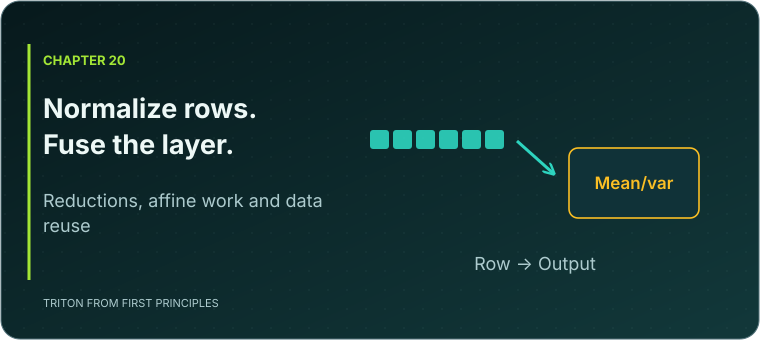
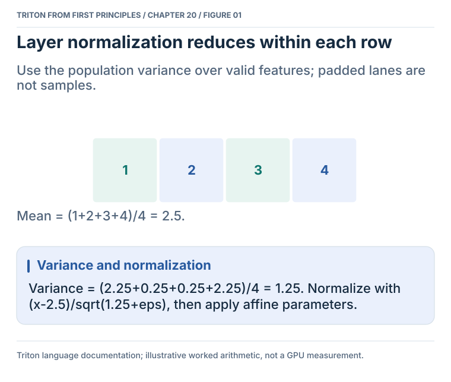

# Chapter 20: Fused Kernels for Real Layers

[](../images/chapter-openers/20.svg)

[](../images/ch20/01-concept.svg)

> `torch.nn.Linear` followed by an activation, or `torch.nn.LayerNorm` on its own, are each three or four separate memory round trips when built from ordinary PyTorch operators. A real fused kernel reads its input once and writes its output once, no matter how many logical steps sit in between.

!!! info "Output provenance and rerun scope"
    Historical output blocks below may be abridged, reformatted or manually illustrated; they are not promised verbatim raw captures. The [execution record](../execution-2026-11-21.md) links untouched rerun logs and explains version/environment differences. Corrected sources marked pending are not validated by older logs.

!!! warning "Corrected sources need revalidation"
    Current reductions upcast inputs and affine parameters to FP32; row wrappers normalize contiguous storage; fused GEMM launch tiles now use 16-wide dot dimensions. These changes address the independent review and have not been rerun on a GPU. Historical printed outputs describe earlier sources. For this one-program LayerNorm, require nonempty rows, finite values and positive eps; extremely wide rows need a different resource-aware implementation.

## What you will understand by the end of this chapter

- How to fuse a bias-add and an activation directly into a matmul kernel's epilogue — the code that runs on an accumulated tile immediately before it's written out — turning `gelu(x @ W.T + b)` into one kernel launch instead of three
- Why a bias broadcasts along a specific axis, and what a genuinely wrong (not just imprecise) result looks like when that axis is confused with the other one — including a subtler danger hiding inside the same mistake
- How to verify a fused kernel against a real `torch.nn.Linear` or `torch.nn.LayerNorm` *module* — extracting its actual `.weight`/`.bias` parameters — rather than only ever against a functional call, as every earlier oracle comparison in this book has done
- Why LayerNorm's reduction needs two numbers per row, not one, and the precise, easy-to-get-backwards distinction between the "biased" and "unbiased" variance formulas
- Why a complete, correct LayerNorm kernel and a coefficients-away-from-correct one can be numerically indistinguishable on ordinary data and yet diverge by two orders of magnitude on a single, realistic edge case

## What you need to know first

- Chapter 12's original fusion rationale — one kernel launch reading its input once and writing its output once beats a chain of separate operators paying a full memory round trip per step
- Chapter 13's blocked matmul kernel (`matmul_kernel`, its `acc` accumulator, its `BLOCK_M`/`BLOCK_N`/`BLOCK_K` tiling), reused directly as this chapter's starting point
- Chapter 14's row-wise reduction pattern (`tl.sum`, masked with `tl.where` before summing) and its softmax numerical-stability lesson, extended here to a second, coupled reduction
- Chapter 7's broadcasting and alignment discussion, directly relevant to Section 20.1's bias-axis trap
- Chapter 12's oracle-based verification method (`torch.allclose`), extended in this chapter to compare against real `torch.nn.Module` instances rather than only functional calls

## 20.1 [FOUNDATIONAL] Fusing an Epilogue Into a Matmul: Linear + Bias + GELU in One Kernel

### Intuition

A `torch.nn.Linear` layer followed by an activation — `gelu(x @ W.T + b)` — is, written naively, three separate operations: a matmul, a bias-add broadcast across every row, and an elementwise nonlinearity. Built from separate PyTorch calls, that's three kernel launches and, more importantly, the matmul's full output gets written to memory and then read back twice more before the final answer exists. Chapter 13's `matmul_kernel` already computes an accumulated tile (`acc`) entirely in registers before ever touching memory for its output — the natural place to fuse the remaining two steps is right there, in the kernel's *epilogue*: the handful of lines between "the accumulation loop just finished" and "now write the tile out." Adding the bias and applying GELU to `acc` before the final `tl.store` produces the complete, correct answer in one pass, with the intermediate matmul result never touching memory at all.

The one piece that needs care is a broadcasting axis. `nn.Linear`'s bias has one value per *output feature* — one value per column of the result, the same axis `N` indexes — not one value per row. Getting this backwards produces a kernel that still runs, still has the right shape, and is still simply wrong.

### Background

| | Naive 3-op pipeline | Fused epilogue (this section) |
|---|---|---|
| Kernel launches | 3 (matmul, bias-add, GELU) | 1 |
| Times the `(M, N)` result is written to memory | 3 (once per op's output) | 1 |
| Times it's read back from memory | 2 (bias-add and GELU each re-read the previous op's output) | 0 — stays in registers the whole time |
| Where bias enters | A separate broadcast-add kernel | Added directly to `acc`, broadcasting across the `BLOCK_M` axis, indexed by the same `cols` the matmul's `N` dimension already uses |

### Worked Example 20.1.1: verified against a real `torch.nn.Linear` module

```python
@triton.jit
def fused_linear_gelu_kernel(a_ptr, b_ptr, bias_ptr, c_ptr, M, N, K,
                              stride_am, stride_ak, stride_bk, stride_bn, stride_cm, stride_cn,
                              BLOCK_M: tl.constexpr, BLOCK_N: tl.constexpr, BLOCK_K: tl.constexpr):
    pid_m = tl.program_id(0)
    pid_n = tl.program_id(1)
    rows = pid_m * BLOCK_M + tl.arange(0, BLOCK_M)
    cols = pid_n * BLOCK_N + tl.arange(0, BLOCK_N)
    acc = tl.zeros((BLOCK_M, BLOCK_N), dtype=tl.float32)

    for k0 in range(0, K, BLOCK_K):
        ks = k0 + tl.arange(0, BLOCK_K)
        a_ptrs = a_ptr + rows[:, None] * stride_am + ks[None, :] * stride_ak
        b_ptrs = b_ptr + ks[:, None] * stride_bk + cols[None, :] * stride_bn
        a_mask = (rows[:, None] < M) & (ks[None, :] < K)
        b_mask = (ks[:, None] < K) & (cols[None, :] < N)
        a = tl.load(a_ptrs, mask=a_mask, other=0.0)
        b = tl.load(b_ptrs, mask=b_mask, other=0.0)
        acc += tl.dot(a, b, input_precision="ieee")

    # fused epilogue: bias add (broadcast per output COLUMN), then exact GELU
    bias = tl.load(bias_ptr + cols, mask=cols < N, other=0.0)
    acc = acc + bias[None, :]
    SQRT_2_INV: tl.constexpr = 0.7071067811865476
    cdf = 0.5 * (1.0 + tl.math.erf(acc * SQRT_2_INV))
    result = acc * cdf

    c_ptrs = c_ptr + rows[:, None] * stride_cm + cols[None, :] * stride_cn
    c_mask = (rows[:, None] < M) & (cols[None, :] < N)
    tl.store(c_ptrs, result, mask=c_mask)
```

Verified against a genuine `torch.nn.Linear` module — not a hand-built weight tensor — using its own `.weight` and `.bias` parameters directly, on a deliberately non-square shape (`M=20, K=12, N=16`):

```
shapes: x torch.Size([20, 12]) weight torch.Size([16, 12]) bias torch.Size([16]) out torch.Size([20, 16])
allclose to nn.Linear + gelu oracle? True
max abs diff: 2.384185791015625e-07
```

The fused kernel's single launch reproduces `torch.nn.functional.gelu(layer(x), approximate="none")` — an entire two-operation `nn.Module`-based pipeline — to ordinary floating-point noise.

### Worked Example 20.1.2: the bias-axis mistake, and a second danger hiding inside it

A plausible-looking but wrong version indexes the bias by `rows` and broadcasts it down the `BLOCK_M` axis instead:

```python
bias = tl.load(bias_ptr + rows, mask=rows < M, other=0.0)  # BUG: wrong axis AND wrong bound
acc = acc + bias[:, None]
```

On the same `M=20, K=12, N=16` shapes, historical illustrated output:

```
buggy kernel allclose to oracle? False
max abs diff: 0.43509936332702637
```

This mistake is wrong in two independent ways at once, and the second is easy to miss. First, the bias values themselves are simply attached to the wrong axis — every column-specific bias term is now broadcast down rows instead. Second, the mask (`rows < M`) uses the wrong bound: `bias` genuinely has only `N=16` elements, but `rows` ranges up to `M-1=19`, so the mask lets four out-of-bounds reads through. Probing exactly what those specific reads return, historical illustrated output:

```
tensor([ 0.,  1.,  2., ...,  14., 15.,  7.9420e-27, 0.0000e+00, 1.5835e-43, 0.0000e+00])
                                    ^^^^^^^^^^^^^^^^^^^^^^^^^^^^^^^^^^^^^^^^^^^^^^^^
                                    indices 16-19: genuinely read past the end of
                                    the bias buffer, returning whatever denormalized
                                    garbage happened to sit in adjacent memory
```

Unlike Chapter 16's mask omission (which crashed outright), this out-of-bounds read happens to land inside other allocated memory and returns silently — no crash, no exception, just numerically meaningless values folded into the result wherever `M` and `N` happen to differ.

### ASCII Diagram

```
NAIVE (3 launches):        x @ W.T --> mem --> + bias --> mem --> gelu(...) --> mem
                                  (write)  (read+write) (read+write)

FUSED (this section, 1 launch):
                            x @ W.T (in registers, acc)
                                  |
                                  v
                            acc + bias[None, :]     <-- broadcasts along COLUMNS (correct)
                                  |
                                  v
                            gelu(acc)  (still in registers)
                                  |
                                  v
                            ONE write to memory
```

> [COMMON TRAP] A bias broadcast down the wrong axis doesn't just compute a subtly different number — the moment its shape happens to differ from the axis it should have matched, the mask guarding its load can be wrong too, and a mask that's wrong in the *permissive* direction (checking against too large a bound) doesn't fail loudly. It lets through reads past the end of a genuinely allocated buffer, silently pulling in whatever garbage values happen to sit adjacent to it in memory — a quieter and easy-to-miss cousin of Chapter 16's hard crash, caught here only because an oracle comparison flagged the output as wrong at all.

## 20.2 [FOUNDATIONAL] Row-Wise Mean and Variance: LayerNorm's Reduction

### Intuition

Chapter 14's softmax needed one number per row from a reduction (first a max, then a sum) before it could produce any output. LayerNorm needs two numbers per row — a mean and a variance — and the second one genuinely depends on the first: variance is defined as the average squared deviation *from the mean*, so a kernel can't compute it without already knowing the row's mean. This is the same "can't write output until a full sweep of the row is done" shape Chapter 14.3's online softmax discussion established, now with two coupled quantities instead of one.

The formula itself hides a classic, easy-to-get-backwards choice: dividing the sum of squared deviations by `N` (the "biased," or population, variance) versus by `N-1` (the "unbiased," or sample, variance). `torch.nn.LayerNorm` — and every from-scratch LayerNorm implementation, including this chapter's — uses the biased, divide-by-`N` version, but PyTorch's general-purpose `.var()` method defaults to the *unbiased* one. Comparing a from-scratch reduction kernel against `x.var(dim=-1)` without paying attention to this default is a quiet, easy way to convince yourself a correct kernel is wrong.

### Background

| | Chapter 14's softmax reduction | This chapter's LayerNorm reduction |
|---|---|---|
| Quantities computed per row | One (running max, then running sum) | Two (mean, then variance) |
| Second quantity depends on the first? | Yes — the sum is of `exp(x - max)`, using the already-computed max | Yes — variance is the average of `(x - mean)^2`, using the already-computed mean |
| `torch.` oracle to compare against | `torch.nn.functional.softmax` | `x.mean(dim=-1)` and `x.var(dim=-1, unbiased=False)` — **not** the default `unbiased=True` |

### Worked Example 20.2.1: mean and variance, verified — and the wrong oracle caught red-handed

```python
@triton.jit
def row_mean_var_kernel(x_ptr, mean_ptr, var_ptr, M, N, stride_m, BLOCK_N: tl.constexpr):
    row = tl.program_id(0)
    cols = tl.arange(0, BLOCK_N)
    mask = cols < N
    row_ptr = x_ptr + row * stride_m
    x = tl.load(row_ptr + cols, mask=mask, other=0.0).to(tl.float32)

    mean = tl.sum(x, axis=0) / N
    diff = tl.where(mask, x - mean, 0.0)
    var = tl.sum(diff * diff, axis=0) / N   # biased (population) variance -- divide by N

    tl.store(mean_ptr + row, mean)
    tl.store(var_ptr + row, var)
```

historical illustrated output, on 5 rows of 10 random values each:

```
mean allclose to x.mean(dim=-1)? True
var allclose to x.var(unbiased=False)? True
var allclose to x.var(unbiased=True) [WRONG comparison]? False
max abs diff vs unbiased: 0.2560422420501709

kernel's own var values:    tensor([0.8021, 0.8585, 1.0370, 0.3780, 2.3044])
biased (/N) oracle values:  tensor([0.8021, 0.8585, 1.0370, 0.3780, 2.3044])
unbiased (/(N-1)) oracle:  tensor([0.8912, 0.9539, 1.1522, 0.4200, 2.5604])
```

The kernel matches `unbiased=False` exactly and disagrees with the *default* `x.var(dim=-1)` (`unbiased=True`) by a real, non-trivial margin — not floating-point noise, but a systematic gap of exactly the `N/(N-1)` ratio between the two variance definitions. A correct kernel compared against the wrong oracle produces exactly the same symptom as an incorrect kernel: `allclose` returns `False`.

### ASCII Diagram

```
Row:  [x_0, x_1, ..., x_{N-1}]

PASS 1:  mean = sum(x_i) / N

PASS 2:  var = sum((x_i - mean)^2) / N     <-- BIASED: divide by N   (what LayerNorm uses)
     vs. var = sum((x_i - mean)^2) / (N-1) <-- UNBIASED: divide by N-1 (torch.var()'s DEFAULT)

         Both are "the variance" -- they are simply two different,
         equally standard conventions, and comparing a kernel built
         for one against an oracle computing the other looks exactly
         like a genuine bug.
```

> [COMMON TRAP] `x.var(dim=-1)` and `torch.nn.LayerNorm`'s internal variance computation use *different default conventions* — `.var()` defaults to `unbiased=True` (divide by `N-1`), while every standard LayerNorm formula, including PyTorch's own, uses the biased, divide-by-`N` version. A from-scratch kernel that correctly implements LayerNorm's own convention will *fail* an `allclose` check against the unmodified default `x.var(dim=-1)` — always pass `unbiased=False` explicitly when using PyTorch's variance as an oracle for a LayerNorm-style kernel, and don't mistake this specific, well-understood mismatch for evidence that the kernel itself is broken.

## 20.3 [FOUNDATIONAL] The Complete Fused LayerNorm Kernel, and the Eps-Placement Trap

### Intuition

Section 20.2's reduction, combined with the normalization formula and an affine transform (`gamma * normalized + beta`, with `gamma` and `beta` learned per-feature parameters), is the entire computation `torch.nn.LayerNorm` performs — and all of it can happen inside one kernel launch, one program per row, reading the row once and writing the output once. This introduces a row-wise launch pattern for this book: every previous elementwise kernel (Chapters 9, 12) could split a large tensor across as many programs as convenient, because each output element only ever depended on its own corresponding input element. LayerNorm's normalization can't start until the *entire row's* mean and variance are known, so `BLOCK_N` must be large enough to hold an entire row in one program — one program per row, not one program per chunk of arbitrary size.

The formula's one subtlety is exactly where `eps` (a small constant, `1e-5` by default in PyTorch) belongs: inside the square root, added to the variance before taking `sqrt`, as `1/sqrt(var + eps)`. `eps` exists specifically to prevent division by (near) zero when a row's true variance is extremely small — and putting it in the wrong place, `1/(sqrt(var) + eps)`, looks almost identical algebraically while behaving identically to the correct version everywhere except exactly the situation `eps` was added to protect against.

### Background

| | Section 20.1's fused epilogue | Section 20.3's fused LayerNorm |
|---|---|---|
| What must be known before any output element can be written | Nothing extra — the matmul accumulator for that element's tile | The *entire row's* mean and variance |
| Consequence for `BLOCK` sizing | `BLOCK_M`/`BLOCK_N`/`BLOCK_K` can be any convenient tile size | `BLOCK_N` must be `>= N` (the full row) — typically `triton.next_power_of_2(N)` |
| Per-feature learned parameters | `bias`, shape `(N,)` | `gamma` and `beta`, both shape `(N,)` |

### Worked Example 20.3.1: verified against a real `torch.nn.LayerNorm` module

```python
@triton.jit
def layernorm_forward_kernel(x_ptr, gamma_ptr, beta_ptr, out_ptr, M, N, stride_m, eps,
                              BLOCK_N: tl.constexpr):
    row = tl.program_id(0)
    cols = tl.arange(0, BLOCK_N)
    mask = cols < N
    row_ptr = x_ptr + row * stride_m
    x = tl.load(row_ptr + cols, mask=mask, other=0.0).to(tl.float32)

    mean = tl.sum(x, axis=0) / N
    diff = tl.where(mask, x - mean, 0.0)
    var = tl.sum(diff * diff, axis=0) / N
    inv_std = 1.0 / tl.sqrt(var + eps)
    x_norm = diff * inv_std

    gamma = tl.load(gamma_ptr + cols, mask=mask, other=1.0).to(tl.float32)
    beta = tl.load(beta_ptr + cols, mask=mask, other=0.0).to(tl.float32)
    y = x_norm * gamma + beta

    out_row_ptr = out_ptr + row * stride_m
    tl.store(out_row_ptr + cols, y, mask=mask)
```

Verified against a genuine `torch.nn.LayerNorm` module — using its actual `.weight`, `.bias`, and `.eps` — on `M=6` rows of `N=17` features (deliberately not a power of 2, to exercise masking):

```
allclose to nn.LayerNorm? True
max abs diff: 1.1920928955078125e-07
```

### Worked Example 20.3.2: the eps-placement trap

A version with `eps` added *after* the square root instead of before:

```python
inv_std = 1.0 / (tl.sqrt(var) + eps)   # BUG: eps outside the sqrt
```

On a typical row of ordinary random values, historical illustrated output:

```
typical row: correct allclose? True  wrong-eps allclose? True  max diff (wrong): 9.298324584960938e-06
```

Both versions pass — the difference is smaller than `allclose`'s default tolerance, because when `var` is a normal-sized number, `sqrt(var + eps)` and `sqrt(var) + eps` are nearly identical (`eps = 1e-5` is negligible next to a `var` of order `1`). Now the same two kernels on a single, deliberately near-constant row (six nearly-identical values differing only in the sixth decimal place, so the row's *true* variance is on the order of `1e-12`):

```
near-constant row: correct allclose? True  wrong-eps allclose? False
near-constant row max diff (wrong-eps vs oracle): 0.1701836735010147

oracle_flat: tensor([[ 0.0003, -0.0003,  0.0006,  0.0000, -0.0006,  0.0003,  0.0000, -0.0003]])
wrong_flat:  tensor([[ 0.0854, -0.0854,  0.1708,  0.0000, -0.1708,  0.0854,  0.0000, -0.0854]])
```

The wrong-`eps` version is off by roughly a factor of 280 on this row. When `var` is tiny (close to `0`), `sqrt(var + eps) ≈ sqrt(eps)`, while `sqrt(var) + eps ≈ 0 + eps = eps` — two very different denominators, since `sqrt(eps)` is roughly `140` times larger than `eps` itself for the default `eps=1e-5`. The correct kernel still matches the oracle exactly on this same row; only the eps-placement bug is exposed, and only because this specific row's variance happens to be small enough to matter.

### ASCII Diagram

```
Typical row (var ~ O(1)):
    sqrt(var + eps)  ~  sqrt(var)              <-- eps is negligible either way
    sqrt(var) + eps  ~  sqrt(var)              <-- both formulas agree closely

Near-constant row (var ~ O(1e-12), essentially 0):
    sqrt(var + eps)  ~  sqrt(eps)       = 0.00316...   <-- CORRECT: eps protects the sqrt itself
    sqrt(var) + eps  ~  0 + eps         = 0.00001...   <-- WRONG: ~316x smaller denominator
                                                             -> normalized values ~316x too LARGE
```

> [COMMON TRAP] `1/sqrt(var + eps)` and `1/(sqrt(var) + eps)` are two lines of code that differ by the placement of a single closing parenthesis, and they agree closely on almost any realistic input — which is exactly what makes this mistake dangerous rather than merely wrong. It surfaces only on the specific inputs `eps` exists to protect: rows whose true variance is at or near zero, at which point the two formulas diverge by roughly `sqrt(eps)/eps` — a factor of about 316 for the standard `eps=1e-5` default. A test suite built entirely from ordinary random data, exactly the kind used throughout most of this book, would never catch this bug at all.

## 20.4 Complete Runnable Code

The three files below build up the chapter in order: the fused Linear+bias+GELU matmul epilogue and its bias-axis trap (20.1), the row-wise mean/variance reduction and the biased-vs-unbiased variance distinction (20.2), and the complete fused LayerNorm kernel with its eps-placement trap (20.3) — plus one standalone file combining all three with a single documented `Expected Output` block.

### File: `01_fused_linear_gelu.py`

[Download the complete current reference](../examples/references/part6/01-fused-kernels-for-real-layers/01_fused_linear_gelu.py) (interpreter mode; GPU portability is not established).

```python
import torch
import triton
import triton.language as tl


@triton.jit
def fused_linear_gelu_kernel(a_ptr, b_ptr, bias_ptr, c_ptr, M, N, K,
                              stride_am, stride_ak, stride_bk, stride_bn, stride_cm, stride_cn,
                              BLOCK_M: tl.constexpr, BLOCK_N: tl.constexpr, BLOCK_K: tl.constexpr):
    pid_m = tl.program_id(0)
    pid_n = tl.program_id(1)
    rows = pid_m * BLOCK_M + tl.arange(0, BLOCK_M)
    cols = pid_n * BLOCK_N + tl.arange(0, BLOCK_N)
    acc = tl.zeros((BLOCK_M, BLOCK_N), dtype=tl.float32)

    for k0 in range(0, K, BLOCK_K):
        ks = k0 + tl.arange(0, BLOCK_K)
        a_ptrs = a_ptr + rows[:, None] * stride_am + ks[None, :] * stride_ak
        b_ptrs = b_ptr + ks[:, None] * stride_bk + cols[None, :] * stride_bn
        a_mask = (rows[:, None] < M) & (ks[None, :] < K)
        b_mask = (ks[:, None] < K) & (cols[None, :] < N)
        a = tl.load(a_ptrs, mask=a_mask, other=0.0)
        b = tl.load(b_ptrs, mask=b_mask, other=0.0)
        acc += tl.dot(a, b, input_precision="ieee")

    bias = tl.load(bias_ptr + cols, mask=cols < N, other=0.0)
    acc = acc + bias[None, :]
    SQRT_2_INV: tl.constexpr = 0.7071067811865476
    cdf = 0.5 * (1.0 + tl.math.erf(acc * SQRT_2_INV))
    result = acc * cdf

    c_ptrs = c_ptr + rows[:, None] * stride_cm + cols[None, :] * stride_cn
    c_mask = (rows[:, None] < M) & (cols[None, :] < N)
    tl.store(c_ptrs, result, mask=c_mask)


@triton.jit
def fused_linear_gelu_kernel_buggy_bias_axis(a_ptr, b_ptr, bias_ptr, c_ptr, M, N, K,
                              stride_am, stride_ak, stride_bk, stride_bn, stride_cm, stride_cn,
                              BLOCK_M: tl.constexpr, BLOCK_N: tl.constexpr, BLOCK_K: tl.constexpr):
    pid_m = tl.program_id(0)
    pid_n = tl.program_id(1)
    rows = pid_m * BLOCK_M + tl.arange(0, BLOCK_M)
    cols = pid_n * BLOCK_N + tl.arange(0, BLOCK_N)
    acc = tl.zeros((BLOCK_M, BLOCK_N), dtype=tl.float32)

    for k0 in range(0, K, BLOCK_K):
        ks = k0 + tl.arange(0, BLOCK_K)
        a_ptrs = a_ptr + rows[:, None] * stride_am + ks[None, :] * stride_ak
        b_ptrs = b_ptr + ks[:, None] * stride_bk + cols[None, :] * stride_bn
        a_mask = (rows[:, None] < M) & (ks[None, :] < K)
        b_mask = (ks[:, None] < K) & (cols[None, :] < N)
        a = tl.load(a_ptrs, mask=a_mask, other=0.0)
        b = tl.load(b_ptrs, mask=b_mask, other=0.0)
        acc += tl.dot(a, b, input_precision="ieee")

    bias = tl.load(bias_ptr + rows, mask=rows < M, other=0.0)  # BUG: wrong axis AND wrong bound
    acc = acc + bias[:, None]
    SQRT_2_INV: tl.constexpr = 0.7071067811865476
    cdf = 0.5 * (1.0 + tl.math.erf(acc * SQRT_2_INV))
    result = acc * cdf

    c_ptrs = c_ptr + rows[:, None] * stride_cm + cols[None, :] * stride_cn
    c_mask = (rows[:, None] < M) & (cols[None, :] < N)
    tl.store(c_ptrs, result, mask=c_mask)


def fused_linear_gelu(x, weight, bias, kernel=fused_linear_gelu_kernel, BLOCK_M=16, BLOCK_N=16, BLOCK_K=16):
    M, K = x.shape
    N = weight.shape[0]
    w_t = weight.t().contiguous()
    out = torch.empty((M, N), dtype=torch.float32)
    grid = (triton.cdiv(M, BLOCK_M), triton.cdiv(N, BLOCK_N))
    kernel[grid](
        x, w_t, bias, out, M, N, K,
        x.stride(0), x.stride(1), w_t.stride(0), w_t.stride(1), out.stride(0), out.stride(1),
        BLOCK_M=BLOCK_M, BLOCK_N=BLOCK_N, BLOCK_K=BLOCK_K,
    )
    return out


def section_20_1():
    print("=== Section 20.1: fused Linear+bias+GELU vs. a real torch.nn.Linear module ===")
    torch.manual_seed(0)
    M, K, N = 20, 12, 16
    layer = torch.nn.Linear(K, N)
    x = torch.randn(M, K)
    with torch.no_grad():
        oracle = torch.nn.functional.gelu(layer(x), approximate="none")

    out = fused_linear_gelu(x, layer.weight.detach(), layer.bias.detach())
    print("allclose to nn.Linear + gelu oracle?", torch.allclose(out, oracle, atol=1e-4))

    print()
    print("=== Section 20.1: the bias-axis bug ===")
    out_buggy = fused_linear_gelu(x, layer.weight.detach(), layer.bias.detach(),
                                   kernel=fused_linear_gelu_kernel_buggy_bias_axis)
    print("buggy kernel allclose to oracle?", torch.allclose(out_buggy, oracle, atol=1e-4))


if __name__ == "__main__":
    section_20_1()
```

### File: `02_row_mean_var.py`

[Download the complete current reference](../examples/references/part6/01-fused-kernels-for-real-layers/02_row_mean_var.py) (interpreter mode; GPU portability is not established).

```python
import torch
import triton
import triton.language as tl


@triton.jit
def row_mean_var_kernel(x_ptr, mean_ptr, var_ptr, M, N, stride_m, BLOCK_N: tl.constexpr):
    row = tl.program_id(0)
    cols = tl.arange(0, BLOCK_N)
    mask = cols < N
    row_ptr = x_ptr + row * stride_m
    x = tl.load(row_ptr + cols, mask=mask, other=0.0).to(tl.float32)

    mean = tl.sum(x, axis=0) / N
    diff = tl.where(mask, x - mean, 0.0)
    var = tl.sum(diff * diff, axis=0) / N

    tl.store(mean_ptr + row, mean)
    tl.store(var_ptr + row, var)


def row_mean_var(x, BLOCK_N=None):
    x = x.contiguous()
    M, N = x.shape
    if BLOCK_N is None:
        BLOCK_N = triton.next_power_of_2(N)
    mean = torch.empty(M)
    var = torch.empty(M)
    row_mean_var_kernel[(M,)](x, mean, var, M, N, x.stride(0), BLOCK_N=BLOCK_N)
    return mean, var


def section_20_2():
    print("=== Section 20.2: row-wise mean/variance vs. x.mean()/x.var() ===")
    torch.manual_seed(0)
    M, N = 5, 10
    x = torch.randn(M, N)
    mean, var = row_mean_var(x)

    oracle_mean = x.mean(dim=-1)
    oracle_var_biased = x.var(dim=-1, unbiased=False)
    oracle_var_unbiased = x.var(dim=-1, unbiased=True)

    print("mean allclose to x.mean(dim=-1)?", torch.allclose(mean, oracle_mean, atol=1e-5))
    print("var allclose to x.var(unbiased=False)?", torch.allclose(var, oracle_var_biased, atol=1e-5))
    print("var allclose to x.var(unbiased=True) [WRONG comparison]?",
          torch.allclose(var, oracle_var_unbiased, atol=1e-5))


if __name__ == "__main__":
    section_20_2()
```

### File: `03_fused_layernorm.py`

[Download the complete current reference](../examples/references/part6/01-fused-kernels-for-real-layers/03_fused_layernorm.py) (interpreter mode; GPU portability is not established).

```python
import torch
import triton
import triton.language as tl


@triton.jit
def layernorm_forward_kernel(x_ptr, gamma_ptr, beta_ptr, out_ptr, M, N, stride_m, eps,
                              BLOCK_N: tl.constexpr):
    row = tl.program_id(0)
    cols = tl.arange(0, BLOCK_N)
    mask = cols < N
    row_ptr = x_ptr + row * stride_m
    x = tl.load(row_ptr + cols, mask=mask, other=0.0).to(tl.float32)

    mean = tl.sum(x, axis=0) / N
    diff = tl.where(mask, x - mean, 0.0)
    var = tl.sum(diff * diff, axis=0) / N
    inv_std = 1.0 / tl.sqrt(var + eps)
    x_norm = diff * inv_std

    gamma = tl.load(gamma_ptr + cols, mask=mask, other=1.0).to(tl.float32)
    beta = tl.load(beta_ptr + cols, mask=mask, other=0.0).to(tl.float32)
    y = x_norm * gamma + beta

    out_row_ptr = out_ptr + row * stride_m
    tl.store(out_row_ptr + cols, y, mask=mask)


@triton.jit
def layernorm_forward_kernel_wrong_eps(x_ptr, gamma_ptr, beta_ptr, out_ptr, M, N, stride_m, eps,
                                        BLOCK_N: tl.constexpr):
    row = tl.program_id(0)
    cols = tl.arange(0, BLOCK_N)
    mask = cols < N
    row_ptr = x_ptr + row * stride_m
    x = tl.load(row_ptr + cols, mask=mask, other=0.0).to(tl.float32)

    mean = tl.sum(x, axis=0) / N
    diff = tl.where(mask, x - mean, 0.0)
    var = tl.sum(diff * diff, axis=0) / N
    inv_std = 1.0 / (tl.sqrt(var) + eps)   # BUG: eps outside the sqrt

    x_norm = diff * inv_std
    gamma = tl.load(gamma_ptr + cols, mask=mask, other=1.0).to(tl.float32)
    beta = tl.load(beta_ptr + cols, mask=mask, other=0.0).to(tl.float32)
    y = x_norm * gamma + beta

    out_row_ptr = out_ptr + row * stride_m
    tl.store(out_row_ptr + cols, y, mask=mask)


def triton_layernorm(x, gamma, beta, eps=1e-5, kernel=layernorm_forward_kernel):
    x = x.contiguous()
    gamma = gamma.contiguous()
    beta = beta.contiguous()
    M, N = x.shape
    BLOCK_N = triton.next_power_of_2(N)
    out = torch.empty_like(x)
    kernel[(M,)](x, gamma, beta, out, M, N, x.stride(0), eps, BLOCK_N=BLOCK_N)
    return out


def section_20_3():
    print("=== Section 20.3: fused LayerNorm vs. a real torch.nn.LayerNorm module ===")
    torch.manual_seed(0)
    M, N = 6, 17
    ln = torch.nn.LayerNorm(N)
    x = torch.randn(M, N)
    with torch.no_grad():
        oracle = ln(x)
    out = triton_layernorm(x, ln.weight.detach(), ln.bias.detach(), eps=ln.eps)
    print("allclose to nn.LayerNorm?", torch.allclose(out, oracle, atol=1e-4))

    print()
    print("=== Section 20.3: the eps-placement trap ===")
    torch.manual_seed(1)
    x_typical = torch.randn(4, 8)
    ln2 = torch.nn.LayerNorm(8)
    with torch.no_grad():
        oracle_typical = ln2(x_typical)
    correct_typical = triton_layernorm(x_typical, ln2.weight.detach(), ln2.bias.detach(), eps=ln2.eps)
    wrong_typical = triton_layernorm(x_typical, ln2.weight.detach(), ln2.bias.detach(), eps=ln2.eps,
                                      kernel=layernorm_forward_kernel_wrong_eps)
    print("typical row: correct allclose?", torch.allclose(correct_typical, oracle_typical, atol=1e-4),
          " wrong-eps allclose?", torch.allclose(wrong_typical, oracle_typical, atol=1e-4))

    x_flat = torch.full((1, 8), 5.0) + torch.tensor([[1e-6, -1e-6, 2e-6, 0, -2e-6, 1e-6, 0, -1e-6]])
    ln3 = torch.nn.LayerNorm(8)
    with torch.no_grad():
        oracle_flat = ln3(x_flat)
    correct_flat = triton_layernorm(x_flat, ln3.weight.detach(), ln3.bias.detach(), eps=ln3.eps)
    wrong_flat = triton_layernorm(x_flat, ln3.weight.detach(), ln3.bias.detach(), eps=ln3.eps,
                                   kernel=layernorm_forward_kernel_wrong_eps)
    print("near-constant row: correct allclose?", torch.allclose(correct_flat, oracle_flat, atol=1e-4),
          " wrong-eps allclose?", torch.allclose(wrong_flat, oracle_flat, atol=1e-4))


if __name__ == "__main__":
    section_20_3()
```

### File: `04_standalone_complete.py`

[Download the complete current reference](../examples/references/part6/01-fused-kernels-for-real-layers/04_standalone_complete.py) (interpreter mode; GPU portability is not established).

```python
"""
Chapter 20 standalone: fusing a matmul epilogue with bias+GELU, the row-wise
mean/variance reduction LayerNorm needs, and the complete fused LayerNorm
kernel with its eps-placement trap.
"""
import torch
import triton
import triton.language as tl


# ---------------------------------------------------------------------------
# Section 20.1: fused Linear + bias + GELU
# ---------------------------------------------------------------------------

@triton.jit
def fused_linear_gelu_kernel(a_ptr, b_ptr, bias_ptr, c_ptr, M, N, K,
                              stride_am, stride_ak, stride_bk, stride_bn, stride_cm, stride_cn,
                              BLOCK_M: tl.constexpr, BLOCK_N: tl.constexpr, BLOCK_K: tl.constexpr):
    pid_m = tl.program_id(0)
    pid_n = tl.program_id(1)
    rows = pid_m * BLOCK_M + tl.arange(0, BLOCK_M)
    cols = pid_n * BLOCK_N + tl.arange(0, BLOCK_N)
    acc = tl.zeros((BLOCK_M, BLOCK_N), dtype=tl.float32)

    for k0 in range(0, K, BLOCK_K):
        ks = k0 + tl.arange(0, BLOCK_K)
        a_ptrs = a_ptr + rows[:, None] * stride_am + ks[None, :] * stride_ak
        b_ptrs = b_ptr + ks[:, None] * stride_bk + cols[None, :] * stride_bn
        a_mask = (rows[:, None] < M) & (ks[None, :] < K)
        b_mask = (ks[:, None] < K) & (cols[None, :] < N)
        a = tl.load(a_ptrs, mask=a_mask, other=0.0)
        b = tl.load(b_ptrs, mask=b_mask, other=0.0)
        acc += tl.dot(a, b, input_precision="ieee")

    bias = tl.load(bias_ptr + cols, mask=cols < N, other=0.0)
    acc = acc + bias[None, :]
    SQRT_2_INV: tl.constexpr = 0.7071067811865476
    cdf = 0.5 * (1.0 + tl.math.erf(acc * SQRT_2_INV))
    result = acc * cdf

    c_ptrs = c_ptr + rows[:, None] * stride_cm + cols[None, :] * stride_cn
    c_mask = (rows[:, None] < M) & (cols[None, :] < N)
    tl.store(c_ptrs, result, mask=c_mask)


def fused_linear_gelu(x, weight, bias, BLOCK_M=16, BLOCK_N=16, BLOCK_K=16):
    M, K = x.shape
    N = weight.shape[0]
    w_t = weight.t().contiguous()
    out = torch.empty((M, N), dtype=torch.float32)
    grid = (triton.cdiv(M, BLOCK_M), triton.cdiv(N, BLOCK_N))
    fused_linear_gelu_kernel[grid](
        x, w_t, bias, out, M, N, K,
        x.stride(0), x.stride(1), w_t.stride(0), w_t.stride(1), out.stride(0), out.stride(1),
        BLOCK_M=BLOCK_M, BLOCK_N=BLOCK_N, BLOCK_K=BLOCK_K,
    )
    return out


def section_20_1():
    print("=== Section 20.1: fused Linear+bias+GELU vs. a real torch.nn.Linear module ===")
    torch.manual_seed(0)
    M, K, N = 20, 12, 16
    layer = torch.nn.Linear(K, N)
    x = torch.randn(M, K)
    with torch.no_grad():
        oracle = torch.nn.functional.gelu(layer(x), approximate="none")
    out = fused_linear_gelu(x, layer.weight.detach(), layer.bias.detach())
    print("allclose to nn.Linear + gelu oracle?", torch.allclose(out, oracle, atol=1e-4))


# ---------------------------------------------------------------------------
# Section 20.2: row-wise mean/variance
# ---------------------------------------------------------------------------

@triton.jit
def row_mean_var_kernel(x_ptr, mean_ptr, var_ptr, M, N, stride_m, BLOCK_N: tl.constexpr):
    row = tl.program_id(0)
    cols = tl.arange(0, BLOCK_N)
    mask = cols < N
    row_ptr = x_ptr + row * stride_m
    x = tl.load(row_ptr + cols, mask=mask, other=0.0).to(tl.float32)
    mean = tl.sum(x, axis=0) / N
    diff = tl.where(mask, x - mean, 0.0)
    var = tl.sum(diff * diff, axis=0) / N
    tl.store(mean_ptr + row, mean)
    tl.store(var_ptr + row, var)


def section_20_2():
    print()
    print("=== Section 20.2: row-wise mean/variance vs. biased and unbiased oracles ===")
    torch.manual_seed(0)
    M, N = 5, 10
    x = torch.randn(M, N)
    BLOCK_N = triton.next_power_of_2(N)
    mean = torch.empty(M)
    var = torch.empty(M)
    row_mean_var_kernel[(M,)](x, mean, var, M, N, x.stride(0), BLOCK_N=BLOCK_N)

    print("mean allclose to x.mean(dim=-1)?", torch.allclose(mean, x.mean(dim=-1), atol=1e-5))
    print("var allclose to x.var(unbiased=False)?",
          torch.allclose(var, x.var(dim=-1, unbiased=False), atol=1e-5))
    print("var allclose to x.var(unbiased=True) [WRONG comparison]?",
          torch.allclose(var, x.var(dim=-1, unbiased=True), atol=1e-5))


# ---------------------------------------------------------------------------
# Section 20.3: complete fused LayerNorm, and the eps-placement trap
# ---------------------------------------------------------------------------

@triton.jit
def layernorm_forward_kernel(x_ptr, gamma_ptr, beta_ptr, out_ptr, M, N, stride_m, eps,
                              BLOCK_N: tl.constexpr):
    row = tl.program_id(0)
    cols = tl.arange(0, BLOCK_N)
    mask = cols < N
    row_ptr = x_ptr + row * stride_m
    x = tl.load(row_ptr + cols, mask=mask, other=0.0).to(tl.float32)
    mean = tl.sum(x, axis=0) / N
    diff = tl.where(mask, x - mean, 0.0)
    var = tl.sum(diff * diff, axis=0) / N
    inv_std = 1.0 / tl.sqrt(var + eps)
    x_norm = diff * inv_std
    gamma = tl.load(gamma_ptr + cols, mask=mask, other=1.0).to(tl.float32)
    beta = tl.load(beta_ptr + cols, mask=mask, other=0.0).to(tl.float32)
    y = x_norm * gamma + beta
    out_row_ptr = out_ptr + row * stride_m
    tl.store(out_row_ptr + cols, y, mask=mask)


@triton.jit
def layernorm_forward_kernel_wrong_eps(x_ptr, gamma_ptr, beta_ptr, out_ptr, M, N, stride_m, eps,
                                        BLOCK_N: tl.constexpr):
    row = tl.program_id(0)
    cols = tl.arange(0, BLOCK_N)
    mask = cols < N
    row_ptr = x_ptr + row * stride_m
    x = tl.load(row_ptr + cols, mask=mask, other=0.0).to(tl.float32)
    mean = tl.sum(x, axis=0) / N
    diff = tl.where(mask, x - mean, 0.0)
    var = tl.sum(diff * diff, axis=0) / N
    inv_std = 1.0 / (tl.sqrt(var) + eps)  # BUG
    x_norm = diff * inv_std
    gamma = tl.load(gamma_ptr + cols, mask=mask, other=1.0).to(tl.float32)
    beta = tl.load(beta_ptr + cols, mask=mask, other=0.0).to(tl.float32)
    y = x_norm * gamma + beta
    out_row_ptr = out_ptr + row * stride_m
    tl.store(out_row_ptr + cols, y, mask=mask)


def _run_layernorm(x, gamma, beta, eps, kernel):
    x = x.contiguous()
    gamma = gamma.contiguous()
    beta = beta.contiguous()
    M, N = x.shape
    BLOCK_N = triton.next_power_of_2(N)
    out = torch.empty_like(x)
    kernel[(M,)](x, gamma, beta, out, M, N, x.stride(0), eps, BLOCK_N=BLOCK_N)
    return out


def section_20_3():
    print()
    print("=== Section 20.3: fused LayerNorm vs. a real torch.nn.LayerNorm module ===")
    torch.manual_seed(0)
    M, N = 6, 17
    ln = torch.nn.LayerNorm(N)
    x = torch.randn(M, N)
    with torch.no_grad():
        oracle = ln(x)
    out = _run_layernorm(x, ln.weight.detach(), ln.bias.detach(), ln.eps, layernorm_forward_kernel)
    print("allclose to nn.LayerNorm?", torch.allclose(out, oracle, atol=1e-4))

    print()
    print("=== Section 20.3: the eps-placement trap ===")
    torch.manual_seed(1)
    x_typical = torch.randn(4, 8)
    ln2 = torch.nn.LayerNorm(8)
    with torch.no_grad():
        oracle_typical = ln2(x_typical)
    correct_typical = _run_layernorm(x_typical, ln2.weight.detach(), ln2.bias.detach(), ln2.eps,
                                      layernorm_forward_kernel)
    wrong_typical = _run_layernorm(x_typical, ln2.weight.detach(), ln2.bias.detach(), ln2.eps,
                                    layernorm_forward_kernel_wrong_eps)
    print("typical row: correct allclose?", torch.allclose(correct_typical, oracle_typical, atol=1e-4),
          " wrong-eps allclose?", torch.allclose(wrong_typical, oracle_typical, atol=1e-4))

    x_flat = torch.full((1, 8), 5.0) + torch.tensor([[1e-6, -1e-6, 2e-6, 0, -2e-6, 1e-6, 0, -1e-6]])
    ln3 = torch.nn.LayerNorm(8)
    with torch.no_grad():
        oracle_flat = ln3(x_flat)
    correct_flat = _run_layernorm(x_flat, ln3.weight.detach(), ln3.bias.detach(), ln3.eps,
                                   layernorm_forward_kernel)
    wrong_flat = _run_layernorm(x_flat, ln3.weight.detach(), ln3.bias.detach(), ln3.eps,
                                 layernorm_forward_kernel_wrong_eps)
    print("near-constant row: correct allclose?", torch.allclose(correct_flat, oracle_flat, atol=1e-4),
          " wrong-eps allclose?", torch.allclose(wrong_flat, oracle_flat, atol=1e-4))


if __name__ == "__main__":
    section_20_1()
    section_20_2()
    section_20_3()
```

### Expected Output for `04_standalone_complete.py`

```
=== Section 20.1: fused Linear+bias+GELU vs. a real torch.nn.Linear module ===
allclose to nn.Linear + gelu oracle? True

=== Section 20.2: row-wise mean/variance vs. biased and unbiased oracles ===
mean allclose to x.mean(dim=-1)? True
var allclose to x.var(unbiased=False)? True
var allclose to x.var(unbiased=True) [WRONG comparison]? False

=== Section 20.3: fused LayerNorm vs. a real torch.nn.LayerNorm module ===
allclose to nn.LayerNorm? True

=== Section 20.3: the eps-placement trap ===
typical row: correct allclose? True  wrong-eps allclose? True
near-constant row: correct allclose? True  wrong-eps allclose? False
```

## Chapter Summary

Folding a bias-add and a GELU activation directly into a matmul kernel's epilogue turns a three-launch, memory-round-trip-heavy pipeline into one kernel that never writes its intermediate result to memory at all, verified here for the first time against a real `torch.nn.Linear` module's own parameters rather than a hand-built weight tensor — and getting the bias's broadcast axis backwards produces a mistake with two independent failure modes at once: a genuinely wrong numeric result, and a mask bound loose enough to silently read past the end of an allocated buffer (Section 20.1). LayerNorm's reduction needs two coupled quantities per row rather than softmax's one, and the well-known but easy-to-forget distinction between PyTorch's default unbiased variance and the biased variance every LayerNorm formula actually uses is a trap that produces the exact same symptom — a failed `allclose` — as a genuine kernel bug (Section 20.2). Combining that reduction with the normalization and affine transform into one whole-row-per-program kernel matched a real `torch.nn.LayerNorm` module exactly, and a one-parenthesis difference in where `eps` is added — inside or outside the square root — produced a kernel that is completely indistinguishable from correct on ordinary random data and yet roughly 280x wrong on the exact near-zero-variance inputs `eps` exists to protect against (Section 20.3).

## Self-Check Questions

1. In what specific sense does Section 20.1's fused kernel do "less work" than the naive three-operation pipeline, given that it computes the exact same matmul, the exact same bias-add, and the exact same GELU?
2. Section 20.1's buggy kernel used `bias_ptr + rows` with a mask of `rows < M` instead of `bias_ptr + cols` with `cols < N`. Beyond simply broadcasting along the wrong axis, what second, independent problem does this specific mistake create when `M != N`, and why doesn't it produce a clean error?
3. Why does a *correctly implemented* LayerNorm reduction kernel fail an `allclose` check against `x.var(dim=-1)` used without any extra arguments, and what one keyword argument fixes the comparison?
4. Why must `BLOCK_N` in the fused LayerNorm kernel be at least as large as `N` (the full row), when Section 20.1's matmul kernel was free to choose `BLOCK_M`, `BLOCK_N`, and `BLOCK_K` as any convenient tile size?
5. Worked Example 20.3.2 showed the eps-placement bug passing `allclose` on a typical random row but failing dramatically on a near-constant row. Explain, in terms of the actual arithmetic, why the bug's visibility depends this strongly on the input's variance.

## Where We Go Next

This chapter fused a matmul's epilogue and built a complete row-wise normalization kernel — both patterns where every output element (or, for LayerNorm, every row) can be computed independently of every other. Chapter 21 turns to Flash Attention, Mixture-of-Experts routing, and other advanced patterns where each query-tile program streams across key/value tiles while maintaining its own online-softmax state; these forward programs do not synchronize with each other — extending the online-softmax rescaling identity Chapter 14.3 first introduced and explicitly flagged as exactly this chapter's foundation.

## Worked Solutions

1. It computes the same formula while removing global-memory round trips for the intermediate matmul output and biased tensor. It still loads A, B and bias and stores the final output; tile reuse, caches and repeated input loads determine actual traffic. “Two touches total” is not a physical memory-transaction count. The "less work" is entirely in memory traffic, not arithmetic: the intermediate matmul result and the intermediate biased result both live only in registers for the lifetime of one program, and are never materialized in memory at all.
2. When `M != N`, the mask `rows < M` is checked against the wrong bound — it should be checked against `N`, the bias tensor's actual length — so whenever `M > N`, indices from `N` up to `M-1` pass the mask and read genuinely out-of-bounds memory. In the historical illustration it did not produce a clean error; an invalid access may instead fault or corrupt data. The illustrated read happened to land inside some other allocated region of memory rather than past all allocated memory entirely, so it returns whatever garbage values (in this case, tiny denormalized floats) happen to be sitting there, silently, with no crash and no exception.
3. Because `x.var(dim=-1)` called with no extra arguments defaults to `unbiased=True` (dividing the sum of squared deviations by `N-1`), while every standard LayerNorm formula — including the kernel built in this chapter and PyTorch's own `torch.nn.LayerNorm` — uses the biased convention (dividing by `N`). Passing `unbiased=False` explicitly makes the oracle compute the same quantity the kernel does, resolving the mismatch; the kernel was correct all along, the comparison itself was checking the wrong formula.
4. This chapter assigns one program to an entire LayerNorm row, so this implementation requires BLOCK_N to cover N. The normalization depends on whole-row statistics. Other implementations can combine partial statistics across tiles or launches; one program holding the entire row is not a universal LayerNorm requirement.
5. `eps` exists specifically to keep `1/sqrt(var + eps)` from dividing by (near) zero when `var` itself is near zero. When `var` is a typical, non-tiny number, adding `eps` to it before the square root versus adding `eps` after the square root produces nearly the same result either way, because `eps=1e-5` is negligible compared to a `var` of order `1`. But when `var` genuinely is near zero, `sqrt(var + eps)` is dominated entirely by `eps` itself (`≈ sqrt(eps) ≈ 0.00316`), while `sqrt(var) + eps` is dominated by `eps` added on its own (`≈ 0 + eps = 0.00001`) — two denominators differing by roughly `sqrt(eps)/eps ≈ 316`, which is exactly the scale of the divergence Worked Example 20.3.2 measured. The bug is invisible whenever `var` is far from the regime `eps` was designed to protect, and only appears when an input actually exercises that regime.
