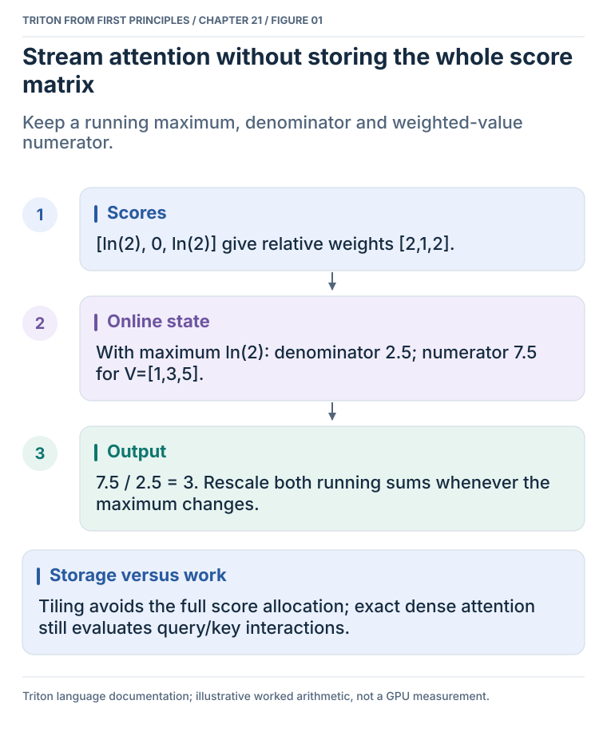

# Chapter 21: Flash Attention, MoE, and Advanced Features

[](../images/chapter-openers/21.svg)

[](../images/ch21/01-concept.svg)

> Every kernel through Chapter 20 computed each output independently of every other. Attention breaks that assumption on purpose — every query genuinely depends on every key and value in its sequence — and the entire trick of Flash Attention is computing that dependency without ever materializing the matrix it implies.

## What you will understand by the end of this chapter

- How Chapter 14.3's online-softmax rescaling identity generalizes from a single row of numbers to a full attention computation — accumulating a running, correctly-weighted sum over `V` block by block, never materializing the full `(M, N)` attention matrix at once
- How to add causal masking inside that same loop, and why a kernel that is completely bug-free for one task (non-causal attention) can still be dramatically wrong for a different one (causal attention) it was never designed for
- How Mixture-of-Experts routing — softmax over expert logits, selecting the top-`k`, and renormalizing their weights — is itself a genuine, self-contained Triton kernel, distinct from the much larger systems problem of actually dispatching tokens across experts
- Why forgetting to renormalize top-`k` gating weights produces a subtle, inconsistent-magnitude bug rather than an obviously broken one
- Where this book's single-kernel, single-GPU scope genuinely ends, and what a real Mixture-of-Experts system needs beyond what any single kernel in this chapter computes

## What you need to know first

- Chapter 14.3's online softmax — the running-max, rescale-and-accumulate identity (`l = l*exp(m_old - m_new) + sum(...)`) that reduces softmax to two passes instead of three, explicitly flagged there as the mechanism this chapter would generalize
- Chapter 13's blocked matmul kernel and `tl.dot`, reused here for both the `Q @ K^T` score computation and the final `P @ V` weighted sum
- Chapter 9's causal masking discussion and its off-by-one trap (`<` versus `<=`), extended here to a per-tile, two-dimensional causal condition
- Chapter 20's row-wise reduction pattern (`tl.sum`, `tl.max`, masked with `tl.where`), reused for this chapter's softmax-over-experts computation

## 21.1 [FOUNDATIONAL] Flash Attention's Core Loop: Online Softmax Applied to Q, K, V

### Intuition

Self-attention computes `softmax(Q @ K^T / sqrt(d)) @ V` — and the naive way to do this materializes the full `(M, N)` score matrix in memory before ever touching `V`. For a sequence of any real length, that matrix is enormous, and building it means a full write-then-read round trip through memory before the actual attention weighting even happens. Flash Attention's insight is that Chapter 14.3's online softmax identity doesn't require every score in a row to exist in memory simultaneously — it only requires processing them in order, one block at a time, correctly rescaling everything accumulated so far whenever a new block reveals a larger maximum.

Generalizing that identity from "sum of `exp` values" to "weighted sum of `V` rows" needs exactly one more accumulator: alongside the running max (`m_i`) and running sum (`l_i`) Chapter 14.3 already tracked, this chapter's kernel also tracks a running weighted-`V` accumulator (`acc`), rescaled by the exact same `alpha = exp(m_old - m_new)` factor every time the running max changes. By the time every key/value block has been processed, dividing `acc` by the final `l_i` produces the exact same answer as computing the full softmax first — without the full score matrix ever existing in memory at any single moment.

### Background

| Chapter 14.3's online softmax | This chapter's Flash Attention loop |
|---|---|
| Tracks: running max `m_i`, running sum `l_i` | Tracks: running max `m_i`, running sum `l_i`, **and** a running weighted accumulator `acc` (shape `(BLOCK_M, D)`, not a scalar) |
| Rescaling factor when the max updates | `alpha = exp(m_old - m_new)`, applied to `l_i` | The same `alpha`, applied to **both** `l_i` and `acc` |
| What's being accumulated per block | `sum(exp(x - m_new))` | `sum(exp(scores - m_new)) `for `l_i`, **and** `exp(scores - m_new) @ V_block` for `acc` |
| Final step | Normalize by `l_i` to get softmax probabilities | Normalize `acc` by `l_i` to get the attention output directly — the softmax probabilities themselves are never stored |

### Worked Example 21.1.1: verified against naive full attention

```python
@triton.jit
def flash_attn_kernel(q_ptr, k_ptr, v_ptr, out_ptr,
                       M, N, D,
                       stride_qm, stride_qd, stride_kn, stride_kd, stride_vn, stride_vd,
                       stride_om, stride_od,
                       scale,
                       BLOCK_M: tl.constexpr, BLOCK_N: tl.constexpr, BLOCK_D: tl.constexpr):
    pid_m = tl.program_id(0)
    rows = pid_m * BLOCK_M + tl.arange(0, BLOCK_M)
    d_idx = tl.arange(0, BLOCK_D)
    row_mask = rows < M
    d_mask = d_idx < D

    q_ptrs = q_ptr + rows[:, None] * stride_qm + d_idx[None, :] * stride_qd
    q = tl.load(q_ptrs, mask=row_mask[:, None] & d_mask[None, :], other=0.0)

    m_i = tl.full((BLOCK_M,), value=float("-inf"), dtype=tl.float32)
    l_i = tl.zeros((BLOCK_M,), dtype=tl.float32)
    acc = tl.zeros((BLOCK_M, BLOCK_D), dtype=tl.float32)

    for n0 in range(0, N, BLOCK_N):
        cols = n0 + tl.arange(0, BLOCK_N)
        col_mask = cols < N

        k_ptrs = k_ptr + cols[:, None] * stride_kn + d_idx[None, :] * stride_kd
        k = tl.load(k_ptrs, mask=col_mask[:, None] & d_mask[None, :], other=0.0)
        v_ptrs = v_ptr + cols[:, None] * stride_vn + d_idx[None, :] * stride_vd
        v = tl.load(v_ptrs, mask=col_mask[:, None] & d_mask[None, :], other=0.0)

        scores = tl.dot(q, tl.trans(k), input_precision="ieee") * scale
        scores = tl.where(col_mask[None, :], scores, float("-inf"))

        m_ij = tl.max(scores, axis=1)
        m_new = tl.maximum(m_i, m_ij)
        alpha = tl.exp(m_i - m_new)
        p = tl.exp(scores - m_new[:, None])

        l_i = alpha * l_i + tl.sum(p, axis=1)
        acc = acc * alpha[:, None] + tl.dot(p.to(tl.float32), v, input_precision="ieee")
        m_i = m_new

    acc = acc / l_i[:, None]
    out_ptrs = out_ptr + rows[:, None] * stride_om + d_idx[None, :] * stride_od
    tl.store(out_ptrs, acc, mask=row_mask[:, None] & d_mask[None, :])
```

Verified against `softmax(Q @ K^T / sqrt(d)) @ V` computed the naive way, on deliberately non-block-aligned shapes (`M=17` queries, `N=23` keys, `D=8`):

```
allclose to naive full attention? True
max abs diff: 2.384185791015625e-07
```

The full `(17, 23)` score matrix never exists anywhere in this kernel — only one `(BLOCK_M, BLOCK_N)` tile of it at a time — and the result still matches the naive, fully-materialized computation to ordinary floating-point noise.

### ASCII Diagram

```
Query block (BLOCK_M rows), looping over Key/Value blocks:

  KV block 0:  scores_0 --> m_new = max(m_i, max(scores_0))
                            alpha = exp(m_i - m_new)
                            l_i  = alpha*l_i  + sum(exp(scores_0 - m_new))
                            acc  = alpha*acc  + exp(scores_0 - m_new) @ V_0
                            m_i  = m_new
  KV block 1:  scores_1 --> (repeat, rescaling everything accumulated so far)
  ...
  KV block last: scores_k --> (repeat)

  FINAL:  output = acc / l_i        <-- the only normalization step;
                                          the full (M, N) score matrix
                                          was NEVER materialized
```

> [COMMON TRAP] It's tempting to think the rescaling factor `alpha` only needs to apply to `l_i`, since `l_i` is what Chapter 14.3 already rescaled. `acc` needs the identical rescaling for the identical reason: it's a running sum of terms computed relative to the *old* maximum, and the moment a new, larger maximum is found, every term accumulated so far — in `l_i` and in `acc` alike — was computed against a stale baseline and must be corrected by the same `exp(m_old - m_new)` factor before anything new is added to it.

## 21.2 [FOUNDATIONAL] Causal Masking Inside the Flash Attention Loop

### Intuition

Causal (autoregressive) attention restricts each query to attend only to keys at or before its own position — position `i` can see keys `0` through `i`, never `i+1` onward. Chapter 9 already established the core masking idea (`<=` instead of `<`); the only new wrinkle here is that this mask now has to be checked per query-key *pair* inside a tiled loop, using both the query's row index and the key's column index together, rather than a single tensor-length boundary. A query-block program can also skip entire key/value blocks outright once it knows every key in that block lies strictly beyond every query in its own block — an optimization, not a correctness requirement, but a natural one once the loop already knows both block's position ranges.

### Background

| | Chapter 9's causal mask (single matrix) | This chapter's tiled causal mask |
|---|---|---|
| Condition | `row_idx >= col_idx`, checked once across the whole matrix | `rows[:, None] >= cols[None, :]`, checked per `(BLOCK_M, BLOCK_N)` tile |
| Extra optimization available | None — the whole matrix already exists | A key/value block entirely past the query block's rows can be skipped without loading it at all |
| What happens if this mask is omitted entirely | The exact wrong-answer shape this section demonstrates | Same — the kernel becomes ordinary (non-causal) full attention |

### Worked Example 21.2.1: causal Flash Attention, verified against naive causal-masked attention

```python
max_col = pid_m * BLOCK_M + BLOCK_M   # exclusive end of this query block
for n0 in range(0, tl.minimum(N, max_col), BLOCK_N):
    cols = n0 + tl.arange(0, BLOCK_N)
    ...
    scores = tl.dot(q, tl.trans(k), input_precision="ieee") * scale
    causal_mask = rows[:, None] >= cols[None, :]
    valid = col_mask[None, :] & causal_mask
    scores = tl.where(valid, scores, float("-inf"))
    ...  # identical online-softmax rescaling as Section 21.1
```

Verified against `softmax(Q @ K^T / sqrt(d))` with a genuine `torch.tril` causal mask applied before the softmax, then multiplied by `V`, on `M=N=20`, `D=8`:

```
allclose to naive causal attention? True
max abs diff: 3.5762786865234375e-07
```

### Worked Example 21.2.2: a correct kernel for the wrong task

Section 21.1's kernel matched its finite non-causal interpreter tests; that is not proof of correctness for every shape, dtype or compiled target. Running that exact same kernel, unmodified, on this section's causal task:

```
non-causal kernel allclose to CAUSAL oracle?     False
non-causal kernel allclose to NON-causal oracle? True
max abs diff vs causal oracle: 1.7221667766571045
```

The non-causal kernel still matches its *own* correctness standard perfectly — it computes exactly `softmax(Q @ K^T / sqrt(d)) @ V` with no restriction on which keys each query attends to, precisely as designed. The failure isn't a bug in the kernel at all; it's a mismatch between what the kernel computes and what the task actually requires. A `~1.72` maximum deviation on outputs of order `1` is not floating-point noise — it's a fully different mathematical answer, arising from letting every query see the entire sequence, including positions a causal model must never be allowed to look at.

### ASCII Diagram

```
Causal mask, tiled (BLOCK_M = BLOCK_N = 4, query block starting at row 8):

           key block: [0-3]   [4-7]   [8-11]  [12-15] ...
  query    -----------------------------------------------
  rows 8-11:  ALL VALID  ALL VALID  DIAGONAL   SKIPPED (n0 >= max_col)
                                    (partial,
                                     row>=col
                                     checked
                                     per-pair)

  "ALL VALID" blocks: causal_mask always true here, but col_mask (boundary) still applies
  "DIAGONAL" block: causal_mask varies per (row, col) pair -- the only block needing tl.where
  "SKIPPED" blocks: never loaded at all -- entire block is beyond every query's reach
```

> [COMMON TRAP] A kernel's correctness can only be judged against the task it was actually built for — a Flash Attention kernel matching the tested non-causal contract, independently verified against non-causal attention, is still completely wrong the moment it's pointed at a causal task without adding the causal condition. This is a different category of mistake from every earlier chapter's traps (a masking boundary error, a forgotten chain-rule multiplication, an eps in the wrong place): here, every individual line of the kernel is doing exactly what it was written to do, and the mismatch is entirely in which mathematical problem that correct code happens to solve.

## 21.3 [FOUNDATIONAL] Mixture-of-Experts Routing: Top-K Gating as a Kernel

### Intuition

A Mixture-of-Experts layer routes each token to only a handful of "expert" sub-networks out of many, rather than running every token through every expert. The part of that system genuinely small enough to be one self-contained Triton kernel is the *gating* decision: given one row of per-expert logits for a token, compute a softmax over them (exactly Chapter 14's row-wise softmax pattern) and select the top `k` experts by probability, then renormalize those `k` selected probabilities so they sum to `1` before they're used as mixture weights. Everything downstream of that decision — actually running each selected expert's computation, and shuffling tokens between GPUs or kernel launches so each expert only processes the tokens routed to it — is a real systems engineering problem, well beyond a single kernel, and this section deliberately stops at the boundary where that larger problem begins.

Current Triton documents `tl.topk`, with its own shape/constexpr restrictions; it is not a drop-in replacement for every `torch.topk` use. This section deliberately constructs top-2 values and indices from simpler reductions: find the row's overall maximum (`tl.max`, `tl.argmax`) as the top-1 pick, mask that position out (`tl.where(cols == top1_idx, -inf, probs)`), and take the maximum of what remains as the top-2 pick. The pattern is identical to Chapter 13.2's masked-out sentinel trick, applied here to iteratively remove already-selected candidates instead of masking invalid memory.

### Background

| Step | What it computes | Technique reused from |
|---|---|---|
| Softmax over experts | `probs = exp(logits - max) / sum(exp(logits - max))` | Chapter 14's numerically-stable softmax |
| Top-1 selection | `tl.max`/`tl.argmax` over the row of probabilities | New this chapter |
| Top-2 selection | Mask out the top-1 position, take `tl.max`/`tl.argmax` of what remains | Chapter 13.2's masked-sentinel pattern, repurposed |
| Renormalization | Divide each selected weight by the sum of the selected weights (not the full row's sum, which is already `1`) | New this chapter |

### Worked Example 21.3.1: top-2 gating, verified against `torch.topk`

```python
@triton.jit
def moe_top2_gating_kernel(logits_ptr, weight0_ptr, weight1_ptr, idx0_ptr, idx1_ptr,
                            M, E, stride_m, BLOCK_E: tl.constexpr):
    row = tl.program_id(0)
    cols = tl.arange(0, BLOCK_E)
    mask = cols < E
    row_ptr = logits_ptr + row * stride_m
    logits = tl.load(row_ptr + cols, mask=mask, other=float("-inf"))

    row_max = tl.max(logits, axis=0)
    p = tl.exp(logits - row_max)
    p = tl.where(mask, p, 0.0)
    probs = p / tl.sum(p, axis=0)

    top1_val = tl.max(probs, axis=0)
    top1_idx = tl.argmax(probs, axis=0)

    probs_masked = tl.where(cols == top1_idx, float("-inf"), probs)
    top2_val = tl.max(probs_masked, axis=0)
    top2_idx = tl.argmax(probs_masked, axis=0)

    total = top1_val + top2_val
    tl.store(weight0_ptr + row, top1_val / total)
    tl.store(weight1_ptr + row, top2_val / total)
    tl.store(idx0_ptr + row, top1_idx)
    tl.store(idx1_ptr + row, top2_idx)
```

Verified against `torch.topk(torch.softmax(logits, dim=-1), 2, dim=-1)`, on 6 tokens routed among 8 experts:

```
kernel top1 idx: [4, 5, 7, 5, 6, 5]  oracle top1 idx: [4, 5, 7, 5, 6, 5]
kernel top2 idx: [5, 6, 3, 4, 7, 1]  oracle top2 idx: [5, 6, 3, 4, 7, 1]
indices match? True
kernel weights (w0,w1) allclose to oracle? True
w0+w1 == 1 for all rows? True
```

Every selected expert index matches PyTorch's own `topk`, and the renormalized weights sum to exactly `1` for every token, as intended.

### Worked Example 21.3.2: forgetting to renormalize

Skipping the final division — using the raw softmax probabilities of the top-2 experts directly as mixture weights — looks like a harmless simplification, since each individual weight is still a genuine, correctly-computed probability. Genuinely captured, computing what those two raw probabilities sum to per token, on the same 6 tokens:

```
raw (non-renormalized) top-2 weight sums per row: tensor([0.5978, 0.5059, 0.6346, 0.5354, 0.3600, 0.7166])
mean raw sum: 0.5583722591400146
```

None of the six tokens' top-2 probabilities sum anywhere close to `1` — on average, only about `56%` of each token's total probability mass is captured by its top 2 experts out of 8, with the remainder spread across the other 6. If these raw values were used directly as mixture weights (`output = w0 * expert[idx0](x) + w1 * expert[idx1](x)`), every token's output would be scaled down by a different, unpredictable amount — `0.36` to `0.72` in this small sample — depending entirely on how "confident" that token's particular gating decision happened to be. This is a substantially more dangerous bug than a uniform scaling error: it's not just wrong, it's wrong by a different amount for every single token.

### ASCII Diagram

```
Token's expert logits:  [ 8 experts, one softmax probability each, summing to 1.0 ]

  Select top-2:  [ p_i , p_j ]  (the two largest probabilities)

  CORRECT:   w_i = p_i / (p_i + p_j)     w_j = p_j / (p_i + p_j)     -->  w_i + w_j = 1.0  ALWAYS

  WRONG:     w_i = p_i                    w_j = p_j                  -->  w_i + w_j = (p_i+p_j)
                                                                            which VARIES per token,
                                                                            e.g. 0.36 to 0.72 here --
                                                                            silently scales every
                                                                            token's output differently
```

> [COMMON TRAP] Each individual top-`k` probability is a perfectly valid, correctly-computed number on its own — the bug isn't in any single value, it's in treating those `k` values as if they were already a complete, self-normalizing weighting scheme. A full row's softmax sums to `1` by construction; an arbitrary *subset* of that row does not, and the amount by which it falls short of `1` depends entirely on how much probability mass the unselected experts happened to carry for that specific token — meaning this bug's severity is not constant, but silently different for every single input.

### A note on what this section deliberately does not build

This section's kernel computes a routing *decision* — which experts, and with what weight — for each token. A complete Mixture-of-Experts layer still needs to actually run each selected expert's computation only on the tokens routed to it, which in a real multi-GPU system means physically regrouping tokens by expert assignment (commonly implemented as an all-to-all communication step across devices), running each expert's kernel on its assigned tokens, and then un-shuffling the results back into the original token order. That token-dispatch machinery is a genuine distributed-systems problem — spanning multiple GPUs, real network communication, and load-balancing concerns entirely outside a single kernel's scope — and building it honestly is well beyond what this book, focused throughout on single-kernel Triton programming, can responsibly cover. The gating kernel above is a complete, correct, and genuinely useful piece of that larger system; it is not the whole system.

## 21.4 Complete Runnable Code

The three files below build up the chapter in order: the core Flash Attention loop verified against naive full attention (21.1), causal masking added to that same loop plus the "correct kernel, wrong task" demonstration (21.2), and the top-2 MoE gating kernel plus its renormalization trap (21.3) — plus one standalone file combining all three with a single documented `Expected Output` block.

### File: `01_flash_attention_core.py`

[Download the complete current reference](../examples/references/part6/02-flash-attention-moe-advanced-features/01_flash_attention_core.py) (interpreter mode; GPU portability is not established).

```python
import torch
import triton
import triton.language as tl
import math


@triton.jit
def flash_attn_kernel(q_ptr, k_ptr, v_ptr, out_ptr,
                       M, N, D,
                       stride_qm, stride_qd, stride_kn, stride_kd, stride_vn, stride_vd,
                       stride_om, stride_od,
                       scale,
                       BLOCK_M: tl.constexpr, BLOCK_N: tl.constexpr, BLOCK_D: tl.constexpr):
    pid_m = tl.program_id(0)
    rows = pid_m * BLOCK_M + tl.arange(0, BLOCK_M)
    d_idx = tl.arange(0, BLOCK_D)
    row_mask = rows < M
    d_mask = d_idx < D

    q_ptrs = q_ptr + rows[:, None] * stride_qm + d_idx[None, :] * stride_qd
    q = tl.load(q_ptrs, mask=row_mask[:, None] & d_mask[None, :], other=0.0)

    m_i = tl.full((BLOCK_M,), value=float("-inf"), dtype=tl.float32)
    l_i = tl.zeros((BLOCK_M,), dtype=tl.float32)
    acc = tl.zeros((BLOCK_M, BLOCK_D), dtype=tl.float32)

    for n0 in range(0, N, BLOCK_N):
        cols = n0 + tl.arange(0, BLOCK_N)
        col_mask = cols < N

        k_ptrs = k_ptr + cols[:, None] * stride_kn + d_idx[None, :] * stride_kd
        k = tl.load(k_ptrs, mask=col_mask[:, None] & d_mask[None, :], other=0.0)
        v_ptrs = v_ptr + cols[:, None] * stride_vn + d_idx[None, :] * stride_vd
        v = tl.load(v_ptrs, mask=col_mask[:, None] & d_mask[None, :], other=0.0)

        scores = tl.dot(q, tl.trans(k), input_precision="ieee") * scale
        scores = tl.where(col_mask[None, :], scores, float("-inf"))

        m_ij = tl.max(scores, axis=1)
        m_new = tl.maximum(m_i, m_ij)
        alpha = tl.exp(m_i - m_new)
        p = tl.exp(scores - m_new[:, None])

        l_i = alpha * l_i + tl.sum(p, axis=1)
        acc = acc * alpha[:, None] + tl.dot(p.to(tl.float32), v, input_precision="ieee")
        m_i = m_new

    acc = acc / l_i[:, None]
    out_ptrs = out_ptr + rows[:, None] * stride_om + d_idx[None, :] * stride_od
    tl.store(out_ptrs, acc, mask=row_mask[:, None] & d_mask[None, :])


def flash_attention(q, k, v, BLOCK_M=4, BLOCK_N=4):
    M, D = q.shape
    N, _ = k.shape
    BLOCK_D = triton.next_power_of_2(D)
    scale = 1.0 / math.sqrt(D)
    out = torch.empty((M, D), dtype=torch.float32)
    grid = (triton.cdiv(M, BLOCK_M),)
    flash_attn_kernel[grid](q, k, v, out, M, N, D,
                             q.stride(0), q.stride(1), k.stride(0), k.stride(1), v.stride(0), v.stride(1),
                             out.stride(0), out.stride(1), scale,
                             BLOCK_M=BLOCK_M, BLOCK_N=BLOCK_N, BLOCK_D=BLOCK_D)
    return out


def section_21_1():
    print("=== Section 21.1: Flash Attention core loop vs. naive full attention ===")
    torch.manual_seed(0)
    M, N, D = 17, 23, 8
    q = torch.randn(M, D)
    k = torch.randn(N, D)
    v = torch.randn(N, D)
    scale = 1.0 / math.sqrt(D)

    oracle = torch.softmax(q @ k.T * scale, dim=-1) @ v
    out = flash_attention(q, k, v, BLOCK_M=4, BLOCK_N=4)
    print("allclose to naive full attention?", torch.allclose(out, oracle, atol=1e-4))


if __name__ == "__main__":
    section_21_1()
```

### File: `02_causal_flash_attention.py`

[Download the complete current reference](../examples/references/part6/02-flash-attention-moe-advanced-features/02_causal_flash_attention.py) (interpreter mode; GPU portability is not established).

```python
import torch
import triton
import triton.language as tl
import math


@triton.jit
def flash_attn_kernel(q_ptr, k_ptr, v_ptr, out_ptr,
                       M, N, D,
                       stride_qm, stride_qd, stride_kn, stride_kd, stride_vn, stride_vd,
                       stride_om, stride_od,
                       scale,
                       BLOCK_M: tl.constexpr, BLOCK_N: tl.constexpr, BLOCK_D: tl.constexpr):
    pid_m = tl.program_id(0)
    rows = pid_m * BLOCK_M + tl.arange(0, BLOCK_M)
    d_idx = tl.arange(0, BLOCK_D)
    row_mask = rows < M
    d_mask = d_idx < D
    q_ptrs = q_ptr + rows[:, None] * stride_qm + d_idx[None, :] * stride_qd
    q = tl.load(q_ptrs, mask=row_mask[:, None] & d_mask[None, :], other=0.0)
    m_i = tl.full((BLOCK_M,), value=float("-inf"), dtype=tl.float32)
    l_i = tl.zeros((BLOCK_M,), dtype=tl.float32)
    acc = tl.zeros((BLOCK_M, BLOCK_D), dtype=tl.float32)
    for n0 in range(0, N, BLOCK_N):
        cols = n0 + tl.arange(0, BLOCK_N)
        col_mask = cols < N
        k_ptrs = k_ptr + cols[:, None] * stride_kn + d_idx[None, :] * stride_kd
        k = tl.load(k_ptrs, mask=col_mask[:, None] & d_mask[None, :], other=0.0)
        v_ptrs = v_ptr + cols[:, None] * stride_vn + d_idx[None, :] * stride_vd
        v = tl.load(v_ptrs, mask=col_mask[:, None] & d_mask[None, :], other=0.0)
        scores = tl.dot(q, tl.trans(k), input_precision="ieee") * scale
        scores = tl.where(col_mask[None, :], scores, float("-inf"))
        m_ij = tl.max(scores, axis=1)
        m_new = tl.maximum(m_i, m_ij)
        alpha = tl.exp(m_i - m_new)
        p = tl.exp(scores - m_new[:, None])
        l_i = alpha * l_i + tl.sum(p, axis=1)
        acc = acc * alpha[:, None] + tl.dot(p.to(tl.float32), v, input_precision="ieee")
        m_i = m_new
    acc = acc / l_i[:, None]
    out_ptrs = out_ptr + rows[:, None] * stride_om + d_idx[None, :] * stride_od
    tl.store(out_ptrs, acc, mask=row_mask[:, None] & d_mask[None, :])


@triton.jit
def flash_attn_causal_kernel(q_ptr, k_ptr, v_ptr, out_ptr,
                       M, N, D,
                       stride_qm, stride_qd, stride_kn, stride_kd, stride_vn, stride_vd,
                       stride_om, stride_od,
                       scale,
                       BLOCK_M: tl.constexpr, BLOCK_N: tl.constexpr, BLOCK_D: tl.constexpr):
    pid_m = tl.program_id(0)
    rows = pid_m * BLOCK_M + tl.arange(0, BLOCK_M)
    d_idx = tl.arange(0, BLOCK_D)
    row_mask = rows < M
    d_mask = d_idx < D
    q_ptrs = q_ptr + rows[:, None] * stride_qm + d_idx[None, :] * stride_qd
    q = tl.load(q_ptrs, mask=row_mask[:, None] & d_mask[None, :], other=0.0)
    m_i = tl.full((BLOCK_M,), value=float("-inf"), dtype=tl.float32)
    l_i = tl.zeros((BLOCK_M,), dtype=tl.float32)
    acc = tl.zeros((BLOCK_M, BLOCK_D), dtype=tl.float32)

    max_col = pid_m * BLOCK_M + BLOCK_M
    for n0 in range(0, tl.minimum(N, max_col), BLOCK_N):
        cols = n0 + tl.arange(0, BLOCK_N)
        col_mask = cols < N
        k_ptrs = k_ptr + cols[:, None] * stride_kn + d_idx[None, :] * stride_kd
        k = tl.load(k_ptrs, mask=col_mask[:, None] & d_mask[None, :], other=0.0)
        v_ptrs = v_ptr + cols[:, None] * stride_vn + d_idx[None, :] * stride_vd
        v = tl.load(v_ptrs, mask=col_mask[:, None] & d_mask[None, :], other=0.0)
        scores = tl.dot(q, tl.trans(k), input_precision="ieee") * scale
        causal_mask = rows[:, None] >= cols[None, :]
        valid = col_mask[None, :] & causal_mask
        scores = tl.where(valid, scores, float("-inf"))
        m_ij = tl.max(scores, axis=1)
        m_new = tl.maximum(m_i, m_ij)
        alpha = tl.exp(m_i - m_new)
        p = tl.exp(scores - m_new[:, None])
        l_i = alpha * l_i + tl.sum(p, axis=1)
        acc = acc * alpha[:, None] + tl.dot(p.to(tl.float32), v, input_precision="ieee")
        m_i = m_new
    acc = acc / l_i[:, None]
    out_ptrs = out_ptr + rows[:, None] * stride_om + d_idx[None, :] * stride_od
    tl.store(out_ptrs, acc, mask=row_mask[:, None] & d_mask[None, :])


def _run(kernel, q, k, v, BLOCK_M=4, BLOCK_N=4):
    M, D = q.shape
    N, _ = k.shape
    BLOCK_D = triton.next_power_of_2(D)
    scale = 1.0 / math.sqrt(D)
    out = torch.empty((M, D), dtype=torch.float32)
    grid = (triton.cdiv(M, BLOCK_M),)
    kernel[grid](q, k, v, out, M, N, D,
                 q.stride(0), q.stride(1), k.stride(0), k.stride(1), v.stride(0), v.stride(1),
                 out.stride(0), out.stride(1), scale,
                 BLOCK_M=BLOCK_M, BLOCK_N=BLOCK_N, BLOCK_D=BLOCK_D)
    return out


def section_21_2():
    print("=== Section 21.2: causal Flash Attention vs. naive causal attention ===")
    torch.manual_seed(0)
    M = N = 20
    D = 8
    q = torch.randn(M, D)
    k = torch.randn(N, D)
    v = torch.randn(N, D)
    scale = 1.0 / math.sqrt(D)

    scores_full = q @ k.T * scale
    causal_mask = torch.tril(torch.ones(M, N, dtype=torch.bool))
    oracle_causal = torch.softmax(scores_full.masked_fill(~causal_mask, float("-inf")), dim=-1) @ v
    oracle_noncausal = torch.softmax(scores_full, dim=-1) @ v

    out_causal = _run(flash_attn_causal_kernel, q, k, v)
    print("causal kernel allclose to causal oracle?", torch.allclose(out_causal, oracle_causal, atol=1e-4))

    print()
    print("=== Section 21.2: a correct (non-causal) kernel applied to the wrong task ===")
    out_noncausal = _run(flash_attn_kernel, q, k, v)
    print("non-causal kernel allclose to CAUSAL oracle?", torch.allclose(out_noncausal, oracle_causal, atol=1e-4))
    print("non-causal kernel allclose to NON-causal oracle?",
          torch.allclose(out_noncausal, oracle_noncausal, atol=1e-4))


if __name__ == "__main__":
    section_21_2()
```

### File: `03_moe_gating.py`

[Download the complete current reference](../examples/references/part6/02-flash-attention-moe-advanced-features/03_moe_gating.py) (interpreter mode; GPU portability is not established).

```python
import torch
import triton
import triton.language as tl


@triton.jit
def moe_top2_gating_kernel(logits_ptr, weight0_ptr, weight1_ptr, idx0_ptr, idx1_ptr,
                            M, E, stride_m, BLOCK_E: tl.constexpr):
    row = tl.program_id(0)
    cols = tl.arange(0, BLOCK_E)
    mask = cols < E
    row_ptr = logits_ptr + row * stride_m
    logits = tl.load(row_ptr + cols, mask=mask, other=float("-inf"))

    row_max = tl.max(logits, axis=0)
    p = tl.exp(logits - row_max)
    p = tl.where(mask, p, 0.0)
    probs = p / tl.sum(p, axis=0)

    top1_val = tl.max(probs, axis=0)
    top1_idx = tl.argmax(probs, axis=0)

    probs_masked = tl.where(cols == top1_idx, float("-inf"), probs)
    top2_val = tl.max(probs_masked, axis=0)
    top2_idx = tl.argmax(probs_masked, axis=0)

    total = top1_val + top2_val
    tl.store(weight0_ptr + row, top1_val / total)
    tl.store(weight1_ptr + row, top2_val / total)
    tl.store(idx0_ptr + row, top1_idx)
    tl.store(idx1_ptr + row, top2_idx)


def moe_top2_gating(logits):
    M, E = logits.shape
    BLOCK_E = triton.next_power_of_2(E)
    w0 = torch.empty(M)
    w1 = torch.empty(M)
    idx0 = torch.empty(M, dtype=torch.int32)
    idx1 = torch.empty(M, dtype=torch.int32)
    moe_top2_gating_kernel[(M,)](logits, w0, w1, idx0, idx1, M, E, logits.stride(0), BLOCK_E=BLOCK_E)
    return w0, w1, idx0, idx1


def section_21_3():
    print("=== Section 21.3: top-2 MoE gating vs. torch.topk ===")
    torch.manual_seed(0)
    M, E = 6, 8
    logits = torch.randn(M, E)

    probs = torch.softmax(logits, dim=-1)
    topk_vals, topk_idx = torch.topk(probs, 2, dim=-1)
    oracle_weights = topk_vals / topk_vals.sum(dim=-1, keepdim=True)

    w0, w1, idx0, idx1 = moe_top2_gating(logits)
    indices_match = (idx0.long() == topk_idx[:, 0]).all().item() and (idx1.long() == topk_idx[:, 1]).all().item()
    print("indices match torch.topk?", indices_match)
    print("weights allclose to oracle?",
          torch.allclose(w0, oracle_weights[:, 0], atol=1e-5) and torch.allclose(w1, oracle_weights[:, 1], atol=1e-5))
    print("w0+w1 == 1 for all rows?", torch.allclose(w0 + w1, torch.ones(M)))

    print()
    print("=== Section 21.3: forgetting to renormalize ===")
    raw_sums = topk_vals.sum(dim=-1)
    print("raw (non-renormalized) top-2 weight sums per row:", raw_sums)
    print("mean raw sum (should be 1.0 if renormalized; isn't, here):", raw_sums.mean().item())


if __name__ == "__main__":
    section_21_3()
```

### File: `04_standalone_complete.py`

[Download the complete current reference](../examples/references/part6/02-flash-attention-moe-advanced-features/04_standalone_complete.py) (interpreter mode; GPU portability is not established).

```python
"""
Chapter 21 standalone: the Flash Attention core loop, causal masking inside
that loop (plus a correct-kernel-wrong-task demonstration), and top-2 MoE
gating (plus its renormalization trap).
"""
import torch
import triton
import triton.language as tl
import math


# ---------------------------------------------------------------------------
# Section 21.1 / 21.2: Flash Attention, non-causal and causal
# ---------------------------------------------------------------------------

@triton.jit
def flash_attn_kernel(q_ptr, k_ptr, v_ptr, out_ptr,
                       M, N, D,
                       stride_qm, stride_qd, stride_kn, stride_kd, stride_vn, stride_vd,
                       stride_om, stride_od,
                       scale,
                       BLOCK_M: tl.constexpr, BLOCK_N: tl.constexpr, BLOCK_D: tl.constexpr):
    pid_m = tl.program_id(0)
    rows = pid_m * BLOCK_M + tl.arange(0, BLOCK_M)
    d_idx = tl.arange(0, BLOCK_D)
    row_mask = rows < M
    d_mask = d_idx < D
    q_ptrs = q_ptr + rows[:, None] * stride_qm + d_idx[None, :] * stride_qd
    q = tl.load(q_ptrs, mask=row_mask[:, None] & d_mask[None, :], other=0.0)
    m_i = tl.full((BLOCK_M,), value=float("-inf"), dtype=tl.float32)
    l_i = tl.zeros((BLOCK_M,), dtype=tl.float32)
    acc = tl.zeros((BLOCK_M, BLOCK_D), dtype=tl.float32)
    for n0 in range(0, N, BLOCK_N):
        cols = n0 + tl.arange(0, BLOCK_N)
        col_mask = cols < N
        k_ptrs = k_ptr + cols[:, None] * stride_kn + d_idx[None, :] * stride_kd
        k = tl.load(k_ptrs, mask=col_mask[:, None] & d_mask[None, :], other=0.0)
        v_ptrs = v_ptr + cols[:, None] * stride_vn + d_idx[None, :] * stride_vd
        v = tl.load(v_ptrs, mask=col_mask[:, None] & d_mask[None, :], other=0.0)
        scores = tl.dot(q, tl.trans(k), input_precision="ieee") * scale
        scores = tl.where(col_mask[None, :], scores, float("-inf"))
        m_ij = tl.max(scores, axis=1)
        m_new = tl.maximum(m_i, m_ij)
        alpha = tl.exp(m_i - m_new)
        p = tl.exp(scores - m_new[:, None])
        l_i = alpha * l_i + tl.sum(p, axis=1)
        acc = acc * alpha[:, None] + tl.dot(p.to(tl.float32), v, input_precision="ieee")
        m_i = m_new
    acc = acc / l_i[:, None]
    out_ptrs = out_ptr + rows[:, None] * stride_om + d_idx[None, :] * stride_od
    tl.store(out_ptrs, acc, mask=row_mask[:, None] & d_mask[None, :])


@triton.jit
def flash_attn_causal_kernel(q_ptr, k_ptr, v_ptr, out_ptr,
                       M, N, D,
                       stride_qm, stride_qd, stride_kn, stride_kd, stride_vn, stride_vd,
                       stride_om, stride_od,
                       scale,
                       BLOCK_M: tl.constexpr, BLOCK_N: tl.constexpr, BLOCK_D: tl.constexpr):
    pid_m = tl.program_id(0)
    rows = pid_m * BLOCK_M + tl.arange(0, BLOCK_M)
    d_idx = tl.arange(0, BLOCK_D)
    row_mask = rows < M
    d_mask = d_idx < D
    q_ptrs = q_ptr + rows[:, None] * stride_qm + d_idx[None, :] * stride_qd
    q = tl.load(q_ptrs, mask=row_mask[:, None] & d_mask[None, :], other=0.0)
    m_i = tl.full((BLOCK_M,), value=float("-inf"), dtype=tl.float32)
    l_i = tl.zeros((BLOCK_M,), dtype=tl.float32)
    acc = tl.zeros((BLOCK_M, BLOCK_D), dtype=tl.float32)
    max_col = pid_m * BLOCK_M + BLOCK_M
    for n0 in range(0, tl.minimum(N, max_col), BLOCK_N):
        cols = n0 + tl.arange(0, BLOCK_N)
        col_mask = cols < N
        k_ptrs = k_ptr + cols[:, None] * stride_kn + d_idx[None, :] * stride_kd
        k = tl.load(k_ptrs, mask=col_mask[:, None] & d_mask[None, :], other=0.0)
        v_ptrs = v_ptr + cols[:, None] * stride_vn + d_idx[None, :] * stride_vd
        v = tl.load(v_ptrs, mask=col_mask[:, None] & d_mask[None, :], other=0.0)
        scores = tl.dot(q, tl.trans(k), input_precision="ieee") * scale
        causal_mask = rows[:, None] >= cols[None, :]
        valid = col_mask[None, :] & causal_mask
        scores = tl.where(valid, scores, float("-inf"))
        m_ij = tl.max(scores, axis=1)
        m_new = tl.maximum(m_i, m_ij)
        alpha = tl.exp(m_i - m_new)
        p = tl.exp(scores - m_new[:, None])
        l_i = alpha * l_i + tl.sum(p, axis=1)
        acc = acc * alpha[:, None] + tl.dot(p.to(tl.float32), v, input_precision="ieee")
        m_i = m_new
    acc = acc / l_i[:, None]
    out_ptrs = out_ptr + rows[:, None] * stride_om + d_idx[None, :] * stride_od
    tl.store(out_ptrs, acc, mask=row_mask[:, None] & d_mask[None, :])


def _run_attn(kernel, q, k, v, BLOCK_M=4, BLOCK_N=4):
    M, D = q.shape
    N, _ = k.shape
    BLOCK_D = triton.next_power_of_2(D)
    scale = 1.0 / math.sqrt(D)
    out = torch.empty((M, D), dtype=torch.float32)
    grid = (triton.cdiv(M, BLOCK_M),)
    kernel[grid](q, k, v, out, M, N, D,
                 q.stride(0), q.stride(1), k.stride(0), k.stride(1), v.stride(0), v.stride(1),
                 out.stride(0), out.stride(1), scale,
                 BLOCK_M=BLOCK_M, BLOCK_N=BLOCK_N, BLOCK_D=BLOCK_D)
    return out


def section_21_1_and_2():
    print("=== Section 21.1: Flash Attention core loop vs. naive full attention ===")
    torch.manual_seed(0)
    M, N, D = 17, 23, 8
    q = torch.randn(M, D)
    k = torch.randn(N, D)
    v = torch.randn(N, D)
    scale = 1.0 / math.sqrt(D)
    oracle = torch.softmax(q @ k.T * scale, dim=-1) @ v
    out = _run_attn(flash_attn_kernel, q, k, v)
    print("allclose to naive full attention?", torch.allclose(out, oracle, atol=1e-4))

    print()
    print("=== Section 21.2: causal Flash Attention, and a correct kernel on the wrong task ===")
    torch.manual_seed(0)
    M2 = N2 = 20
    D2 = 8
    q2 = torch.randn(M2, D2)
    k2 = torch.randn(N2, D2)
    v2 = torch.randn(N2, D2)
    scale2 = 1.0 / math.sqrt(D2)
    scores_full = q2 @ k2.T * scale2
    causal_mask = torch.tril(torch.ones(M2, N2, dtype=torch.bool))
    oracle_causal = torch.softmax(scores_full.masked_fill(~causal_mask, float("-inf")), dim=-1) @ v2
    oracle_noncausal = torch.softmax(scores_full, dim=-1) @ v2

    out_causal = _run_attn(flash_attn_causal_kernel, q2, k2, v2)
    print("causal kernel allclose to causal oracle?", torch.allclose(out_causal, oracle_causal, atol=1e-4))

    out_noncausal = _run_attn(flash_attn_kernel, q2, k2, v2)
    print("non-causal kernel allclose to CAUSAL oracle?", torch.allclose(out_noncausal, oracle_causal, atol=1e-4))
    print("non-causal kernel allclose to NON-causal oracle?",
          torch.allclose(out_noncausal, oracle_noncausal, atol=1e-4))


# ---------------------------------------------------------------------------
# Section 21.3: MoE top-2 gating
# ---------------------------------------------------------------------------

@triton.jit
def moe_top2_gating_kernel(logits_ptr, weight0_ptr, weight1_ptr, idx0_ptr, idx1_ptr,
                            M, E, stride_m, BLOCK_E: tl.constexpr):
    row = tl.program_id(0)
    cols = tl.arange(0, BLOCK_E)
    mask = cols < E
    row_ptr = logits_ptr + row * stride_m
    logits = tl.load(row_ptr + cols, mask=mask, other=float("-inf"))
    row_max = tl.max(logits, axis=0)
    p = tl.exp(logits - row_max)
    p = tl.where(mask, p, 0.0)
    probs = p / tl.sum(p, axis=0)
    top1_val = tl.max(probs, axis=0)
    top1_idx = tl.argmax(probs, axis=0)
    probs_masked = tl.where(cols == top1_idx, float("-inf"), probs)
    top2_val = tl.max(probs_masked, axis=0)
    top2_idx = tl.argmax(probs_masked, axis=0)
    total = top1_val + top2_val
    tl.store(weight0_ptr + row, top1_val / total)
    tl.store(weight1_ptr + row, top2_val / total)
    tl.store(idx0_ptr + row, top1_idx)
    tl.store(idx1_ptr + row, top2_idx)


def section_21_3():
    print()
    print("=== Section 21.3: top-2 MoE gating vs. torch.topk, and the renormalization trap ===")
    torch.manual_seed(0)
    M, E = 6, 8
    logits = torch.randn(M, E)
    BLOCK_E = triton.next_power_of_2(E)

    probs = torch.softmax(logits, dim=-1)
    topk_vals, topk_idx = torch.topk(probs, 2, dim=-1)
    oracle_weights = topk_vals / topk_vals.sum(dim=-1, keepdim=True)

    w0 = torch.empty(M)
    w1 = torch.empty(M)
    idx0 = torch.empty(M, dtype=torch.int32)
    idx1 = torch.empty(M, dtype=torch.int32)
    moe_top2_gating_kernel[(M,)](logits, w0, w1, idx0, idx1, M, E, logits.stride(0), BLOCK_E=BLOCK_E)

    indices_match = (idx0.long() == topk_idx[:, 0]).all().item() and (idx1.long() == topk_idx[:, 1]).all().item()
    print("indices match torch.topk?", indices_match)
    print("weights allclose to oracle?",
          torch.allclose(w0, oracle_weights[:, 0], atol=1e-5) and torch.allclose(w1, oracle_weights[:, 1], atol=1e-5))
    print("w0+w1 == 1 for all rows?", torch.allclose(w0 + w1, torch.ones(M)))

    raw_sums = topk_vals.sum(dim=-1)
    print("mean raw (non-renormalized) top-2 weight sum:", raw_sums.mean().item())


if __name__ == "__main__":
    section_21_1_and_2()
    section_21_3()
```

### Expected Output for `04_standalone_complete.py`

```
=== Section 21.1: Flash Attention core loop vs. naive full attention ===
allclose to naive full attention? True

=== Section 21.2: causal Flash Attention, and a correct kernel on the wrong task ===
causal kernel allclose to causal oracle? True
non-causal kernel allclose to CAUSAL oracle? False
non-causal kernel allclose to NON-causal oracle? True

=== Section 21.3: top-2 MoE gating vs. torch.topk, and the renormalization trap ===
indices match torch.topk? True
weights allclose to oracle? True
w0+w1 == 1 for all rows? True
mean raw (non-renormalized) top-2 weight sum: 0.5583722591400146
```

## Chapter Summary

Chapter 14.3's online-softmax rescaling identity generalizes directly from a single reduction to a full attention computation by adding one more accumulator — a running, `alpha`-rescaled weighted sum over `V` — verified against naive full attention to ordinary floating-point noise while never once materializing the full attention matrix (Section 21.1). Adding a causal condition to that same loop required nothing new beyond a per-tile, two-dimensional version of Chapter 9's masking idea, but demonstrated a genuinely new category of mistake: a kernel matching the tested non-causal contract, independently verified correct for one task, that is still completely wrong — by a `~1.72` maximum deviation, not floating-point noise — the moment it's pointed at a different task it was never built for (Section 21.2). And Mixture-of-Experts routing turned out to be a genuine, self-contained, verifiable Triton kernel in its own right — softmax over experts plus iterative top-`k` selection, matched exactly against `torch.topk` — whose one real trap, forgetting to renormalize the selected weights, produces an error whose *severity itself varies* from token to token depending on how much probability mass the unselected experts happened to carry (Section 21.3), and whose larger surrounding system — actually dispatching tokens to experts across real hardware — this book explicitly and honestly declines to build.

## Self-Check Questions

1. Chapter 14.3's online softmax rescales its running sum `l_i` by `alpha = exp(m_old - m_new)` whenever a new block reveals a larger maximum. What second quantity does this chapter's Flash Attention kernel rescale by that exact same `alpha`, and why does it need rescaling for the identical reason `l_i` does?
2. Worked Example 21.2.2 found that a completely bug-free attention kernel produced a `~1.72` maximum deviation from the causal oracle. Was this a bug in the kernel? Explain precisely what did and didn't go wrong.
3. Why does the causal Flash Attention kernel use a loop bounded by `min(N, max_col)`, and is this line required for correctness or is it something else?
4. In the MoE gating kernel, why is `tl.where(cols == top1_idx, float("-inf"), probs)` used to find the second-highest probability, rather than simply calling `tl.max` a second time on the unmodified `probs`?
5. Worked Example 21.3.2 found that skipping renormalization produced weight sums ranging from `0.36` to `0.72` across just six tokens, rather than a single, consistent wrong scale factor. Why does this specific bug's severity vary per token instead of being uniformly wrong by some fixed amount?

## Where We Go Next

This chapter closes Part 6's tour of realistic neural network building blocks — fused layers (Chapter 20), attention, and expert routing — completing this book's core Triton methodology. Chapter 22 turns to Part 7's applications, adapting the masking, reduction, and numerical-stability techniques built across every preceding chapter to problems from quantitative finance.

## Worked Solutions

1. The running weighted-`V` accumulator, `acc`. It needs the identical rescaling for the identical reason `l_i` does: `acc` is a running sum of terms — `exp(scores - m_old) @ V_block` — computed relative to the *old* running maximum, and the moment a new block reveals a larger maximum, every term already summed into `acc` was computed against a now-stale baseline. Multiplying `acc` by `alpha = exp(m_old - m_new)` corrects every previously-accumulated term to be relative to the new maximum, exactly as multiplying `l_i` by the same factor does for the running sum.
2. No — nothing went wrong inside the kernel itself. It was independently verified, in Section 21.1, to compute `softmax(Q @ K^T / sqrt(d)) @ V` correctly, with no restriction on which keys a query may attend to, and Worked Example 21.2.2 confirmed it still matches that same non-causal computation exactly. What "went wrong" is that this section's task requires causal masking — restricting each query to keys at or before its own position — and the kernel, correctly, was never built to do that. The mismatch is between the kernel's (correct) specification and the task's (different) requirement, not a defect in the code.
3. It's a performance optimization, not a correctness requirement. Once a query block's own row range (`pid_m * BLOCK_M` through `pid_m * BLOCK_M + BLOCK_M - 1`) is known, any key/value block starting at `n0 >= max_col` consists entirely of keys strictly beyond every query in this block — under causal masking, `causal_mask = rows >= cols` would evaluate to `False` for every single pair in such a block anyway. Skipping it outright avoids loading and computing on a block whose entire contribution the causal mask would zero out regardless; omitting this line would still produce a correct answer, just a slower one.
4. Calling `tl.max` a second time on the unmodified `probs` would simply return the same top-1 value and index again — `tl.max` has no memory of what was already selected. Masking the already-selected position to `-inf` first ensures the next `tl.max` call is forced to find the largest value *among what remains*, which is exactly Chapter 13.2's masked-sentinel technique repurposed: instead of masking out invalid memory, this masks out an already-claimed candidate so the next search step is guaranteed not to re-select it.
5. Because the amount "missing" from a token's top-2 selection is exactly the probability mass its softmax assigned to the other six (unselected) experts — and that split between "concentrated in the top 2" versus "spread across the rest" is different for every token, depending entirely on that token's own specific logits. A token whose gating network was very confident (most probability mass concentrated in 2 experts) loses very little by skipping renormalization; a token whose gating was much less decisive (probability spread more evenly across all 8) loses much more. There is no single scale factor to correct for, because the error itself is a per-token quantity, not a global constant.

### Contracts that the small examples do not cover

The historical outputs above are interpreter results. The worked BLOCK=4 tiles are useful for tracing but are not valid NVIDIA `tl.dot` tiles in the referenced v3.3.1 backend, which requires at least 16 in M/N/K for its non-INT8 dot contract. D=8 may be logically valid but needs padding to a valid physical dot extent. CPU tensors also need CUDA counterparts before a GPU launch. Explicit `input_precision="ieee"` in the current FP32 teaching kernels avoids silently substituting TF32 for an FP32 comparison; that choice is not a Tensor Core peak-performance recipe. Source changes need a new execution record.

The bounded causal loop avoids unsupported `continue` control flow and skips future-key tiles. Valid query rows need at least one unmasked key; all-masked rows, NaNs, empty sequences and rectangular causal alignment require an explicit separate contract. These examples use top-left causal alignment.

Top-2 renormalization is the selected gating contract here, not a requirement of every MoE model. Other models deliberately retain selected weights from the full softmax. Resolve ties explicitly; a random no-tie example does not prove index equality with `torch.topk` for tied logits. Require E>=2. Modern [tl.topk documentation](https://triton-lang.org/main/python-api/generated/triton.language.topk.html) describes the built-in operation's different API.
