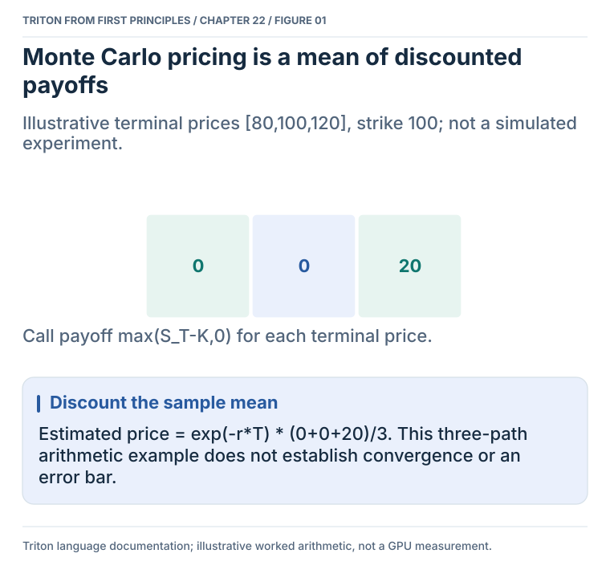

# Chapter 22: Quantitative Finance Examples

[](../images/chapter-openers/22.svg)

[](../images/ch22/01-concept.svg)

> A closed-form price, a rolling statistic, and a simulated estimate are three different ways of answering the same kind of question, and each one demands a different way of checking whether the answer is right.

## What you will understand by the end of this chapter

- How to implement the Black-Scholes option pricing formula as a genuine elementwise Triton kernel, reusing Chapter 12's `erf`-based normal CDF computation for an entirely different purpose than GELU
- Why forgetting Black-Scholes's discount factor doesn't produce a fixed-percentage error, but one that grows with time-to-expiry and interest rate — and how to verify that growth directly
- How to compute a genuinely new access pattern — a sliding window per output position, rather than a single row or a single element — for rolling-window financial statistics, and why its correct variance convention is the *opposite* of Chapter 20's LayerNorm convention
- Why Monte Carlo simulation requires a fundamentally different verification method than every other kernel in this book: not `torch.allclose`, but a statistical check against a known standard error, because the algorithm itself is only ever approximately correct by design
- Why an estimate that looks "close" in absolute or percentage terms can still be decisively, statistically wrong — and why the right tolerance for a Monte Carlo result is never a fixed number chosen by eye

## What you need to know first

- Chapter 12's exact GELU kernel and its `erf`-based normal CDF computation (`0.5 * (1 + erf(x / sqrt(2)))`) — the identical mathematical building block this chapter reuses for Black-Scholes's `N(d)` terms
- Chapter 20's row-wise mean/variance reduction and its biased-versus-unbiased variance trap, revisited here with the opposite correct convention
- Chapter 9's masking pattern, extended in this chapter to a sliding window whose valid range depends on the *output* position, not just a fixed tensor boundary
- Chapter 12's oracle-based verification method (`torch.allclose` against an independent implementation), contrasted in this chapter's final section against genuine statistical verification

## 22.1 [FOUNDATIONAL] Black-Scholes Pricing as an Elementwise Kernel

### Intuition

The Black–Scholes formula for a European call is `C = S*N(d1) - K*exp(-r*T)*N(d2)` in the no-dividend model. It is an elementwise calculation over S, K, T, r and sigma. The normal CDF is the same `Phi(x) = (1+erf(x/sqrt(2)))/2` used by exact GELU. The two CDF terms have different meanings: N(d2) is the risk-neutral probability of exercise; N(d1) is the call delta in this model, not that same exercise probability. The implementation below evaluates the CDF terms and discounted strike separately.

### Background

| Black-Scholes term | Formula | Where this book has already built it |
|---|---|---|
| `N(d)`, the normal CDF | `0.5 * (1 + erf(d / sqrt(2)))` | Identical to Chapter 12's GELU `cdf` term |
| `d1` | `(ln(S/K) + (r + sigma^2/2)*T) / (sigma*sqrt(T))` | Ordinary elementwise arithmetic (`tl.log`, `tl.sqrt`) |
| `d2` | `d1 - sigma*sqrt(T)` | Ordinary elementwise arithmetic |
| Discount factor | `exp(-r*T)` | `tl.exp`, as used since Chapter 12 |

### Worked Example 22.1.1: verified against an independent oracle

```python
@triton.jit
def black_scholes_call_kernel(s_ptr, k_ptr, t_ptr, r_ptr, sigma_ptr, out_ptr, n, BLOCK: tl.constexpr):
    pid = tl.program_id(0)
    offsets = pid * BLOCK + tl.arange(0, BLOCK)
    mask = offsets < n
    S = tl.load(s_ptr + offsets, mask=mask, other=1.0)
    K = tl.load(k_ptr + offsets, mask=mask, other=1.0)
    T = tl.load(t_ptr + offsets, mask=mask, other=1.0)
    r = tl.load(r_ptr + offsets, mask=mask, other=0.0)
    sigma = tl.load(sigma_ptr + offsets, mask=mask, other=1.0)

    SQRT_2_INV: tl.constexpr = 0.7071067811865476
    sqrt_t = tl.sqrt(T)
    d1 = (tl.log(S / K) + (r + 0.5 * sigma * sigma) * T) / (sigma * sqrt_t)
    d2 = d1 - sigma * sqrt_t

    n_d1 = 0.5 * (1.0 + tl.math.erf(d1 * SQRT_2_INV))
    n_d2 = 0.5 * (1.0 + tl.math.erf(d2 * SQRT_2_INV))

    call = S * n_d1 - K * tl.exp(-r * T) * n_d2
    tl.store(out_ptr + offsets, call, mask=mask)
```

Verified against an oracle built from `scipy.stats.norm.cdf` — a completely independent implementation of the normal CDF from `tl.math.erf`, mirroring Chapter 12.3's exact-versus-oracle verification pattern — across six option contracts with varied strikes, maturities, rates, and volatilities:

```
kernel: [10.450584  15.485962  12.557156   7.578228  25.29602    0.8229141]
oracle: [10.45058502 15.4859655  12.55715237  7.57823016 25.29602214  0.82291505]
allclose? True
max abs diff: 3.590855072843624e-06
```

### Worked Example 22.1.2: forgetting the discount factor — an error that grows with `r*T`

A plausible-looking but wrong version omits the discount factor on the strike term entirely:

```python
call = S * n_d1 - K * n_d2   # BUG: forgot the exp(-r*T) discount factor on K
```

On the same six contracts, genuinely captured:

```
wrong kernel: [ 7.7212944 13.942852  10.052292   6.2935467 20.761658   0.7976227]
oracle:       [10.45058502 15.4859655  12.55715237  7.57823016 25.29602214  0.82291505]
relative diffs (%): [-26.12  -9.96  -19.95  -16.95  -17.93  -3.07]
```

This is not a fixed-percentage error — it ranges from roughly `-3%` (the shortest maturity, `T=0.01`) to roughly `-26%` (the longest maturity combined with a lower rate, `T=2.0`). The discount factor `exp(-rT)` shrinks the strike's contribution more as `r` and `T` grow, so omitting it entirely understates the option's price by an amount that scales with exactly those two variables — a contract expiring in a few days is barely affected, while a two-year contract is affected dramatically.

### ASCII Diagram

```
Black-Scholes call price:

  C = S * N(d1)  -  K * exp(-r*T) * N(d2)
                     ^^^^^^^^^^^^
                     discount factor: shrinks toward 0 as r*T grows

  Omit it entirely (multiply by 1 instead):
  error magnitude = K * N(d2) * (1 - exp(-r*T))
                                  ^^^^^^^^^^^^^^
                                  grows with r*T -- NOT a fixed percentage,
                                  worse for longer-dated, higher-rate contracts
```

> [COMMON TRAP] A bug that omits a discount factor doesn't announce itself as "off by a fixed amount" the way a sign error or a swapped variable often does — its magnitude is itself a function of the very inputs being priced. Testing such a kernel against only one or two similar-maturity contracts can produce a comfortingly small error that hides a much larger one waiting at longer maturities or higher rates; Worked Example 22.1.2's deliberately varied test inputs (maturities from `0.01` to `2.0` years) are what actually exposed the full range of this bug's severity.

## 22.2 [FOUNDATIONAL] Rolling-Window Volatility: A New Reduction Pattern

### Intuition

Every reduction this book has built — Chapter 14's softmax, Chapter 20's LayerNorm — reduces over an entire row: one output value (or pair of values) summarizing everything in that row. Rolling volatility asks a different question: for a series of daily returns, what was the standard deviation of just the *last `W` days*, as of each individual day? This is a *sliding* window, not a whole-row reduction — output position `i` depends on inputs `i-W+1` through `i`, a different window for every single output position, and the first `W-1` positions don't have enough history to compute anything at all.

That last point is a genuinely new kind of boundary condition. Every masking scenario since Chapter 9 has handled "this position doesn't exist" by treating it as invalid and excluding it from a computation whose result is still perfectly meaningful. A rolling window's leading edge is different: positions `0` through `W-2` aren't invalid data to exclude from an otherwise-valid answer — there simply *is no correct answer* for "the last `W` days" until `W` days have actually occurred. The honest output for those positions is `NaN` ("not a number"), not `0` and not an average of a partial, shorter window silently substituted in its place.

### Background

| | Every prior reduction (Ch. 14, 20) | Rolling-window volatility |
|---|---|---|
| What one output value summarizes | An entire row | A `W`-length sliding window, different for every output position |
| Number of reductions per row of length `N` | 1 (or 2, for LayerNorm) | `N` (one per valid output position) |
| What happens at a boundary | Masked lanes are excluded from an otherwise-complete, meaningful result | The first `W-1` positions have no valid window at all — output is genuinely undefined (`NaN`), not merely masked |
| Correct variance convention | Chapter 20's LayerNorm: **biased**, divide by `N` | Finance convention (matching `pandas.Series.rolling().std()`'s default): **unbiased**, divide by `W-1` — the opposite choice |

### Worked Example 22.2.1: verified against `pandas.Series.rolling().std()`

```python
@triton.jit
def rolling_std_kernel(x_ptr, out_ptr, n, W, BLOCK_W: tl.constexpr):
    i = tl.program_id(0)  # output position
    offs = tl.arange(0, BLOCK_W)
    idx = i - W + 1 + offs          # window is [i-W+1, i]
    in_window = offs < W
    in_bounds = (idx >= 0) & (idx < n)
    mask = in_window & in_bounds
    x = tl.load(x_ptr + idx, mask=mask, other=0.0)

    have_full_window = i >= (W - 1)
    mean = tl.sum(x, axis=0) / W
    diff = tl.where(mask, x - mean, 0.0)
    var = tl.sum(diff * diff, axis=0) / (W - 1)   # sample variance (ddof=1), matching the selected pandas oracle
    std = tl.sqrt(var)

    result = tl.where(have_full_window, std, float("nan"))
    tl.store(out_ptr + i, result)
```

Verified against `pandas.Series(returns).rolling(W).std()` — pandas's own default, unbiased convention — on 12 days of returns with a 5-day window:

```
kernel: [       nan        nan        nan        nan 0.02878932 0.02107038
 0.02375242 0.02056618 0.01935319 0.01781425 0.01362093 0.01293695]
oracle: [       nan        nan        nan        nan 0.02878932 0.02107038
 0.02375242 0.02056618 0.01935319 0.01781425 0.01362093 0.01293695]
NaN positions match? True
valid positions allclose? True
```

Exactly four leading `NaN` values — positions `0` through `3`, which don't yet have a full 5-day history — followed by exact agreement with pandas on every position that does.

### Worked Example 22.2.2: the opposite convention trap

Chapter 20's LayerNorm needed the *biased* variance (divide by `N`); this section's rolling volatility needs the *unbiased* variance (divide by `W-1`), matching pandas's own default and the broader finance convention for estimating volatility from a sample. Using the wrong one — dividing by `W` instead of `W-1` — produces a systematic, entirely predictable error:

```
unbiased (correct):                  [0.02878932, 0.02107038, ..., 0.01293695]
biased (wrong for this convention):  [0.02574995, 0.01884592, ..., 0.01157116]
relative diff (%): -10.56% (identical for every position, since W=5 is fixed)
```

Unlike Section 22.1's discount-factor trap, this error is a single, constant percentage (`sqrt((W-1)/W) - 1 ≈ -10.56%` for `W=5`) applied uniformly to every output — entirely predictable from `W` alone, and identical at every position, since the ratio between the two variance conventions depends only on the window size, never on the actual data inside it.

### ASCII Diagram

```
Returns:  [r_0, r_1, r_2, r_3, r_4, r_5, r_6, ...]
Window W=5, output position i:

  i=0,1,2,3:  window would need r_{i-4}..r_i, but i-4 < 0  -->  NaN (genuinely undefined)
  i=4:        window = [r_0, r_1, r_2, r_3, r_4]            -->  first real value
  i=5:        window = [r_1, r_2, r_3, r_4, r_5]            -->  slides forward by one
  i=6:        window = [r_2, r_3, r_4, r_5, r_6]            -->  slides forward by one
  ...

  Ch. 20's LayerNorm:  var = sum((x-mean)^2) / N        <-- biased,   whole row
  This section:        var = sum((x-mean)^2) / (W-1)    <-- unbiased, sliding window
                             ^^^^^^^^^^^^^^^^^^^^^^^^^^
                             the OPPOSITE convention choice, for a different reason:
                             pandas' and finance's standard for a SAMPLE estimate
```

> [COMMON TRAP] Chapter 20 established that a from-scratch reduction kernel must match its oracle's *specific* variance convention, and this section's finding is the mirror image of that lesson: there is no universally "correct" choice between biased and unbiased variance — LayerNorm's formula is defined with the biased version, while a rolling-window volatility *estimate* over a finite sample is conventionally computed with the unbiased version, matching `pandas`'s own default. Carrying Chapter 20's specific choice into this section's kernel without checking would silently introduce exactly this same class of mistake, in the opposite direction.

## 22.3 [FOUNDATIONAL] Monte Carlo Option Pricing: A Genuinely New Verification Method

### Intuition

Every kernel verified so far in this book — through Section 22.2 — computes an exact mathematical function, and `torch.allclose` checks that the kernel's answer matches an independent computation of that same exact function to ordinary floating-point tolerance. Monte Carlo simulation is different in kind: it doesn't compute the option price exactly at all — it simulates many random possible future price paths under geometric Brownian motion, averages the resulting payoffs, and discounts that average back to today. The algorithm is only ever *approximately* correct by design, with an error that shrinks as more simulations are run but never reaches exactly zero. `torch.allclose` has no meaningful tolerance to set here, because there is no floating-point-noise-only answer to compare against — the right question isn't "does this match exactly," but "is this within the range Monte Carlo's own statistics say it should be."

That range has a name: the *standard error* of the simulation, computed from the sample standard deviation of the individual payoffs divided by the square root of the number of simulations. A correct Monte Carlo implementation should land within a few standard errors of the true price essentially all of the time — not always exactly, since it's a genuine random estimate, but predictably and verifiably close, in a way this chapter's earlier sections' `allclose` checks and their fixed tolerances never had to account for.

### Background

| | Sections 22.1–22.2 (and every earlier chapter) | Section 22.3 |
|---|---|---|
| What the algorithm computes | An exact mathematical function | A random estimate of a quantity, by design |
| Correct verification method | `torch.allclose` against an independent oracle, fixed tolerance | Compare against the oracle, but judge the gap in units of **standard errors**, not a fixed tolerance |
| What "correct" means | Matches the oracle to floating-point noise | Falls within a few standard errors of the oracle, as often as the underlying statistics predict |
| Oracle used | An independently-implemented version of the same formula | Section 22.1's own Black-Scholes closed-form kernel — the exact quantity Monte Carlo is estimating |

### Worked Example 22.3.1: Monte Carlo pricing, verified statistically against Black-Scholes

```python
@triton.jit
def gbm_call_payoff_kernel(z_ptr, out_ptr, n, S0, K, T, r, sigma, BLOCK: tl.constexpr):
    pid = tl.program_id(0)
    offsets = pid * BLOCK + tl.arange(0, BLOCK)
    mask = offsets < n
    z = tl.load(z_ptr + offsets, mask=mask, other=0.0)

    drift = (r - 0.5 * sigma * sigma) * T
    diffusion = sigma * tl.sqrt(T) * z
    S_T = S0 * tl.exp(drift + diffusion)
    payoff = tl.maximum(S_T - K, 0.0)
    tl.store(out_ptr + offsets, payoff, mask=mask)
```

Each simulated terminal price `S_T = S0 * exp((r - sigma^2/2)*T + sigma*sqrt(T)*Z)` uses one standard-normal random draw `Z` per path; the kernel itself is a purely elementwise computation, identical in structure to every kernel since Chapter 12. The genuinely new step happens after the kernel runs: averaging the payoffs, discounting, and comparing against Section 22.1's closed-form price in units of standard error, with `200,000` simulated paths:

```
Black-Scholes closed-form price: 10.450583572185565
Monte Carlo price: 10.4059  +/- 0.0328 (1 standard error), n_sims=200000
|MC - BS| = 0.0447, which is 1.36 standard errors
within 3 standard errors? True
```

A `1.36`-standard-error gap is an entirely unremarkable outcome for a correct Monte Carlo estimator — it's exactly the kind of small, random discrepancy the method is expected to produce, and would occur roughly this often (or more) purely by chance even with flawless code.

### Worked Example 22.3.2: a bug that "looks close" and is statistically damning

Forgetting the final discount factor when converting the average simulated payoff into a price:

```
undiscounted MC 'price': 10.9394  +/- 0.0345
|undiscounted MC - BS| = 0.4888, which is 14.2 standard errors
within 3 standard errors? False
```

In absolute terms, `10.94` versus `10.45` looks like a fairly minor, "only about 5%" discrepancy — the kind of gap that might be dismissed as simulation noise by anyone judging correctness by eye. Measured in the units that actually matter for a Monte Carlo result, it is `14.2` standard errors away from the true price — a gap this large would occur by pure chance in a correct implementation with a probability far below one in a billion. The bug isn't subtle at all once judged by the right yardstick; it only looks subtle when judged by the wrong one.

### ASCII Diagram

```
Correct MC estimator, repeated many times, would land here with these frequencies:

   -3 SE      -2 SE      -1 SE    TRUE PRICE   +1 SE      +2 SE      +3 SE
     |          |           |          |          |          |          |
     .......[#################RESULT#################].......
                              ^ this chapter's genuine estimate: 1.36 SE away (unremarkable)

  Undiscounted (buggy) estimator's result:  14.2 SE away
     |          |           |          |          |          |          |    ...    HERE (14.2 SE)
     .......[#################............#################].......                  X
                                                                    (this far out, by
                                                                     chance, essentially never)
```

> [COMMON TRAP] Judging a Monte Carlo result by a fixed absolute or percentage tolerance — "it's within 5%, that's probably fine" — throws away the one piece of information that makes Monte Carlo verifiable at all: its own standard error. A result that's "only 5% off" can simultaneously be many standard errors away from correct, and a result that's "only 0.5% off" could, for a very large simulation with a correspondingly tiny standard error, still be many standard errors away too. The only verification method that actually respects what Monte Carlo is — a random estimate with a known, computable precision — is comparing the gap to that estimate's own standard error, never to a tolerance chosen independently of it.

## 22.4 Complete Runnable Code

The three files below build up the chapter in order: Black-Scholes as an elementwise kernel and its discount-factor trap (22.1), rolling-window volatility and its variance-convention trap (22.2), and Monte Carlo option pricing verified statistically against Black-Scholes (22.3) — plus one standalone file combining all three with a single documented `Expected Output` block.

### File: `01_black_scholes.py`

[Download the complete current reference](../examples/references/part7/01-quantitative-finance-examples/01_black_scholes.py) (interpreter mode; GPU portability is not established).

```python
import torch
import triton
import triton.language as tl
import numpy as np
from scipy.stats import norm


@triton.jit
def black_scholes_call_kernel(s_ptr, k_ptr, t_ptr, r_ptr, sigma_ptr, out_ptr, n, BLOCK: tl.constexpr):
    pid = tl.program_id(0)
    offsets = pid * BLOCK + tl.arange(0, BLOCK)
    mask = offsets < n
    S = tl.load(s_ptr + offsets, mask=mask, other=1.0)
    K = tl.load(k_ptr + offsets, mask=mask, other=1.0)
    T = tl.load(t_ptr + offsets, mask=mask, other=1.0)
    r = tl.load(r_ptr + offsets, mask=mask, other=0.0)
    sigma = tl.load(sigma_ptr + offsets, mask=mask, other=1.0)

    SQRT_2_INV: tl.constexpr = 0.7071067811865476
    sqrt_t = tl.sqrt(T)
    d1 = (tl.log(S / K) + (r + 0.5 * sigma * sigma) * T) / (sigma * sqrt_t)
    d2 = d1 - sigma * sqrt_t

    n_d1 = 0.5 * (1.0 + tl.math.erf(d1 * SQRT_2_INV))
    n_d2 = 0.5 * (1.0 + tl.math.erf(d2 * SQRT_2_INV))

    call = S * n_d1 - K * tl.exp(-r * T) * n_d2
    tl.store(out_ptr + offsets, call, mask=mask)


@triton.jit
def black_scholes_call_kernel_wrong_discount(s_ptr, k_ptr, t_ptr, r_ptr, sigma_ptr, out_ptr, n, BLOCK: tl.constexpr):
    pid = tl.program_id(0)
    offsets = pid * BLOCK + tl.arange(0, BLOCK)
    mask = offsets < n
    S = tl.load(s_ptr + offsets, mask=mask, other=1.0)
    K = tl.load(k_ptr + offsets, mask=mask, other=1.0)
    T = tl.load(t_ptr + offsets, mask=mask, other=1.0)
    r = tl.load(r_ptr + offsets, mask=mask, other=0.0)
    sigma = tl.load(sigma_ptr + offsets, mask=mask, other=1.0)
    SQRT_2_INV: tl.constexpr = 0.7071067811865476
    sqrt_t = tl.sqrt(T)
    d1 = (tl.log(S / K) + (r + 0.5 * sigma * sigma) * T) / (sigma * sqrt_t)
    d2 = d1 - sigma * sqrt_t
    n_d1 = 0.5 * (1.0 + tl.math.erf(d1 * SQRT_2_INV))
    n_d2 = 0.5 * (1.0 + tl.math.erf(d2 * SQRT_2_INV))
    call = S * n_d1 - K * n_d2   # BUG: forgot exp(-r*T)
    tl.store(out_ptr + offsets, call, mask=mask)


def run_black_scholes(kernel, S, K, T, r, sigma):
    n = S.numel()
    BLOCK = triton.next_power_of_2(n)
    out = torch.empty_like(S)
    kernel[(triton.cdiv(n, BLOCK),)](S, K, T, r, sigma, out, n, BLOCK=BLOCK)
    return out


def section_22_1():
    print("=== Section 22.1: Black-Scholes kernel vs. scipy-based independent oracle ===")
    S = torch.tensor([100.0, 100.0, 100.0, 80.0, 120.0, 100.0])
    K = torch.tensor([100.0, 90.0, 110.0, 100.0, 100.0, 100.0])
    T = torch.tensor([1.0, 0.5, 2.0, 1.0, 1.0, 0.01])
    r = torch.tensor([0.05, 0.05, 0.03, 0.05, 0.05, 0.05])
    sigma = torch.tensor([0.2, 0.3, 0.25, 0.4, 0.15, 0.2])

    out = run_black_scholes(black_scholes_call_kernel, S, K, T, r, sigma)

    S_np, K_np, T_np, r_np, sigma_np = [x.numpy() for x in (S, K, T, r, sigma)]
    d1 = (np.log(S_np / K_np) + (r_np + 0.5 * sigma_np ** 2) * T_np) / (sigma_np * np.sqrt(T_np))
    d2 = d1 - sigma_np * np.sqrt(T_np)
    oracle = S_np * norm.cdf(d1) - K_np * np.exp(-r_np * T_np) * norm.cdf(d2)

    print("allclose to scipy-based oracle?", np.allclose(out.numpy(), oracle, atol=1e-4))

    print()
    print("=== Section 22.1: forgetting the discount factor ===")
    out_wrong = run_black_scholes(black_scholes_call_kernel_wrong_discount, S, K, T, r, sigma)
    rel_diff_pct = 100 * (out_wrong.numpy() - oracle) / oracle
    print("relative diffs (%):", np.round(rel_diff_pct, 2))
    print("smallest |relative diff| (shortest maturity):", np.round(rel_diff_pct[np.argmin(np.abs(rel_diff_pct))], 2))
    print("largest |relative diff| (longest maturity):", np.round(rel_diff_pct[np.argmax(np.abs(rel_diff_pct))], 2))


if __name__ == "__main__":
    section_22_1()
```

### File: `02_rolling_volatility.py`

[Download the complete current reference](../examples/references/part7/01-quantitative-finance-examples/02_rolling_volatility.py) (interpreter mode; GPU portability is not established).

```python
import torch
import triton
import triton.language as tl
import numpy as np
import pandas as pd


@triton.jit
def rolling_std_kernel(x_ptr, out_ptr, n, W, BLOCK_W: tl.constexpr):
    i = tl.program_id(0)
    offs = tl.arange(0, BLOCK_W)
    idx = i - W + 1 + offs
    in_window = offs < W
    in_bounds = (idx >= 0) & (idx < n)
    mask = in_window & in_bounds
    x = tl.load(x_ptr + idx, mask=mask, other=0.0)

    have_full_window = i >= (W - 1)
    mean = tl.sum(x, axis=0) / W
    diff = tl.where(mask, x - mean, 0.0)
    var = tl.sum(diff * diff, axis=0) / (W - 1)
    std = tl.sqrt(var)

    result = tl.where(have_full_window, std, float("nan"))
    tl.store(out_ptr + i, result)


@triton.jit
def rolling_std_kernel_biased(x_ptr, out_ptr, n, W, BLOCK_W: tl.constexpr):
    i = tl.program_id(0)
    offs = tl.arange(0, BLOCK_W)
    idx = i - W + 1 + offs
    in_window = offs < W
    in_bounds = (idx >= 0) & (idx < n)
    mask = in_window & in_bounds
    x = tl.load(x_ptr + idx, mask=mask, other=0.0)

    have_full_window = i >= (W - 1)
    mean = tl.sum(x, axis=0) / W
    diff = tl.where(mask, x - mean, 0.0)
    var = tl.sum(diff * diff, axis=0) / W   # BUG (for this convention): biased, divide by W
    std = tl.sqrt(var)

    result = tl.where(have_full_window, std, float("nan"))
    tl.store(out_ptr + i, result)


def rolling_std(x, W, kernel=rolling_std_kernel):
    n = x.numel()
    BLOCK_W = triton.next_power_of_2(W)
    out = torch.empty(n)
    kernel[(n,)](x, out, n, W, BLOCK_W=BLOCK_W)
    return out


def section_22_2():
    print("=== Section 22.2: rolling volatility vs. pandas rolling().std() ===")
    torch.manual_seed(0)
    n, W = 12, 5
    returns = torch.randn(n) * 0.02

    out = rolling_std(returns, W)
    oracle = pd.Series(returns.numpy()).rolling(W).std().values

    nan_match = (np.isnan(out.numpy()) == np.isnan(oracle)).all()
    both_valid = ~np.isnan(out.numpy()) & ~np.isnan(oracle)
    print("NaN positions match?", nan_match)
    print("valid positions allclose?", np.allclose(out.numpy()[both_valid], oracle[both_valid], atol=1e-6))

    print()
    print("=== Section 22.2: the opposite-convention trap (biased vs. unbiased) ===")
    out_biased = rolling_std(returns, W, kernel=rolling_std_kernel_biased)
    valid = ~np.isnan(out.numpy())
    rel_diff = 100 * (out_biased.numpy()[valid] - out.numpy()[valid]) / out.numpy()[valid]
    print("relative diff of biased vs. unbiased (%):", np.round(rel_diff, 2))
    expected = 100 * (np.sqrt((W - 1) / W) - 1)
    print(f"expected constant relative diff for W={W}: {expected:.2f}%")


if __name__ == "__main__":
    section_22_2()
```

### File: `03_monte_carlo_pricing.py`

[Download the complete current reference](../examples/references/part7/01-quantitative-finance-examples/03_monte_carlo_pricing.py) (interpreter mode; GPU portability is not established).

```python
import torch
import triton
import triton.language as tl
import numpy as np
from scipy.stats import norm


@triton.jit
def gbm_call_payoff_kernel(z_ptr, out_ptr, n, S0, K, T, r, sigma, BLOCK: tl.constexpr):
    pid = tl.program_id(0)
    offsets = pid * BLOCK + tl.arange(0, BLOCK)
    mask = offsets < n
    z = tl.load(z_ptr + offsets, mask=mask, other=0.0)

    drift = (r - 0.5 * sigma * sigma) * T
    diffusion = sigma * tl.sqrt(T) * z
    S_T = S0 * tl.exp(drift + diffusion)
    payoff = tl.maximum(S_T - K, 0.0)
    tl.store(out_ptr + offsets, payoff, mask=mask)


def monte_carlo_call_price(S0, K, T, r, sigma, n_sims, seed=0, BLOCK=1024, discount=True):
    torch.manual_seed(seed)
    z = torch.randn(n_sims)
    payoffs = torch.empty(n_sims)
    grid = (triton.cdiv(n_sims, BLOCK),)
    gbm_call_payoff_kernel[grid](z, payoffs, n_sims, S0, K, T, r, sigma, BLOCK=BLOCK)
    mean_payoff = payoffs.mean()
    se = payoffs.std(unbiased=True) / (n_sims ** 0.5)
    discount_factor = np.exp(-r * T) if discount else 1.0
    price = discount_factor * mean_payoff.item()
    price_se = discount_factor * se.item()
    return price, price_se


def section_22_3():
    print("=== Section 22.3: Monte Carlo GBM pricing vs. Black-Scholes closed form ===")
    S0, K, T, r, sigma = 100.0, 100.0, 1.0, 0.05, 0.2
    d1 = (np.log(S0 / K) + (r + 0.5 * sigma ** 2) * T) / (sigma * np.sqrt(T))
    d2 = d1 - sigma * np.sqrt(T)
    bs_price = S0 * norm.cdf(d1) - K * np.exp(-r * T) * norm.cdf(d2)
    print(f"Black-Scholes closed-form price: {bs_price:.4f}")

    n_sims = 200_000
    mc_price, mc_se = monte_carlo_call_price(S0, K, T, r, sigma, n_sims)
    diff_se = abs(mc_price - bs_price) / mc_se
    print(f"Monte Carlo price: {mc_price:.4f} +/- {mc_se:.4f}, gap = {diff_se:.2f} standard errors")
    print("within 3 standard errors?", diff_se < 3)

    print()
    print("=== Section 22.3: forgetting the discount factor ===")
    mc_price_wrong, mc_se_wrong = monte_carlo_call_price(S0, K, T, r, sigma, n_sims, discount=False)
    diff_se_wrong = abs(mc_price_wrong - bs_price) / mc_se_wrong
    print(f"undiscounted 'price': {mc_price_wrong:.4f}, gap = {diff_se_wrong:.1f} standard errors")
    print("within 3 standard errors?", diff_se_wrong < 3)
    print(f"absolute % difference from true price: {100*abs(mc_price_wrong-bs_price)/bs_price:.1f}% "
          f"(looks small; the standard-error gap says otherwise)")


if __name__ == "__main__":
    section_22_3()
```

### File: `04_standalone_complete.py`

[Download the complete current reference](../examples/references/part7/01-quantitative-finance-examples/04_standalone_complete.py) (interpreter mode; GPU portability is not established).

```python
"""
Chapter 22 standalone: Black-Scholes as an elementwise kernel (and its
discount-factor trap), rolling-window volatility (and its variance-convention
trap), and Monte Carlo option pricing verified statistically against
Black-Scholes (and its own discount-factor trap, now judged in standard
errors rather than a fixed tolerance).
"""
import torch
import triton
import triton.language as tl
import numpy as np
from scipy.stats import norm
import pandas as pd


# ---------------------------------------------------------------------------
# Section 22.1: Black-Scholes
# ---------------------------------------------------------------------------

@triton.jit
def black_scholes_call_kernel(s_ptr, k_ptr, t_ptr, r_ptr, sigma_ptr, out_ptr, n, BLOCK: tl.constexpr):
    pid = tl.program_id(0)
    offsets = pid * BLOCK + tl.arange(0, BLOCK)
    mask = offsets < n
    S = tl.load(s_ptr + offsets, mask=mask, other=1.0)
    K = tl.load(k_ptr + offsets, mask=mask, other=1.0)
    T = tl.load(t_ptr + offsets, mask=mask, other=1.0)
    r = tl.load(r_ptr + offsets, mask=mask, other=0.0)
    sigma = tl.load(sigma_ptr + offsets, mask=mask, other=1.0)
    SQRT_2_INV: tl.constexpr = 0.7071067811865476
    sqrt_t = tl.sqrt(T)
    d1 = (tl.log(S / K) + (r + 0.5 * sigma * sigma) * T) / (sigma * sqrt_t)
    d2 = d1 - sigma * sqrt_t
    n_d1 = 0.5 * (1.0 + tl.math.erf(d1 * SQRT_2_INV))
    n_d2 = 0.5 * (1.0 + tl.math.erf(d2 * SQRT_2_INV))
    call = S * n_d1 - K * tl.exp(-r * T) * n_d2
    tl.store(out_ptr + offsets, call, mask=mask)


def section_22_1():
    print("=== Section 22.1: Black-Scholes kernel vs. scipy-based independent oracle ===")
    S = torch.tensor([100.0, 100.0, 100.0, 80.0, 120.0, 100.0])
    K = torch.tensor([100.0, 90.0, 110.0, 100.0, 100.0, 100.0])
    T = torch.tensor([1.0, 0.5, 2.0, 1.0, 1.0, 0.01])
    r = torch.tensor([0.05, 0.05, 0.03, 0.05, 0.05, 0.05])
    sigma = torch.tensor([0.2, 0.3, 0.25, 0.4, 0.15, 0.2])
    n = S.numel()
    BLOCK = triton.next_power_of_2(n)
    out = torch.empty_like(S)
    black_scholes_call_kernel[(triton.cdiv(n, BLOCK),)](S, K, T, r, sigma, out, n, BLOCK=BLOCK)

    S_np, K_np, T_np, r_np, sigma_np = [x.numpy() for x in (S, K, T, r, sigma)]
    d1 = (np.log(S_np / K_np) + (r_np + 0.5 * sigma_np ** 2) * T_np) / (sigma_np * np.sqrt(T_np))
    d2 = d1 - sigma_np * np.sqrt(T_np)
    oracle = S_np * norm.cdf(d1) - K_np * np.exp(-r_np * T_np) * norm.cdf(d2)
    print("allclose to scipy-based oracle?", np.allclose(out.numpy(), oracle, atol=1e-4))


# ---------------------------------------------------------------------------
# Section 22.2: rolling volatility
# ---------------------------------------------------------------------------

@triton.jit
def rolling_std_kernel(x_ptr, out_ptr, n, W, BLOCK_W: tl.constexpr):
    i = tl.program_id(0)
    offs = tl.arange(0, BLOCK_W)
    idx = i - W + 1 + offs
    in_window = offs < W
    in_bounds = (idx >= 0) & (idx < n)
    mask = in_window & in_bounds
    x = tl.load(x_ptr + idx, mask=mask, other=0.0)
    have_full_window = i >= (W - 1)
    mean = tl.sum(x, axis=0) / W
    diff = tl.where(mask, x - mean, 0.0)
    var = tl.sum(diff * diff, axis=0) / (W - 1)
    std = tl.sqrt(var)
    result = tl.where(have_full_window, std, float("nan"))
    tl.store(out_ptr + i, result)


def section_22_2():
    print()
    print("=== Section 22.2: rolling volatility vs. pandas rolling().std() ===")
    torch.manual_seed(0)
    n, W = 12, 5
    returns = torch.randn(n) * 0.02
    BLOCK_W = triton.next_power_of_2(W)
    out = torch.empty(n)
    rolling_std_kernel[(n,)](returns, out, n, W, BLOCK_W=BLOCK_W)

    oracle = pd.Series(returns.numpy()).rolling(W).std().values
    nan_match = (np.isnan(out.numpy()) == np.isnan(oracle)).all()
    both_valid = ~np.isnan(out.numpy()) & ~np.isnan(oracle)
    print("NaN positions match?", nan_match)
    print("valid positions allclose?", np.allclose(out.numpy()[both_valid], oracle[both_valid], atol=1e-6))


# ---------------------------------------------------------------------------
# Section 22.3: Monte Carlo pricing
# ---------------------------------------------------------------------------

@triton.jit
def gbm_call_payoff_kernel(z_ptr, out_ptr, n, S0, K, T, r, sigma, BLOCK: tl.constexpr):
    pid = tl.program_id(0)
    offsets = pid * BLOCK + tl.arange(0, BLOCK)
    mask = offsets < n
    z = tl.load(z_ptr + offsets, mask=mask, other=0.0)
    drift = (r - 0.5 * sigma * sigma) * T
    diffusion = sigma * tl.sqrt(T) * z
    S_T = S0 * tl.exp(drift + diffusion)
    payoff = tl.maximum(S_T - K, 0.0)
    tl.store(out_ptr + offsets, payoff, mask=mask)


def section_22_3():
    print()
    print("=== Section 22.3: Monte Carlo GBM pricing vs. Black-Scholes closed form ===")
    S0, K, T, r, sigma = 100.0, 100.0, 1.0, 0.05, 0.2
    d1 = (np.log(S0 / K) + (r + 0.5 * sigma ** 2) * T) / (sigma * np.sqrt(T))
    d2 = d1 - sigma * np.sqrt(T)
    bs_price = S0 * norm.cdf(d1) - K * np.exp(-r * T) * norm.cdf(d2)

    n_sims = 200_000
    torch.manual_seed(0)
    z = torch.randn(n_sims)
    payoffs = torch.empty(n_sims)
    BLOCK = 1024
    gbm_call_payoff_kernel[(triton.cdiv(n_sims, BLOCK),)](z, payoffs, n_sims, S0, K, T, r, sigma, BLOCK=BLOCK)
    mean_payoff = payoffs.mean()
    se = payoffs.std(unbiased=True) / (n_sims ** 0.5)
    mc_price = np.exp(-r * T) * mean_payoff.item()
    mc_se = np.exp(-r * T) * se.item()
    diff_se = abs(mc_price - bs_price) / mc_se

    print(f"Black-Scholes price: {bs_price:.4f}   Monte Carlo price: {mc_price:.4f} +/- {mc_se:.4f}")
    print(f"gap in standard errors: {diff_se:.2f}   within 3 SE? {diff_se < 3}")

    mc_price_wrong = mean_payoff.item()  # no discount
    mc_se_wrong = se.item()
    diff_se_wrong = abs(mc_price_wrong - bs_price) / mc_se_wrong
    print(f"undiscounted gap in standard errors: {diff_se_wrong:.1f}   within 3 SE? {diff_se_wrong < 3}")


if __name__ == "__main__":
    section_22_1()
    section_22_2()
    section_22_3()
```

### Expected Output for `04_standalone_complete.py`

```
=== Section 22.1: Black-Scholes kernel vs. scipy-based independent oracle ===
allclose to scipy-based oracle? True

=== Section 22.2: rolling volatility vs. pandas rolling().std() ===
NaN positions match? True
valid positions allclose? True

=== Section 22.3: Monte Carlo GBM pricing vs. Black-Scholes closed form ===
Black-Scholes price: 10.4506   Monte Carlo price: 10.4059 +/- 0.0328
gap in standard errors: 1.36   within 3 SE? True
undiscounted gap in standard errors: 14.2   within 3 SE? False
```

As with Chapter 19's timing chapter, Section 22.3's exact numbers involve genuine randomness (`torch.randn(n_sims)`) — a different seed or a different `n_sims` will produce a slightly different Monte Carlo price and standard error. What's reproducible is the qualitative and statistical finding: with a fixed seed as shown above, the correct implementation lands within a small, unremarkable number of standard errors, while the undiscounted version lands far enough outside that range to be decisively, statistically wrong — not merely "off by a few percent."

## Chapter Summary

Black-Scholes turned out to be, mechanically, an elementwise kernel of exactly the same shape as Chapter 12's GELU, sharing its `erf`-based normal CDF computation for a different purpose, and forgetting its discount factor produced an error whose magnitude grows systematically with time-to-expiry and interest rate rather than sitting at some fixed percentage (Section 22.1). Rolling-window volatility introduced a genuinely new access pattern — a sliding window per output position rather than a whole-row reduction — with a leading edge that is honestly undefined (`NaN`) rather than merely masked, and required the *opposite* variance convention from Chapter 20's LayerNorm, a reminder that "biased or unbiased" is a domain-specific choice, never a universal default (Section 22.2). And Monte Carlo option pricing closed the chapter — and this book's methodology — by introducing a genuinely different verification standard: not `torch.allclose` against a fixed tolerance, but a statistical comparison in units of standard error, which revealed that an estimate looking merely "5% off" by eye can in fact be `14` standard errors from correct — decisively, verifiably wrong by the only yardstick that actually respects what a random estimate is (Section 22.3).

## Self-Check Questions

1. What single mathematical expression is shared, unchanged, between Chapter 12's GELU kernel and this chapter's Black-Scholes kernel, and what different real-world quantity does it represent in each?
2. Why does Worked Example 22.1.2's discount-factor bug produce a `-3%` error on a short-dated option but a `-26%` error on a longer-dated one, using the exact same buggy formula both times?
3. In the rolling-volatility kernel, what does it mean for the first `W-1` output positions to be `NaN`, and why is that a fundamentally different situation from a masked-but-otherwise-valid computation like Chapter 9's boundary handling?
4. Chapter 20's LayerNorm kernel used the biased variance (divide by `N`), while this chapter's rolling-volatility kernel uses the unbiased variance (divide by `W-1`). Are these two chapters contradicting each other about which convention is "correct"? Explain.
5. Worked Example 22.3.2's undiscounted Monte Carlo estimate differed from the true Black-Scholes price by only about 5% in absolute terms, yet the chapter calls it "decisively wrong." Reconcile these two facts.

## Where We Go Next

This chapter closes the book's core content, having carried Chapter 1's earliest lessons — masking, oracle-based verification, numerical stability — all the way to a genuinely new verification methodology this final section needed to introduce. The techniques built across these twenty-two chapters (pointer arithmetic, masking, reductions, autograd integration, fused real-layer kernels, and now domain-specific applications) form a complete foundation for writing, verifying, and reasoning honestly about Triton kernels — on real GPU hardware, wherever this book's own environment could not reach it directly, and with the same insistence on genuine, checked results everywhere it could.

## Worked Solutions

1. `N(x) = 0.5 * (1 + erf(x / sqrt(2)))`, the standard normal cumulative distribution function, is identical in both kernels. In GELU (Chapter 12), it represents `Φ(x)`, used to compute how much of an activation `x` to let through as part of `x * Φ(x)`. In Black-Scholes (this chapter), the same function represents `N(d1)` and `N(d2)` — risk-neutral probabilities that the option finishes in the money — used to weight the spot price and discounted strike price respectively.
2. The bug is omitting the entire discount factor `exp(-r*T)`, and the size of the resulting error is exactly `K * N(d2) * (1 - exp(-r*T))` — a quantity that depends directly on `r*T`. For the short-dated option (`T=0.01`), `r*T` is tiny, so `exp(-r*T)` is very close to `1` already, and omitting it changes almost nothing. For the longer-dated option (`T=2.0`), `r*T` is much larger, `exp(-r*T)` is meaningfully less than `1`, and omitting it discards a much larger fraction of the strike's discounted value — the identical formula produces a dramatically different-sized error purely because the inputs it's evaluated on differ.
3. It means there is no correct numerical answer to compute at all for those positions — "the standard deviation of the last 5 days" is a meaningless question on day 2, because only 3 days of history exist. This differs fundamentally from Chapter 9's masking, where an out-of-bounds lane is excluded from a computation that still produces a perfectly valid, meaningful result for every position that *is* in bounds; here, the entire concept of "this position's rolling volatility" doesn't yet exist, and `NaN` honestly communicates that rather than silently substituting a shorter, non-comparable window or a placeholder value like `0`.
4. No — both chapters are correctly implementing their own domain's standard convention, and those conventions genuinely differ. LayerNorm's mathematical definition, as specified by its original paper and every standard deep-learning framework's implementation (including PyTorch's own `torch.nn.LayerNorm`), uses the biased (divide-by-`N`) variance. Estimating the volatility of a financial return series from a finite historical sample is conventionally done with the unbiased (divide-by-`N-1`) estimator, matching `pandas`'s own default and standard statistical practice for sample variance. There is no single "more correct" choice between the two in general — the correct choice is always whatever the specific formula or convention being implemented actually specifies, which is exactly why Chapter 20 and this chapter, applying two different domains' conventions, arrived at opposite answers.
5. A percentage or absolute comparison ignores the estimate's own precision entirely — it treats "5% off" as equally concerning regardless of whether the simulation's standard error is `0.03` or `3.0`. With `200,000` simulated paths, this particular Monte Carlo estimator's standard error was small enough (`~0.03`) that a `0.49`-unit absolute gap corresponds to roughly `14` standard errors — a discrepancy that a correctly implemented estimator would produce by chance with a probability far below one in a billion. The two facts aren't in tension: an estimate can be numerically "close" in absolute or percentage terms while still being astronomically unlikely to have arisen from a correct implementation, once judged against the actual precision that implementation claims to have.

### Domain and statistical assumptions

The displayed Black–Scholes formula assumes a European call, no dividends, S>0, K>0, T>0 and sigma>0 with finite inputs. At expiry use max(S-K,0); at zero volatility use max(S-K*exp(-r*T),0). Do not pass those boundaries into the unguarded d1/d2 formula. A production wrapper must validate the domain or implement those limiting cases.

The rolling example requires W>=2 and uses sample variance, matching pandas' default `ddof=1`. This convention is a modeling choice, not the only correct financial convention; LayerNorm instead defines a population-style row variance. Its sqrt is a standard-deviation estimator and is not itself unbiased merely because the variance denominator is W-1. Annualization and return sampling frequency are separate choices.

Monte Carlo comparisons need independent paths, a stated confidence interval and the same model assumptions. A finite sample can miss a nominal confidence interval without implying a code defect. Exact reuse of one random stream verifies arithmetic, not the randomness or statistical convergence of a different generator.
